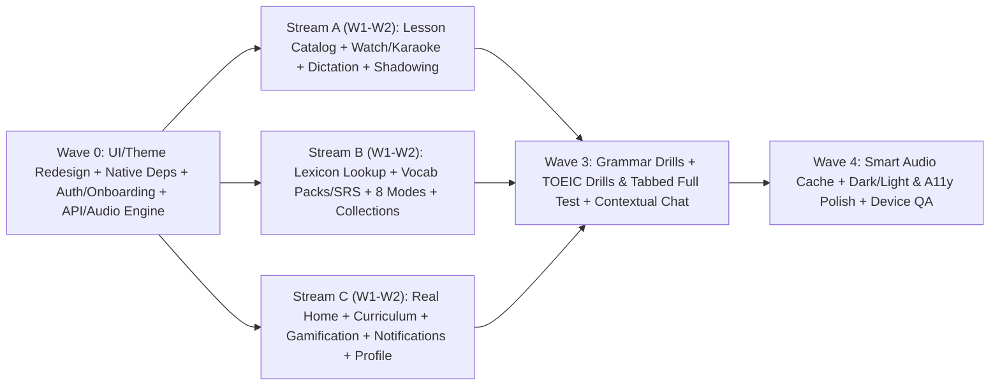

# Lyreo Mobile Engineering Handoff & Backlog

> **Tài liệu bàn giao cho Team Mobile / Vibe-Coding.** Mục tiêu của file này là giúp dev/AI nắm nhanh: app Mobile hiện đang có gì, phần UI/code nào chỉ là scaffold "bỏ đại" cần làm lại, những luật nghiệp vụ & API nào đã sẵn sàng ở Backend, và **bảng backlog phân rã task theo độ ưu tiên** để import Google Sheets.
>
> **Cách dùng:** Không cần đọc lại hết doc trong repo trước khi code. Cứ pick **1 Task ID** ở mục 6, mở các file ghi ở cột **Owner Docs & Code Pointers** để xem code thật rồi làm. Tài liệu gốc về yêu cầu nằm ở [docs/README.md](../README.md) và đặc tả HTTP nằm ở [http-api-contract.md](../architecture/http-api-contract.md).

---

## 1. Chiến lược Sản phẩm: Mobile-First (đẩy tối đa) vs Learner Web tương lai

Theo [PRD — Scope và ưu tiên](../product/prd.md#6-scope-va-uu-tien), **Mobile là trải nghiệm Learner chính**, còn **Learner Web** sẽ phát triển ở giai đoạn sau. Vì vậy, thứ tự ưu tiên không cố ép 100% tính năng desktop lên điện thoại, nhưng các luồng học cốt lõi trên di động cần làm **thật tới bến**:

| Miền tính năng | Mobile Scope | Định hướng triển khai trên Mobile | Lý do & Giới hạn so với Web tương lai |
|---|---|---|---|
| **Design System, Auth, Onboarding & API Core** | `Full on Mobile` | **P0 — Làm mới sạch sẽ:** OIDC PKCE, Onboarding 3 bước, Navigation Tabs, UI Kit & Theme mới, Audio/Media Core | Nền móng toàn app; `GUEST` bị cấm ngay từ server |
| **Home Dashboard** | `Full on Mobile` | **P0 — Thay mock bằng data thật:** Continue Learning 1 chạm, streak, kim cương, từ đến hạn, chuông thông báo | Điểm mở app hằng ngày |
| **Lesson (Catalog, Watch, Shadowing, Dictation)** | `Full on Mobile` | **P0/P1 — Đầu tư sâu nhất:** Audio/YouTube player, Karaoke câu–từ, Context notes, chạm từ tra điển & lưu từ, thu âm Shadowing + kết quả chấm phát âm từng từ/IPA, Dictation nghe–chép + diff | **Linh hồn của Lyreo.** Học nghe–nói vi mô mọi lúc mọi nơi là điểm mạnh nhất của điện thoại |
| **Vocabulary & SRS Flashcards** | `Full on Mobile` | **P0/P1 — Đầy đủ:** Duyệt Pack/Unit, Flashcards SRS 4 mức, 8 chế độ luyện & Đoán từ, Saved Words & Personal Collections | Ôn flashcard 5–10 phút cực kỳ hợp thao tác chạm/vuốt trên Mobile |
| **Lexicon (Tra từ nhanh)** | `Full on Mobile` | **P0/P1 — Đầy đủ:** Tra từ toàn cục + Bottom-sheet tra nhanh ngay khi đang học Lesson, đổi chế độ Anh–Việt / Anh–Anh, nghe giọng UK/US | Hỗ trợ tra tức thì không ngắt mạch nghe |
| **Curriculum Paths** | `Full on Mobile` | **P0/P1 — Đầy đủ:** Duyệt lộ trình, Enroll, xem cây bài học khóa/mở tuần tự, bấm item nhảy thẳng đúng bài/từ/drill tương ứng | Dẫn đường tự động; Backend đã xử lý sẵn rule mở khóa |
| **Gamification & Notifications** | `Full on Mobile` | **P1 — Đầy đủ:** Streak, Level/XP, Diamond Ledger, Daily Missions (**nút Claim thủ công**), Achievements + badge, Notifications badge & mark-read | Giữ thói quen học mỗi ngày trên điện thoại |
| **Profile, Avatar & Settings IA** | `Full on Mobile` | **P1 — Đầy đủ:** Đổi hồ sơ, mục tiêu TOEIC, upload/preset avatar, Settings phân nhóm rõ ràng (`FR-IDN-005`), xem gói `FREE`/`PLUS` & quota | Kiểm soát quyền lợi gói & đồng bộ preferences |
| **Grammar Practice** | `Mobile-Lite` | **P1/P2 — Gọn nhẹ:** Chọn Topic/Subtopic/Bank → làm câu trắc nghiệm từng câu → xem giải thích EN/VI ngắn | Tài liệu ngữ pháp dài và tra cứu sâu để Web làm sau |
| **TOEIC Practice** | `Mobile-Lite` *(Full Exam Station -> Web)* | **P1/P2 — Đẩy tốt Parts 1–5 + Tabbed Full Test:** **Part 1, 2, 5** chạy cực mượt trên Mobile. Với **Part 6–7 nhiều đoạn văn** và **Full Test 200 câu**, làm giao diện chuyển tab Đoạn văn/Câu hỏi để dùng được khi cần | Màn hình thi thử 2 giờ và split-pane 3 tài liệu Part 7 hợp Web màn lớn hơn |
| **AI English Tutor Chat** | `Mobile-Lite` | **P1/P2 — Hỏi nhanh theo ngữ cảnh:** Nút **"Hỏi AI Tutor"** ngay tại câu Lesson/Grammar/Từ vựng + xem/xóa/đổi tên hội thoại gọn | Thảo luận bài viết dài, đa khung để dành Web |
| **Analytics & History** | `Mobile-Lite` | **P1/P2 — Tổng quan + Vài lượt gần nhất:** Giữ Overview tuần/kỹ năng/điểm yếu (`learner-progress.tsx`), thêm list vài phiên gần đây | Bảng thống kê dài hạn & export dữ liệu để Web |

---

## 2. Hiện trạng `apps/mobile/` & Chỉ dẫn Thiết kế lại UI

### 2.1 Lưu ý quan trọng: Giao diện & màu sắc hiện tại chỉ là đồ "bỏ đại" (Scaffold)

Phần UI trong `apps/mobile/` trước đây chỉ dựng nhanh để test build Expo và login Keycloak, **không phải thiết kế cuối cùng**. Team Mobile hãy **mạnh dạn chọn lại bảng màu, font scale, khoảng cách, icon và bố cục hiện đại hơn** cho một app học tiếng Anh:

- `apps/mobile/src/theme/primitives.ts` hiện có 3 bảng màu chồng chéo (`stone/blue`, bộ màu mascot Lyreo bị bỏ hoang, và `forest/gold` cũ). Hãy dọn sạch và chọn một hệ màu mới nhất quán.
- `apps/mobile/src/theme/semantic.ts` bản Light mode đang gán `background === secondary === muted` (cùng `#F5F5F4`) và `surface === surfaceElevated` (cùng `#FFFFFF`) nên card và pill không có độ nổi/tương phản. Cần phân tách rõ các lớp nền, chữ và màu trạng thái (XP, streak, đúng/sai, waveform).
- `apps/mobile/src/providers/AppProviders.tsx` đang bọc toàn app bằng `<SafeAreaView>`, làm app không thể vẽ header tràn viền, bottom-tab bar đẹp hay bottom sheet. Hãy đưa `SafeAreaView` vào từng màn hình/tab shell.
- `apps/mobile/src/components/ui/` mới có đúng 3 component (`button`, `card`, `text`) và chưa có thư viện icon nào (đang dùng emoji 💎 và chữ ASCII `▂▄▆█`). Hãy cài `lucide-react-native` và dựng bộ UI kit tử tế.

**Chỉ cần giữ đúng 4 quy tắc để `make validate` không báo lỗi ([frontend.py](../../tooling/repo_checks/frontend.py)):**
1. Tách riêng theme/component của Mobile khỏi `apps/admin-web`.
2. Không viết màu hex/rgb cứng trực tiếp trong JSX/`StyleSheet` — mọi màu phải nằm trong `src/theme/primitives.ts` và `src/theme/semantic.ts`.
3. Không import `primitiveColors` ngoài thư mục `src/theme/` (luôn dùng semantic token để hỗ trợ Light & Dark mode).
4. Mọi key `t('...')` mới phải có đủ cả bản `en` và `vi` trong `packages/i18n/src/locales/{en,vi}/mobile.json`; `expo-secure-store` chỉ dùng trong `src/auth/`.

### 2.2 Những phần đã chạy thật & nên giữ lại

- **Auth & Session (`src/auth/`):** Keycloak OIDC + PKCE (`oidc.ts`), `SessionManager` (`session-manager.ts`), lưu refresh token an toàn bằng `expo-secure-store`.
- **API Client & Error Mapper (`src/api/`):** `client.ts` tự refresh token khi gặp `401`; `errors.ts` đã map sẵn mã lỗi RFC 9457 (`FEATURE_ENTITLEMENT_REQUIRED`, `QUOTA_EXCEEDED`, `STALE_REVISION`, `SESSION_EXPIRED`, `IDEMPOTENCY_CONFLICT`, `PAYLOAD_TOO_LARGE`, `RATE_LIMITED`).
- **3 phần UI đã nối API thật:** Màn hình Notifications (`hasMore` pagination + retry lỗi vừa bổ sung), màn hình Progress Overview (`/api/v1/analytics/overview`), và phần Settings lưu preferences + đổi ngôn ngữ/giao diện.

### 2.3 Những phần đang giả / lỗi thời / thiếu cần xử lý sớm

- **Onboarding chưa có:** Chưa kiểm tra cờ `onboarded` từ `/api/v1/learner/profile` và chưa có wizard 3 bước (`FR-IDN-003`).
- **Auth chưa check `ROLE_LEARNER` & mất trạng thái khi app bị Android kill:** Cần đọc `roles` từ `/api/v1/me` để chặn lịch sự nếu đăng nhập nhầm acc Admin-only; lưu PKCE state qua `session-storage` tránh lỗi callback khi trình duyệt mở lâu; hiện thông báo rõ nếu bị khóa tài khoản (`401`) thay vì văng ra màn login im lặng; thêm `AppState` listener.
- **Home & AccountSummary đang là mock:** `home-screen.tsx` viết cứng `"💎 240"`, `"LEVEL 12"`, `"82%"`, `"18"`, `"25m"` và card giả trỏ vào `/lesson`; `account-summary.tsx` chỉ là hộp debug `"Loaded securely from GET /api/v1/me"`.
- **Lesson Screen (`app/(app)/lesson.tsx`) là mock 100%:** Chữ, waveform, điểm `84`, nút ghi âm đều là giả. Cần thay hoàn toàn bằng luồng Lesson thật.
- **Settings bị phẳng & thiếu control:** Chưa chia nhóm theo `FR-IDN-005`, thiếu chỉnh `preferredAccent` (`US`/`UK`) & `defaultPlaybackSpeed` (`0.5–2.0`), và copy báo lỗi hiện sai sự thật (báo "đang hiện mặc định" nhưng thực tế ẩn form).
- **`client.ts` & `useCoreResource` cần nâng cấp:** `client.ts` hiện ép mọi response 2xx phải là JSON (chưa tải được binary/audio hay đọc header `Location`/`ETag`), còn `useCoreResource` đang nuốt mất object `ApiError` và xóa danh sách đang xem mỗi khi focus lại màn hình.
- **Native dependencies chưa cài:** `apps/mobile/package.json` chưa có thư viện phát audio, ghi âm, YouTube iframe, icon, hay xử lý ảnh avatar. Nhớ chạy `make mobile-android-install` (rebuild Dev Client) sau khi thêm native libs vì Lyreo **không hỗ trợ Expo Go**.

### 2.4 Nguyên tắc Công nghệ & Thư viện MỞ (Chủ động research, không tự trói tay)

> **Quan trọng:** Danh sách thư viện gợi ý trong tài liệu này **không phải giới hạn cứng**. `apps/mobile/` hiện mới là bộ khung cơ bản trên **Expo + React Native + Expo Router**.

- **Được tự do research & cài thư viện tốt nhất cho trải nghiệm Mobile:** Team có thể chủ động tìm và cài thêm bất kỳ thư viện/SDK phổ biến, còn được bảo trì tốt cho Expo/React Native nếu giúp app đẹp hơn, mượt hơn, nhanh hơn (ví dụ: thư viện UI/component, animation kiểu `react-native-reanimated`, gesture/bottom-sheet như `@gorhom/bottom-sheet`, `FlashList`, audio/video player, waveform, haptic, toast, skeleton, TanStack Query/cache offline, biểu đồ, v.v.).
- **Không dùng lý do "tài liệu không ghi thư viện đó" để làm giao diện sơ sài hoặc trải nghiệm kém.** Chất lượng app thực tế trên tay người dùng là ưu tiên số 1.
- **Chỉ cần đảm bảo 3 nguyên tắc khi cài thư viện mới:**
  1. Tương thích với **Expo Dev Client** (nếu có native code thì rebuild dev client bằng `make mobile-android-install` / `expo prebuild` tương ứng).
  2. Giữ nguyên hợp đồng **Auth (Keycloak OIDC PKCE + `expo-secure-store`), API Core, server-side authority và không lộ secret**.
  3. Chạy qua được `pnpm --filter @lyreo/mobile typecheck`, `pnpm --filter @lyreo/mobile test` và `make validate` (không hardcode màu ngoài theme, đủ i18n `en`/`vi`).

---

## 3. Luật Chơi Team & Quyền Sửa Backend / Logic / DB / Docs

Team Mobile **được phép sửa cả Backend, Logic, Database và Docs** nếu điều đó giúp tính năng Mobile chạy đúng, mượt và sạch hơn.

### Được phép sửa xuyên tầng khi phục vụ task đang làm
1. **Java Backend (`modules/*`, `libs/contracts/*`, `apps/core-service/*`):** Thêm field DTO, filter tìm kiếm, endpoint mới, sửa bug hoặc tối ưu stream media.
2. **Business Logic & DB (`apps/core-service/src/main/resources/db/migration/`):** Tinh chỉnh logic học tập hợp lý hoặc tạo migration **mới nối tiếp** (`V021__...sql`, `V022__...sql`, ...). **Tuyệt đối không sửa** `V001`..`V020` đã chạy.
3. **Documentation (`docs/`):** Khi cố ý thay đổi API contract, rule sản phẩm hoặc biến môi trường, cập nhật đồng bộ [http-api-contract.md](../architecture/http-api-contract.md), file `docs/requirements/*.md` liên quan và `.env.example`.

### Ranh giới cứng không được phá (CI & `ArchitectureTest` sẽ chặn)
- **Spring Modulith:** Module chỉ giao tiếp qua public/named API hoặc domain event; không import/query trực tiếp repository hoặc bảng nội bộ của module khác.
- **Server quyết định điểm & thưởng:** Client không gửi `score`, `xp`, `diamonds`, hay tự đánh dấu `completed`; mọi thao tác ghi quan trọng cần `Idempotency-Key` và `revision`.
- **Không lộ secret / storage key:** Không đưa secret vào `EXPO_PUBLIC_*` và không trả `storageKey` R2 thô trong Learner DTO (luôn trả HTTP media URL được bảo vệ).
- **Kiểm tra trước khi xong việc:** Chạy `pnpm --filter @lyreo/mobile typecheck && pnpm --filter @lyreo/mobile test`, `make validate`, và `./mvnw -B -pl modules/<module-đã-sửa>,apps/core-service -am verify` (nếu có sửa Java).

---

## 4. Tóm tắt Business Rules (BR) & Bẫy Kỹ Thuật Cốt Lõi

Phần này tóm tắt nhanh các quy tắc dễ làm sai nhất và những chi tiết kỹ thuật **đã kiểm chứng thẳng từ Backend** để dev khỏi mò:

1. **Identity, Profile & Avatar (`modules/identity`, `modules/learner`)**
   - Không có Guest Mode. Login xong gọi `GET /api/v1/me` (kiểm `ROLE_LEARNER`) và `GET /api/v1/learner/profile`. Nếu `onboarded = false`, ép qua Onboarding 3 bước (`goal`, `currentLevel`, `dailyMinutes` 5/10/15/20) → `PUT /api/v1/learner/onboarding`.
   - Avatar dùng **`GET/PUT /api/v1/learner/profile/avatar`** (không có `DELETE`; `GET` hỗ trợ `If-None-Match` `304`). Backend chỉ nhận JPEG/PNG ≤ 2 MiB (≤ 4096×4096) và **không tự xoay ảnh theo EXIF Orientation** — khi upload ảnh chụp từ camera điện thoại, Mobile nhớ dùng `expo-image-manipulator` resize + xuất JPEG trước khi gửi để ảnh không bị xoay ngang 90°.
   - Preferences (`GET/PUT /api/v1/learner/preferences`) là cài đặt đồng bộ tài khoản; tốc độ phát, loop câu hay bật/tắt note tạm trong lúc học chỉ lưu state phiên (`FR-IDN-004`).

2. **Entitlements & Quota (`modules/entitlement`)**
   - Đọc quyền hiện tại từ `GET /api/v1/entitlements` (hoặc `/api/v1/learner/entitlements`): có `tier` (`FREE` | `PLUS`), `validUntil` và danh sách feature + `remaining`/`resetAt`.
   - Mọi tính năng khóa gói hoặc có hạn mức (Shadowing, AI Chat, Pack/Lesson `FEATURE`) phải xử lý `403 FEATURE_ENTITLEMENT_REQUIRED` (`featureKey`) và `403 QUOTA_EXCEEDED` (`limit`, `remaining`, `resetAt` UTC).

3. **Pagination, ETag & Audio Streaming (`platform/content`, CORS)**
   - List phân trang dùng chuẩn `{ items, total, page, size, hasMore }` (riêng `/gamification/ledger` có thêm `balance`, `/notifications` có thêm `unreadCount`).
   - Toàn bộ endpoint phát audio (Lesson `/audio`, Shadowing `/audio`, Lexicon `/pronunciations/{pid}/audio`, Vocabulary `/media`, Assessment `/media`) **đều đã hỗ trợ HTTP `Range` (`206 Partial Content`)** để phát mượt trên iOS `AVPlayer` và Android. Nhớ truyền `Authorization: Bearer <token>` header vào player và `<Image source={{ uri, headers }}>`.

4. **Lesson: Watch, Dictation & Shadowing (`modules/lesson`, `modules/speech-assessment`)**
   - **Watch / Listen:** Dùng chung canonical audio (`/api/v1/lessons/{id}/audio`) hoặc YouTube player (`videoId`, `sourceStartMs`–`sourceEndMs`) kèm danh sách câu & mốc từ để chạy Karaoke (`FR-LSN-003`). Bấm hoàn thành Watch gọi `POST .../activities/{activityId}/complete`.
   - **Dictation (`BR-LSN-003`):** Gửi answer text lên `POST .../dictation/attempts` (không gửi điểm); server trả `serverScore`, `expectedText`, `completedItems`, `totalItems`, `activityCompleted`. Ngưỡng đạt mặc định phía backend là `70` (`OQ-002`).
   - **Shadowing (luồng async):**
     - Bước 1: Gọi `GET .../shadowing/sentences/{sentenceId}/constraints?revision=...` để lấy giới hạn giây thu (`maxDurationSeconds`), `maxUploadBytes` (8 MiB), `quotaRemaining` (báo `409 STALE_REVISION` nếu bài đã đổi revision).
     - Bước 2: **Định dạng ghi âm:** Core đã gắn `ffmpeg` tự convert sang 16kHz mono WAV cho Azure. Mobile cứ cấu hình ghi **AAC `.m4a`** trên cả iOS lẫn Android (tránh `.3gp` AMR và `.caf` vì bị từ chối).
     - Bước 3: Upload `POST .../attempts?revision=...` (`multipart/form-data` part `audio`) — **bắt buộc header `Idempotency-Key` là UUID hợp lệ**! Nhận `202` + `Location`.
     - Bước 4: Poll `GET /api/v1/shadowing-attempts/{id}` (payload `result` đã được lọc sạch `providerRaw` để response nhẹ) và nghe lại bản thu tại `/shadowing-attempts/{id}/audio` (bản thu lưu 24 giờ).

5. **Lexicon Global Dictionary (`modules/lexicon`)**
   - `GET /api/v1/lexicon/search?q=...` trả summary + `hasMore`.
   - Mở chi tiết bằng `GET /api/v1/lexicon/{entryId}`, hoặc gọi thẳng **`GET /api/v1/lexicon/by-headword/{headwordId}`** khi user chạm vào một từ vựng trong Lesson / Saved Card! Có sẵn `readingModes` (`en-vi`, `en-en`) và `pronunciations[].audioEndpoint` (hỗ trợ `Range`). Không tự trộn lẫn 2 nguồn Anh/Việt ở client (`FR-LEX-004`).

6. **Vocabulary SRS, 8 Practice Modes & Collections (`modules/vocabulary`)**
   - **Hai luồng tách biệt (`BR-LEX-001`, `FR-VOC-001`):**
     - *Học bộ curated (Packs/Units):* `GET /api/v1/vocabulary/flashcards` (`DUE_AND_NEW` hoặc `ALL`, có sẵn `intervalPreviews` 4 nút) → `POST /api/v1/vocabulary/entries/{entryId}/flashcard-review` (gửi `Idempotency-Key` + `expectedReviewCount`). *Luật chống farm:* ở chế độ `ALL`, lật lại thẻ chưa đến hạn vẫn tính SRS nhưng không cộng thưởng mission.
     - *Sổ từ cá nhân (Saved Cards / Collections):* Lưu từ bất kỳ qua `POST /api/v1/vocabulary/saved-items` (đã chặn nếu nguồn thuộc Pack `FEATURE` chưa mở quyền), quản lý bộ qua `/api/v1/vocabulary/collections/**`, ôn thẻ đã lưu qua `GET /api/v1/vocabulary/due` & `POST /api/v1/vocabulary/cards/{cardId}/review`.
   - **8 Mode Luyện tập & Đoán từ:** `CHOOSE_MEANING`, `CHOOSE_WORD`, `LETTER_SCRAMBLE`, `MISSING_LETTERS`, `LISTEN_WRITE`, `CONTEXT_CLOZE`, `GUESS_WORD` (có `/hint` và `/check`), `MIXED`. Các mode này **không** làm thay đổi lịch ôn SRS (`FR-VOC-003`).

7. **Curriculum Paths (`modules/curriculum`)**
   - `GET /api/v1/curriculum/paths`, `GET .../paths/{id}`, `POST .../paths/{id}/enroll`, `GET /api/v1/curriculum/continue`.
   - **Bẫy pre-enroll:** Trước khi user bấm Enroll, `GET /paths/{id}` trả `enrollmentStatus: null` và gán tất cả item là `LOCKED`. UI Mobile **nhớ kiểm tra `enrollmentStatus == null`** để hiện nút "Đăng ký lộ trình / Enroll", đừng hiển thị nhầm là bài bị khóa! Khi deep-link từ item vào Lesson/Vocab/Grammar/TOEIC, đọc `item.config` để lọc đúng slice câu/từ nếu có.

8. **Gamification & Notifications (`modules/gamification`, `modules/notification`)**
   - Gamification có `GET .../summary`, `GET .../missions`, **`POST .../missions/{missionId}/claim`** (nhận thưởng **thủ công** có `Idempotency-Key` — nhớ làm nút Claim nổi bật khi mission đạt target), `GET .../achievements` (+ `/badge` `304`), `GET .../ledger` (bất biến, balance không âm).
   - Notifications đã có đủ `GET /api/v1/notifications` (`unreadCount`, `unreadOnly`), **`POST /api/v1/notifications/{id}/read`**, và **`POST /api/v1/notifications/read-all`**.

9. **Grammar, TOEIC, Analytics & AI Chat (`modules/grammar`, `toeic`, `assessment`, `analytics`, `chat`)**
   - Grammar (`limit <= 50`) và TOEIC (`DRILL` với `parts: [1..7]` hoặc `FULL_TEST`) đều dùng chung `/api/v1/assessment-sessions/**` (`GET /{id}`, `PUT /{id}/answers` gửi kèm `revision`, `POST /{id}/submit`, `GET /{id}/media/{assetId}`). Phiên hết hạn sau 24 giờ (`409 SESSION_EXPIRED`).
   - **TOEIC Score (`BR-TOE-001`, `OQ-004`):** `DRILL` trả `accuracyPercent` và để scaled scores = `null` (tuyệt đối không tự bịa điểm 990); chỉ `FULL_TEST` mới trả scaled scores xấp xỉ từ Core. Part 2 chỉ có 3 đáp án A/B/C; Part 1–2 ẩn text trước khi nộp (`audioOnly`).
   - **Analytics:** `GET /api/v1/analytics/overview`. Lưu ý hiện tại backend chưa ghi `study_seconds` nên `today.studySeconds`/`week.studySeconds` đang là `0` — UI nên ưu tiên hiện `lessonCount`, `vocabularyReviewCount`, `grammarAnswerCount`, `toeicQuestionCount`, `activeDays` và `weaknesses` thay vì hiện `0m`.
   - **Chat (`modules/chat`):** `POST /api/v1/chat/ask` (đã nâng cấp dùng `reserveQuota`/`releaseQuota` nên **lỗi AI sẽ không bị mất lượt quota oan**; luôn gửi `Idempotency-Key`), `GET/PATCH/DELETE /api/v1/chat/conversations/**`.

### Tài khoản & Chạy Local Cho Dev Mobile
Xem chi tiết [apps/mobile/README.md](../../apps/mobile/README.md) và [ACCOUNT.md](../ACCOUNT.md). Chạy `make migrate && make seed` để có sẵn:
- Plus Learner: `demo-learner-minh-anh` / `Password123!` (đã onboard, full grant, 35 saved cards, curriculum đang học)
- Free Learner: `demo-learner-gia-huy` / `Password123!` (đã onboard, grant hết hạn — tiện test paywall/quota)
- New Learner: `demo-learner-new` / `Password123!` (chưa onboard — test Wizard 3 bước & empty state)
- Metro chạy port **8082**; Android Emulator dùng `10.0.2.2`, máy thật USB dùng `adb reverse`.

---

## 5. Lộ trình Thực thi Theo Wave & Luồng Song Song

Sau **Wave 0 (Làm sạch Nền tảng + UI Redesign)**, team có thể chia tối đa **3–4 luồng song song**:



- **Wave 0 (Nền móng & UI Redesign):** Dọn theme/màu cũ & dựng UI kit + icon mới, cài native packages (audio/recorder/YouTube/image-manipulator) + rebuild Dev Client, tổ chức lại Tabs/Stack Shell, Onboarding 3 bước & Auth hardening, nâng cấp `client.ts` & Reusable Audio/Mic hooks.
- **Wave 1 (Core Loop Hàng Ngày — P0):** Home thật 100%, Curriculum Paths + Enroll + Unlock Map, Lesson Catalog + Overview + Watch/Listen Player (Audio + YouTube + Karaoke + Tap-word Lexicon + Context notes) + Dictation, Lexicon Search/Detail, Vocab Packs/Units + Flashcards SRS.
- **Wave 2 (Shadowing Sâu & Daily Retention — P0/P1):** Shadowing Full Flow (Mic `.m4a`, Constraints, 202 Polling, Word/Phoneme/IPA feedback), Lesson Completion & Resume, Vocab 8-Mode Practice & Guess Word, Saved Cards & Collections, Gamification Hub (Streak, Missions Claim, Achievements, Diamond Ledger), Notifications unread/mark-read/deep-link, Profile/Avatar Editor + Grouped Settings + Entitlements.
- **Wave 3 (Mở rộng Thực dụng — P1/P2):** Grammar Quick Drills, TOEIC Part Drills (tối ưu Parts 1–5) + Tabbed Reader cho Part 6–7 & Full Test 200Q, Contextual AI Tutor Chat, Progress Recent Attempts.
- **Wave 4 (Hardening & Release — P2):** Smart audio/card prefetch + Clear cache, Keyboard/IME/Haptics & Dark Mode sweep, E2E QA trên emulator & máy thật Android/iOS.

---

## 6. Bảng Phân Rã Task Chi Tiết (Google Sheets-Ready)

> **Cách import vào Google Sheets:** Copy toàn bộ bảng Markdown bên dưới, dán vào Google Sheets và chọn **Data → Split text to columns** với dấu phân tách `|` (sau đó xóa 2 cột rìa trống), bật Filter theo `Wave`, `Priority`, `Mobile Scope`, hoặc `Group`.

| Task ID | Wave | Priority | Mobile Scope | Group | Task Name | Current Status | Depends On | Size | Can Touch BE/DB | Key APIs | Owner Docs & Code Pointers | Key Business Rules & Gotchas | Done Criteria (DoD) |
|---|---|---|---|---|---|---|---|---|---|---|---|---|---|
| MOB-001 | Wave 0 | P0 | Full on Mobile | UI Redesign & Theme | Thiết kế lại bảng màu, typography scale & semantic theme mới (xóa 3 palette rác, phân tầng nền Light/Dark rõ ràng, chuẩn hóa spacing thay cho magic numbers) | Outdated Scaffold | - | L | No | - | `apps/mobile/src/theme/primitives.ts`, `apps/mobile/src/theme/semantic.ts`, `apps/mobile/src/theme/foundation.json`, `apps/mobile/tailwind.config.js` | Tách biệt `admin-web`; cấm hex/rgb ngoài `src/theme/{primitives,semantic}.ts`; cấm `primitiveColors` ngoài `src/theme/` | Light & Dark mode có độ tương phản card/pill đẹp, rõ; `make validate` & `typecheck` pass |
| MOB-002 | Wave 0 | P0 | Full on Mobile | Native Setup | Cài đặt native dependencies (`expo-audio`, `react-native-youtube-iframe`, `react-native-webview`, `lucide-react-native`, `expo-image-manipulator`, `expo-haptics`) + quyền Mic/Photo + rebuild Dev Client | Not Started | - | M | No | - | `apps/mobile/package.json`, `apps/mobile/app.json`, `apps/mobile/README.md`, `Makefile` (`mobile-android-install`) | Không dùng Expo Go; config ghi âm AAC `.m4a` hợp lệ cho Azure/ffmpeg Core | `make mobile-android-install` chạy tốt trên emulator; build sạch không cảnh báo trùng plugin |
| MOB-003 | Wave 0 | P0 | Full on Mobile | Navigation Shell | Tổ chức lại Navigation Shell: bỏ `<SafeAreaView>` bọc toàn app khỏi `AppProviders.tsx`, đưa Home vào `(app)/(tabs)/_layout.tsx` (Home, Paths, Lessons, Vocab, Profile) + nested stacks/modals | Outdated Scaffold | MOB-001 | M | No | - | `apps/mobile/app/(app)/_layout.tsx`, `apps/mobile/app/index.tsx`, `apps/mobile/src/providers/AppProviders.tsx` | Safe-area xử lý đúng theo màn hình/tab để hỗ trợ edge-to-edge và bottom sheet | Điều hướng 5 tab mượt, `route-contract.test.ts` cập nhật pass |
| MOB-004 | Wave 0 | P0 | Full on Mobile | UI Component Kit | Xây bộ UI Kit chuẩn theo theme mới (`Button` chuẩn size, `Input`, `Badge`, `ProgressBar`, `Avatar`, `BottomSheet`, `Tabs`, `Skeleton`, `Toast`, `QuotaBanner`) + icon `lucide-react-native` | Minimal Scaffold (3 files) | MOB-001, MOB-002 | L | No | - | `apps/mobile/src/components/ui/*`, `apps/mobile/src/components/states/*`, `packages/i18n/` | Touch target >= 44pt; đủ key `en` & `vi`; tránh để file component unused (validator sẽ cảnh báo) | Toàn bộ primitive tái sử dụng sạch, thay thế emoji/ASCII placeholder |
| MOB-005 | Wave 0 | P0 | Full on Mobile | Auth & Onboarding | Hardening Auth & Onboarding Gate: kiểm tra `ROLE_LEARNER` từ `/me`, lưu PKCE state chống Android cold-start kill, hiện thông báo rõ khi acc bị khóa 401, thêm `AppState` refresh & Wizard Onboarding 3 bước | Partial (PKCE works, missing gate/role) | MOB-003, MOB-004 | L | No | `GET /api/v1/me`, `GET /api/v1/learner/profile`, `PUT /api/v1/learner/onboarding` | `apps/mobile/src/auth/*`, `apps/mobile/src/navigation/root-route.ts`, `../requirements/identity-learner.md` (`FR-IDN-003`) | Chưa onboard → ép qua 3 bước (`goal` → `level` → `dailyMinutes`) nhận `starterSuggestion`; admin-only bị chặn lịch sự; `SecureStore` chỉ ở `src/auth/` | Test 3 demo user: New đi qua Onboarding vào Home; Locked thấy lý do rõ |
| MOB-006 | Wave 0 | P0 | Full on Mobile | API & Error Core | Nâng cấp API Client & `useCoreResource`: thêm verb helpers (`get/post/put/patch/delete`), `createIdempotencyKey()` (UUID), đọc header `Location`/`ETag`, auth headers cho audio/image, timeout & expose full `ApiError` | Partial (JSON-only) | MOB-004 | M | No | All Learner APIs & RFC 9457 | `apps/mobile/src/api/client.ts`, `apps/mobile/src/api/errors.ts`, `apps/mobile/src/api/use-core-resource.ts` | Map đủ `FEATURE_ENTITLEMENT_REQUIRED`, `QUOTA_EXCEEDED`, `STALE_REVISION`, `SESSION_EXPIRED`, `IDEMPOTENCY_CONFLICT`, `PAYLOAD_TOO_LARGE`, `RATE_LIMITED` | Test `api-client.test.ts` pass; màn hình không bị xóa data khi focus refetch |
| MOB-007 | Wave 0 | P0 | Full on Mobile | Audio Engine | Xây Audio Player & Voice Recorder Hooks: phát stream có `Bearer` token + HTTP `Range` (`206`), seek ms, loop câu A–B, tốc độ `0.5x–1.5x`, ghi âm AAC `.m4a` & nghe thử | Not Started | MOB-002, MOB-006 | L | Yes (nếu cần tinh chỉnh stream thực địa) | `/api/v1/lessons/{id}/audio`, `/api/v1/shadowing-attempts/{id}/audio`, `/api/v1/lexicon/.../audio`, `/api/v1/vocabulary/.../media/...` | `../requirements/lesson.md` (`FR-LSN-003`), `apps/mobile/src/auth/session-manager.ts` | Luôn gửi Bearer token; giải phóng player/recorder khi unmount; record `.m4a` trên iOS/Android | Phát `.wav` seed trên emulator seek/speed mượt; ghi `.m4a` nghe lại được ngay |
| MOB-101 | Wave 1 | P0 | Full on Mobile | Home Dashboard | Thay thế toàn bộ Mock Home & bỏ box debug `account-summary.tsx`: header tên/avatar, pill Streak/Diamond thật, chuông unread badge, card "Tiếp tục học" từ `/curriculum/continue`, tóm tắt hoạt động tuần | Mock / Outdated | MOB-003, MOB-004, MOB-005, MOB-006 | L | Yes (nếu muốn thêm BFF summary) | `GET /api/v1/learner/profile`, `GET /api/v1/gamification/summary`, `GET /api/v1/curriculum/continue`, `GET /api/v1/analytics/overview`, `GET /api/v1/vocabulary/due?size=1`, `GET /api/v1/notifications?size=1` | `apps/mobile/src/features/home/home-screen.tsx`, `../requirements/analytics-notification-chat.md` (`AC-ANL-002`) | Không bịa số giả; ưu tiên `lessonCount`/`vocabularyReviewCount`/`activeDays` (do `studySeconds` BE hiện trả `0`); chưa enroll thì dùng `starterSuggestion` | Không còn chuỗi `"💎 240"`, `"82%"`, `"18"`, `"25m"` giả; test đủ 3 demo user |
| MOB-102 | Wave 1 | P0 | Full on Mobile | Curriculum | Màn hình Danh sách Lộ trình (Curriculum Paths): card cover (`If-None-Match`), level CEFR, tiến độ required items, badge `PLUS`/`FREE`, nút Enroll | Not Started | MOB-004, MOB-006 | M | No | `GET /api/v1/curriculum/paths`, `GET .../paths/{id}/cover`, `POST .../paths/{id}/enroll` | `modules/curriculum/.../CurriculumController.java`, `../requirements/curriculum-gamification.md` (`FR-CUR-001`) | Tôn trọng `locked` / `FEATURE`; enroll idempotent | Xem đủ 5 seeded paths, enroll thành công mở sang Timeline |
| MOB-103 | Wave 1 | P0 | Full on Mobile | Curriculum | Màn hình Timeline Lộ trình: cây Section -> Item với trạng thái `LOCKED`/`UNLOCKED`/`IN_PROGRESS`/`COMPLETED`, xử lý đúng pre-enroll (`enrollmentStatus == null`) và deep-link kèm `config` slice | Not Started | MOB-102 | M | Yes (nếu `VOCABULARY_REVIEW` cấp pack cần phân biệt pack vs unit) | `GET /api/v1/curriculum/paths/{id}` | `modules/curriculum/.../CurriculumService.java` | Item `LOCKED` sau enroll không được bypass; đọc `config` (`sentenceIds`/`entryIds`/`subtopicIds`) để mở đúng phần | Chạm item nhảy thẳng vào Lesson/Vocab/Grammar/TOEIC tương ứng; xong tự mở item sau |
| MOB-104 | Wave 1 | P0 | Full on Mobile | Lesson Core | Thư viện Bài học (Catalog) & Tổng quan Bài học (Overview): tìm kiếm, lọc Category / CEFR / SourceType / Activity, phân trang `hasMore`, kiểm tra entitlement & chọn chế độ học | Mock Only (`lesson.tsx`) | MOB-004, MOB-006 | L | No | `GET /api/v1/lessons`, `GET /api/v1/lessons/categories`, `GET /api/v1/lessons/{lessonId}` | `modules/lesson/.../LearnerLessonController.java`, `../requirements/lesson.md` (`FR-LSN-001`, `BR-LSN-001`) | Chỉ hiện bài `PUBLISHED`; check `locked` rõ ràng; tách biệt Content/Notes và Activity | Filter + load-more chạy mượt trên data seed; mở Overview xem đủ sentences & progress |
| MOB-105 | Wave 1 | P0 | Full on Mobile | Lesson Watch | Trình phát Watch / Listen: hỗ trợ cả Canonical Audio (`/audio`) lẫn YouTube (`videoId`, `sourceStartMs`–`sourceEndMs`), Karaoke sáng từng từ theo timestamps, lặp 1 câu & tốc độ phát | Not Started | MOB-007, MOB-104 | XL | Yes (nếu thiếu metadata YouTube clip range) | `GET /api/v1/lessons/{id}/activities/{actId}`, `GET /api/v1/lessons/{id}/audio`, `POST .../activities/{actId}/complete` | `../requirements/lesson.md` (`FR-LSN-003`), `../requirements/open-questions.md` (`OQ-001`) | YouTube dùng official iframe; tốc độ & loop là session-only (`FR-IDN-004`); hoàn tất Watch gọi `POST .../complete` | Phát audio `.wav` và video YouTube karaoke khớp từng từ, bấm câu nào nhảy đúng mốc |
| MOB-106 | Wave 1 | P0 | Full on Mobile | Lesson Transcript | Thanh điều khiển Transcript & Bottom-Sheet Tra/Lưu từ: bật/tắt Dịch VI, IPA, Thought groups, Context notes theo `preferences` + chạm từ mở nhanh Lexicon (`by-headword`) & nút Lưu 1 chạm | Not Started | MOB-105, MOB-108 | L | No (đã có `by-headword`) | `GET /api/v1/learner/preferences`, `GET /api/v1/lexicon/by-headword/{headwordId}`, `POST /api/v1/vocabulary/saved-items` | `../requirements/lesson.md` (`FR-LSN-004`, `BR-LSN-001`), `../requirements/identity-learner.md` (`AC-IDN-004`) | Toggle trên màn học không ghi đè preference account nếu user không chọn lưu mặc định | Chạm từ trong transcript bật bottom-sheet nghĩa + phát audio + lưu vào bộ cá nhân |
| MOB-107 | Wave 1 | P0 | Full on Mobile | Lesson Dictation | Luyện Dictation (Nghe–Chép chính tả): loop từng câu, Proper-noun/Cloze hints (`hintLevel`), Submit nhận Diff từng từ & `serverScore`, xem Attempts History & hoàn thành bài | Not Started | MOB-007, MOB-104 | XL | Yes (nếu muốn thêm cờ `completed` per-sentence rõ hơn) | `GET .../activities/{actId}?hintLevel=...`, `POST .../dictation/attempts`, `GET /api/v1/lessons/{id}/attempts`, `POST .../complete` | `modules/lesson/.../LessonPracticeController.java`, `../requirements/lesson.md` (`FR-LSN-005`, `BR-LSN-003`, `OQ-002`) | Client không tự chấm (`BR-LSN-003`); giữ ẩn đáp án cho câu chưa nộp; cập nhật tiến độ `completedItems/totalItems` | Chép đủ câu 1 bài seed, xem diff đúng/sai và nhận cờ `activityCompleted` |
| MOB-108 | Wave 1 | P0 | Full on Mobile | Lexicon | Tra Từ Điển (Search & Detail): debounce query, giữ nguyên xếp hạng server (`hasMore`), 2 tab Anh–Việt / Anh–Anh (`readingModes`), hiển thị ví dụ & phát audio từng vùng giọng UK/US | Not Started | MOB-004, MOB-007 | L | No | `GET /api/v1/lexicon/search`, `GET /api/v1/lexicon/{id}`, `GET /api/v1/lexicon/by-headword/{headwordId}`, `GET .../pronunciations/{pid}/audio` | `modules/lexicon/.../LexiconController.java`, `../requirements/lexicon-vocabulary.md` (`FR-LEX-001`, `FR-LEX-004`, `AC-LEX-001`) | Không trộn nguồn Anh và Việt ở client; báo rõ nếu từ chỉ có tiếng Anh | Đổi tab EN-VI / EN-EN giữ nguyên entry, phát audio từng vùng giọng mượt |
| MOB-109 | Wave 1 | P0 | Full on Mobile | Vocabulary Catalog | Danh mục Bộ Từ Vựng (Packs & Units): 19 bộ Word Atlas + TOEIC pack với cover ETag, CEFR level từng unit, danh sách từ <= 30 từ kèm IPA, ảnh, ví dụ & audio | Not Started | MOB-004, MOB-006 | M | No | `GET /api/v1/vocabulary/packs`, `GET .../packs/{id}/cover`, `GET .../packs/{id}/units`, `GET /api/v1/vocabulary/units/{unitId}` | `modules/vocabulary/.../VocabularyStudyController.java`, `../requirements/lexicon-vocabulary.md` (`FR-VOC-003`) | Tôn trọng `locked` / `FEATURE`; tải media có header xác thực | Duyệt Pack -> Unit -> mở list từ vựng phát audio & xem ảnh mượt |
| MOB-110 | Wave 1 | P0 | Full on Mobile | Vocabulary SRS | Trình Học Flashcard SRS (`Học`): phạm vi `DUE_AND_NEW` hoặc `ALL`, animation lật thẻ, phát âm theo preference, 4 nút `AGAIN`/`HARD`/`GOOD`/`EASY` kèm `intervalPreviews` | Not Started | MOB-007, MOB-109 | L | No | `GET /api/v1/vocabulary/flashcards`, `POST /api/v1/vocabulary/entries/{entryId}/flashcard-review` | `modules/vocabulary/.../VocabularyStudyController.java`, `VocabularyStudyService.java` | Bắt buộc `Idempotency-Key` + `expectedReviewCount`; lưu ý lặp thẻ chưa đến hạn ở chế độ `ALL` không tính farm mission | Lật 10 thẻ, chấm xong queue cập nhật chuẩn và đồng bộ SRS |
| MOB-201 | Wave 2 | P0 | Full on Mobile | Lesson Shadowing | Shadowing Mic Recorder & Constraints: xin quyền mic, gọi `constraints?revision=...` lấy giới hạn giây thu & quota, đếm lùi khi ghi AAC `.m4a` và cho nghe lại bản vừa thu trước khi gửi | Not Started | MOB-007, MOB-104 | L | No | `GET .../shadowing/sentences/{sentenceId}/constraints` | `modules/speech-assessment/.../LearnerShadowingController.java`, `RecordingLimits.java`, `../requirements/lesson.md` (`FR-LSN-006`) | Kiểm tra `quotaAllowed` & `STALE_REVISION` trước khi thu; xử lý từ chối quyền mic | Thu `.m4a` đúng giới hạn giây trên emulator/device thật và nghe lại được ngay |
| MOB-202 | Wave 2 | P0 | Full on Mobile | Lesson Shadowing | Shadowing Submit, Job Polling & Phoneme Feedback UI: upload multipart (`Idempotency-Key` UUID + `revision`), chờ job 202 + nút Cancel, xem 4 điểm & highlight từng từ/âm vị + nghe lại bản thu | Not Started | MOB-201 | XL | Yes (nếu muốn mở rộng bảng hướng dẫn IPA cho Learner) | `POST .../shadowing/.../attempts`, `GET /api/v1/shadowing-attempts/{id}`, `GET .../audio`, `POST .../cancel` | `modules/speech-assessment/.../LearnerPronunciationAttempts.java`, `../requirements/lesson.md` (`FR-LSN-006`, `BR-LSN-005`) | Payload `result` đã sạch `providerRaw`; xử lý `NO_SPEECH`, `QUOTA_EXCEEDED`, và audio hết hạn 24h | Upload -> polling -> highlight từ sai/thiếu/thừa + IPA & nghe lại bản thu HTTP `206` |
| MOB-203 | Wave 2 | P1 | Full on Mobile | Lesson Completion | Lesson Attempt History & Next-Up: xem lịch sử lượt làm (`attempts`), màn chúc mừng khi hoàn tất Activity/Lesson và nút nhảy sang bài tiếp theo của Curriculum | Not Started | MOB-105, MOB-107, MOB-202 | M | No | `GET /api/v1/lessons/{id}/attempts`, `GET /api/v1/curriculum/continue` | `modules/lesson/.../LessonPracticeService.java`, `../requirements/lesson.md` (`BR-LSN-004`) | Tách attempt score với completion transition thật sự | Xong bài hiện summary & 1 chạm sang bài kế trong lộ trình |
| MOB-204 | Wave 2 | P1 | Full on Mobile | Vocabulary Practice | Luyện Tập 8 Dạng Vocabulary & Guess Word (`CHOOSE_MEANING`, `CHOOSE_WORD`, `LETTER_SCRAMBLE`, `MISSING_LETTERS`, `LISTEN_WRITE`, `CONTEXT_CLOZE`, `GUESS_WORD`, `MIXED`): dùng `/hint` & `/check`, auto-save & resume | Not Started | MOB-007, MOB-109 | XL | No | `POST .../units/{id}/sessions`, `POST .../packs/{id}/sessions`, `GET .../sessions`, `GET .../sessions/{id}`, `/hint`, `/check`, `PUT .../answers`, `POST .../submit` | `modules/vocabulary/.../VocabularyStudyController.java`, `../requirements/lexicon-vocabulary.md` (`FR-VOC-003`) | Các mode practice/guess **KHÔNG** sửa lịch SRS; gửi kèm `revision` tránh `409 STALE_REVISION` | Chơi được đủ 8 dạng trên data seed, thoát ra quay lại resume đúng chỗ |
| MOB-205 | Wave 2 | P1 | Full on Mobile | Vocabulary Collections | Bộ Từ Cá Nhân & Hàng Đợi Ôn (`/due`): tạo/đổi tên/xóa Collection, tìm kiếm, chuyển/xóa từ giữa các bộ, và ôn Flashcard các từ đã lưu | Not Started | MOB-108, MOB-110 | L | Yes (nếu muốn thêm `intervalPreviews` cho `/due` & `/cards/{id}/review`) | `GET/POST/PATCH/DELETE /api/v1/vocabulary/collections`, `.../items`, `.../move`, `POST .../saved-items`, `GET .../due`, `POST .../cards/{id}/review` | `modules/vocabulary/.../VocabularyCollectionController.java`, `VocabularyController.java`, `../requirements/open-questions.md` (`OQ-008`) | Collection mặc định không xóa được (`409`); phân biệt rõ Personal Due vs Curated Unit | Lưu từ ở Lesson/Lexicon -> quản lý trong bộ -> ôn thẻ đến hạn |
| MOB-206 | Wave 2 | P1 | Full on Mobile | Gamification | Gamification Hub: Dashboard Level/XP, Streak hiện tại/kỷ lục (UTC), và danh sách Nhiệm vụ Daily/Weekly kèm nút **Nhận thưởng (Claim)** thủ công | Not Started | MOB-101 | M | No | `GET /api/v1/gamification/summary`, `GET /api/v1/gamification/missions`, `POST /api/v1/gamification/missions/{missionId}/claim` | `modules/gamification/.../GamificationController.java`, `../requirements/curriculum-gamification.md` (`FR-GAM-001`, `BR-GAM-001`) | Claim gửi `Idempotency-Key` & khóa nút khi đang gọi; ghi chú rõ mốc reset UTC | Mission hoàn thành bấm Claim -> tăng XP/Diamond khớp sổ Ledger |
| MOB-207 | Wave 2 | P1 | Full on Mobile | Gamification | Thành Tựu (Achievements) & Sổ Kim Cương (Diamond Ledger): tải badge `If-None-Match`, progress từng mốc và lịch sử biến động kim cương phân trang | Not Started | MOB-206 | M | No | `GET /api/v1/gamification/achievements`, `GET .../achievements/{id}/badge`, `GET /api/v1/gamification/ledger` | `modules/gamification/.../GamificationController.java`, `../requirements/curriculum-gamification.md` (`FR-GAM-002`) | Ledger bất biến, không có mua bán kim cương | Badge hiện đúng tier/màu, ledger cuộn nhiều trang mượt |
| MOB-208 | Wave 2 | P1 | Full on Mobile | Notifications | Hoàn thiện Notifications Center: phân biệt unread/read, lọc "Chưa đọc", bấm đánh dấu đã đọc (`/{id}/read`), nút "Đọc tất cả" (`/read-all`), icon loại thông báo & deep-link | Partial (`hasMore` + retry done) | MOB-101 | S | No | `GET /api/v1/notifications`, `POST /api/v1/notifications/{id}/read`, `POST /api/v1/notifications/read-all` | `apps/mobile/src/features/notifications/notifications-screen.tsx`, `modules/notification/.../LearnerNotificationController.java`, `../requirements/analytics-notification-chat.md` (`FR-NTF-001`) | Reload khi mở màn hình; cập nhật lại `unreadCount` trên chuông Home | Mark-read 1 item hoặc Read-all làm badge ở Home giảm đúng ngay |
| MOB-209 | Wave 2 | P1 | Full on Mobile | Profile & Avatar | Hồ Sơ Học Viên & Avatar Picker: sửa tên, mục tiêu, trình độ, phút/ngày, kỹ năng ưu tiên, TOEIC Target Score (`10..990` bội 5), chọn preset hoặc chụp/chọn ảnh resize + **xoay EXIF** trước khi upload | Not Started | MOB-004, MOB-005 | M | Yes (nếu muốn Core tự xoay EXIF thay client) | `GET/PATCH /api/v1/learner/profile`, `GET/PUT /api/v1/learner/profile/avatar` | `modules/learner/.../LearnerController.java`, `LearnerAvatarImage.java`, `../requirements/identity-learner.md` (`FR-IDN-006`) | Avatar tối đa 2 MiB JPEG/PNG; dùng `expo-image-manipulator` xử lý trước khi upload tránh ảnh camera bị xoay ngang 90° | Upload ảnh chụp từ máy hiển thị đúng chiều, cache ETag `304`, lưu profile OK |
| MOB-210 | Wave 2 | P1 | Full on Mobile | Settings & Entitlements | Tái cấu trúc Settings theo 8 nhóm (`FR-IDN-005`) + Màn Gói Thành Viên: bổ sung UI cho `preferredAccent` & `defaultPlaybackSpeed`, sửa lỗi copy `loadFailed`, thêm màn xem gói `FREE`/`PLUS`, ngày hết hạn & quota từng feature | Outdated Scaffold | MOB-004, MOB-209 | M | No | `GET/PUT /api/v1/learner/preferences`, `GET /api/v1/entitlements` | `apps/mobile/app/(app)/settings.tsx`, `apps/mobile/src/features/preferences/api.ts`, `modules/entitlement/.../LearnerEntitlementController.java`, `../requirements/identity-learner.md` (`FR-IDN-005`) | Ngôn ngữ/Theme lưu máy; preferences học tập đồng bộ account; không làm cổng thanh toán | Đủ hết toàn bộ controls theo DTO; hiện thanh quota & giờ reset |
| MOB-301 | Wave 3 | P1 | Mobile-Lite | TOEIC Drills | Danh mục TOEIC & Bộ chọn Luyện theo Part: xem đề (`catalog/page`), phân bổ Part 1–7 (`parts` breakdown), ưu tiên nút **"Luyện theo Part"** (Part 1, 2, 5 cực hợp Mobile), giữ tùy chọn Full Test + khôi phục phiên 24h | Not Started | MOB-004, MOB-006 | M | No | `GET /api/v1/toeic/catalog/page`, `GET /api/v1/toeic/catalog/{id}`, `POST .../sessions`, `GET /api/v1/assessment-sessions?domain=toeic` | `modules/toeic/.../ToeicCatalogController.java`, `../requirements/grammar-toeic.md` (`FR-TOE-001`, `FR-TOE-003`) | `DRILL` gửi `parts: [...]` (không gửi `placementIds`); resume được phiên `OPEN` còn hạn 24h | Chọn Part 1/2/5 bắt đầu drill ngay; thấy lịch sử phiên đang làm dở |
| MOB-302 | Wave 3 | P1 | Mobile-Lite | TOEIC Drills | Trình làm TOEIC Parts 1–5: ảnh Part 1 (`media/{assetId}`), audio Part 1–4, 3 option Part 2 (A/B/C), 4 option Part 3–5, auto-save `answers` kèm `revision`, nộp bài xem `accuracyPercent`, transcript & giải thích | Not Started | MOB-007, MOB-301 | XL | No | `GET /api/v1/assessment-sessions/{id}`, `PUT .../answers`, `POST .../submit`, `GET .../media/{assetId}` | `modules/assessment/.../AssessmentSessionController.java`, `../requirements/grammar-toeic.md` (`BR-TOE-001`, `BR-ASM-001`, `OQ-004`) | **Không bịa điểm quy đổi 990 cho Drill**; xử lý `409 STALE_REVISION` / `SESSION_EXPIRED`; Part 1–2 ẩn chữ trước khi nộp | Hoàn thành trọn vẹn Part 1, 2, 5 Drill trên đề seed, xem đáp án & giải thích |
| MOB-303 | Wave 3 | P2 | Mobile-Lite *(Web-First Full)* | TOEIC Multi-Passage | TOEIC Part 6 (Cloze), Part 7 (2–3 văn bản) & Full Test 200Q dạng Mobile Tabbed-Reader: tab chuyển "Đoạn văn / Câu hỏi" + lưới nhảy câu nhanh; hiện scaled scores ETS khi nộp `FULL_TEST` *(bản split-pane 120 phút để Web)* | Not Started | MOB-302 | L | No | `POST /api/v1/toeic/catalog/{id}/sessions` (`FULL_TEST`), `/api/v1/assessment-sessions/{id}/...` | `modules/assessment/...`, `../requirements/grammar-toeic.md` (`FR-TOE-003`, `AC-TOE-002`) | Giữ đúng `gapNumber` Part 6; render passage HTML an toàn; chỉ hiện scaled score khi server trả không null | Đọc được Part 7 nhiều tài liệu trên màn hình dọc không vỡ layout, nộp Full Test thấy scaled score |
| MOB-304 | Wave 3 | P1 | Mobile-Lite | Grammar Practice | Danh mục Ngữ pháp & Quiz Nhanh: duyệt Topic -> Subtopic -> Bank, nhận biết khóa thừa kế từ Topic cha, làm câu trắc nghiệm & xem giải thích EN/VI | Not Started | MOB-004, MOB-006 | M | No | `GET /api/v1/grammar/catalogs/{kind}/page`, `.../catalogs/{kind}/{id}`, `POST .../sessions` (`limit<=50`), `/api/v1/assessment-sessions/**` | `modules/grammar/.../GrammarCatalogController.java`, `../requirements/grammar-toeic.md` (`BR-GRM-001`) | Không gọi AI tự sinh câu mặc định; tối đa 50 câu/lượt; hoàn thành xong cập nhật Curriculum unlock | Làm quiz 10 câu ngữ pháp, nộp bài xem giải thích chi tiết |
| MOB-305 | Wave 3 | P1 | Mobile-Lite | AI Tutor Chat | Contextual AI Tutor & Chat Nhanh: nút **"Hỏi AI Tutor"** từ câu Lesson / câu sai Grammar / Từ vựng + màn hình chat gọn (tạo, đổi tên, xóa hội thoại, hiện quota còn lại) | Not Started | MOB-006, MOB-106 | L | Yes (nếu muốn nhận structured context trong `AskRequest`) | `POST /api/v1/chat/ask`, `GET/PATCH/DELETE /api/v1/chat/conversations/**` | `modules/chat/.../EnglishTutorController.java`, `EnglishTutorService.java`, `../requirements/analytics-notification-chat.md` (`FR-CHT-001`) | Gửi `Idempotency-Key` duy nhất mỗi tin; lỗi AI không mất oan quota; xử lý `403 QUOTA_EXCEEDED` & `503` | Bấm hỏi từ Lesson nhận trả lời giữ ngữ cảnh 6 tin gần nhất, đổi tên/xóa hội thoại OK |
| MOB-306 | Wave 3 | P2 | Mobile-Lite | Progress & History | Mở rộng Progress Screen (`learner-progress.tsx`): hiện `today` activity counts, `skills[].sampleCount`, và list ngắn **"Hoạt động gần đây"** *(báo cáo nhiều tháng & export để Web)* | Partial (`overview` basic done) | MOB-203, MOB-204, MOB-302, MOB-304 | M | Yes (nếu muốn backend cộng `studySeconds` trong Analytics) | `GET /api/v1/analytics/overview`, `GET /api/v1/assessment-sessions`, `GET /api/v1/vocabulary/sessions` | `apps/mobile/src/features/progress/learner-progress.tsx`, `modules/analytics/.../AnalyticsOverview.java` | Cấm bịa metric giả (`AC-ANL-002`); tự localize `TOEIC_PART`/`SHADOWING_ASSESSMENT` nếu label null | Màn Progress đủ thông tin hữu ích theo ngày/tuần/kỹ năng & mở xem lại phiên vừa làm |
| MOB-401 | Wave 4 | P2 | Full on Mobile | Performance & Cache | Smart Media Prefetch & Cache Control: preload audio câu/thẻ tiếp theo khi học Lesson & Flashcard để lật/chuyển câu không khựng mạng + nút "Xóa bộ nhớ đệm" trong Settings | Not Started | MOB-007, MOB-110 | M | No | Protected media endpoints (`ETag` / `Range`) | `apps/mobile/src/api/`, `apps/mobile/app/(app)/settings.tsx` | Không lưu token; dọn sạch cache user cũ ngay khi Logout / đổi tài khoản | Chuyển câu Dictation/Flashcard mượt mà; Logout xóa cache riêng tư sạch sẽ |
| MOB-402 | Wave 4 | P2 | Full on Mobile | Polish & Accessibility | Kiểm toán Keyboard/IME, Haptics, Dark/Light & Accessibility: tránh bàn phím che nút Submit (Dictation/Guess/Chat), rung nhẹ khi SRS/Claim, kiểm tra tiếng Việt có dấu font Raleway & font scale | Not Started | Wave 1–3 screens | M | No | - | `apps/mobile/src/theme/*`, `packages/i18n/src/locales/{en,vi}/mobile.json` | Font Raleway đúng weight iOS/Android; tương phản chữ đạt chuẩn cả Light & Dark | Không lỗi che nút / tràn viền trên màn hình nhỏ & Dark mode |
| MOB-403 | Wave 4 | P2 | Full on Mobile | E2E QA & Release | E2E QA Thực Địa & Sweep Gate: test thông suốt từ Login -> Onboarding -> Home -> Curriculum -> Watch/YouTube -> Dictation -> Shadowing -> Lexicon -> Vocab -> Claim Mission -> TOEIC Drill -> Profile trên máy thật | Not Started | Wave 1–3 screens | L | Yes (fix bug phát sinh lúc QA) | Full Learner API Surface | `apps/mobile/README.md`, `Makefile` (`validate`, `typecheck`, `test-frontend`) | `typecheck`, `mobile test`, `make validate`, Java ITs phải pass 100%; không unhandled promise rejection | Có log test sạch trên Emulator + thiết bị thật; chốt bàn giao Mobile MVP |
| WEB-DEFER-01 | Future Web | Web-First | Defer Full to Web | Future Learner Web | *(Tham chiếu ranh giới — KHÔNG làm trên Mobile)* Full 200Q 2-hour TOEIC Exam Simulator (bảng đáp án 200 câu, split-pane 3 tài liệu Part 7), Sổ tay Grammar chi tiết, Thống kê nhiều tháng & Export, AI Writing Chat đa khung | Deferred | Learner Web Phase | - | Future Web Scope | Shared Learner APIs | `../product/prd.md`, `../architecture/http-api-contract.md` | Giữ Backend contract sạch ngay từ Mobile Phase để Learner Web dùng lại 100% API | Web Phase tái sử dụng trọn vẹn Learner APIs từ Core |

---

## 7. Mẫu Prompt Vibe-Coding Giao Việc Cho Dev / AI Agent

Khi pick **1 Task ID** từ Google Sheets (ví dụ `MOB-105` hoặc `MOB-202`), chỉ cần copy prompt này gửi cho coding Agent đang mở repo `lyreo-platform`:

```text
Hãy triển khai task [MÃ_TASK — VD: MOB-202] trong repo lyreo-platform theo hướng dẫn tại docs/mobile/HANDOFF_AND_BACKLOG.md.

Yêu cầu:
1. Đọc mục 1–4 và dòng [MÃ_TASK] trong docs/mobile/HANDOFF_AND_BACKLOG.md, sau đó mở các file Owner Docs & Code Pointers được ghi ở dòng đó để xem code hiện tại trước khi sửa.
2. Lưu ý UI cũ trong apps/mobile chỉ là scaffold placeholder: tuân thủ design token/UI kit mới ở Wave 0 (hoặc hoàn thiện sạch đẹp trong src/theme/), KHÔNG hardcode màu hex/rgb bên ngoài src/theme/primitives.ts và semantic.ts, thêm đủ text en + vi vào packages/i18n/src/locales/{en,vi}/mobile.json. Bạn ĐƯỢC TỰ DO research và cài thêm thư viện Expo/React Native tốt, phổ biến (UI, animation, bottom sheet, audio/video, icon, haptic, cache...) để app đẹp và mượt, miễn tương thích Expo Dev Client và không làm hỏng rule kiểm tra repo.
3. Task này thuộc phạm vi [Full on Mobile / Mobile-Lite] — hãy tối ưu UX di động (nhất là audio/chạm/lặp câu) vừa đúng phạm vi, không over-engineer phần để dành Web.
4. Bạn ĐƯỢC PHÉP sửa Java backend (modules/*), business logic, thêm Flyway migration mới (V021+) và cập nhật docs/ nếu phát hiện thiếu field, sai format hay bất hợp lý — nhưng phải giữ đúng Spring Modulith boundaries và server-side authority.
5. Sau khi xong, chạy kiểm tra thực tế và báo kết quả:
   - `pnpm --filter @lyreo/mobile typecheck && pnpm --filter @lyreo/mobile test`
   - `make validate`
   - `./mvnw -B -pl modules/<module-đã-sửa>,apps/core-service -am verify` (nếu có sửa Java).
```

---

## 8. Open Decisions & Điểm Mở Cần Theo Dõi

Chi tiết các quyết định đang mở nằm ở [open-questions.md](../requirements/open-questions.md):

1. **YouTube Playback (`OQ-001`):** Đang giả định dùng official YouTube player ([D-024](../DECISIONS.md#d-024--integrated-youtube-lesson-authoring-and-free-only-research-2026-10-25)); test kỹ seek `startMs..endMs` và behavior khi app xuống nền ở `MOB-105`.
2. **Ngưỡng đạt Dictation (`OQ-002`):** Backend hiện dùng ngưỡng `70`; UI cứ dựa vào cờ `activityCompleted`/`lessonCompleted` server trả, nếu cần đổi threshold thì chỉnh phía Core.
3. **Điểm quy đổi TOEIC (`OQ-004`):** `FULL_TEST` hiện tính điểm quy đổi xấp xỉ ETS từ Core, còn `DRILL` giữ scaled score là `null` và trả `accuracyPercent`.
4. **Bộ từ cá nhân mặc định (`OQ-008`):** Hiện Core tự tạo collection mặc định và giữ thẻ khi xóa bộ phụ; trên UI (`MOB-106`, `MOB-205`) cho chọn nhanh bộ đích hoặc nhớ bộ dùng gần nhất.
5. **Chính sách thưởng & KPI (`OQ-007`, `OQ-003`):** Đang chạy bộ rule `dev-v1` (Missions claim thủ công, quota/hạn mức chỉnh được ở Admin Console).
