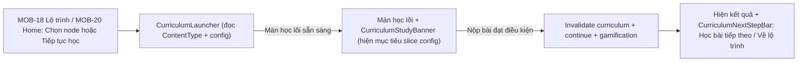
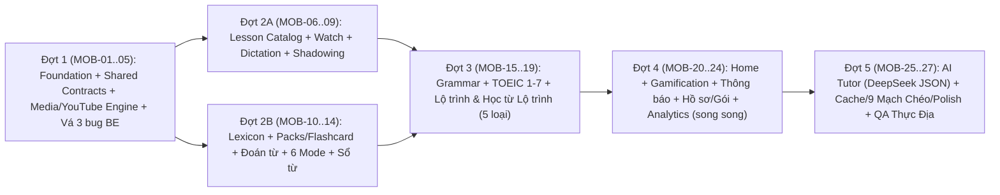

# Lyreo Mobile — Tài Liệu Bàn Giao Kỹ Thuật & Danh Mục Công Việc

> **Tài liệu nguồn duy nhất cho đội ngũ Lyreo Mobile:** Toàn bộ tính năng lớn và nhỏ, API, DTO, kỹ thuật React Native ↔ Spring Boot, đánh giá DeepSeek / AI Chat và luật validator bên dưới đã được đối chiếu trực tiếp từ mã nguồn thực tế của **15 module Learner Backend**, `apps/ai-service/`, `apps/mobile/`, `packages/i18n/` và `tooling/repo_checks/`.
> **Quy tắc vàng:** Lấy từng mã `MOB-xx` đưa vào AI Agent đang mở repo `lyreo-platform` → **tự đọc code + kiểm tra liên kết chéo + bắt buộc Agent lập Plan để bạn phản biện và duyệt trước khi viết một dòng code nào**. Team có toàn quyền sửa Backend/DB/API/Header khi FE gặp bất tiện, và tự do research/cài thư viện Expo/RN tốt nhất.

Tài liệu liên quan: [Bản đồ tài liệu (docs/README.md)](../README.md) · [Hợp đồng HTTP API](../architecture/http-api-contract.md) · [Kiến trúc AI Execution](../architecture/ai-execution.md) · [Tài khoản & Dev Auth](../ACCOUNT.md) · [README ứng dụng Mobile](../../apps/mobile/README.md) · [Rule kiểm tra Frontend](../../tooling/repo_checks/frontend.py) · [Câu hỏi mở](../requirements/open-questions.md)

---

## 1. Bảng Danh Mục Công Việc (27 Gói Việc — Thứ Tự DAG Sạch)

> **Quy ước:**
> - **Thứ tự 5 Đợt theo DAG sạch (không phụ thuộc ngược, tối ưu song song):** **Đợt 1** dựng nền tảng + hợp đồng dùng chung + vá bug BE sớm; **Đợt 2** làm các màn học lõi độc lập (Lesson, Lexicon, Vocab); **Đợt 3** làm Luyện thi (Grammar/TOEIC) + Lộ trình & luồng **Học trực tiếp từ Lộ trình (`MOB-19`)**; **Đợt 4** ghép các màn tổng hợp chạy song song (Home, Gamification, Thông báo, Hồ sơ/Gói, Analytics Điểm yếu); **Đợt 5** hoàn thiện AI Tutor ngữ cảnh, tối ưu tích hợp & QA thực địa.
> - **Ưu tiên:** `P0` (Bắt buộc làm trước — lõi sản phẩm), `P1` (Hoàn thiện đầy đủ trải nghiệm học), `P2` (Mở rộng & tối ưu phát hành).
> - **Cỡ:** `S` (0.5–1 ngày), `M` (1–2 ngày), `L` (2–4 ngày), `XL` (4–5 ngày).
> - **API chính:** Toàn bộ đường dẫn trong cột này mặc định có tiền tố `/api/v1` (rút gọn cho gọn bảng). Chi tiết sâu nằm ở **Mục 3 → Mục 8**.

| Mã | Đợt | Ưu tiên | Nhóm | Tên công việc | Cỡ | Phụ thuộc | Liên quan | Tóm tắt tính năng chính & Gợi ý UX / BE | API chính (tiền tố `/api/v1`) |
|---|---|---|---|---|---|---|---|---|---|
| **MOB-01** | Đợt 1 | P0 | Nền tảng | Thiết kế lại Theme Sáng/Tối, UI Kit, Icon, `app.json` & Vá Foundation + Dev Client | XL | - | MOB-02, MOB-03, MOB-04 | Dựng semantic theme Light/Dark rõ chiều sâu, bỏ ~50 màu chết, sửa đảo token radius (`sm=14 > xl=12`), sửa chớp Splash khi cold-start, đồng bộ NativeWind `colorScheme` + `SystemUI`, sửa `defaultNS: 'mobile'` ở **cả `src/i18n.ts` (runtime) lẫn `src/i18next.d.ts` (type)**, `Button` `minHeight`, bỏ Unicode/emoji giả; bổ sung quyền Mic/Camera/Photo & Cleartext dev vào `app.json`, mở glob test Jest/`tsx` đệ quy & `transformIgnorePatterns`. **Gợi ý UX / BE:** Tự do research & cài thư viện tương thích Expo SDK 57 / RN 0.86 Dev Client; giữ xanh 7 luật `frontend.py` + 1 luật env `repository.py`. | - |
| **MOB-02** | Đợt 1 | P0 | Điều hướng & Tài khoản | Navigation 5 Tab, Gỡ `SafeAreaView`, Hợp đồng Route, Auth Hardening & Onboarding 3 bước | L | MOB-01 | MOB-03, MOB-18, MOB-20, MOB-23 | Gỡ `<SafeAreaView>` bọc toàn app & sửa `<PortalHost />`, dựng Navigation 5 Tab + khóa sớm `routes.ts` (`typedRoutes: true` trong `app.json`, cập nhật `route-contract.test.ts`), giữ `<Stack>` mount khi `exchanging`, lưu PKCE vào `SecureStore` chống Android kill, fix `signOut()` popup iOS, xử lý acc bị khóa `401` (parse **`WWW-Authenticate`** header `"This session is no longer valid"` vì JSON `detail` là câu chung!), check **`GET /me` trả `"LEARNER"`** *(đã bỏ `ROLE_`!)*; Onboarding 3 bước (`starterSuggestion`). | `GET /me`, `GET /learner/profile`, `PUT /learner/onboarding` |
| **MOB-03** | Đợt 1 | P0 | Nền tảng Dữ liệu | Nâng cấp `ApiClient`, Hàng đợi `revision`, Query Cache & Shared Feature Primitives | L | MOB-01 | Toàn app | Phân vùng rõ với `MOB-02` (`MOB-02` giữ `SessionManager` & `routes.ts`; `MOB-03` giữ `ApiClient` & shared hooks): single-flight `refreshSession(failedToken)`, `Crypto.randomUUID()` (`expo-crypto`), `X-Correlation-Id`, helper `FormData` (không set `Content-Type`), timeout phân tầng (JSON 15s / Upload 60s / Chat 45s), binary, `Location`/`ETag`, `429` 5 bucket, **Serialized Auto-Save Queue (`revision`)**, `NetInfo` + `AppState`, **Logout/`401` Full Purge Pipeline**, `query-keys.ts`; khóa 3 primitive: `useLearnerPreferences`, `useEntitlements` + `UpgradePromptSheet`, `SaveWordButton`. | `GET /learner/preferences`, `GET /entitlements`, `POST /vocabulary/saved-items` |
| **MOB-04** | Đợt 1 | P0 | Media Engine | Audio Player (`FileSystem` `file://`), YouTube Wrapper, `expo-image` & Mic `.m4a` | L | MOB-01, MOB-03 | MOB-07..11, MOB-16, MOB-18 | Xây Audio Player dùng chung tải file Bearer về `FileSystem.cacheDirectory` phát **`file://`** (tránh lỗi auth header `AVPlayer` iOS, tua ms không trễ & tiết kiệm bucket `media`), lặp A–B, tốc độ **`0.5x–2.0x`** từ `useLearnerPreferences`; bọc **shared YouTube Player** (cần cho `MOB-07/08/09` vì bài `YOUTUBE` trả `GET /audio` `404`!); `expo-image` Bearer + `ETag 304`; Recorder **AAC `.m4a`** (tránh `.caf`/AMR) có chạm & giữ + sóng âm. **Gợi ý UX:** xử lý iOS `silent-switch` & tạm dừng khi có cuộc gọi/ngắt tai nghe. | `GET /lessons/{id}/audio`, `/shadowing-attempts/{id}/audio`, `/lexicon/.../audio`, `/vocabulary/.../media/...`, `/assessment-sessions/.../media/...`, `/learner/profile/avatar`, `/vocabulary/packs/{id}/cover`, `/curriculum/paths/{id}/cover`, `/gamification/achievements/{id}/badge` |
| **MOB-05** | Đợt 1 | P0 | Backend Enablement | Vá 3 bug BE bắt buộc & Mở rộng API nền cho Mobile (Migration `V022+`) | M | - | MOB-15, MOB-18..21, MOB-23, MOB-24 | Chạy song song ngay Đợt 1: **(1) Bắt buộc** vá `GamificationQueryService.summary()` reset `currentStreak` quá ngày UTC + `studiedToday` (#1); **(2) Bắt buộc** thêm `subtopicIds` vào `GrammarCatalogController.Start` (#2); **(3) Bắt buộc** điền `used`/`remaining` cho `CAPACITY` ở `/entitlements` (#6); **(4)** Xoay EXIF Avatar (#9), nhãn 4 `weaknessType` (#11) & tối ưu latency Chat (`thinking: "disabled"`, `max_output_tokens`, tách `@Transactional` idempotency #10). *(Tùy chọn #3/#4/#5/#7/#8; migration mới từ `V022__...sql`).* | `/gamification/summary`, `/grammar/catalogs/{kind}/{id}/sessions`, `/entitlements`, `/analytics/overview`, `/learner/profile/avatar` |
| **MOB-06** | Đợt 2 | P0 | Bài học | Thư viện Bài học (lọc đa tiêu chí) & Màn Tổng quan Bài học (Overview) | L | MOB-02, MOB-03 | MOB-07..09, MOB-18, MOB-24 | Xóa `lesson.tsx` giả; tìm kiếm `q`, lọc Chủ đề (`categoryId` đa ngôn ngữ + `lessonCount`), CEFR, `sourceType` (`TEXT`/`AUDIO`/`YOUTUBE`), `activity`, phân trang `hasMore`, hiện `channelTitle`, `durationMs`, `locked`. Lưu ý DTO Lesson **không có `lockReason`** và `GET /lessons/{id}` trả `403` cho bài Plus bị khóa (mở `UpgradePromptSheet` từ card hoặc `403`). **Gợi ý UX:** chip lọc trượt ngang, badge Đang dở / Đã xong / Plus. | `GET /lessons`, `GET /lessons/categories`, `GET /lessons/{id}` |
| **MOB-07** | Đợt 2 | P0 | Bài học | Watch / Listen Karaoke (Audio & YouTube) + 4 Lớp Ngữ cảnh & Tra/Lưu từ 1 chạm | XL | MOB-04, MOB-06, MOB-10 | MOB-08, MOB-09, MOB-14, MOB-19, MOB-21, MOB-25 | Phát Audio gốc (`file://`) & YouTube (`sourceStartMs..sourceEndMs`); Karaoke sáng câu & từ (`words[]`), chạm câu nhảy mốc, lặp A–B, tốc độ session-only, `thoughtGroups[]`. Tích hợp 4 lớp câu (`translation`, `ipa`, `vocabulary[]` có `headwordId`, `grammar[]`, `notes[]`) theo `useLearnerPreferences`, chạm từ mở Lexicon & `SaveWordButton`. **Gợi ý UX / BE:** nhận `curriculumContext` khi mở từ lộ trình; thêm batch check từ đã lưu (#3). | `GET /lessons/{id}/activities/{actId}`, `GET .../audio`, `POST .../complete`, `GET /lexicon/by-headword/{hid}`, `POST /vocabulary/saved-items` |
| **MOB-08** | Đợt 2 | P0 | Bài học | Nghe–Chép chính tả (Dictation 3 mức đục lỗ + Gợi ý Word Pool kéo/chạm từ) | XL | MOB-04, MOB-06 | MOB-07, MOB-09, MOB-18, MOB-19, MOB-21 | Đủ 3 mức `hintLevel` (`NONE`/`EASY`/`MEDIUM`) + `properNounHints`, hỗ trợ Audio lẫn YouTube (`MOB-04`), lọc lát cắt `sentenceIds`, tắt `autoCorrect`/`spellCheck` bàn phím; server chấm (`RELAXED_TOKEN_DISTANCE_V1`) mở khóa 4 lớp câu ngay sau **lần nộp đầu (`attempted=true`)** (cần refetch activity trừ khi làm BE #7), còn ngưỡng **`>= 70`** tính hoàn thành câu/lộ trình. **Gợi ý UX / BE:** thêm **Word Pool kéo/chạm thẻ từ** & mở rộng BE (#7). | `GET /lessons/{id}/activities/{actId}?hintLevel=...&properNounHints=...`, `GET /lessons/{id}/audio`, `POST .../dictation/attempts` |
| **MOB-09** | Đợt 2 | P0 | Bài học | Shadowing trọn luồng (Thu `.m4a`, Chấm AI từng từ/IPA, Nghe lại & Lịch sử) | XL | MOB-04, MOB-06 | MOB-07, MOB-08, MOB-19, MOB-21 | `constraints?revision=...` (`STALE_REVISION`), thu **AAC `.m4a`** (12–60s, ≤ 8 MiB); upload multipart `POST .../attempts?revision=...` part **`"audio"`** (file 8 MiB–30 MB trả **`400`**, > 30 MB trả `413`; giữ UUID `Idempotency-Key` qua retry, không đè quota khi replay `null`) → poll stepped backoff `202` + `/cancel` + `AbortSignal` (**lưu `attemptId` cục bộ để resume** vì `/attempts` chỉ liệt kê bài đã chấm xong); 4 điểm + màu IPA, 24h `audioAvailable`, `NO_SPEECH` hoàn quota. **Gợi ý UX:** đối chiếu A/B & tổng kết bài. | `GET /lessons/{id}/activities/{actId}`, `GET /lessons/{id}/audio`, `GET .../shadowing/sentences/{sid}/constraints`, `POST .../attempts?revision=...`, `GET /shadowing-attempts/{id}`, `GET .../audio`, `POST .../cancel`, `GET /lessons/{id}/attempts` |
| **MOB-10** | Đợt 2 | P0 | Từ điển | Từ điển Tra cứu chuyên sâu (5 loại từ, Biến thể, EN–VI/EN–EN & Phát âm đa vùng) | L | MOB-02, MOB-04 | MOB-07, MOB-14, MOB-25 | Search debounce giữ ranking server cho 5 `entryType` (`WORD`..`COLLOCATION`) & 4 `matchType` (`EXACT_FORM` gõ `went` khớp `go`, tô đậm `matchedText`). Chi tiết có `etymologyText`, `forms[]`, `pronunciationVariants[]` (UK/US/AU, `Range 206`), 2 tab tách nguồn sạch `en-vi`/`en-en` (`readingModes`), bản quyền `licenseText` & `SaveWordButton` theo từng nghĩa. **Gợi ý UX:** lưu lịch sử từ vừa tra trên máy & báo rõ khi từ chỉ có `en-en`. | `GET /lexicon/search`, `GET /lexicon/{id}`, `GET /lexicon/by-headword/{hid}`, `GET .../pronunciations/{pid}/audio`, `POST /vocabulary/saved-items` |
| **MOB-11** | Đợt 2 | P0 | Từ vựng | Bộ từ chuẩn (Packs/Units giàu media, `modeAvailability`) & Học Flashcard SRS | XL | MOB-02, MOB-04 | MOB-12..14, MOB-21, MOB-24 | Duyệt Packs (`completedEntries/entryCount`, `locked` — **chú ý `GET .../packs/{id}/cover` trả `403` cho user FREE ở pack Plus bị khóa**, cần placeholder!) & Units (CEFR); đọc **`modeAvailability`** 8 mode (khóa mode 0 câu); 5 media & full metadata. Flashcard SRS (`DUE_AND_NEW`/`ALL`, 4 nút `intervalPreviews`, `expectedReviewCount`; ôn sớm `ALL` không tính thưởng). **Gợi ý UX / BE:** lật/vuốt thẻ + haptic; thêm pack `modeAvailability`, `entryIds` ở `/flashcards` & `*Url` (#4, #5). | `GET /vocabulary/packs`, `GET .../cover`, `GET .../units`, `GET /vocabulary/units/{uid}`, `GET .../entries/{eid}/media/{aid}`, `GET /vocabulary/flashcards`, `POST .../entries/{eid}/flashcard-review` |
| **MOB-12** | Đợt 2 | P0 | Từ vựng | Chế độ Đoán Từ tương tác (`GUESS_WORD` — Trụ cột ngang hàng Flashcard) | L | MOB-11 | MOB-13, MOB-14, MOB-18, MOB-19 | Game đoán từ chủ lực ngang hàng Flashcard: nghĩa (`prompt`), từ loại, ảnh, `maskedTerm` (`******`), `clozeSentence` (`***`), `exampleVi` (**lưu ý BE cố ý ẩn `ipaUk/ipaUs/audioId = null` để không lộ đáp án!**); mở từng chữ (`/hint` trái→phải, không bump `revision`), kiểm tra từng câu (`POST .../questions/{qid}/check` + `revision`, khóa câu sau check), đầu hàng (`giveUp: true`); chơi Unit / Pack / `entryIds[]`. **Gợi ý UX:** nút lưu nhanh từ sai (`SaveWordButton`). **Lưu ý:** Nộp Unit mở khóa `VOCABULARY_REVIEW`. | `POST /vocabulary/units/{uid}/sessions`, `POST .../packs/{pid}/sessions`, `GET /vocabulary/sessions/{id}`, `POST .../questions/{qid}/hint`, `POST .../questions/{qid}/check`, `POST .../submit` |
| **MOB-13** | Đợt 2 | P0 | Từ vựng | 6 Chế độ Luyện từ vựng, Chế độ `MIXED`, lát cắt `entryIds` & Lưu nháp / Resume 24h | XL | MOB-11 | MOB-12, MOB-18, MOB-19, MOB-24 | UX cảm ứng cho 6 dạng + `MIXED` (`CHOOSE_MEANING`, `CHOOSE_WORD`, `LETTER_SCRAMBLE`, `MISSING_LETTERS`, `LISTEN_WRITE`, `CONTEXT_CLOZE`); `POST .../questions/{qid}/check` dùng được cho **mọi** mode; auto-save `answers` qua **Serialized Queue (`MOB-03`)** (bắt buộc strip/freeze câu đã check hoặc `gaveUp` để không dính `409 STATE_CONFLICT`), banner Resume `OPEN` 24h & lịch sử (không đổi SRS). **Gợi ý UX:** chạm/kéo chip chữ & tự nhảy ô nhập. | `POST .../units/{uid}/sessions`, `POST .../packs/{pid}/sessions`, `GET /vocabulary/sessions`, `GET .../sessions/{id}`, `PUT .../answers`, `POST .../questions/{qid}/check`, `POST .../submit` |
| **MOB-14** | Đợt 2 | P1 | Từ vựng | Sổ từ cá nhân, Collections CRUD/Move, Collection Picker & Hàng đợi ôn SRS (`/due`) | L | MOB-02, MOB-03, MOB-04, MOB-11 | MOB-07, MOB-10, MOB-21, MOB-23 | CRUD bộ sưu tập (`coverPreset`, bộ mặc định `"Đã lưu"` **không đổi tên & không xóa được `409`**; xóa bộ thường chuyển thẻ về mặc định), tìm kiếm `q`, gắn/gỡ `/items`, di chuyển `/move`, nâng cấp `SaveWordButton` thêm Collection Picker cho toàn app, nghe media thẻ đã lưu (hết Plus vẫn đọc chữ, media `403`), quota 100 FREE, ôn `/due` + `/cards/{cid}/review`. **Gợi ý BE:** Thêm `intervalPreviews`/`srsState` cho `/due` & `/cards/{id}/review` (#4). | `CRUD /vocabulary/collections`, `.../items`, `.../move`, `POST /vocabulary/saved-items`, `GET /vocabulary/saved-items/{cid}/media/{aid}`, `GET /vocabulary/due`, `POST /vocabulary/cards/{cid}/review`, `DELETE .../cards/{cid}` *(legacy: `POST /vocabulary/cards`)* |
| **MOB-15** | Đợt 3 | P1 | Ngữ pháp | Danh mục Ngữ pháp phân cấp (Topic→Subtopic→Bank) & Quiz + Review chi tiết | M | MOB-02, MOB-03, MOB-05 | MOB-19, MOB-21, MOB-24, MOB-25 | Duyệt cây `topic`/`subtopic`/`bank` song ngữ (khóa thừa kế Topic cha), quiz `limit <= 50` (truyền `subtopicIds` đã vá ở `MOB-05` khi mở từ Lộ trình), auto-save `revision` qua **Serialized Queue (`MOB-03`)**, resume `OPEN` 24h (`?domain=grammar` bắt buộc khi lấy list); review đủ `explanationVi`, `translationVi`, `combinedTranslationVi`, `answerTranslationVi`, `vocabularyNote`. | `GET /grammar/catalogs/{kind}`, `GET .../page`, `GET .../{id}`, `POST .../sessions`, `GET /assessment-sessions?domain=grammar`, `GET/PUT/POST /assessment-sessions/{id}/**` |
| **MOB-16** | Đợt 3 | P1 | TOEIC | Danh mục TOEIC (`PartBreakdown`, Drill/Full Test) & Trình làm Parts 1–5 + Review sâu | XL | MOB-02, MOB-03, MOB-04 | MOB-17, MOB-19, MOB-21, MOB-24, MOB-25 | Danh mục đề (`parts[]` chỉ trả ở `GET /toeic/catalog/{id}`), chọn `DRILL` (`parts[]`/`placementIds[]`) hoặc `FULL_TEST`, resume 24h (`?domain=toeic` bắt buộc khi lấy list); Parts 1–5 (Part 2 đúng 3 đáp án A/B/C; Part 1–2 bị ẩn text ở `View.questions` **kể cả sau nộp** → đọc từ `View.result.questions[].content` & `View.result.groups[]`), auto-save qua Serialized Queue, hiện `accuracyPercent` cho Drill. **Gợi ý UX:** cờ `flag`, bảng nhảy câu & `SaveWordButton` ở review. | `GET /toeic/catalog`, `GET .../page`, `GET .../catalog/{id}`, `POST .../sessions`, `GET /assessment-sessions?domain=toeic`, `GET/PUT/POST /assessment-sessions/{id}/**` |
| **MOB-17** | Đợt 3 | P2 | TOEIC | TOEIC Part 6, Part 7 (Tab/Sheet Đoạn văn–Câu hỏi), Đồng hồ Wall-Clock & Full Test ETS | L | MOB-16 | MOB-19, MOB-21, MOB-24, MOB-25 | Đồng hồ Listening/Reading tính theo **wall-clock `sectionStartEpochMs + durationSeconds*1000 - Date.now()`** (clamp bởi `expiresAt` 24h — lưu ý `expiresAt` chỉ là hạn nháp 24h!); giao diện tab/sheet **"Đoạn văn / Câu hỏi"** + bảng nhảy câu cho Part 6 (`gapNumber`) & Part 7 (1–3 HTML docs render theo Light/Dark theme); hiện scaled scores (`5..495` / `10..990` từ `ToeicScoreConverter`) khi `FULL_TEST` đủ 100/100 câu. **Gợi ý BE:** Ghim thời gian vào `View` & gửi final `answers` trong `/submit` (#8). | `POST /toeic/catalog/{id}/sessions` (`FULL_TEST`), `/assessment-sessions/{id}/**` |
| **MOB-18** | Đợt 3 | P0 | Lộ trình | Danh sách Lộ trình, Enroll, Cây bài học (bắt buộc/nhánh phụ) & `CurriculumLauncher` | L | MOB-02, MOB-03, MOB-04, MOB-08, MOB-12 | MOB-19, MOB-20 | Duyệt lộ trình `PUBLISHED` (`cover` ETag `304`, CEFR, `locked` — lưu ý DTO không có `lockReason` nên `UpgradePromptSheet` đọc từ `useEntitlements()` hoặc `403` khi `/enroll`), Enroll idempotent, gate `enrollmentStatus == null` → nút Enroll, cây `sections -> items` (`required: true/false`); xây `CurriculumLauncher` ánh xạ đủ 5 `ContentType` + `config`. **Gợi ý UX:** node timeline + thanh tiến độ chặng & Paywall ngữ cảnh. | `GET /curriculum/paths`, `GET .../cover`, `GET .../paths/{id}`, `POST .../enroll`, `GET /curriculum/continue` |
| **MOB-19** | Đợt 3 | P0 | Lộ trình | **Luồng Học Trực Tiếp Từ Lộ Trình (`Curriculum Study Loop`) — Nối Thông Đủ 5 `ContentType`** | M | MOB-07..09, MOB-12..13, MOB-15..18 | MOB-20, MOB-21, MOB-26 | Khóa chặt mạch học từ Lộ trình: dựng `CurriculumStudyBanner` (hiện chặng hiện tại & mục tiêu `config`: `activityType`, `sentenceIds`, `entryIds`, `subtopicIds`, `parts`, `questionCount`) và `CurriculumNextStepBar` (sau nộp bài tự invalidate `curriculum` + `continue` + `gamification` và hiện CTA **"Học bài tiếp theo trong lộ trình"**). Kiểm chứng mở khóa tuần tự thật (non-retroactive) cho đủ cả **5 loại** (`LESSON`, `VOCABULARY_REVIEW` Unit-only, `GRAMMAR_PRACTICE`, `TOEIC_DRILL`, `TOEIC_TEST`). | `GET /curriculum/paths/{id}`, `GET /curriculum/continue` + endpoints nộp bài 5 loại |
| **MOB-20** | Đợt 4 | P0 | Trang chủ | Thay toàn bộ Mock Trang chủ bằng dữ liệu thật (Home Dashboard) | L | MOB-02, MOB-03, MOB-04, MOB-05, MOB-18 | MOB-19, MOB-21, MOB-22, MOB-23, MOB-24 | Xóa sạch số giả & debug box `account-summary.tsx`; hiện tên/avatar, Streak UTC thật (`MOB-05`), Kim cương, chuông `unreadCount`, thẻ **"Tiếp tục học"** 1 chạm nối thẳng `CurriculumLauncher` (hoặc `starterSuggestion`), lối tắt thật tới Bài học / Đoán từ / Flashcard / Từ điển, thống kê tuần thật. **Gợi ý UX / BE:** dùng skeleton không giật layout; cân nhắc thêm endpoint BFF Home (#11). | `GET /learner/profile`, `/gamification/summary`, `/curriculum/continue`, `/analytics/overview`, `/vocabulary/due`, `/notifications` |
| **MOB-21** | Đợt 4 | P1 | Thưởng | Gamification trọn gói: Level/XP, Streak (UTC), Nhiệm vụ Claim, Thành tựu & Sổ Kim cương | L | MOB-02, MOB-03, MOB-04, MOB-05 | MOB-07..09, MOB-11, MOB-14..16, MOB-20 | Chạy song song cùng Home: thanh Level/XP (trần Lv 99, tự cộng `LEVEL_MILESTONE` mỗi 5 level + Lv 99), Streak UTC chuẩn (`studiedToday` từ `MOB-05`), Nhiệm vụ 3 chu kỳ (`DAILY`/`WEEKLY` thứ Hai UTC/`ONE_TIME`) + Claim thủ công (`Idempotency-Key`, xong invalidate Summary/Missions/Achievements/Ledger), **6 chỉ số Thành tựu** (3 định nghĩa seed sẵn, Admin tạo thêm được, `badge` ETag `304`), Sổ Kim cương 8 loại (`directLessonActivityDiamondsEnabled=false`, `TOEIC_DRILL_COMPLETED` chỉ tính `DRILL`). | `GET /gamification/summary`, `GET /gamification/missions`, `POST .../missions/{mid}/claim`, `GET /gamification/achievements`, `GET .../{id}/badge`, `GET /gamification/ledger` |
| **MOB-22** | Đợt 4 | P1 | Thông báo | Hoàn thiện Hộp thư Thông báo (Lọc chưa đọc, Mark-read & đồng bộ badge Home) | S | MOB-02, MOB-03 | MOB-20 | Chạy song song cùng Home: mở rộng `notifications-screen.tsx` (`hasMore` & chống race): phân biệt 4 loại (`SYSTEM`/`STUDY_REMINDER`/`REWARD`/`PROMO`) + chưa đọc/đã đọc, lọc `unreadOnly`, `/{id}/read`, `/read-all`, sửa nút back mượn nhầm `progress.back` & đồng bộ `unreadCount` qua `query-keys.ts`. **Lưu ý / UX:** DTO `Announcement` hiện chưa có `targetUrl`/`referenceType` → mặc định điều hướng tổng quát theo `category` (trừ khi mở rộng BE). | `GET /notifications`, `POST /notifications/{id}/read`, `POST /notifications/read-all` |
| **MOB-23** | Đợt 4 | P1 | Tài khoản | Hồ sơ, Mục tiêu TOEIC, Đổi Avatar (27 Preset + Camera/EXIF), Cài đặt 9 mục & Gói Free/Plus | L | MOB-02, MOB-03, MOB-04, MOB-05 | MOB-07, MOB-08, MOB-24 | Sửa hồ sơ + mục tiêu TOEIC (`10..990` bội 5); đổi avatar 27 preset (4 nhóm + 4 legacy, `GET /avatar` trả `404` khi dùng preset) hoặc chụp/chọn ảnh qua `expo-image-manipulator` đổi `content://`→`file://` JPEG xoay EXIF ≤ 2 MiB (2–30 MB server trả `400`, > 30 MB trả `413`); chia nhóm `settings.tsx` đủ 9 preferences đồng bộ `useLearnerPreferences` (sửa bug ẩn form khi lỗi); màn Gói (`8` keys, 3 `lockReason`, thanh quota `CAPACITY` thật từ `MOB-05`). | `GET/PATCH /learner/profile`, `GET/PUT /learner/profile/avatar`, `GET/PUT /learner/preferences`, `GET /entitlements`, `GET /learner/entitlements` |
| **MOB-24** | Đợt 4 | P1 | Tiến độ | Phân tích Tiến độ 7 kỹ năng, Điểm yếu (`weaknesses`) & `WeaknessActionRouter` | M | MOB-03, MOB-05, MOB-06, MOB-11, MOB-13, MOB-15, MOB-16 | MOB-17, MOB-20, MOB-23 | Mở rộng `learner-progress.tsx`: cửa sổ hôm nay/tuần (bỏ qua `studySeconds` vì BE trả `0`), đủ **7 `skillCode`** (`GENERAL` từ `WATCH` + 6 kỹ năng khác) & `sampleCount`, 7 `weaknessType` (đủ nhãn từ `MOB-05` + fallback i18n) nối **`WeaknessActionRouter`** (gồm cả `TOEIC_SECTION`) nhảy thẳng màn luyện bù & list phiên gần đây (`?domain=grammar` + `?domain=toeic`). | `GET /analytics/overview`, `GET /vocabulary/sessions`, `GET /assessment-sessions?domain=grammar`, `GET /assessment-sessions?domain=toeic` |
| **MOB-25** | Đợt 5 | P1 | Trợ lý AI | Trợ lý AI English Tutor theo ngữ cảnh (`AskAiTrigger`) & Lịch sử Chat (DeepSeek Ready) | L | MOB-03, MOB-07, MOB-10, MOB-15, MOB-16 | MOB-17, MOB-26 | Dựng màn lịch sử hội thoại (`lastMessagePreview`, `messageCount`, đổi tên/xóa) + **`AskAiTrigger` / Bottom Sheet ngữ cảnh** cắm vào Lesson, Lexicon, Grammar Review & TOEIC Review (kèm chip gợi ý). DeepSeek đã nối sẵn ở `apps/ai-service` (`GENERAL_LLM`, `deepseek-*`); `POST /chat/ask` là **JSON đồng bộ** (`AskResponse`) → đặt timeout `30–45s`, `Idempotency-Key` & hoàn quota khi lỗi. **RCM:** **KHÔNG** bật SSE streaming ở MVP (dễ đứt fallback & phức tạp quota); streaming là **Post-MVP / P3+**, ưu tiên structured `context` + `thinking: "disabled"` (#10). | `POST /chat/ask`, `GET /chat/conversations`, `GET/PATCH/DELETE .../conversations/{id}` |
| **MOB-26** | Đợt 5 | P2 | Tối ưu & Tích hợp | Cache Audio/Ảnh thông minh, Dọn cache Logout, Khóa 9 Mạch Chéo & Polish Dark Mode | L | MOB-04, MOB-11, MOB-14, MOB-19..25 | Toàn app | Preload audio/ảnh câu hoặc thẻ kế tiếp (tôn trọng bucket `media`), nút "Xóa bộ nhớ đệm" & kiểm chứng Full Purge Pipeline khi Logout/khóa `401` (`WWW-Authenticate`); rà khóa chặt **9 Mạch Liên Kết Chéo** (Mục 5); chống bàn phím che nút (`react-native-keyboard-controller`), haptic nhẹ, rà chữ Việt có dấu với Raleway & Dark mode trên màn nhỏ. | Media endpoints (`ETag` / `Range 206`) |
| **MOB-27** | Đợt 5 | P2 | QA | Kiểm thử E2E thực địa toàn app trên Emulator & Thiết bị thật + Chốt toàn bộ Gate | L | MOB-01..26 | Toàn app | Test trọn hành trình + **Học từ Lộ trình đủ 5 `ContentType`** + ma trận lỗi (`401` khóa acc header `WWW-Authenticate`, `403` 3 lockReason, `409` conflict/checked, `400`/`413` upload lớn, `429` bucket, replay `null`) trên máy thật Android/iOS; fix dứt điểm bug FE/BE phát sinh; chốt xanh `typecheck`, `test`, `make validate` & Java IT liên quan. | Toàn bộ Learner API |

---

## 2. Quy Trình Làm Việc Bắt Buộc, Quyền Sửa Xuyên Tầng & Công Nghệ Mở

### 2.1 Quy trình bắt buộc: Tự Nghiên Cứu + Plan-First + Phản Biện (Chống quăng task mù vào Agent)

> [!CAUTION]
> **CẤM TUYỆT ĐỐI** quăng cộc lốc mã Task (kiểu *"làm cho tôi MOB-08"*) cho AI Agent tự viết code và commit mù quáng! Làm vậy gần như chắc chắn sẽ dính sai `GET /me` (`"LEARNER"` vs `"ROLE_LEARNER"`), quên parse `WWW-Authenticate`, vi phạm rule `frontend.py`, sai masking TOEIC, đứt hàng đợi `revision` hoặc đứt liên kết chéo sang Curriculum/Gamification.

Mỗi task (`MOB-01` → `MOB-27`) bắt buộc đi qua **5 bước**:
1. **Dev tự đọc & đối chiếu code thật:** Đọc Mục 3, 4, 5, 6, 7, 8 liên quan tới `MOB-xx` trong tài liệu này, rồi tự mở file Java Controller/DTO/Service và `apps/mobile/` tương ứng để hiểu tận gốc dữ liệu và ngoại lệ.
2. **Dev kiểm tra UX & liên kết chéo:** Chủ động thiết kế luồng thao tác di động mượt (tránh nhồi form web vào điện thoại) và rà **Mục 5 (9 mạch liên kết chéo)** xem màn này cần cập nhật cache/trạng thái của màn nào khác.
3. **Bắt Agent lập Kế hoạch chi tiết (chưa được code):** Dùng mẫu lệnh ở **Mục 9**, yêu cầu Agent đọc code thật và trả về Bản Kế Hoạch (screen/component, API/header, kỹ thuật RN↔BE ở Mục 4, error/retry, thư viện cần cài, phần BE/DB đề xuất sửa, danh sách test).
4. **Dev phản biện & chốt Kế hoạch:** Soi ngược bản Plan của Agent với quy tắc `frontend.py`, hợp đồng DTO và liên kết chéo; chỉ cho phép viết code sau khi Plan đã sạch lỗ hổng.
5. **Kiểm chứng thực tế trước khi xong:**
   - `pnpm --filter @lyreo/mobile typecheck && pnpm --filter @lyreo/mobile test`
   - `make validate`
   - Nếu có sửa Java Backend: `./mvnw -B -pl modules/<module-đã-sửa>,apps/core-service -am verify`
   - Chạy thử thực tế trên **Expo Dev Client** nối vào Backend cục bộ (`make core`) và rà kỹ `git diff`.

### 2.2 Quyền sửa xuyên tầng (Không ép cứng nếu FE gặp khó)
Nếu API, request/response, header, quy tắc lọc hay luồng dữ liệu hiện tại khiến Frontend phải xử lý vòng vo hoặc làm trải nghiệm di động bị gượng, đội Mobile **được quyền chủ động sửa cả Backend lẫn Database**:
- **Java Backend (`modules/*`, `libs/contracts/*`, `apps/core-service/*`, `apps/ai-service/*`):** Thêm/đổi field DTO, thêm query param/header, tạo BFF endpoint gom dữ liệu cho Mobile (xem 11 đề xuất ở **Mục 7**), hoặc đưa xử lý nặng lên server.
- **Database (`apps/core-service/src/main/resources/db/migration/`):** Tạo migration mới nối tiếp (**`V022__...sql`**, `V023__...sql`, ...). **Không sửa** các migration cũ (**`V001`..`V021`**), giữ Hibernate ở mode `validate`.
- **Docs (`docs/`):** Khi cố ý đổi API/luật nghiệp vụ/biến môi trường, cập nhật đồng bộ [http-api-contract.md](../architecture/http-api-contract.md), `docs/requirements/*.md` và `.env.example`.

**4 ranh giới bắt buộc giữ vững (CI & `ArchitectureTest` kiểm soát):**
1. **Spring Modulith:** Giao tiếp giữa các module chỉ qua public/named API, shared contracts hoặc domain events; không import repository hay query thẳng bảng nội bộ module khác.
2. **Server nắm quyền điểm, thưởng & quyền truy cập:** Client không tự gửi `score`, `xp`, `diamonds` hay tự đánh dấu `completed`; các thao tác ghi quan trọng dùng `Idempotency-Key` và `revision`.
3. **Bảo mật & Quyền riêng tư:** Không đưa secret vào `EXPO_PUBLIC_*`; không trả raw storage key cho client (luôn đi qua HTTP media endpoint được bảo vệ); `expo-secure-store` chỉ dùng trong `apps/mobile/src/auth/`.
4. **Quy tắc giao diện & i18n (`make validate` — [frontend.py](../../tooling/repo_checks/frontend.py)):** Tách riêng theme/component khỏi `apps/admin-web`; tuân thủ toàn bộ 8 luật CI ở **Mục 3.3**.

### 2.3 Công nghệ & Thư viện MỞ (Chỉ gợi ý tham khảo, không gò bó)
- Code hiện tại trong `apps/mobile/` chỉ là khung khởi tạo tối thiểu (scaffold) trên **Expo SDK 57 (`~57.0.24`) + React Native `0.86.3` + React `19.2.3` + Expo Router + Reanimated 4 (`~4.5.1`) + NativeWind 4 (`4.2.6`) + TypeScript `~6.0.3`**.
- Mọi tên thư viện trong tài liệu **chỉ là gợi ý tham khảo (RCM)**. Khuyến khích team chủ động research và cài thư viện Expo/RN hiện đại, bảo trì tốt (VD: `react-native-gesture-handler`, `@gorhom/bottom-sheet`, `@shopify/flash-list`, `lucide-react-native`, `expo-audio`, `expo-file-system`, `react-native-youtube-iframe`, `expo-image`, `expo-image-manipulator`, `expo-haptics`, `react-native-keyboard-controller`, `@react-native-community/netinfo`, `@tanstack/react-query`, `zustand`, `react-native-render-html`...).
- **Điều kiện duy nhất:** Tương thích **Expo SDK 57 + React Native 0.86 + Expo Dev Client** (Lyreo **không dùng Expo Go**; rebuild Dev Client bằng `make mobile-android-install` hoặc `expo prebuild` khi thêm native package hay sửa quyền trong `app.json`) và giữ xanh `typecheck`, `test`, `make validate`.

---

## 3. Hiện Trạng `apps/mobile/`, Kiến Trúc Điều Hướng, Luật CI & Môi Trường Chạy Thử

### 3.1 Đã chạy thật (giữ làm nền) vs Lỗi/Quirk hiện hữu cần xử lý ngay (Đợt 1)
- **Đã chạy thật (`src/config/env.ts`, `src/auth/*`, `src/api/*`, một phần UI):**
  - `SessionManager` + `expo-secure-store`: OIDC PKCE (`lyreo://auth/callback`), single-flight `bootstrap()` / `refreshSession()`, phân biệt mất phiên vs lỗi mạng (`SessionUnavailableError`).
  - `ApiClient` & `errors.ts`: RFC 9457 Problem Details mapping.
  - `NotificationsScreen` (đã có `hasMore` & `AbortController` chống race refresh), `LearnerProgress` (đã gọi `analytics/overview`), `SettingsScreen` (đã đọc/ghi một phần preferences & đổi theme/locale).
- **Lỗi & điểm yếu thực tế cần sửa ngay ở `MOB-01..04`:**
  - **Cấu hình `app.json` còn thiếu quyền native:** Hiện `app.json` mới có `expo-router`, `expo-secure-store`, `expo-localization`, `expo-font` (có `experiments.typedRoutes: true`) — **chưa khai báo** quyền Microphone (`NSMicrophoneUsageDescription` / `RECORD_AUDIO`), Camera/Thư viện ảnh (`NSCameraUsageDescription` / `NSPhotoLibraryUsageDescription`) và cấu hình mạng local HTTP dev (`usesCleartextTraffic` Android / NSAppTransportSecurity iOS cho `http://10.0.2.2:8080` & IP LAN).
  - **Theme & Typography:** `foundation.json`/`tailwind.config.js` đảo ngược bo góc (`rounded-sm=14px`, `rounded-md=20px`, `rounded-lg=28px` lớn hơn `rounded-xl=12px` & `rounded-2xl=16px`); Light mode trùng `background === secondary === muted` (`#F5F5F4`) và `surface === surfaceElevated` (`#FFFFFF`); Dark mode trùng `secondary === muted === surfaceElevated` (`#44403C`); thiếu token nền dịu (`primarySubtle`, `successSubtle`, `warningSubtle`, `destructiveSubtle`); `primitives.ts` còn ~50 màu chết; Raleway chỉ có 5 weight (400–800, không italic, cần test dấu tiếng Việt Android).
  - **Cold-start & Theme Providers:** `SplashScreen.hideAsync()` không đợi `AppThemeProvider`/`LocaleProvider` đọc `AsyncStorage` → chớp theme/ngôn ngữ; `AppThemeProvider` (`value` đã `useMemo`) nhưng tạo mới `themeVariables(colors)` (`vars(...)`) và hàm `setPreference` (không `useCallback`) mỗi lần render, thiếu `.catch()`, chưa gọi NativeWind `colorScheme.set(mode)` và `SystemUI.setBackgroundColorAsync(...)`.
  - **SafeArea, Portal & Route/Stack:** `AppProviders.tsx` bọc `<PortalHost />` bên trong `<SafeAreaView>` toàn cục (chặn edge-to-edge và lệch modal/sheet); `app/_layout.tsx` hủy mount `<Stack>` khi `status === 'bootstrapping'` (gồm cả `exchanging`); `app/(app)/_layout.tsx` thiếu `contentStyle: { backgroundColor }`.
  - **Auth & API Client:** PKCE `codeVerifier`/`state` chỉ nằm trong RAM (bị Android kill app khi mở Keycloak tab là lỗi callback); `app/auth/callback.tsx` chạy ngay trước khi `discovery`/`request` sẵn sàng; `signOut()` mở `WebBrowser` gây iOS consent popup; `errors.ts` chưa đọc header `WWW-Authenticate` (khiến acc bị khóa `"This session is no longer valid"` không phân biệt được với 401 thường!); `client.ts` bị double-refresh nếu 2 request `401` nối đuôi nhau (`refreshSession` chưa nhận `failedToken`), chưa parse binary, chưa có timeout (`'timeout'` không được sinh ra) và chưa có `multipart/form-data`; `useCoreResource` xóa sạch data cũ về loading mỗi lần focus và nuốt `ApiError`.
  - **UI, i18n & Bẫy Test Runner (`package.json`):** Cả `src/i18n.ts:17` (runtime) **lẫn** `src/i18next.d.ts` (type, đang import sai `mobileI18nResources`) đều khai báo `defaultNS: 'common'` (lệch với `frontend.py`); `Button` ép `minHeight: 44/48` inline lên cả `size="sm"`; `NotificationsScreen` & `LearnerProgress` tạo `Intl.*` mới mỗi lần render; `settings.tsx` ẩn luôn form khi lỗi; **Bẫy Jest/`tsx`:** `package.json` chỉ match top-level (`**/src/test/*.test.tsx` và `src/tests/*.test.ts`) — bỏ test vào thư mục con sẽ bị bỏ qua âm thầm! Đồng thời `jest.transformIgnorePatterns` thiếu các gói RN/ESM mới, `typecheck` chạy `expo customize tsconfig.json` có thể ghi sửa `tsconfig.json`, và `home-screen.tsx`/`account-summary.tsx`/`lesson.tsx` vẫn đang mock cứng.

### 3.2 Kiến Trúc Điều Hướng, Hợp Đồng Dùng Chung & Luồng Học Từ Lộ Trình
- **Gỡ `<SafeAreaView>` bọc toàn app** trong `src/providers/AppProviders.tsx`; giữ `<PortalHost />` toàn màn hình và tự áp `useSafeAreaInsets()` ở header, `contentContainerStyle`, tab bar và thanh action đáy để hỗ trợ cuộn edge-to-edge mượt trên iOS Dynamic Island & Android gesture bar.
- **Hợp nhất Authenticated Shell + 5 Tab chính (`MOB-02`):** Hiện `app/index.tsx` nằm ngoài `app/(app)/_layout.tsx` (lưu ý `src/tests/route-contract.test.ts` đang khóa cấu trúc hiện tại — khi hợp nhất thành shell chuẩn có **5 Tab chính**, tận dụng `experiments.typedRoutes: true` đã bật sẵn trong `app.json` và cập nhật chủ đích `route-contract.test.ts`). Gợi ý 5 Tab: **Trang chủ**, **Lộ trình / Bài học**, **Từ vựng & Từ điển**, **Luyện thi (Grammar / TOEIC)**, **Cá nhân / Tiến độ**.
- **Hợp đồng dùng chung cho làm song song (`MOB-02` + `MOB-03` khóa trước):**
  1. `routes.ts`: Định nghĩa typed route & params chuẩn cho toàn app, gồm cả `curriculumContext?: { pathId, itemId, sectionTitle, contentType, config }` truyền sang các màn học lõi.
  2. `query-keys.ts`: Quy chuẩn cache keys cho `curriculum`, `gamification`, `analytics`, `vocabulary`, `preferences`, `entitlements`, `notifications` để mọi màn nộp bài xong invalidate đồng bộ không bỏ sót.
  3. **Shared Primitives Đợt 1:** `useLearnerPreferences`, `useEntitlements` + `UpgradePromptSheet` (xử lý đủ 3 `lockReason` ngay từ Đợt 2), `useSaveVocabulary` + `SaveWordButton` (lưu 1 chạm vào `"Đã lưu"` ở Đợt 2, `MOB-14` cắm Collection Picker vào mà không phải sửa các màn Lesson/Lexicon), và slot `AskAiTrigger` (`MOB-25` cắm Bottom Sheet vào).
  4. **Luồng Học Trực Tiếp Từ Lộ Trình (`Curriculum Study Loop` — `MOB-18` & `MOB-19`):**



### 3.3 Luật Chặn CI Bắt Buộc (7 luật `frontend.py` + 1 luật `repository.py`)
`make validate` kiểm tra 8 luật sau — vi phạm là **chết CI ngay**:
1. **Cấm màu cứng (`#[0-9a-fA-F]{3,8}\b|rgba?\(`)** trong mọi `.ts`/`.tsx`/`.css` dưới `apps/mobile/app/**` và `apps/mobile/src/**` (kể cả trong **comment, test, SVG props, `bg-[#...]`, `global.css`**) — **chỉ cho phép** trong `src/theme/primitives.ts` và `src/theme/semantic.ts`.
2. **Cấm chữ `"primitiveColors"`** ở mọi file `.ts`/`.tsx` dưới `app/` hoặc `src/` ngoài `primitives.ts` và `semantic.ts` (kể cả comment).
3. **`"SecureStore"`** chỉ được xuất hiện (kể cả trong comment) tại các đường dẫn có segment **`auth`** (VD: `src/auth/...`).
4. **Khớp 100% key EN ↔ VI** trong `packages/i18n/src/locales/{en,vi}/{common,admin,mobile}.json`.
5. **Kiểm tra literal `t('...')` trong `.tsx`** (trừ `src/components/ui/**`): mọi key không có dấu `:` **luôn kiểm tra trong namespace `mobile`** — muốn dùng key trong `common` **bắt buộc viết `t('common:...')`** (kể cả khi hook có truyền `'common'`).
6. **Baseline packages bắt buộc** trong `apps/mobile/package.json`: `nativewind`, `tailwindcss`, `tailwindcss-animate`, `@rn-primitives/portal` (deps/devDeps) và `expo-router`, `expo-constants`, `expo-linking`, `expo-status-bar`, `react-native-safe-area-context`, `react-native-screens`, `expo-auth-session`, `expo-crypto` (runtime deps).
7. **Component UI không tạo barrel `index.ts`:** Mỗi file `src/components/ui/<name>.tsx` phải được import theo đường dẫn có chứa `components/ui/<name>` ở file `.tsx` ngoài `components/ui/` (nếu tạo barrel sẽ dính warning).
8. **Env contract (`repository.py`):** Các key trong `apps/mobile/.env.example` phải khớp với `src/config/env.ts` và tên key **không** được chứa từ nhạy cảm kiểu `SECRET`, `API_KEY`, `PASSWORD`, `PRIVATE_KEY`.

### 3.4 Tài Khoản Demo Cục Bộ, Seed Audio (`V021`) & Sơ Đồ Chia Luồng Song Song
Xem [apps/mobile/README.md](../../apps/mobile/README.md) và [ACCOUNT.md](../ACCOUNT.md). Chạy `make core` + `make migrate && make seed` để có sẵn:
- **Plus Learner (full dữ liệu & quyền):** `demo-learner-minh-anh` / `Password123!`
- **Free Learner (test paywall & hạn mức quota):** `demo-learner-gia-huy` / `Password123!`
- **New Learner (test Onboarding 3 bước & empty state):** `demo-learner-new` / `Password123!`
- Metro chạy port **8082**; Android Emulator nối host qua `10.0.2.2`, máy thật USB dùng `adb reverse`.
- **Lưu ý Seed Audio từ migration `V021`:** View `lesson_availability` sẽ **ẩn bài học `TEXT` nếu object audio của bài đang nằm trong `seed_lesson_audio_unavailable`**. Nếu test cục bộ thấy thiếu bài `TEXT` trong `MOB-06`, hãy chạy script chuẩn bị seed audio (`scripts/seed.sh` / `tools/data-import/scripts/prepare_lesson_seed_audio.py`) thay vì tưởng lỗi BE.



---

## 4. Cẩm Nang Kỹ Thuật Giao Tiếp React Native ↔ Spring Boot Backend

Mục này tổng hợp các kỹ thuật **đặc thù cho React Native / Hermes khi nói chuyện với Spring Boot Core** để team tránh những lỗi khó gỡ chỉ xuất hiện trên máy thật:

### 4.1 Media Bảo Vệ Bearer (`expo-image` & Audio `FileSystem.cacheDirectory` → `file://`)
- **Không dùng `URL.createObjectURL` hay `<Image>` thô:** Mọi endpoint audio và ảnh (`/avatar`, `/cover`, `/badge`, `/vocabulary/.../media/...`, `/assessment-sessions/.../media/...`) đều yêu cầu header `Authorization: Bearer <token>`. *(Riêng cover của Pack Plus bị khóa hoặc bài `LESSON` bị khóa trả `403` cho user FREE — luôn có fallback placeholder!)*
- **Bẫy `AVPlayer` iOS & chiến lược Audio chuẩn (`MOB-04`):** Native player iOS thường gửi probe `Range: bytes=0-1` hoặc **tự cắt mất header `Authorization` khi redirect/stream**, ngoài ra việc tua lặp A–B trực tiếp qua mạng liên tục sẽ đốt sạch bucket rate-limit `media` (`120 req/phút`).
  - *Cách làm khuyến nghị:* Tải file audio qua `expo-file-system` kèm header `Authorization: Bearer` (và truyền `AccessToken` mới nhất nếu bị `401`) lưu xuống `FileSystem.cacheDirectory`, sau đó đưa đường dẫn **`file://...`** vào `expo-audio` để phát. Kết quả: **tua ms trễ 0ms, lặp A–B mượt, gần như không tốn quota `media`**.
- **Ảnh bảo vệ (`expo-image`):** Truyền `source={{ uri, headers: { Authorization: 'Bearer ...' } }}` kết hợp `ETag` / `If-None-Match` cho 4 endpoint hỗ trợ `304` (`/avatar`, `/cover`, `/badge`); chú ý cập nhật key cache theo URL/ETag khi user vừa upload avatar mới.

### 4.2 Upload Multipart `FormData` (`Shadowing` 8 MiB & `Avatar` 2 MiB) — 4 Bẫy React Native
1. **TUYỆT ĐỐI KHÔNG tự set header `Content-Type: multipart/form-data`:** Phải để `fetch` tự sinh `Content-Type: multipart/form-data; boundary=...`! Tự gán tay làm mất `boundary` và Spring Boot sẽ từ chối `400`/`415`.
2. **Đúng tên Part, Query Param & xử lý Android `content://`:**
   - **Shadowing (`MOB-09`):** Bắt buộc query param **`?revision=...`** và tên part **`"audio"`** (`{ uri, name: 'shadowing.m4a', type: 'audio/mp4' }`).
   - **Avatar (`MOB-23`):** Tên part **`"file"`**. Với ảnh chọn từ thư viện Android thường có URI `content://...` (dễ lỗi với OkHttp hoặc lệch chiều EXIF) → đi qua **`expo-image-manipulator`** trước để chuyển thành **`file://` JPEG**, xoay đúng chiều EXIF và nén chắc chắn dưới **2 MiB**.
   - **Lưu ý mã lỗi dung lượng (`400` vs `413`):** File Shadowing `8 MiB–30 MB` hoặc Avatar `2 MiB–30 MB` trả **`400 REQUEST_VALIDATION_FAILED`**, còn **`413 PAYLOAD_TOO_LARGE`** chỉ nổ khi vượt ngưỡng servlet `30 MB`!
3. **Retry `401` cho Multipart:** Khi request upload dính `401` và vừa refresh token xong, trên React Native/OkHttp **phải dựng lại `FormData` mới** cho lần gửi lại (vì stream body cũ có thể đã bị đọc/đóng), đồng thời **giữ nguyên 100% cùng một UUID `Idempotency-Key`**.
4. **Timeout & không retry mù lỗi `4xx`:** Dùng timeout riêng **45–60s** cho upload (so với 15s JSON); tuyệt đối **không tự retry** nếu server trả `400`/`413`/`409`.

### 4.3 Mạng Di Động, Vòng Đời `AppState` & Đồng Hồ Wall-Clock
- **Single-flight Refresh khi quay lại app (`MOB-02`/`MOB-03`):** User mở app từ nền (`AppState: background → active`), 5–6 query có thể cùng bắn và cùng dính `401` trên token cũ `T1`. Hàm `refreshSession(failedAccessToken)` phải giữ 1 promise duy nhất đang chạy **và** so sánh `failedAccessToken` với token hiện tại trong RAM — nếu request sau đến muộn khi đã refresh sang `T2` rồi thì dùng luôn `T2`, không refresh lần 2 (tránh `invalid_grant` do rotation!).
- **Tích hợp `NetInfo` + TanStack Query `onlineManager`:** Rớt mạng giữa chừng không nên văng lỗi trắng màn hình; giữ nháp đáp án cục bộ (AsyncStorage/state) để đồng bộ lại ngay khi `NetInfo` báo có mạng.
- **BẮT BUỘC dùng Wall-Clock (`sectionStartEpochMs + durationSeconds*1000 - Date.now()`) cho Đồng hồ TOEIC (`MOB-17`):**
  - iOS và Android **tạm dừng hoặc làm chậm `setInterval` JS khi app xuống nền hoặc khóa màn hình**, nên tuyệt đối không đếm lùi bằng `count - 1` mỗi giây!
  - **Cảnh báo:** Field `expiresAt` trong `AssessmentSessions.View` là **hạn lưu nháp 24 giờ** (`created_at + 24h`), **KHÔNG phải** thời gian làm bài Listening (45p) / Reading (75p)! Phải lấy `listeningDurationSeconds`/`readingDurationSeconds` (từ `GET /toeic/catalog/{id}` hoặc BE #8) để tính `sectionStartEpochMs + durationSeconds * 1000 - Date.now()` (clamp bởi `expiresAt`).

### 4.4 `Idempotency-Key` (`expo-crypto`), `X-Correlation-Id`, Hàng Đợi `revision`, Polling & AI Chat
- **Sinh UUID an toàn trên Hermes:** Dùng `Crypto.randomUUID()` từ `expo-crypto`. Sinh **1 key cho mỗi ý định thao tác của user**: giữ nguyên key khi retry do rớt mạng/`401`, chỉ tạo key mới khi user sửa payload (gửi lại key cũ với payload mới sẽ dính `409 IDEMPOTENCY_CONFLICT`). Áp dụng cho Shadowing (`POST .../attempts` — bắt buộc UUID), Dictation, Flashcard Review, Mission Claim, Chat Ask.
- **`X-Correlation-Id` cho truy vết log:** Bọc `ApiClient` sinh hoặc giữ `X-Correlation-Id` (Spring Boot tự echo lại header này và gắn vào Problem Details) — hiển thị mã rút gọn trong chi tiết lỗi kỹ thuật để QA/Dev đối chiếu thẳng với log Core.
- **Chống tự bắn mình `409 STALE_REVISION`/`STATE_CONFLICT` bằng Hàng đợi Tuần Tự (`Serialized Auto-Save Queue`):** Khi user chạm liên tiếp đáp án A→B→C ở Vocab 6 mode (`MOB-13`), Grammar (`MOB-15`) hay TOEIC (`MOB-16`), nếu bắn 3 lệnh `PUT /answers` song song với cùng `revision = 5`, lệnh 2 và 3 sẽ chết `409 STALE_REVISION`!
  - *Cách xử lý chuẩn:* Debounce **500–800ms** + chạy hàng đợi **tuần tự từng request một** (request kế tiếp đợi response lấy `newRevision` từ request trước rồi mới gửi); ở Vocab (`MOB-13`), bắt buộc **strip/freeze các câu đã gọi `/check` hoặc `gaveUp`** khỏi payload `PUT /answers` (nếu gửi đè câu đã check/gaveUp BE sẽ trả `409 STATE_CONFLICT`!). Khi user bấm `POST /submit`, phải **flush/đợi hàng đợi hoàn tất** rồi mới submit với `revision` mới nhất.
- **Polling Shadowing & Timeout AI Chat (`MOB-09`, `MOB-25`):**
  - Shadowing `202 Accepted` dùng `AbortController` + **stepped backoff (`1s → 1.5s → 2s → 3s`)**; nhớ lưu `attemptId` cục bộ khi gửi vì `GET /lessons/{id}/attempts` chỉ liệt kê bài đã chấm xong (`SCORED`).
  - `POST /api/v1/chat/ask` hiện trả **JSON đồng bộ** (`AskResponse`) — đặt timeout **30–45s** kèm `Idempotency-Key`. *(RCM: không làm SSE streaming ở MVP; nếu team làm sau ở P3+ phải filter `delta.reasoning_content` theo `BR-AI-006`, xử lý 2-phase idempotency & Nginx `proxy_buffering off`, dùng `expo/fetch` `ReadableStream` thay cho `fetch` buffer mặc định.)*

### 4.5 Hermes Serialization, Múi Giờ UTC & Render HTML An Toàn Theo Theme
- **Ngày giờ & Streak/Quota (`UTC`):** Tất cả `resetAt`, `expiresAt`, `validUntil`, chu kỳ Mission `DAILY`/`WEEKLY` (reset `00:00 UTC` thứ Hai) đều là ISO-8601 UTC. Memoize `Intl.DateTimeFormat` / `Intl.NumberFormat` bên ngoài hàm render để không giật list `Notifications` hay `Progress`.
- **Ép kiểu số strict JSON (`dailyMinutes`):** Backend dùng `DailyMinutesDeserializer` từ chối số thực — luôn dùng `Math.round()` trước khi gửi `PUT /learner/onboarding` hoặc `PATCH /learner/profile`.
- **Render HTML TOEIC Part 6–7 (`MOB-17`):** Tránh nhúng mỗi câu/đoạn văn 1 `<WebView>` riêng (cực nặng RAM trên Android); ưu tiên parser HTML lightweight thuần RN (`react-native-render-html` hoặc parser nhẹ tùy nghiên cứu) đọc màu chữ/nền trực tiếp từ `useAppTheme()` để hỗ trợ cả Dark Mode mà không dính màu hex cứng.

### 4.6 Bảo Mật Phiên, Chuỗi Dọn Cache Logout/`401` Toàn Phần & Mạng Dev Client Cục Bộ
- **Ranh giới lưu trữ:** `accessToken` chỉ sống trong RAM; `refreshToken` / `idToken` / PKCE `codeVerifier` chỉ sống trong `expo-secure-store` nằm gọn trong `apps/mobile/src/auth/**` (luật CI `frontend.py`).
- **Full Purge Pipeline (chạy ở cả Logout lẫn `401` tài khoản bị khóa):** Gọi 1 hàm duy nhất theo đúng thứ tự: `(1) Hủy toàn bộ request/timer đang chạy → (2) Xóa SecureStore → (3) queryClient.clear() → (4) Xóa sạch FileSystem.cacheDirectory (audio/avatar đã tải) & expo-image disk cache → (5) Reset Zustand/Memory stores → (6) Đưa về màn Đăng nhập / Thông báo khóa acc`.
- **Mạng Dev Client cục bộ:** Android Emulator trỏ `10.0.2.2`; máy thật cắm USB dùng `adb reverse tcp:8080 tcp:8080` (kèm các port `8081`, `8082`, `8180` cho Keycloak) hoặc dùng IP LAN + mở Cleartext HTTP trong profile dev của `app.json`.

---

## 5. Ma Trận 9 Mạch Liên Kết Chéo Toàn Hệ Thống (Coi Chừng Đứt Mạch)

| Mạch liên kết | Điểm phát sinh (Producer) | Hệ quả & Màn hình chịu tác động | Bẫy bắt buộc phải xử lý |
|---|---|---|---|
| **1. Saved Vocab mọi nơi** | Lesson `vocabulary[]`, Lexicon `Sense`, Vocab `UnitEntry`, Grammar/TOEIC `vocabularyNote` | `POST /vocabulary/saved-items` → Bộ sưu tập & hàng đợi `/vocabulary/due` | 1) Chưa có API batch check "từ này đã lưu chưa" (#3). 2) Thẻ lưu từ Pack Plus kiểm tra quyền lúc lưu **và lúc stream** `saved-items/{id}/media/{aid}` (hết Plus vẫn đọc được chữ, media trả `403`). 3) Nếu bỏ trống `collectionIds` sẽ vào bộ mặc định `"Đã lưu"`. |
| **2. Preferences → Practice** | `PUT /learner/preferences` | Watch, Dictation, Shadowing, Flashcard, Listen-Write | Server **chỉ** tự đọc `properNounHints` trong `GET /lessons/{id}/activities/{actId}`. Cả **8 tùy chọn còn lại** (`preferredAccent`, `defaultPlaybackSpeed`, 4 `DisplayTiming`, `thoughtGroups`, `karaokeHighlighting`) FE phải tự áp dụng qua `useLearnerPreferences`; chỉnh tạm trong lúc học là state phiên (`FR-IDN-004`). |
| **3. Entitlements & 3 kiểu `403`** | `entitlement` (`FREE`/`PLUS`, quotas) | 8 feature keys ở Lesson, Vocab, Shadowing, Grammar, TOEIC, Curriculum, Chat, Notifications | Phân biệt đủ 3 mã `403` (`ACCESS_DENIED`, `FEATURE_ENTITLEMENT_REQUIRED`, `QUOTA_EXCEEDED`) trong `UpgradePromptSheet`; Lesson/Curriculum DTO không có `lockReason` riêng nên dùng `useEntitlements()` + `403`; đổi gói làm thay đổi ngay Notifications; phiên Assessment/Vocab đang dở giữ snapshot nên vẫn resume được dù catalog bị ẩn sau đó. |
| **4. Curriculum không hồi tố & Slice `config`** | Nộp Lesson, Unit Practice, Grammar Subtopic, TOEIC | `CurriculumCompletionListener` → mở khóa mục tiếp & `/curriculum/continue` | 1) **Chỉ item đang `UNLOCKED`/`IN_PROGRESS` mới hoàn thành** (không hồi tố!). 2) `VOCABULARY_REVIEW` **chỉ** tính khi nộp **Unit** Practice/Guess (`unitId != null`) — **không** tính Flashcard SRS và **không** tính Pack! 3) `GRAMMAR_PRACTICE` có `config.subtopicIds` bắt buộc truyền `subtopicIds` (`MOB-05`) hoặc chạy từ `kind="subtopic"`. 4) `LESSON` có `activityType` thì `LessonCompletedEvent` trả `false` — phải nộp đúng activity đó (và đạt `>= 70` mọi `sentenceIds` nếu có). |
| **5. Gamification Anti-Farm & Sync sau Claim** | Lesson, Vocab SRS (chỉ due/new), Shadowing `SCORED`, Grammar, TOEIC (`DRILL` cho mission), Claim | `MissionEventListener`, `JdbcXpLedger` | 1) Sau khi bấm **Claim** (`POST /missions/{id}/claim`), **bắt buộc** invalidate đồng thời **Summary + Missions + Achievements + Ledger** (vì Claim thưởng XP có thể làm lên cấp & tự thưởng `LEVEL_MILESTONE` Diamonds!). 2) Ôn sớm `scope=ALL` ở Flashcard không tạo sự kiện thưởng/analytics. 3) `TOEIC FULL_TEST` chỉ cộng Streak/Analytics, **không** tính mission `TOEIC_DRILL_COMPLETED`. |
| **6. Analytics → Deep-Link Luyện Bù** | `LearningAnalyticsListener` | `GET /analytics/overview` (`weaknesses[]`) → nhảy thẳng vào module đích | Branch `WeaknessActionRouter` theo đủ **7 `weaknessType`**: `GRAMMAR_TOPIC`→topic/subtopic UUID, `VOCABULARY_UNIT`→`unitId`, `VOCABULARY`→`headwordId`/`cardId`, `TOEIC_PART`→part `"1".."7"`, **`TOEIC_SECTION`**→`"LISTENING"`/`"READING"`, `LESSON_ACTIVITY`/`SHADOWING_ASSESSMENT`→Lesson filtered. Đảm bảo đủ nhãn từ `MOB-05` (#11) + fallback i18n cho 4 type. |
| **7. AI Tutor theo ngữ cảnh** | Câu Lesson, Từ điển, Câu sai Grammar/TOEIC | `POST /chat/ask` (`chat.tutor` quota) | Hiện `AskRequest` chỉ nhận `{conversationId, learnerLevel, question, title}` nên tạm thời FE gói context vào `question` (≤ 2000 ký tự) + truyền `profile.currentLevel`, hoặc làm **Đề xuất BE #10**. |
| **8. Media Auth, 5 Bucket Rate Limit & Dọn Cache** | Mọi URL `/audio`, `/media/`, `/cover`, `/badge`, `/avatar` | Player, Image loader & Disk Cache | Mọi URL đều bắt buộc header `Authorization: Bearer` (`ByteRangeResponses` trả `no-store`; `avatar`/`cover`/`badge` hỗ trợ `ETag 304`; locked Pack cover trả `403`). Rate limit `120 req/phút` chia 5 bucket (`media`, `chat`, `speech`, `lesson`, `general`) → `429` + `Retry-After`. Tải audio về `FileSystem.cacheDirectory` & khi **Logout / Khóa acc** phải chạy Full Purge Pipeline. |
| **9. Khóa Tài Khoản / Thu Hồi Phiên (`401`)** | `AccountAccessGuard`, `ProblemAuthenticationEntryPoint` | `ApiClient`, `errors.ts` & `SessionManager` | BE đặt `"This session is no longer valid"` **chỉ trong HTTP header `WWW-Authenticate`**, còn JSON `detail` luôn trả chuỗi chung `"Authentication is required to access this resource."`. `errors.ts` phải parse `WWW-Authenticate` (hoặc vá BE ở `MOB-05`), ngắt retry refresh, chạy Full Purge Pipeline và hiện màn thông báo rõ ràng. |

---

## 6. Chi Tiết Kỹ Thuật Toàn Bộ 15 Module Backend + AI Service (Code-Verified)

### 6.1 Nền tảng Bảo mật, Rate Limit, Media Streaming & ETag
- **`GET /api/v1/me` (`MeController.java:30`):** Strip tiền tố `ROLE_` nên `roles[]` trả **`"LEARNER"`** / **`"ADMIN"`** (không dùng `"ROLE_LEARNER"`). Toàn bộ endpoint learner yêu cầu `hasRole("LEARNER")` (riêng `/lexicon/**` cho `hasAnyRole("LEARNER", "ADMIN")`).
- **Rate Limit (`ApiRateLimitConfiguration.java`):** `120 req/phút` chia riêng theo **5 bucket**: `media`, `chat`, `speech`, `lesson`, `general` → vượt trả `429 RATE_LIMITED` + header `Retry-After`.
- **Byte-Range Media & ETag:** Toàn bộ `ByteRangeResponses` audio trả `Cache-Control: no-store`, `Accept-Ranges: bytes`, hỗ trợ single-range `206` hoặc `416`. Bốn endpoint ảnh hỗ trợ `If-None-Match` → `304`: `/learner/profile/avatar`, `/vocabulary/packs/{id}/cover` (`403` nếu locked Plus pack với FREE user), `/curriculum/paths/{id}/cover`, `/gamification/achievements/{id}/badge`.

### 6.2 Định danh, Hồ sơ, 27 Avatar Preset, Cài đặt & Gói (`identity`, `learner`, `entitlement`)
- **Onboarding (`PUT /api/v1/learner/onboarding`):** `goal` (`CONVERSATION|WORK|TOEIC|UNDECIDED`), `currentLevel` (`A1..C2|UNKNOWN`), `dailyMinutes` (integer JSON chặt `5..240`), `toeicTargetScore` (nullable `10..990` bội `5`). Gọi lại là idempotent; `PATCH /profile` hay `PUT /profile/avatar` trước khi onboarding trả `409 STATE_CONFLICT`.
- **Avatar 2 cách chọn:**
  - **27 Preset chính thức (+ 4 legacy):** Động vật (9): `BEAR`, `PANDA`, `RED_PANDA`, `KOALA`, `LION`, `PENGUIN`, `GIRAFFE`, `ORCA`, `TOUCAN`; Hoa (6): `FLOWER_HEATHER`, `FLOWER_CLIMBING_LILY`, `FLOWER_CHRYSANTHEMUMS`, `FLOWER_ROSES_LILACS`, `FLOWER_IRISES`, `FLOWER_POTTED_PANSIES`; Peep (6): `PEEP_CURLS`, `PEEP_BEANIE`, `PEEP_BUN`, `PEEP_HEADSCARF`, `PEEP_LONG_HAIR`, `PEEP_QUIFF`; Comic (6): `COMIC_MILO`, `COMIC_LUNA`, `COMIC_NOVA`, `COMIC_KYO`, `COMIC_MIKA`, `COMIC_ARI` *(4 legacy: `CAT`, `DOG`, `FOX`, `RABBIT`)*.
  - Upload (`PUT /learner/profile/avatar`, part `"file"`): JPEG/PNG ≤ 2 MiB (≤ 4096×4096), BE cắt thành PNG `256×256` **không tự xoay EXIF** trước khi vá #9 ở `MOB-05`. Ảnh `2 MiB–30 MB` trả `400`, > `30 MB` trả `413`. `GET /learner/profile/avatar` trả **`404`** khi đang dùng preset/initials.
- **9 Tùy chọn (`GET/PUT /api/v1/learner/preferences`, nằm trong `LearnerController.java`):** Gọi được cả trước onboarding. Mặc định: `preferredAccent="US"`, `defaultPlaybackSpeed=1.0` (**`0.5..2.0`**), 4 `DisplayTiming` (`OFF|TAP_TO_SHOW|AFTER_ATTEMPT|ALWAYS`: `translation=AFTER_ATTEMPT`, `sentenceIpa=TAP_TO_SHOW`, `vocabularyNotes=AFTER_ATTEMPT`, `grammarNotes=AFTER_ATTEMPT`), cùng `thoughtGroups=true`, `karaokeHighlighting=true`, `properNounHints=true`.
- **Quyền & Quota (`GET /api/v1/entitlements` & alias `/api/v1/learner/entitlements`):**
  - **8 feature keys (dùng gạch nối `-`):** `vocabulary.plus-packs`, `toeic.full-access`, `grammar.advanced`, `lesson.plus-lessons` (`GRANT`); `vocabulary.saved-cards` (`CAPACITY`: `100` FREE / `5000` PLUS — **BE ban đầu trả `used: null, remaining: null` → vá ở `MOB-05` #6**); `speech.shadowing` (`5`/`100` ngày UTC), `chat.tutor` (`10`/`200` ngày UTC), `speaking.roleplay` (`5`/`100`, future) (`PERIOD_USAGE`).
  - `lockReason`: `FEATURE_UNAVAILABLE | FEATURE_GRANT_REQUIRED | QUOTA_EXCEEDED`.

### 6.3 Bài Học — Watch Karaoke, Ngữ Cảnh, Dictation & Shadowing (`lesson`, `speech-assessment`)
- **Catalog & Access (`LearnerLessonController.java`, `LearnerLessonQuery.java`):** Lọc `q`, `categoryId` (UUID), `cefr`, `sourceType`, `activity`, `page`, `size`. Lưu ý DTO không có `lockReason`; `GET /lessons/{id}` trả `403 FEATURE_ENTITLEMENT_REQUIRED` cho bài Plus bị khóa (bài `YOUTUBE` có `audioReady: false` nên `GET /lessons/{id}/audio` trả `404`).
- **Watch / Listen Karaoke:** Audio (`file://`) & YouTube (`videoId`, `sourceStartMs..sourceEndMs`), sáng từng câu & từng từ (`words[]`), `thoughtGroups[]`, `POST .../complete` chỉ nhận activity `WATCH`.
- **4 lớp kiến thức `SentenceView`:** (1) `translation` & `ipa`; (2) `vocabulary[]` (có `headwordId` → mở Lexicon & lưu 1 chạm); (3) `grammar[]`; (4) `notes[]`. **Lưu ý:** Chế độ `WATCH` và `SHADOWING` **luôn trả sẵn đủ 4 lớp** kể cả khi `attempted == false`; chỉ riêng **`DICTATION`** mới ẩn (`null`/`[]`) cho tới khi user nộp lần đầu (`attempted == true`).
- **Dictation (`RELAXED_TOKEN_DISTANCE_V1`):** 3 `hintLevel` (`NONE|EASY|MEDIUM`) + `properNounHints` (nếu bỏ trống param sẽ dùng từ Preferences). Nộp lần đầu (`attempted=true`) **bất kể điểm** là mở khóa 4 lớp câu (refetch `GET .../activities/{actId}` trừ khi làm BE #7), còn ngưỡng **`>= 70`** tính hoàn thành câu/lộ trình. **RCM UX:** thêm **Word Pool kéo/chạm thẻ từ** (#7).
- **Shadowing (`speech-assessment`):**
  - `maxDurationSeconds = ceil(clamp(refMs * 2.0 / 1000 + 6, 12, 60))` (+1.5s tolerance); max **8 MiB**; thu **AAC `.m4a`** (tránh `.caf` & AMR vì bị `ffmpeg` từ chối).
  - `POST .../attempts?revision=...` (part **`"audio"`**, bắt buộc header **`Idempotency-Key` chuẩn UUID**): file `8 MiB–30 MB` trả `400`, > `30 MB` trả `413`. Replay idempotent trả các trường quota = **`null`** — tuyệt đối không ghi đè state quota client bằng `null`!
  - **7 `BackgroundJobStatus`:** `QUEUED`, `RUNNING`, `RETRY_WAIT`, `CANCEL_REQUESTED`, `CANCELLED`, `SUCCEEDED`, `FAILED`; `outcome`: `"SCORED"` | `"NO_SPEECH"` | `null`. Quota chỉ trừ khi `SCORED`, được hoàn nếu `NO_SPEECH`/`CANCELLED`/`FAILED`/`EXPIRED`.
  - WAV giữ **24h** (`audioAvailable: false` / `404` sau 24h), kết quả điểm giữ lâu dài. Nhớ lưu `attemptId` cục bộ nếu thoát khi đang chấm vì `GET /lessons/{id}/attempts` chỉ liệt kê bài đã `SCORED`.

### 6.4 Từ Điển Chuyên Sâu (`lexicon`)
- **Search (`GET /api/v1/lexicon/search`):** `q` (1..120), `limit` (1..50, mặc định 20), 5 `entryType` (`WORD`, `PHRASE`, `PHRASAL_VERB`, `IDIOM`, `COLLOCATION`), 4 `matchType` (`EXACT_HEADWORD`, `EXACT_FORM`, `PREFIX_HEADWORD`, `PREFIX_FORM`) + `matchedText` + `hasMore`.
- **Chi tiết (`/{id}`, `/by-headword/{headwordId}`):** `readingModes` (`["en-vi", "en-en"]` sạch nguồn, không bịa dịch), `items[]` (`partOfSpeech`, `etymologyText`), `forms[]`, `senses[]` (`translationStatus`, `examples`, `definitions`), `pronunciationVariants[]` (UK/US/AU, `audioEndpoint` `Range 206`), `licenseText`.

### 6.5 Từ Vựng — 4 Trụ Cột Ngang Hàng (`vocabulary`)
1. **Packs & Units:** `UnitDetail.modeAvailability` báo trước số câu cho cả **8 mode** (khóa mode 0 câu); 5 loại media (`imageId`, `ukAudioId`, `usAudioId`, `exampleAudioId`, `secondExampleAudioId`). Cover Pack Plus bị khóa trả `403` cho user FREE.
2. **Đoán Từ (`GUESS_WORD` — ngang hàng Flashcard):** Hiện nghĩa (`prompt`), từ loại, ảnh, `maskedTerm`, `clozeSentence` (`***`), `exampleVi`, `maxHints` (**`ipaUk/ipaUs/audioId` = `null`** để không lộ từ!), `/hint` (trái→phải, không cần `revision`; `409` nếu đã check), `POST .../questions/{qid}/check` (`revision`, khóa câu), `giveUp: true`. Hỗ trợ Unit / Pack / `entryIds[]`.
3. **6 Chế độ Luyện & `MIXED` + Nháp 24h:** `CHOOSE_MEANING`, `CHOOSE_WORD`, `LETTER_SCRAMBLE`, `MISSING_LETTERS`, `LISTEN_WRITE`, `CONTEXT_CLOZE`, `MIXED`. **Lưu ý:** `POST .../questions/{qid}/check` chạy được cho **tất cả các mode**, nhưng sau khi `/check` hoặc `gaveUp`, `PUT /answers` sẽ trả **`409 STATE_CONFLICT`** nếu gửi đè câu đó → Serialized Queue phải strip/freeze! Nộp phiên Unit không đổi lịch SRS.
4. **Flashcard SRS & Sổ từ cá nhân:**
   - Bộ chuẩn (`GET /flashcards`, `POST /entries/{id}/flashcard-review`): `DUE_AND_NEW` / `ALL`, `expectedReviewCount` (`409 STALE_REVISION`), `intervalPreviews` (`AGAIN` min `1` ngày). Ôn sớm `ALL` cập nhật SRS nhưng **không** phát `VocabularyReviewCompletedEvent`.
   - Sổ từ cá nhân: `POST /vocabulary/saved-items` chống trùng đa nghĩa (`ENTRY` / `LEXICON_SENSE` / `TERM` / `SENSE_FP`; ưu tiên thay cho `/cards` legacy); giới hạn `100` FREE / `5000` PLUS; CRUD Collection (bộ mặc định `"Đã lưu"` **không đổi tên & không xóa được `409`**; xóa bộ thường chuyển thẻ về mặc định), `POST/DELETE /collections/{id}/items`, `/move`, `GET /vocabulary/saved-items/{cid}/media/{aid}` (`403` nếu hết Plus), `/due` + `/cards/{cid}/review`.

### 6.6 Lộ Trình (`5 ContentType` Mapping), Ngữ Pháp, TOEIC, Điểm Thưởng, Thông Báo, Tiến Độ & AI Tutor (DeepSeek)
- **Curriculum (`curriculum`) — Bảng ánh xạ chuẩn 5 `ContentType` (`MOB-18` & `MOB-19`):**
  Trước enroll `enrollmentStatus == null` & mọi item `LOCKED`. `CurriculumPathSummary`/`Detail` không có `lockReason`. **Chỉ hoàn thành item đang `UNLOCKED`/`IN_PROGRESS`** (không hồi tố).

| `contentType` | Màn hình đích (`routes.ts`) | Lát cắt `config` nhận vào | Sự kiện hoàn thành & Điều kiện BE (`CurriculumService.java:254-306`) | UX khi học từ Lộ trình (`CurriculumStudyBanner`) |
|---|---|---|---|---|
| `LESSON` | `Lesson` (`MOB-06..09`) | `activityType` (`WATCH`/`DICTATION`/`SHADOWING`), `sentenceIds[]` | Nếu `config` trống: **chỉ** `LessonCompletedEvent` (`activityType == null`). Nếu có `activityType`: **`LessonCompletedEvent` trả `false`**, bắt buộc `LessonActivityCompletedEvent` / `LessonSentenceProgressEvent` đúng `activityType` (và đủ mọi `sentenceIds` đạt `>= 70`) | Nếu có `activityType` dẫn thẳng activity đó, lọc/highlight `sentenceIds` & báo tiến độ câu còn lại |
| `VOCABULARY_REVIEW` | **Unit Practice / Guess** (`MOB-12`/`13`) *(KHÔNG Flashcard)* | `entryIds[]` (trộn cùng full pool unit làm nhiễu) | **Chỉ** hoàn thành khi nộp phiên **Unit** (`VocabularyUnitCompletedEvent`, `unitId != null`) đủ `entryIds` | Gắn nhãn "Hoàn thành mục Lộ trình", hiện số từ mục tiêu trong Unit |
| `GRAMMAR_PRACTICE` | `Grammar Quiz` (`MOB-15`) | `subtopicIds[]`, `questionCount` | Nộp phiên có bất kỳ `subtopicId` giao với `subtopicIds` & `totalCount >= questionCount` | Truyền `subtopicIds` (vá #2 ở `MOB-05` hoặc gọi `kind="subtopic"`) & prefill số câu |
| `TOEIC_DRILL` | `TOEIC Drill` (`MOB-16`/`17`) | `parts[]`, `questionCount` | Nộp `DRILL` có đủ toàn bộ `parts` & tổng câu `>= questionCount` | `Start` **chỉ nhận `parts[]` hoặc `placementIds[]` (không có param `questionCount`)** — mở `DRILL` theo `parts[]` hoặc cắt group `placementIds[]` đủ số câu |
| `TOEIC_TEST` | `TOEIC Full Test` (`MOB-16`/`17`) | `parts[]`, `questionCount` *(thường 1–7 / 200)* | Nộp `FULL_TEST` khớp `contentReferenceId` (& `parts`/số câu nếu có) | Dẫn thẳng màn chuẩn bị / resume Full Test 200 câu |

- **Grammar & TOEIC (`grammar`, `toeic`, `assessment`):**
  - `GET /api/v1/assessment-sessions?domain=...`: **`domain` (`grammar` | `toeic`) là bắt buộc**, thiếu trả `400`.
  - Grammar: `kind` chữ thường `topic | subtopic | bank`; **lưu ý bug `Start` (#2):** BE gốc chưa nhận `subtopicIds` và start `topic` để `subtopicId = null` (vá ở `MOB-05` hoặc start `kind="subtopic"`).
  - TOEIC: `GET /toeic/catalog` & `/page` trả `parts: []`, chỉ `/catalog/{id}` trả `PartBreakdown`; Part 2 có đúng **3 đáp án A/B/C**; Part 1–2 ẩn text ở `View.questions` **kể cả sau submit** — đọc đầy đủ text, transcript, `explanationVi`, `translationVi`, **`combinedTranslationVi`**, `answerTranslationVi`, `vocabularyNote` từ **`View.result.questions[].content`** & **`View.result.groups[]`**. Chế độ `FULL_TEST` tính **`ToeicScoreConverter`** (`5..495` / `10..990`) khi `listeningTotal == 100 && readingTotal == 100`, còn `DRILL` giữ scaled score `null` & dùng `accuracyPercent`. Lưu ý `expiresAt` chỉ là hạn nháp 24h!
- **Gamification (`gamification`):** Lv 1–99; tự cộng `LEVEL_MILESTONE` Diamonds khi vượt bội 5 + Lv 99; `directLessonActivityDiamondsEnabled=false`; 3 chu kỳ Mission (`DAILY`/`WEEKLY` thứ Hai UTC/`ONE_TIME`) với **5 metrics** (`TOEIC_DRILL_COMPLETED` chỉ tính `DRILL`!), Claim thủ công (`Idempotency-Key`); **6 Achievement metrics** (3 định nghĩa seed sẵn, Admin tạo thêm được, `badge` `304`); **8 `DiamondTransaction.Type`**. *(Vá `GamificationQueryService.summary()` ở `MOB-05` #1!)*
- **Notifications (`GET /notifications`):** Lọc theo tier `FREE`/`PLUS`, 4 loại (`SYSTEM`, `STUDY_REMINDER`, `REWARD`, `PROMO`), chưa có SSE push; DTO `Announcement` hiện chưa có `targetUrl`/`referenceType`.
- **Analytics (`GET /analytics/overview`):** **7 `skillCode`** (`GENERAL` từ `WATCH` + `LISTENING`, `SPEAKING`, `VOCABULARY`, `GRAMMAR`, `TOEIC_LISTENING`, `TOEIC_READING`), `studySeconds` = `0`, 7 `weaknessType` (gồm `TOEIC_SECTION`; 4 loại `LESSON_ACTIVITY`, `TOEIC_PART`, `TOEIC_SECTION`, `SHADOWING_ASSESSMENT` cần bổ sung nhãn ở `MOB-05` #11 + fallback i18n).
- **AI Chat & Đánh giá DeepSeek Streaming (`modules/chat/`, `modules/ai/`, `apps/ai-service/`):**
  - **DeepSeek đã tích hợp sẵn:** `apps/ai-service/app/providers/openai_compatible.py` hỗ trợ native nhà cung cấp `DEEPSEEK` (`DEEPSEEK_BASE_URL=https://api.deepseek.com`, cho mọi model `deepseek-*`), gồm cả xử lý `thinking` / `reasoning_tokens`.
  - **Không RCM SSE streaming cho MVP (`MOB-25`):** Toàn hệ thống learner hiện chỉ dùng REST JSON đồng bộ (`POST /api/v1/chat/ask` → `AskResponse`); chỉ Admin jobs có `SseEmitter`. Bật SSE cho Chat ở MVP đòi hỏi phá 4 tầng (FastAPI `StreamingResponse` + lọc `delta.reasoning_content` theo `BR-AI-006`, mất fallback provider tự động sau token đầu, viết lại 2-phase idempotency & quota settlement khi ngắt kết nối giữa chừng, mở Nginx `proxy_buffering off` và đổi RN `fetch` sang `expo/fetch` `ReadableStream`). **Khuyến nghị:** Giữ JSON đồng bộ (`timeout 30–45s` + `Idempotency-Key`) ở `MOB-25`; xem SSE là hạng mục **Post-MVP / P3+**; thay vào đó ưu tiên sửa 2 điểm ROI cao hơn hẳn ở #10 (`thinking: "disabled"` + `max_output_tokens` để phản hồi ~2–5s và tách `@Transactional` khỏi `JdbcOperationIdempotencyService`).

---

## 7. 11 Đề Xuất Vá & Nâng Cấp Backend Cụ Thể (`MOB-05` & Tăng Cường Theo Module)

> **Các mục BẮT BUỘC (#1, #2, #6) nên xử lý ngay ở `MOB-05` (Đợt 1)**; các mục còn lại (#3, #4, #5, #7, #8, #9, #10, #11) có thể gộp vào `MOB-05` hoặc làm kèm theo từng task tính năng:

1. **`modules/gamification` — `GamificationQueryService.summary()` (`MOB-05` / `MOB-21`, BẮT BUỘC):** Vá `currentStreak` luôn reset về `0` khi `lastStudyDate < todayUtc - 1` (khớp `AdminGamificationController`) và thêm `studiedToday`.
2. **`modules/grammar` — `GrammarCatalogController.Start` (`MOB-05` / `MOB-15`, BẮT BUỘC):** Hỗ trợ thêm optional `subtopicIds[]` và gán đúng `subtopicId` cho từng item khi start từ `kind="topic"` để pass Curriculum `config.subtopicIds`.
3. **`modules/vocabulary` — Batch Saved-State Lookup (`MOB-07/10/11/14`):** Thêm `POST /api/v1/vocabulary/saved-items/status` (hoặc `savedCardId` trong `UnitEntryDetail`) để tô sáng hàng loạt từ đã lưu không bị N+1 request.
4. **`modules/vocabulary` — Chuẩn hóa `/due`, `/cards/{id}/review` & URL (`MOB-11/13/14`):** Bổ sung `intervalPreviews`, `srsState`, `reviewCount`, `lapseCount` cho `/due` & `/cards/{id}/review`; bổ sung đồng nhất `audioUrl`/`imageUrl` trên `UnitEntryDetail`, `QuestionView`, `CollectionItemView`.
5. **`modules/vocabulary` — Pack `modeAvailability` & `/flashcards` `entryIds` (`MOB-11`):** Trả `modeAvailability` ở Pack và hỗ trợ query param `entryIds` trên `GET /vocabulary/flashcards`.
6. **`modules/entitlement` — `DefaultEntitlementService` cho `CAPACITY` (`MOB-05` / `MOB-23`, BẮT BUỘC):** Tính & trả `used` và `remaining` cho `vocabulary.saved-cards` (hiện trả `null`).
7. **`modules/lesson` — `DictationAttemptResponse` & `?sentenceIds` (`MOB-08`):** Trả ngay annotations vừa mở khóa (+ optional `wordPool` xáo trộn) khi nộp dictation và hỗ trợ filter `?sentenceIds` trên `GET .../activities/{actId}`.
8. **`modules/assessment` — Timer TOEIC & Final `answers` (`MOB-17`):** Ghim `listeningDurationSeconds`/`readingDurationSeconds` vào `AssessmentSessions.View` và cho phép gửi `answers` cuối kèm `POST /submit`.
9. **`modules/learner` — `LearnerAvatarImage.normalize()` (`MOB-05` / `MOB-23`):** Tự động đọc & xoay pixel theo EXIF Orientation trước khi crop 256×256 PNG.
10. **`modules/chat` + `platform/config` — Tối ưu DeepSeek Latency, Transaction Bug & Context (`MOB-05` / `MOB-25`):** (a) Đặt `thinking: "disabled"` & `max_output_tokens` hợp lý trong `EnglishTutorService` để Chat nhanh (~2–5s) mà không cần SSE; (b) Tách `JdbcOperationIdempotencyService` không giữ `@Transactional` + advisory lock suốt lúc chờ HTTP LLM (và dùng `REQUIRES_NEW` cho audit `FAILED`); (c) Thêm optional structured `context` trong `AskRequest` (streaming SSE giữ ở Post-MVP/P3+).
11. **`modules/analytics` & Home BFF (`MOB-05` / `MOB-20` / `MOB-24`):** Điền `label`/`labelEn` cho 4 `weaknessType` đang bị `null` ở `MOB-05`; thêm optional `GET /api/v1/home/summary` gom dữ liệu Trang chủ (và bổ sung `studySeconds` khi chốt telemetry).

---

## 8. Tài Liệu & Mã Nguồn Cần Đọc + Tiêu Chí Xong Theo Từng Mã Công Việc (`MOB-01` → `MOB-27`)

- **`MOB-01`:** `apps/mobile/src/theme/*`, `tailwind.config.js`, `app.json`, `package.json`, `src/providers/*`, `src/i18n.ts`, `src/i18next.d.ts`, `tooling/repo_checks/frontend.py`. *Xong khi:* Sửa hết bug radius/surface/Splash/Button; fix `defaultNS: 'mobile'` ở cả `src/i18n.ts` lẫn `src/i18next.d.ts`; `app.json` có đủ quyền Mic/Camera/Photo & Cleartext dev; mở glob test Jest/`tsx` đệ quy & `transformIgnorePatterns`; UI Kit + icon vector đầy đủ; dev client SDK 57 chạy mượt; `make validate` pass 100%.
- **`MOB-02`:** `apps/mobile/app/_layout.tsx`, `app/(app)/_layout.tsx`, `src/auth/*`, `apps/mobile/src/api/errors.ts`, `src/tests/route-contract.test.ts`, `LearnerController.java`, `MeController.java`, `ProblemAuthenticationEntryPoint.java`. *Xong khi:* 5 tab + `routes.ts` (`typedRoutes: true`) + `route-contract.test.ts` pass, check `"LEARNER"`, PKCE giữ khi Android kill, `signOut()` sạch không popup, parse `WWW-Authenticate` cho acc `401` khóa, 3 demo user qua đúng luồng.
- **`MOB-03`:** `apps/mobile/src/api/*`, `src/tests/api-client.test.ts`, `ApiRateLimitConfiguration.java`, `LearnerController.java`, `LearnerEntitlementController.java`. *Xong khi:* Single-flight refresh (`failedToken`), `Crypto.randomUUID()`, `X-Correlation-Id`, `FormData` helper (không ép `Content-Type`), timeout phân tầng, Serialized Auto-Save Queue (`revision`), `NetInfo`+`AppState`, Full Purge Pipeline Logout/`401`, `query-keys.ts`, có sẵn `useLearnerPreferences`, `UpgradePromptSheet`, `SaveWordButton`.
- **`MOB-04`:** `apps/mobile/package.json`, `ByteRangeResponses.java`, `modules/lesson/`, `modules/speech-assessment/`. *Xong khi:* Audio Player tải qua Bearer xuống `FileSystem.cacheDirectory` phát `file://` (tua ms, lặp A–B, tốc độ **`0.5x–2.0x`**, iOS `silent-switch`, ngắt cuộc gọi/tai nghe), shared YouTube Player wrapper, `expo-image` Bearer/`ETag 304`, Recorder AAC `.m4a` (chạm + giữ + sóng âm + nghe thử) chạy chuẩn trên máy thật.
- **`MOB-05`:** `GamificationQueryService.java`, `GrammarCatalogController.java`, `DefaultEntitlementService.java`, `LearnerAvatarImage.java`, `JdbcAnalyticsProjectionRepository.java`, `EnglishTutorService.java`, `JdbcOperationIdempotencyService.java`, `apps/core-service/src/main/resources/db/migration/`. *Xong khi:* Vá xanh #1 (`currentStreak` + `studiedToday`), #2 (`subtopicIds`), #6 (`CAPACITY`), khuyến nghị #9, #10a-b & #11; migration mới đặt từ `V022+` (nếu có); unit + IT Java liên quan xanh.
- **`MOB-06`:** `LearnerLessonController.java`, `LearnerLessonQuery.java`, `LearnerLessonService.java`. *Xong khi:* Tìm kiếm + lọc (`categoryId`) + phân trang mượt; xử lý `403` từ card hoặc `GET /lessons/{id}` cho bài Plus bị khóa; Overview hiện tiến độ & danh sách câu.
- **`MOB-07`:** `LearnerLessonService.java`, `AuthoringSentence.java`, `LexiconController.java`. *Xong khi:* Karaoke sáng từng từ trên Audio (`file://`) & YouTube, đủ 4 lớp câu theo `useLearnerPreferences`, chạm từ mở Lexicon & lưu 1 chạm, hỗ trợ `curriculumContext`.
- **`MOB-08`:** `LessonPracticeController.java`, `DictationMaskingPolicy.java`, `LessonPracticeService.java`. *Xong khi:* Đủ 3 mức `hintLevel` + `properNounHints` (+ Word Pool nếu triển khai) cho cả Audio & YouTube, diff từng từ, mở khóa 4 lớp ngay lần nộp đầu (`attempted=true`), hoàn thành `sentenceIds` (`>= 70`) khi mở từ Lộ trình.
- **`MOB-09`:** `LearnerShadowingController.java`, `LearnerPronunciationAttempts.java`. *Xong khi:* Thu AAC `.m4a` hợp lệ, gửi `POST .../attempts?revision=...` part `"audio"` (xử lý `400` 8–30 MB / `413` > 30 MB), giữ nguyên UUID `Idempotency-Key` qua retry + bảo toàn quota khi replay `null`, poll stepped backoff + lưu `attemptId` cục bộ để resume, `/cancel` + `AbortSignal`, xử lý `NO_SPEECH` & `audioAvailable=false` sau 24h.
- **`MOB-10`:** `LexiconController.java`, `LexiconAudioController.java`. *Xong khi:* Search `EXACT_FORM` giữ ranking, tab `en-vi`/`en-en` sạch nguồn, nghe phát âm đa vùng & `SaveWordButton` lưu từng nghĩa.
- **`MOB-11`:** `VocabularyStudyController.java`, `VocabularyStudyService.java`, `VocabularyStudyModels.java`. *Xong khi:* Pack/Unit hiện `modeAvailability`, placeholder khi cover Pack Plus trả `403`, phát đủ 5 media; Flashcard SRS `DUE_AND_NEW`/`ALL` với 4 nút `intervalPreviews`.
- **`MOB-12`:** `VocabularyStudyController.java`, `VocabularyExerciseGenerator.java`. *Xong khi:* Chơi trọn `GUESS_WORD` (`/hint`, `POST .../questions/{qid}/check`, `giveUp`) đúng payload không IPA/audio cho Unit/Pack/`entryIds`, lưu nhanh từ sai, nộp Unit sẵn sàng mở khóa Curriculum.
- **`MOB-13`:** `VocabularyStudyController.java`, `VocabularyStudyService.java`. *Xong khi:* Chơi mượt 6 chế độ + `MIXED`, `POST .../questions/{qid}/check` mọi mode, auto-save qua Serialized Queue (strip/freeze câu đã check/`gaveUp` tránh `409`) + flush trước `submit`, banner Resume phiên `OPEN` 24h, hỗ trợ `entryIds[]`, không ảnh hưởng SRS.
- **`MOB-14`:** `VocabularyCollectionController.java`, `VocabularyController.java`, `VocabularyCommandService.java`. *Xong khi:* CRUD collection (bảo vệ `409` đổi tên/xóa ở `"Đã lưu"`), `/items`, `/move`, `saved-items`, nâng cấp `SaveWordButton` có Collection Picker, stream `/saved-items/{cid}/media/{aid}` (handle `403` hết Plus), quota 100 FREE, ôn `/due`.
- **`MOB-15`:** `GrammarCatalogController.java`, `AssessmentSessionController.java`. *Xong khi:* Topic→Subtopic→Bank đúng khóa thừa kế, quiz ≤ 50 câu (truyền `subtopicIds` từ `MOB-05`), auto-save qua Serialized Queue, resume 24h (`?domain=grammar`), review đủ giải thích/dịch.
- **`MOB-16`:** `ToeicCatalogController.java`, `AssessmentSessionController.java`, `AssessmentSessions.java`. *Xong khi:* Drill/Full Test, auto-save qua Serialized Queue, resume (`?domain=toeic`), Part 2 3 đáp án, **đọc review Part 1–2 từ `View.result.questions[].content` & `View.result.groups[]`**, hiện `accuracyPercent` cho Drill.
- **`MOB-17`:** `PublishedToeicTests.java`, `AssessmentSessions.java`, `ToeicScoreConverter.java`. *Xong khi:* Đồng hồ **wall-clock (`sectionStartEpochMs + durationSeconds*1000 - Date.now()`, clamp `expiresAt`)** không trôi khi app xuống nền, tab/sheet Part 6–7 HTML sạch theo Light/Dark theme, nộp `FULL_TEST` (100/100 câu) hiện đúng scaled scores ETS.
- **`MOB-18`:** `CurriculumController.java`, `CurriculumService.java`, `apps/mobile/src/navigation/routes.ts`. *Xong khi:* Enroll idempotent, cây bài học phân biệt bắt buộc/nhánh phụ, dựng xong `CurriculumLauncher` + paywall `UpgradePromptSheet` (test chạy thật với Lesson & Vocab từ Đợt 2; fallback lịch sự nếu chưa có màn).
- **`MOB-19`:** `CurriculumService.java`, `CurriculumCompletionListener.java`, cùng các màn `MOB-07..09`, `12/13`, `15..17`. *Xong khi:* `CurriculumStudyBanner` & `CurriculumNextStepBar` hoạt động trơn tru, invalidate đồng bộ và **chạy thông suốt vòng học + mở khóa thật (non-retroactive) cho đủ cả 5 `ContentType`** (khớp chính xác rule `activityType` của `LESSON` & `parts`/`placementIds` của `TOEIC_DRILL`).
- **`MOB-20`:** `home-screen.tsx`, `account-summary.tsx`, `ContinueLearningView.java`. *Xong khi:* Xóa hết số giả & debug box; Home hiển thị dữ liệu thật trên cả 3 demo user và bấm "Tiếp tục học" đi qua `CurriculumLauncher`.
- **`MOB-21`:** `GamificationController.java`, `GamificationQueryService.java`, `AchievementService.java`, `DiamondTransaction.java`. *Xong khi:* Hiển thị đủ Level 1–99 + `LEVEL_MILESTONE`, Streak UTC thật (`studiedToday`), Claim invalidates 4 query, 6 chỉ số Thành tựu (`badge` ETag `304`), sổ 8 loại giao dịch.
- **`MOB-22`:** `notifications-screen.tsx`, `LearnerNotificationController.java`. *Xong khi:* Lọc chưa đọc, mark-read & read-all đồng bộ badge Home qua `query-keys.ts`, điều hướng theo `category` (hoặc target nếu mở rộng BE), sửa key back, pass test chống race.
- **`MOB-23`:** `LearnerController.java`, `LearnerAvatarImage.java`, `settings.tsx`, `LearnerEntitlementController.java`. *Xong khi:* Đủ 27 preset + chuẩn hóa ảnh `content://`→`file://` JPEG qua `expo-image-manipulator` đúng EXIF (xử lý `400`/`413`), sửa lỗi ẩn form settings, đủ 9 preferences đồng bộ toàn app, hiện đúng quota (gồm `CAPACITY`).
- **`MOB-24`:** `learner-progress.tsx`, `AnalyticsOverview.java`, `JdbcAnalyticsProjectionRepository.java`. *Xong khi:* Đủ hôm nay/tuần (xử lý `studySeconds=0`), **7 `skillCode` (gồm `GENERAL`)**, 7 điểm yếu nối `WeaknessActionRouter` (gồm `TOEIC_SECTION`) nhảy đúng màn luyện bù thật, gọi đủ `?domain=grammar` & `?domain=toeic`.
- **`MOB-25`:** `EnglishTutorController.java`, `EnglishTutorService.java`, `apps/ai-service/app/providers/openai_compatible.py`. *Xong khi:* Màn lịch sử Chat + `AskAiTrigger` Bottom Sheet cắm trực tiếp vào Lesson/Lexicon/Grammar/TOEIC, `POST /chat/ask` JSON đồng bộ timeout 30–45s + `Idempotency-Key`, cập nhật `remainingQuota`, hoàn quota khi lỗi, đổi tên/xóa mượt (không SSE ở MVP).
- **`MOB-26`:** `apps/mobile/src/api/`, `src/auth/session-manager.ts`, `src/theme/*`, `settings.tsx`. *Xong khi:* Prefetch mượt, kiểm chứng Full Purge Pipeline khi Logout/Khóa `401` (`WWW-Authenticate`), rà chặt **9 Mạch Liên Kết Chéo** (Mục 5), bàn phím không che nút, tiếng Việt/Dark mode sắc nét.
- **`MOB-27`:** `apps/mobile/README.md`, `Makefile`, `tooling/repo_checks/frontend.py`. *Xong khi:* Test trọn hành trình (gồm Học từ Lộ trình đủ 5 `ContentType`) & ma trận lỗi (`401`/`403`/`409`/`400`/`413`/`429`/replay `null`) trên Emulator + máy thật; `typecheck`, `test`, `make validate` & Java IT xanh 100%.

---

## 9. Mẫu Lệnh Giao Việc Chuẩn Cho AI Agent & Các Điểm Mở Cần Theo Dõi

### 9.1 Mẫu Prompt Bắt Buộc (Self-Research + Plan-First + Phản Biện)

```text
Tôi cần triển khai công việc [MÃ_TASK — VD: MOB-12] trong repo lyreo-platform theo docs/mobile/HANDOFF_AND_BACKLOG.md.

NGỮ CẢNH TÔI ĐÃ ĐỌC TRƯỚC:
- Mục kỹ thuật RN↔BE (Mục 4), Liên kết chéo (Mục 5) & Module BE (Mục 6) áp dụng cho [MÃ_TASK]: [tóm tắt ngắn]
- Các file Backend/Mobile tôi vừa mở kiểm tra: [liệt kê đường dẫn]
- Đề xuất UX / Thay đổi BE kèm theo (nếu có): [VD: thêm Word Pool, hoặc làm Đề xuất BE #x]

QUY TRÌNH BẮT BUỘC — KHÔNG ĐƯỢC CODE NGAY:
1. Mở đọc mã nguồn thật của các file Backend, Mobile và Docs liên quan tới [MÃ_TASK] (không đoán tên field/endpoint).
2. Kiểm tra đủ 8 luật CI của tooling/repo_checks/frontend.py & repository.py (cấm #hex/rgb/rgba/primitiveColors ngoài primitives.ts & semantic.ts kể cả comment/SVG/global.css; SecureStore chỉ trong path chứa /auth/; t('...') không prefix trỏ vào mobile namespace nên fix defaultNS ở cả i18n.ts & i18next.d.ts và dùng common: khi cần; EN/VI JSON khớp 100%).
3. Gửi tôi BẢN KẾ HOẠCH TRIỂN KHAI CHI TIẾT để phản biện trước:
   - Màn hình, navigation, luồng UX di động & component dự kiến (gồm `curriculumContext` / shared primitives ở Mục 3.2 nếu liên quan).
   - API/DTO/header sẽ gọi, áp dụng kỹ thuật RN↔BE ở Mục 4 (FormData part/boundary, Cache `file://`, Wall-clock timer, Serialized `revision` queue, Purge pipeline...), state/cache invalidation (Mục 5) và xử lý lỗi (`401` WWW-Authenticate, `403` 3 lockReason, `409`, `400`/`413`, `429` bucket, replay null).
   - Thư viện Expo/RN đề xuất cài thêm (RCM, tương thích Expo SDK 57 / RN 0.86 Dev Client).
   - Phần Backend Java / Migration V022+ / DTO đề xuất sửa (nếu có).
   - Phương án kiểm thử cụ thể (chú ý đặt test khớp glob Jest/tsx trong package.json).
4. DỪNG LẠI CHỜ TÔI PHẢN BIỆN VÀ DUYỆT PLAN RỒI MỚI CODE.
5. Sau khi được duyệt code xong, chạy đủ:
   `pnpm --filter @lyreo/mobile typecheck && pnpm --filter @lyreo/mobile test`
   `make validate`
   và `./mvnw -B -pl modules/<module-đã-sửa>,apps/core-service -am verify` (nếu sửa Java).
```

### 9.2 Các Điểm Mở Cần Theo Dõi
Chi tiết tại [open-questions.md](../requirements/open-questions.md):
1. **YouTube Playback (`OQ-001` — `MOB-07`):** Kiểm thử kỹ tua/dừng `sourceStartMs..sourceEndMs` và hành vi nền.
2. **Ngưỡng đạt Dictation & Shadowing (`OQ-002` — `MOB-08/09`):** Hiện BE đang chốt mặc định `70`.
3. **Scaled Score `FULL_TEST` (`OQ-004` — `MOB-17`):** BE (`ToeicScoreConverter`) & `http-api-contract.md` đã trả điểm quy đổi ETS (`5..495` / `10..990` khi đủ 100/100 câu), cần đồng bộ lại wording cũ ở `docs/requirements/grammar-toeic.md` nếu chỉnh TOEIC.
4. **Word Pool (`MOB-08`), `studySeconds` (`MOB-24`) & EXIF Avatar (`MOB-05`/`MOB-23`):** Theo dõi trực tiếp ở **Mục 7 (Đề xuất #7, #9, #11)**; SSE Streaming Chat để ở **Post-MVP / P3+**.
