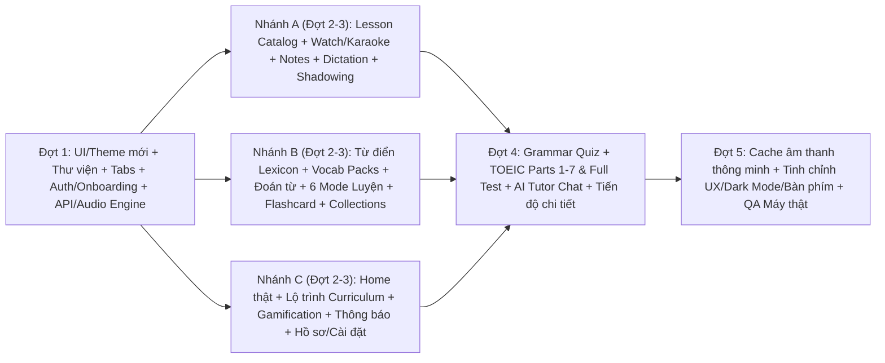

# Lyreo Mobile — Tài Liệu Bàn Giao Kỹ Thuật & Danh Mục Công Việc (Backlog)

> **Mục đích tài liệu:** Bản đặc tả bàn giao đầy đủ, tự chứa (self-contained) dành cho đội ngũ phát triển ứng dụng **Lyreo Mobile**. Tài liệu này mô tả hiện trạng thực tế của `apps/mobile/`, toàn bộ tính năng lớn và nhỏ đã có sẵn trên Backend (được đối chiếu trực tiếp từ mã nguồn), danh mục API liên quan, các quy tắc nghiệp vụ quan trọng, gợi ý mở rộng UX thân thiện với điện thoại, quy trình làm việc bắt buộc với AI Agent và bảng phân rã công việc theo thứ tự ưu tiên & phụ thuộc.
>
> **Tham chiếu gốc trong dự án:** Bản đồ tài liệu tại [docs/README.md](../README.md), hợp đồng HTTP tại [http-api-contract.md](../architecture/http-api-contract.md), tài liệu yêu cầu tại `docs/requirements/*.md`.

---

## 1. Quy Trình Làm Việc Bắt Buộc & Quyền Chủ Động Toàn Diện

### 1.1 Quy trình triển khai bắt buộc (Plan-First với Agent trong dự án)

Mỗi công việc trong tài liệu này **bắt buộc** đi theo đúng 4 bước sau — không nhảy thẳng vào viết code khi chưa có kế hoạch rõ ràng:

1. **Chọn 1 mã công việc (`MOB-xxx`)** theo đúng thứ tự ưu tiên và kiểm tra các mã phụ thuộc (`Phụ thuộc`) đã hoàn thành chưa.
2. **Đưa mã công việc vào AI Coding Agent đang mở trực tiếp repo `lyreo-platform`**, yêu cầu Agent:
   - Đọc phần mô tả miền tính năng, luật nghiệp vụ và bảng chi tiết công việc của `MOB-xxx` trong file này.
   - Đọc mã nguồn thật của các file Backend/Mobile và tài liệu sở hữu được liệt kê ở công việc đó.
   - **Lập kế hoạch triển khai (Plan) chi tiết trước khi sửa code**: nêu rõ màn hình/component sẽ tạo hoặc sửa, luồng gọi API, thư viện dự kiến cài thêm (nếu có), phần Backend/DB cần điều chỉnh (nếu có) và cách kiểm thử.
3. **Duyệt Plan trước khi code:** Chỉ bắt đầu triển khai sau khi người phụ trách đã xem và đồng ý với Plan (đặc biệt khi Plan có thay đổi giao diện lớn, thêm thư viện native hoặc chỉnh API/DB).
4. **Triển khai & Kiểm chứng thực tế:** Chạy đủ bộ kiểm tra tự động trước khi đóng công việc:
   - `pnpm --filter @lyreo/mobile typecheck && pnpm --filter @lyreo/mobile test`
   - `make validate`
   - Nếu có sửa Backend Java: `./mvnw -B -pl modules/<module-đã-sửa>,apps/core-service -am verify`

### 1.2 Quyền sửa xuyên tầng (Frontend, Backend, Logic, API, Header & Database)

Đội Mobile **KHÔNG bị trói tay ở tầng giao diện**. Nếu một thiết kế API, payload response/request, header, quy tắc lọc hay luồng xử lý hiện tại khiến Frontend phải gồng gánh logic phức tạp, xử lý nặng hoặc gây trải nghiệm kém trên điện thoại, đội Mobile **được phép chủ động sửa xuyên tầng**:

- **Backend Java (`modules/*`, `libs/contracts/*`, `apps/core-service/*`):** Được phép thêm field vào DTO trả về, thêm tham số lọc/phân trang, thêm endpoint tổng hợp (BFF) cho màn hình Mobile, điều chỉnh định dạng request/response/header, bổ sung xử lý phía server (ví dụ: tự xoay ảnh EXIF khi upload avatar, trả sẵn danh sách token xáo trộn cho chế độ Dictation kéo từ, bổ sung `intervalPreviews` cho `/vocabulary/due`, v.v.).
- **Database (`apps/core-service/src/main/resources/db/migration/`):** Được phép tạo thêm migration mới nối tiếp (`V021__...sql`, `V022__...sql`, ...). **Tuyệt đối không sửa** các file migration cũ đã áp dụng (`V001`..`V020`).
- **Tài liệu & Hợp đồng (`docs/`):** Khi cố ý thay đổi API, quy tắc nghiệp vụ hoặc biến môi trường, cập nhật đồng bộ [http-api-contract.md](../architecture/http-api-contract.md), tài liệu `docs/requirements/*.md` liên quan và `.env.example`.

**Chỉ cần giữ đúng 4 ranh giới nền tảng (được CI & `ArchitectureTest` bảo vệ):**
1. **Kiến trúc Spring Modulith:** Các module Backend chỉ giao tiếp qua public/named API, shared contracts hoặc domain events; không import repository hay query trực tiếp bảng nội bộ của module khác.
2. **Server nắm quyền quyết định điểm, thưởng & quyền truy cập:** Client không tự gửi điểm số (`score`), `xp`, `diamonds` hay tự đánh dấu `completed`; mọi thao tác ghi quan trọng cần `Idempotency-Key` và `revision`.
3. **Bảo mật & Quyền riêng tư:** Không đưa secret/API key vào biến `EXPO_PUBLIC_*`; không trả raw storage key (R2/local path) cho client (luôn đi qua HTTP media endpoint được bảo vệ); `expo-secure-store` chỉ dùng trong `apps/mobile/src/auth/`.
4. **Quy tắc giao diện & i18n để `make validate` xanh ([frontend.py](../../tooling/repo_checks/frontend.py)):**
   - Giữ hệ thống theme/component của Mobile tách biệt với `apps/admin-web`.
   - Không viết cứng mã màu hex/rgb trực tiếp trong JSX/`StyleSheet` — mọi màu phải khai báo qua semantic token trong `src/theme/primitives.ts` và `src/theme/semantic.ts` (không import `primitiveColors` ngoài thư mục `src/theme/`).
   - Mọi khóa dịch `t('...')` phải khai báo đủ cả tiếng Anh và tiếng Việt trong `packages/i18n/src/locales/{en,vi}/mobile.json`.

### 1.3 Nguyên tắc Công nghệ & Thư viện MỞ (Chỉ gợi ý tham khảo, không gò bó)

> **Lưu ý quan trọng:** Các thư viện được nhắc tới trong tài liệu này **chỉ là gợi ý tham khảo (RCM)**, **KHÔNG phải danh sách bắt buộc hay giới hạn cứng**.

- `apps/mobile/` hiện mới dừng ở khung khởi tạo cơ bản trên **Expo + React Native + Expo Router**. Giao diện, bảng màu và component cũ chỉ là **đồ dựng tạm (scaffold)** để test build và login.
- **Khuyến khích tìm tòi và chọn công nghệ tốt nhất:** Đội Mobile được tự do nghiên cứu, đề xuất phương pháp UX mới và cài đặt các thư viện hiện đại, phổ biến, được duy trì tốt cho Expo/React Native để app thật đẹp, mượt và có cảm giác "xịn" trên tay người dùng — ví dụ:
  - *UI & Styling:* Tự do thiết kế lại toàn bộ bảng màu, typography, spacing, bộ component (hoặc kết hợp thư viện UI phù hợp với NativeWind / React Native).
  - *Animation & Gesture:* `react-native-reanimated`, `react-native-gesture-handler`, `@gorhom/bottom-sheet`, `moti`, `lottie-react-native`...
  - *Danh sách hiệu năng cao:* `@shopify/flash-list` cho danh sách bài học/từ vựng/lịch sử dài.
  - *Audio, Video & Thu âm:* `expo-audio` / `react-native-track-player`, `react-native-youtube-iframe`, `react-native-webview`, thư viện vẽ waveform...
  - *Icon, Haptic, Ảnh, State/Cache:* `lucide-react-native`, `expo-image`, `expo-image-manipulator`, `expo-haptics`, `@tanstack/react-query` / `zustand`...
- **Yêu cầu duy nhất khi thêm thư viện native:** Phải tương thích **Expo Dev Client** (Lyreo **không hỗ trợ Expo Go** — sau khi thêm thư viện có native code cần rebuild Dev Client qua `make mobile-android-install` hoặc `expo prebuild` tương ứng) và giữ xanh `typecheck`, `test`, `make validate`.

---

## 2. Hiện Trạng Codebase `apps/mobile/` (Cần Biết Trước Khi Làm)

### 2.1 Những phần đã chạy thật & giữ lại làm nền
- **Xác thực OIDC PKCE (`apps/mobile/src/auth/`):** `oidc.ts`, `session-manager.ts`, `session-storage.ts` đã nối Keycloak và lưu refresh token an toàn bằng `expo-secure-store`.
- **Lớp gọi API & Map lỗi (`apps/mobile/src/api/`):** `client.ts` đã tự refresh token một lần khi gặp `401`; `errors.ts` đã map sẵn mã lỗi RFC 9457 (`FEATURE_ENTITLEMENT_REQUIRED`, `QUOTA_EXCEEDED`, `STALE_REVISION`, `SESSION_EXPIRED`, `IDEMPOTENCY_CONFLICT`, `PAYLOAD_TOO_LARGE`, `RATE_LIMITED`).
- **3 màn hình đã gọi API thật (nhưng cần mở rộng hoàn thiện):**
  - `notifications-screen.tsx`: đã có phân trang `hasMore` và chống race-condition khi kéo làm mới, còn thiếu trạng thái đã đọc/chưa đọc, lọc `unreadOnly`, nút `read` / `read-all` và deep-link.
  - `learner-progress.tsx`: đã nối `/api/v1/analytics/overview`, còn thiếu chỉ số trong ngày và danh sách các phiên luyện tập gần đây.
  - `settings.tsx`: đã lưu một phần preferences & đổi ngôn ngữ/theme máy, nhưng bố cục bị phẳng, thiếu control `preferredAccent` & `defaultPlaybackSpeed`, và câu báo lỗi đang hiển thị sai ngữ cảnh.

### 2.2 Những phần đang là đồ giả / lỗi thời cần đập đi làm lại
- **Theme & Màu sắc (`src/theme/primitives.ts`, `src/theme/semantic.ts`):** Đang chứa 3 bảng màu rác chồng chéo; ở Light mode `background === secondary === muted` (`#F5F5F4`) và `surface === surfaceElevated` (`#FFFFFF`) khiến thẻ và nút bị chìm hoàn toàn. Cần thiết kế lại hệ màu sạch, có chiều sâu ở cả Sáng và Tối.
- **Vỏ App (`src/providers/AppProviders.tsx`):** Đang bọc cứng `<SafeAreaView>` quanh toàn bộ ứng dụng, làm hỏng layout tràn viền, thanh bottom tab và bottom sheet. Phải chuyển xử lý safe-area về từng màn hình/tab.
- **UI Kit (`src/components/ui/`):** Mới có đúng 3 file sơ sài (`button`, `card`, `text`), chưa có thư viện icon (đang dùng emoji `💎` và chữ ASCII `▂▄▆█`).
- **Trang chủ (`home-screen.tsx`) & `account-summary.tsx`:** Toàn bộ số liệu (`"💎 240"`, `"LEVEL 12"`, `"82%"`, `"18"`, `"25m"`) là dữ liệu giả cứng; `account-summary.tsx` là hộp debug chữ `"Loaded securely from GET /api/v1/me"`.
- **Màn Lesson (`app/(app)/lesson.tsx`):** 100% là màn hình giả tĩnh (waveform giả, điểm 84 giả, nút thu âm không hoạt động).
- **Auth & Onboarding:** Chưa kiểm tra vai trò `ROLE_LEARNER` từ `/api/v1/me` (chặn lịch sự nếu đăng nhập nhầm acc Admin), chưa có luồng Onboarding 3 bước khi `onboarded = false`, chưa lưu PKCE state chống Android kill process khi chuyển sang trình duyệt đăng nhập, chưa hiện rõ thông báo khi tài khoản bị khóa (`401`), chưa có `AppState` listener.
- **API Client (`client.ts` & `use-core-resource.ts`):** Hiện ép mọi response 2xx phải là JSON (chưa tải binary/blob, chưa đọc header `Location`/`ETag`), còn `useCoreResource` đang nuốt object `ApiError` chi tiết và xóa trắng màn hình mỗi lần focus lại.

---

## 3. Bản Đồ Tính Năng Chi Tiết Theo Miền & Toàn Bộ API Liên Quan

Phần này liệt kê **đầy đủ mọi tính năng lớn và nhỏ** đã có sẵn trên Backend (kiểm chứng trực tiếp từ controller & domain model) kèm các **gợi ý UX nâng cao cho Mobile** để đội phát triển không bỏ sót bất kỳ giá trị nào.

### 3.1 Xác thực, Hồ sơ, Cài đặt & Quyền gói (`identity`, `learner`, `entitlement`)

- **API liên quan:**
  - `GET /api/v1/me` — trả `id`, `subject`, `email`, `roles[]` (kiểm tra phải có `ROLE_LEARNER`).
  - `GET /api/v1/learner/profile` — trả `{ userId, onboarded, profile }` (gồm `displayName`, `currentLevel`, `goal`, `dailyMinutes`, `focusArea`, `toeicTargetScore`, `preferences`, `starterSuggestion`, `avatarPreset`, `avatarUploadId`, `avatarUrl`).
  - `PUT /api/v1/learner/onboarding` — gửi `{ goal, currentLevel, dailyMinutes, toeicTargetScore? }` (`goal`: `CONVERSATION|WORK|TOEIC|UNDECIDED`; `currentLevel`: `A1..C2|UNKNOWN`; `dailyMinutes`: `5..240`; `toeicTargetScore`: `10..990` bội 5).
  - `PATCH /api/v1/learner/profile` — sửa từng phần hồ sơ (`displayName`, `goal`, `currentLevel`, `dailyMinutes`, `focusArea` (`LISTENING|SPEAKING|VOCABULARY|GRAMMAR`), `toeicTargetScore`, `avatarPreset`).
  - `GET /api/v1/learner/profile/avatar` (hỗ trợ header `If-None-Match` trả `304`) & `PUT /api/v1/learner/profile/avatar` (`multipart/form-data`, part `file`, JPEG/PNG ≤ 2 MiB, ≤ 4096×4096).
  - `GET /api/v1/learner/preferences` & `PUT /api/v1/learner/preferences` — gồm đủ 9 tùy chọn: `preferredAccent` (`US|UK`), `translation`, `sentenceIpa`, `vocabularyNotes`, `grammarNotes` (4 timing modes: `ALWAYS|AFTER_ATTEMPT|TAP_TO_SHOW|OFF`), `thoughtGroups` (bool), `karaokeHighlighting` (bool), `properNounHints` (bool), `defaultPlaybackSpeed` (`0.5..2.0`).
  - `GET /api/v1/entitlements` (alias: `GET /api/v1/learner/entitlements`) — trả `tier` (`FREE|PLUS`), `validUntil`, danh sách feature và hạn mức quota (`limit`, `used`, `remaining`, `resetAt` UTC).
- **Chi tiết & Lưu ý quan trọng:**
  - **Không có Guest Mode:** Mọi API học tập đều yêu cầu JWT hợp lệ có `ROLE_LEARNER`.
  - **Xoay ảnh EXIF cho Avatar:** Backend hiện chuẩn hóa JPEG/PNG nhưng chưa tự xoay theo cờ EXIF Orientation từ camera điện thoại. Mobile có thể xử lý bằng `expo-image-manipulator` trước khi upload **hoặc** nâng cấp `LearnerAvatarImage.java` ở Backend để tự xoay EXIF phía server.
  - **Phân biệt Preference tài khoản vs State phiên học (`FR-IDN-004`):** Tốc độ phát, lặp câu, bật/tắt dịch tạm khi đang học bài chỉ là state phiên; không tự ghi đè `PUT /preferences` trừ khi người dùng đổi trong Cài đặt.

### 3.2 Bài Học — Trung Tâm Nghe, Karaoke, Chép Chính Tả, Shadowing & Ngữ Cảnh (`lesson`, `speech-assessment`)

Đây là miền giàu tính năng nhất của Lyreo. Mỗi bài học (`Lesson`) tách rõ **Nội dung ngữ cảnh (câu, mốc thời gian từng từ, dịch, IPA, từ vựng đáng học, điểm ngữ pháp, ghi chú, cụm ngắt hơi)** và **3 Hoạt động luyện tập (`WATCH`, `DICTATION`, `SHADOWING`)**:

- **API liên quan:**
  - `GET /api/v1/lessons` — danh mục bài `PUBLISHED`, hỗ trợ lọc `categoryId`, `cefr`, `sourceType` (`TEXT|YOUTUBE`), `activity` (`WATCH|DICTATION|SHADOWING`), tìm kiếm `q`, phân trang `page`/`size` (`hasMore`), trả sẵn `locked`, `accessMode`, `requiredFeatureKey`, `audioReady`, `progress`.
  - `GET /api/v1/lessons/categories` — danh sách chủ đề kèm số lượng bài (`lessonCount`) và bản dịch tên (`translations`).
  - `GET /api/v1/lessons/{lessonId}` — tổng quan bài học: `revision`, `videoId`, `sourceStartMs`, `sourceEndMs`, `audioReady`, `cefr`, `accent`, `activities[]` (kèm `status`, `completedItems`, `totalItems`, `bestScore`), `sentences[]` (kèm `dictationSelected`, `shadowingSelected`).
  - `GET /api/v1/lessons/{lessonId}/audio` — stream audio gốc, **hỗ trợ HTTP `Range` (`206 Partial Content`)** để tua/lặp mượt trên iOS & Android.
  - `GET /api/v1/lessons/{lessonId}/activities/{activityId}?hintLevel=NONE|EASY|MEDIUM&properNounHints=true|false` — trả `ActivityView` gồm danh sách `sentences[]` đầy đủ:
    - `text`, `expectedText` (ẩn khi Dictation chưa thử), `attempted`, `words[]` (mốc `startMs`, `endMs`, `charStart`, `charEnd`, `masked`).
    - `properNounHints[]` (`tokenIndex`, `surfaceText` — tên riêng, số, từ viết tắt).
    - `translation` (dịch tiếng Việt), `ipa`, `ipaAccent`, `ipaVersion`.
    - **`vocabulary[]`** (từ vựng đáng học trong câu: `tokenStart`, `tokenEnd`, `surface`, `label`, `explanation`, `importance`, `canonicalForm`, **`headwordId`**).
    - **`grammar[]`** (điểm ngữ pháp đáng học trong câu: `tokenStart`, `tokenEnd`, `surface`, `label`, `explanation`, `importance`).
    - **`notes[]`** (ghi chú sắc thái/ngữ cảnh/cách dùng tự nhiên: `tokenStart`, `tokenEnd`, `text`, `kind`).
    - **`thoughtGroups[]`** (cụm ngắt hơi/ngắt ý: `tokenStart`, `tokenEnd` — cực hữu ích khi đọc & Shadowing).
    - `latestScore`, `bestScore`, `latestAttempt`.
  - `POST /api/v1/lessons/{lessonId}/activities/{activityId}/complete` (header `Idempotency-Key`) — đánh dấu hoàn thành hoạt động `WATCH`.
  - `POST /api/v1/lessons/{lessonId}/activities/{activityId}/dictation/attempts` (header `Idempotency-Key`) — body `{ sentenceId, answer }`, server chấm và trả `{ attemptId, serverScore, expectedText, completedItems, totalItems, activityCompleted, lessonCompleted }`.
  - `GET /api/v1/lessons/{lessonId}/attempts` — lịch sử lượt làm, lọc theo `activityId`, `activityType`, `sentenceId`, phân trang.
  - **Shadowing (luồng bất đồng bộ):**
    - `GET /api/v1/lessons/{lessonId}/activities/{activityId}/shadowing/sentences/{sentenceId}/constraints?revision=...` — trả `maxDurationSeconds`, `maxUploadBytes` (8 MiB), `startMs`, `endMs`, `quotaAllowed`, `tier`, `quotaLimit`, `quotaRemaining`, `quotaResetAt`, `lockReason` (báo `409 STALE_REVISION` nếu bài đổi phiên bản).
    - `POST /api/v1/lessons/{lessonId}/activities/{activityId}/shadowing/sentences/{sentenceId}/attempts?revision=...` (`multipart/form-data`, part `audio`, **bắt buộc header `Idempotency-Key` là UUID hợp lệ**) — nhận `202 Accepted` + header `Location` + `{ attemptId, jobId, expiresAt, quotaLimit, quotaRemaining, quotaResetAt }`.
    - `GET /api/v1/shadowing-attempts/{id}` — poll trạng thái job (`QUEUED|RUNNING|SUCCEEDED|FAILED|CANCELLED`), trả `overallScore`, `outcome` (`OK|NO_SPEECH|...`), `audioAvailable`, `result` (chi tiết điểm Accuracy/Fluency/Completeness/Prosody + từng từ/âm vị IPA; đã lọc sạch `providerRaw`).
    - `GET /api/v1/shadowing-attempts/{id}/audio` — nghe lại bản thu của chính học viên (HTTP `Range 206`, lưu 24 giờ).
    - `POST /api/v1/shadowing-attempts/{id}/cancel` — hủy lượt chấm đang chờ/chạy.
- **Các chế độ & Ý tưởng mở rộng UX đáng làm trên Mobile:**
  1. **Chế độ Chỉ Nghe / Xem Karaoke (`WATCH`):** Hỗ trợ cả Audio bài đọc (`TEXT`) và Video YouTube (`YOUTUBE` theo đoạn `sourceStartMs..sourceEndMs`), bôi sáng từng từ khớp `words[].startMs..endMs`, bấm vào câu nào nhảy nghe ngay câu đó, lặp 1 câu A–B, chỉnh tốc độ phát (`0.5x–1.5x`), hiển thị dấu ngắt hơi `thoughtGroups` trực tiếp trên câu.
  2. **Lớp kiến thức ngữ cảnh trong bài:** Nút bật/tắt nhanh dịch tiếng Việt, IPA cả câu, highlight **từ vựng đáng học (`vocabulary[]`)**, **ngữ pháp đáng học (`grammar[]`)** và **ghi chú (`notes[]`)**; chạm vào từ vựng hoặc từ bất kỳ mở bottom-sheet tra từ điển (`by-headword/{headwordId}`) và lưu vào Sổ từ cá nhân chỉ 1 chạm.
  3. **Chế độ Nghe – Chép chính tả (`DICTATION`) đa mức & gợi ý Word Pool:**
     - Hỗ trợ đủ 3 mức gợi ý có sẵn ở Backend: `NONE` (nghe chép toàn bộ câu), `EASY` (đục lỗ mức dễ, giữ ngữ cảnh), `MEDIUM` (đục lỗ vừa) kèm công tắc hiện tên riêng/số (`properNounHints`).
     - **Ý tưởng UX rất đáng làm cho Mobile (RCM):** Gõ cả câu dài trên bàn phím điện thoại dễ mỏi tay. Team có thể làm thêm **chế độ Chọn/Kéo từ từ Word Pool (Word Bank)** song song với chế độ gõ bàn phím: người học chạm hoặc kéo các thẻ từ xáo trộn để lắp thành câu rồi gửi chuỗi ghép lên đúng API `POST .../dictation/attempts`! *(Vì Backend hiện ẩn `expectedText` trước khi nộp để chống lộ đáp án, team được toàn quyền thêm 1 trường `wordPool: string[]` đã xáo trộn phía server trong `SentenceView` hoặc 1 query param như `includeWordPool=true` nếu muốn bật chế độ này sạch sẽ mà vẫn giữ bảo mật đáp án!)*
     - Sau khi nộp, hiển thị diff so sánh từ đúng / sai / thiếu / dư với `expectedText`, mở khóa dịch/IPA/từ vựng/ngữ pháp của câu đó (`attempted = true`).
  4. **Chế độ Nói theo chấm điểm (`SHADOWING`):** Ghi âm AAC `.m4a` (Backend gắn sẵn `ffmpeg` tự chuyển sang 16kHz mono WAV cho Azure; tránh `.3gp` và `.caf`), nghe lại bản vừa thu trước khi gửi, xem phân tích màu sắc từng từ & từng âm vị IPA đọc sai/thiếu/thừa và nghe lại giọng mình đối chiếu với giọng mẫu.

### 3.3 Từ Điển Tra Cứu Toàn Hệ Thống (`lexicon`)

- **API liên quan:**
  - `GET /api/v1/lexicon/search?q=...&limit=1..50` — tìm kiếm từ điển, trả danh sách tóm tắt theo thứ tự xếp hạng server (không tự sắp xếp lại ở client) + `hasMore`.
  - `GET /api/v1/lexicon/{id}` — chi tiết mục từ theo `entryId`.
  - `GET /api/v1/lexicon/by-headword/{headwordId}` — tra nhanh trực tiếp từ `headwordId` (dùng khi chạm vào từ vựng trong Lesson hoặc thẻ đã lưu).
  - `GET /api/v1/lexicon/{id}/pronunciations/{pronunciationId}/audio` — phát âm theo từng vùng giọng UK/US (hỗ trợ HTTP `Range 206`).
- **Tính năng nhỏ cần làm đủ:**
  - Chuyển đổi sạch 2 chế độ đọc **`readingModes` (`en-vi` Anh–Việt và `en-en` Anh–Anh)** theo đúng nguồn, không trộn lẫn hai nguồn ở client; thông báo rõ nếu mục từ chỉ có bản tiếng Anh.
  - Hiển thị đầy đủ từ loại, phiên âm IPA theo vùng giọng, nút nghe từng phát âm, nghĩa phân nhánh kèm ví dụ, họ từ, và nút **Lưu từng nghĩa cụ thể** vào bộ sưu tập cá nhân.

### 3.4 Từ Vựng — 4 Trụ Cột Ngang Hàng (`vocabulary`)

> **Lưu ý sản phẩm quan trọng:** Module Từ vựng của Lyreo **KHÔNG chỉ có Flashcard**! Trong mã nguồn Backend (`VocabularyStudyController`, `VocabularyExerciseGenerator`, `VocabularyCollectionController`), **Đoán từ (`GUESS_WORD`) và 7 chế độ luyện tập tương tác có chiều sâu ngang hàng — thậm chí mang tính trải nghiệm học tập cao hơn cả Flashcard**, song song với Bộ từ chuẩn (Packs/Units) và Sổ từ cá nhân (Collections). Cần thiết kế UX làm nổi bật đồng đều cả 4 trụ cột này:

- **Trụ cột 1 — Khám phá Bộ từ chuẩn (Packs & Units) giàu đa phương tiện:**
  - `GET /api/v1/vocabulary/packs` — danh sách bộ từ (Word Atlas, TOEIC packs...), có `locked`, `accessMode`, thống kê số unit/từ.
  - `GET /api/v1/vocabulary/packs/{packId}/cover` (hỗ trợ `If-None-Match` `304`).
  - `GET /api/v1/vocabulary/packs/{packId}/units` — danh sách Unit kèm trình độ CEFR, số từ, tiến độ.
  - `GET /api/v1/vocabulary/units/{unitId}` — chi tiết tất cả từ trong Unit (tối đa 30 từ/unit): ảnh minh họa, phát âm **UK**, **US**, **audio câu ví dụ 1 (`exampleAudioUrl`)**, **audio câu ví dụ 2 (`secondExampleAudioUrl`)**, nhiều nghĩa `senses[]` (`pos`, `definitionEn`, `meaningVi`), `examples[]`, `examplesVi[]`, `collocations[]`, `family[]`, `synonyms[]`, `antonyms[]`, `contextNotes[]`.
  - `GET /api/v1/vocabulary/entries/{entryId}/media/{assetId}` — tải ảnh/audio của từ (hỗ trợ HTTP `Range 206`).
- **Trụ cột 2 — Đoán Từ Tương Tác (`GUESS_WORD`) — Chế độ chủ lực ngang hàng Flashcard:**
  - Tạo phiên qua `POST /api/v1/vocabulary/units/{unitId}/sessions` hoặc `POST /api/v1/vocabulary/packs/{packId}/sessions` với `{ mode: "GUESS_WORD", limit?, entryIds? }` (header `Idempotency-Key`).
  - Mỗi câu trả về: gợi ý nghĩa tiếng Việt/tiếng Anh, từ loại, IPA, ảnh/audio, chuỗi che chữ cái `maskedTerm` (VD: `******`), `maxHints`, `hintsUsed`, `hintsRemaining`, `revealedPositions[]`, `checked`, `gaveUp`.
  - **Vòng tương tác trực tiếp từng câu:**
    - `POST /api/v1/vocabulary/sessions/{id}/questions/{questionId}/hint` — mở hé thêm 1 chữ cái từ trái sang phải (`p*****` → `pe****`), cập nhật `hintsRemaining`.
    - `POST /api/v1/vocabulary/sessions/{id}/questions/{questionId}/check` — gửi `{ revision, answer, giveUp }` để chấm ngay câu đang đoán hoặc chọn "Đầu hàng xem đáp án" (`giveUp: true`). Câu đã check sẽ bị khóa không cho sửa lại.
    - `POST /api/v1/vocabulary/sessions/{id}/submit` — tổng kết toàn phiên (`correctCount`, `totalCount`, `accuracyPercent`, `questions[]` feedback chi tiết gồm số gợi ý đã dùng & câu nào đầu hàng).
- **Trụ cột 3 — 6 Chế độ Luyện tập Chuyên sâu & Trộn nhiều dạng (`MIXED`) + Lưu nháp 24h:**
  - `POST /api/v1/vocabulary/units/{unitId}/sessions` & `POST /api/v1/vocabulary/packs/{packId}/sessions` (header `Idempotency-Key`) — hỗ trợ truyền 1 `mode` hoặc nhiều `modes[]` (kèm `mode: "MIXED"`), `limit` (`1..100`), và **`entryIds[]`** (tùy chọn, dùng khi vào từ một lát cắt Curriculum để luyện đúng nhóm từ được giao trong khi vẫn lấy nhiễu 4 đáp án từ toàn bộ Unit/Pack!).
  - 6 dạng bài đã được Backend sinh câu chuẩn xác:
    1. `CHOOSE_MEANING`: Nhìn từ/nghe phát âm → chọn nghĩa đúng trong 4 phương án A/B/C/D.
    2. `CHOOSE_WORD`: Đọc nghĩa → chọn đúng từ tiếng Anh trong 4 phương án.
    3. `LETTER_SCRAMBLE`: Backend trả sẵn `scrambledLetters[]` và `wordLengths[]` → **cực hợp UX chạm/kéo thẻ chữ ghép thành từ trên Mobile!**
    4. `MISSING_LETTERS`: Điền chữ cái còn thiếu theo `maskedTerm` và `blankPositions[]`.
    5. `LISTEN_WRITE`: Nghe `audioId` (`ukAudioId`/`usAudioId`) và viết lại từ.
    6. `CONTEXT_CLOZE`: Đọc câu ví dụ đục lỗ (`clozeSentence`, `spanStart`, `spanEnd`, kèm dịch `exampleVi`) và điền từ đúng dạng ngữ cảnh.
  - Quản lý phiên: `GET /api/v1/vocabulary/sessions?packId=&unitId=&status=&page=&size=` (xem phiên `OPEN` đang làm dở 24h hoặc lịch sử `SUBMITTED`), `GET /api/v1/vocabulary/sessions/{id}`, `PUT /api/v1/vocabulary/sessions/{id}/answers` (auto-save kèm `revision`), `POST /api/v1/vocabulary/sessions/{id}/submit` (header `Idempotency-Key`).
  - *Quy tắc:* Các phiên luyện tập & đoán từ **không làm thay đổi lịch ôn Flashcard SRS** (`FR-VOC-003`).
- **Trụ cột 4 — Học Flashcard SRS & Sổ Từ Cá Nhân (Collections + `/due`):**
  - **Flashcard bộ chuẩn:**
    - `GET /api/v1/vocabulary/flashcards?unitId=&packId=&scope=DUE_AND_NEW|ALL&limit=1..200` — trả sẵn bộ đếm chi tiết `counts` (`dueAndNewUnit`, `allUnit`, `dueAndNewPack`, `allPack`, `dueCount`, `newCount`, `learningCount`, `masteredCount`) và danh sách thẻ có sẵn `intervalPreviews` cho 4 nút `AGAIN|HARD|GOOD|EASY`.
    - `POST /api/v1/vocabulary/entries/{entryId}/flashcard-review` (header `Idempotency-Key`, body `{ rating, expectedReviewCount }`) — cập nhật SRS (`NEW|LEARNING|REVIEW|MASTERED`). Lưu ý: ở chế độ `ALL`, ôn lại thẻ chưa đến hạn vẫn cập nhật SRS nhưng server không cộng thưởng nhiệm vụ lặp.
  - **Sổ từ cá nhân & Bộ sưu tập (Collections):**
    - `POST /api/v1/vocabulary/saved-items` (header `Idempotency-Key`) — lưu từ từ Lesson, Lexicon, Vocabulary Entry (chọn đúng `senseIndex` / `lexiconSenseId` để lưu **nhiều nghĩa khác nhau của cùng 1 từ thành các thẻ riêng**) hoặc tự nhập từ `CUSTOM`, gắn thẳng vào nhiều `collectionIds[]`.
    - `GET /api/v1/vocabulary/collections`, `POST /api/v1/vocabulary/collections` (`name`, `coverPreset`), `PATCH /api/v1/vocabulary/collections/{id}`, `DELETE /api/v1/vocabulary/collections/{id}` (bộ mặc định "Đã lưu" không thể xóa — `409`; khi xóa bộ tùy chỉnh, các từ mồ côi tự động chuyển an toàn về "Đã lưu").
    - `GET /api/v1/vocabulary/collections/{id}/items?q=&page=&size=`, `POST .../items`, `DELETE .../items/{cardId}`, `POST /api/v1/vocabulary/collections/{id}/move` (chuyển hàng loạt từ sang bộ khác).
    - `GET /api/v1/vocabulary/saved-items/{cardId}/media/{assetId}` (Range 206).
    - `GET /api/v1/vocabulary/due?page=&size=` & `POST /api/v1/vocabulary/cards/{cardId}/review` (header `Idempotency-Key`, `{ rating, expectedReviewCount }`) & `DELETE /api/v1/vocabulary/cards/{cardId}` — ôn SRS riêng cho sổ từ cá nhân (cũng áp dụng luật chống cộng thưởng lặp khi thẻ chưa đến hạn).

### 3.5 Lộ Trình Học Tập (`curriculum`)

- **API liên quan:**
  - `GET /api/v1/curriculum/paths` — danh sách lộ trình `PUBLISHED` (kèm `locked`, tiến độ `completedRequiredItems`/`totalRequiredItems`, `enrollmentStatus`).
  - `GET /api/v1/curriculum/paths/{id}/cover` (hỗ trợ `If-None-Match` `304`).
  - `GET /api/v1/curriculum/paths/{id}` — chi tiết cây `sections[] -> items[]` với `contentType` (`LESSON|VOCABULARY_REVIEW|GRAMMAR_PRACTICE|TOEIC_DRILL|TOEIC_TEST`), `contentReferenceId`, `required`, `unlockRule`, `config`, `progressStatus` (`LOCKED|UNLOCKED|IN_PROGRESS|COMPLETED`).
  - `POST /api/v1/curriculum/paths/{id}/enroll` — đăng ký lộ trình (idempotent).
  - `GET /api/v1/curriculum/continue` — mục học tiếp theo để gắn vào nút **"Tiếp tục học"** 1 chạm ở Trang chủ & sau khi hoàn thành bài.
- **Chi tiết quan trọng:**
  - **Bẫy pre-enroll:** Khi người dùng chưa đăng ký lộ trình, `enrollmentStatus` là `null` và tất cả item trả `LOCKED`. UI phải kiểm tra `enrollmentStatus == null` để hiện nút **"Bắt đầu lộ trình / Enroll"**, không báo nhầm là các bài đang bị khóa!
  - **Deep-link đúng lát cắt (`item.config`):** Backend hỗ trợ chia 1 bài học/unit thành nhiều lát cắt nhỏ trong lộ trình:
    - `LESSON`: đọc `config.activityType` (`WATCH|DICTATION|SHADOWING`) và `config.sentenceIds[]` → mở thẳng đúng chế độ và lọc/ưu tiên đúng nhóm câu đó (hoàn thành đủ `sentenceIds` là tự đánh dấu xong mục lộ trình, không bắt làm thừa các câu ngoài slice!).
    - `VOCABULARY_REVIEW`: đọc `config.entryIds[]` → truyền thẳng `entryIds` vào `POST /api/v1/vocabulary/units/{unitId}/sessions` để luyện đúng nhóm từ của mục đó.
    - `GRAMMAR_PRACTICE`: đọc `config.subtopicIds[]`, `config.questionCount`.
    - `TOEIC_DRILL` / `TOEIC_TEST`: đọc `config.parts[]`, `config.questionCount`.

### 3.6 Luyện Ngữ Pháp & TOEIC (`grammar`, `toeic`, `assessment`)

Cả Grammar và TOEIC đều dùng chung động cơ phiên làm bài `/api/v1/assessment-sessions/**` (lưu nháp tự động, khóa lạc quan `revision`, hết hạn 24 giờ `409 SESSION_EXPIRED`):

- **API Grammar:**
  - `GET /api/v1/grammar/catalogs/{kind}/page` & `GET /api/v1/grammar/catalogs/{kind}/{id}` (`kind`: `topics`, `subtopics`, `banks`; hỗ trợ lọc `parentId`, `q`, `page`, `size`, nhận biết khóa thừa kế từ Topic cha).
  - `POST /api/v1/grammar/catalogs/{kind}/{id}/sessions` (header `Idempotency-Key`, body `{ limit }` tối đa `50` câu/lượt).
- **API TOEIC:**
  - `GET /api/v1/toeic/catalog/page` & `GET /api/v1/toeic/catalog/{id}` — trả danh sách đề TOEIC kèm phân bổ số câu từng Part 1–7 (`parts` breakdown), trạng thái khóa gói.
  - `POST /api/v1/toeic/catalog/{id}/sessions` (header `Idempotency-Key`) — chế độ `DRILL` (gửi `parts: [1..7]`, `questionCount?`) hoặc `FULL_TEST` (200 câu đủ 7 Part).
- **API Phiên làm bài chung (`assessment-sessions`):**
  - `GET /api/v1/assessment-sessions?domain=grammar|toeic&status=OPEN|SUBMITTED&catalogId=&page=&size=` — khôi phục phiên đang làm dở hoặc xem lịch sử.
  - `GET /api/v1/assessment-sessions/{id}` — chi tiết câu hỏi, nhóm đoạn văn (`stimulusGroups`), tài liệu đọc (`documents`), media ảnh/audio, đáp án đang chọn và kết quả sau nộp.
  - `PUT /api/v1/assessment-sessions/{id}/answers` — auto-save đáp án kèm `revision` (xử lý `409 STALE_REVISION`).
  - `POST /api/v1/assessment-sessions/{id}/submit` — nộp bài kèm `revision`, nhận điểm & giải thích EN/VI.
  - `GET /api/v1/assessment-sessions/{id}/media/{assetId}` — ảnh Part 1 và audio Part 1–4 (HTTP `Range 206`).
- **Chi tiết & Lưu ý quan trọng:**
  - **Điểm quy đổi TOEIC (`BR-TOE-001`):** Chế độ `DRILL` chỉ trả `accuracyPercent` và để điểm quy đổi (`listeningScaledScore`, `readingScaledScore`, `totalScaledScore`) là `null` — **tuyệt đối không tự bịa điểm thang 990 cho Drill**; chỉ hiển thị điểm quy đổi khi server trả không null ở `FULL_TEST`.
  - **Đặc thù từng Part trên Mobile:** Part 2 chỉ có đúng **3 đáp án A/B/C**; Part 1 & Part 2 ẩn nội dung nghe trước khi nộp (`audioOnly`); Part 6 giữ đúng số chỗ trống `gapNumber`; Part 7 (đọc hiểu 2–3 văn bản) nên làm giao diện chuyển tab gọn **"Đoạn văn / Câu hỏi"** kèm bảng nhảy câu nhanh để đọc thoải mái trên màn hình dọc.

### 3.7 Điểm Thưởng, Thông Báo, Tiến Độ & Trợ Lý AI (`gamification`, `notification`, `analytics`, `chat`)

- **Gamification (`modules/gamification`):**
  - `GET /api/v1/gamification/summary` — Level, XP hiện tại/mục tiêu lên cấp, Streak hiện tại & kỷ lục (tính theo ngày UTC), số dư Kim cương.
  - `GET /api/v1/gamification/missions` — danh sách Nhiệm vụ Daily & Weekly kèm tiến độ (`progress/target`, `completed`, `claimed`).
  - `POST /api/v1/gamification/missions/{missionId}/claim` (header `Idempotency-Key`) — **nhận thưởng thủ công** (UI cần nút Claim nổi bật khi nhiệm vụ đạt target; khóa nút khi đang gửi).
  - `GET /api/v1/gamification/achievements` & `GET /api/v1/gamification/achievements/{id}/badge` (`If-None-Match` `304`) — danh sách thành tựu cho tất cả chỉ số (Streak, Lesson, Vocabulary, TOEIC, Shadowing, Grammar) kèm tier huy hiệu.
  - `GET /api/v1/gamification/ledger?page=&size=` — sổ lịch sử Kim cương bất biến (có `balance` và phân trang `hasMore`).
- **Thông báo (`modules/notification`):**
  - `GET /api/v1/notifications?page=&size=&unreadOnly=false|true` — trả `{ items, total, page, size, hasMore, unreadCount }`, phân loại `SYSTEM`, `STUDY_REMINDER`, `REWARD`, `PROMO`.
  - `POST /api/v1/notifications/{id}/read` & `POST /api/v1/notifications/read-all`.
- **Tiến độ học tập (`modules/analytics`):**
  - `GET /api/v1/analytics/overview` — hoạt động hôm nay/tuần (`lessonCount`, `vocabularyReviewCount`, `grammarAnswerCount`, `toeicQuestionCount`, `activeDays`), tóm tắt theo kỹ năng (`skills[]` gồm `sampleCount`) và danh sách điểm yếu (`weaknesses[]`). *Lưu ý:* `studySeconds` hiện backend chưa ghi (trả `0`), nên ưu tiên hiển thị số bài/từ/câu/ngày học thực tế thay vì hiện `0m` (hoặc team có thể bổ sung cơ chế ghi nhận thời lượng ở Backend nếu cần).
- **Trợ lý AI English Tutor (`modules/chat`):**
  - `POST /api/v1/chat/ask` (header `Idempotency-Key`) — body `{ conversationId?, learnerLevel?, question, title? }`, trả `{ conversationId, messageId, answer, aiInvocationId, remainingQuota, quotaResetAt }`. Backend đã dùng cơ chế giữ/hoàn quota nên lỗi AI không trừ oan lượt dùng.
  - `GET /api/v1/chat/conversations?page=&size=`, `GET /api/v1/chat/conversations/{id}`, `PATCH /api/v1/chat/conversations/{id}` (đổi tiêu đề), `DELETE /api/v1/chat/conversations/{id}`.
  - *Gợi ý UX:* Gắn nút **"Hỏi AI Tutor"** ngay tại câu trong Lesson, từ vựng khó hoặc câu làm sai ở Grammar/TOEIC để điền sẵn ngữ cảnh câu hỏi (nếu cần gửi ngữ cảnh có cấu trúc riêng thay vì nối chuỗi vào `question`, team được phép mở rộng `AskRequest` ở Backend).

---

## 4. Môi Trường & Tài Khoản Chạy Thử Cục Bộ

Xem hướng dẫn chi tiết tại [apps/mobile/README.md](../../apps/mobile/README.md) và [ACCOUNT.md](../ACCOUNT.md). Chạy `make migrate && make seed` để có sẵn dữ liệu mẫu đầy đủ:
- **Học viên Plus (đầy đủ dữ liệu & quyền):** `demo-learner-minh-anh` / `Password123!` (đã onboard, full grant, có sẵn saved cards & curriculum đang học).
- **Học viên Free (test paywall & giới hạn quota):** `demo-learner-gia-huy` / `Password123!` (đã onboard, grant hết hạn).
- **Học viên mới (test Onboarding 3 bước & empty state):** `demo-learner-new` / `Password123!` (chưa onboard).
- **Cổng phát triển:** Metro chạy port **8082**; Android Emulator kết nối host qua `10.0.2.2`, máy thật qua USB dùng `adb reverse`.

---

## 5. Lộ Trình Thực Thi Theo Đợt & Phân Luồng Song Song

Sau khi hoàn tất **Đợt 1 (Nền tảng, Thiết kế lại UI & Hạ tầng Audio/API)**, nhóm có thể chia song song **3–4 nhánh độc lập**:



- **Đợt 1 — Dựng khung & Thiết kế lại Nền tảng (`MOB-001`..`MOB-007`):** Làm sạch toàn bộ giao diện scaffold cũ, chọn hệ màu/UI kit/thư viện mở, dựng 5 tab điều hướng, hoàn thiện Auth + Onboarding 3 bước, nâng cấp API Client và Audio/Mic Engine.
- **Đợt 2 — Vòng Học Cốt Lõi Hàng Ngày (`MOB-101`..`MOB-107`, `MOB-201`..`MOB-203`):** Trang chủ dữ liệu thật, Lộ trình Curriculum + deep-link slice, Lesson (Catalog, Watch/Karaoke, Lớp từ vựng/ngữ pháp/ghi chú, Dictation đa mức + Word Pool), Từ điển Lexicon, Bộ từ vựng Packs/Units và chế độ **Đoán từ (`GUESS_WORD`)**.
- **Đợt 3 — Luyện Tập Chuyên Sâu & Giữ Chân (`MOB-108`..`MOB-109`, `MOB-204`..`MOB-206`, `MOB-401`..`MOB-403`, `MOB-405`..`MOB-406`):** Shadowing chấm điểm AI + phân tích âm vị + lịch sử bài, 6 chế độ luyện từ vựng & `MIXED`, Flashcard SRS, Sổ từ cá nhân Collections & `/due`, Gamification Hub (Claim thủ công, Achievements, Diamond Ledger), Thông báo hoàn chỉnh, Hồ sơ/Avatar & Cài đặt/Gói thành viên.
- **Đợt 4 — Mở Rộng Luyện Thi & Trợ Lý AI (`MOB-301`..`MOB-304`, `MOB-404`):** Grammar Quiz, TOEIC Parts 1–5, TOEIC Part 6–7 & Full Test dạng chuyển tab gọn, Trợ lý AI Tutor ngữ cảnh.
- **Đợt 5 — Tối Ưu Hiệu Năng & Kiểm Thử Máy Thật (`MOB-501`..`MOB-503`):** Prefetch/cache âm thanh thông minh, tinh chỉnh bàn phím/haptics/Dark Mode/tiếng Việt, QA thông suốt trên Emulator & thiết bị thật.

---

## 6. Danh Mục Phân Rã Công Việc Chi Tiết

> **Giải thích cột:**
> - **Ưu tiên:** `P0` (Bắt buộc làm trước — xương sống app), `P1` (Quan trọng — hoàn thiện đầy đủ trải nghiệm học), `P2` (Nâng cao — tối ưu & hoàn thiện phát hành).
> - **Cỡ việc:** `S` (0.5 ngày), `M` (1–2 ngày), `L` (2–4 ngày), `XL` (4–5 ngày).
> - **Phụ thuộc / Liên quan:** Liệt kê rõ các mã công việc phải làm trước (`Cần trước:`) và các màn hình/công việc kết nối qua lại (`Liên quan:`).
> - **Cho phép sửa BE/DB:** Ghi chú sẵn các gợi ý cải tiến Backend/DB nên cân nhắc nếu giúp FE mượt hơn.

| Mã | Đợt | Ưu tiên | Nhóm việc | Tên công việc | Hiện trạng | Cỡ | Phụ thuộc / Liên quan | API liên quan | Tài liệu & Mã nguồn cần đọc | Chi tiết tính năng, Luật nghiệp vụ & Gợi ý mở rộng BE/UX | Tiêu chí hoàn thành |
|---|---|---|---|---|---|---|---|---|---|---|---|
| MOB-001 | Đợt 1 | P0 | Nền tảng & UI | Thiết kế lại hệ màu, typography & semantic theme Sáng/Tối | Scaffold cũ | L | Cần trước: - ; Liên quan: MOB-003, MOB-004 | - | `apps/mobile/src/theme/primitives.ts`, `semantic.ts`, `foundation.json`, `tailwind.config.js` | Xóa 3 bảng màu rác chồng chéo; phân tầng nền/card/pill rõ ràng cho cả Light & Dark mode; tạo token trạng thái (XP, streak, đúng/sai, waveform, badge Plus). Giữ toàn bộ màu trong `src/theme/{primitives,semantic}.ts` để qua `make validate`. | Giao diện Sáng/Tối có chiều sâu, độ tương phản tốt; `typecheck` & `make validate` xanh |
| MOB-002 | Đợt 1 | P0 | Nền tảng & UI | Research & cài đặt thư viện Expo/RN mở (Audio, Video, Icon, Ảnh, Animation...) + Build Dev Client | Chưa làm | M | Cần trước: - ; Liên quan: MOB-004, MOB-007, MOB-105, MOB-108, MOB-405 | - | `apps/mobile/package.json`, `app.json`, `README.md`, `Makefile` (`mobile-android-install`) | Chủ động chọn các thư viện tốt nhất cho Expo Dev Client (RCM: `expo-audio`, `react-native-youtube-iframe`, `react-native-webview`, `lucide-react-native`, `expo-image`, `expo-image-manipulator`, `expo-haptics`, `react-native-reanimated`, `@gorhom/bottom-sheet`, `@shopify/flash-list`...). Khai báo quyền Mic/Photo, cấu hình ghi âm AAC `.m4a`. | `make mobile-android-install` build sạch trên emulator/máy thật, không cảnh báo trùng plugin |
| MOB-003 | Đợt 1 | P0 | Nền tảng & UI | Tổ chức lại Navigation Shell 5 Tab & xử lý SafeArea theo từng màn | Scaffold cũ | M | Cần trước: MOB-001 ; Liên quan: MOB-005, MOB-101 | - | `apps/mobile/app/(app)/_layout.tsx`, `app/index.tsx`, `src/providers/AppProviders.tsx`, `src/tests/route-contract.test.ts` | Gỡ `<SafeAreaView>` bọc cứng toàn app khỏi `AppProviders.tsx` để hỗ trợ header tràn viền & bottom sheet. Dựng 5 tab chính (Trang chủ, Lộ trình, Bài học, Từ vựng, Cá nhân) + stack/modal cho các màn học sâu. | Điều hướng 5 tab mượt trên iOS/Android, cập nhật `route-contract.test.ts` pass |
| MOB-004 | Đợt 1 | P0 | Nền tảng & UI | Dựng bộ UI Kit tái sử dụng & thay sạch placeholder cũ | Mới có 3 file | L | Cần trước: MOB-001, MOB-002 ; Liên quan: Toàn bộ màn hình | - | `apps/mobile/src/components/ui/*`, `src/components/states/*`, `packages/i18n/src/locales/{en,vi}/mobile.json` | Dựng hoặc tích hợp thư viện UI sạch đẹp cho: Button, Input, Badge, Chip, ProgressBar, Avatar, BottomSheet, Tabs, Skeleton, Toast, QuotaBanner, Empty/Error states + icon vector thay toàn bộ emoji/ASCII cũ. Touch target >= 44pt; đủ key `en` & `vi`. | Bộ component dùng chung sạch sẽ, không còn file thừa (validator không báo unused), đủ i18n |
| MOB-005 | Đợt 1 | P0 | Đăng nhập & Hồ sơ | Hoàn thiện Auth Hardening & Luồng Onboarding 3 bước | Làm dở (thiếu gate/role) | L | Cần trước: MOB-003, MOB-004 ; Liên quan: MOB-101, MOB-405 | `GET /api/v1/me`, `GET /api/v1/learner/profile`, `PUT /api/v1/learner/onboarding` | `apps/mobile/src/auth/*`, `src/navigation/root-route.ts`, `modules/learner/.../LearnerController.java`, `../requirements/identity-learner.md` | Kiểm tra `roles` từ `/me` để chặn lịch sự nếu đăng nhập nhầm acc Admin-only; lưu PKCE state chống Android cold-start kill; hiện thông báo rõ nếu bị khóa tài khoản (`401`); thêm `AppState` refresh. Khi `onboarded = false`, dẫn qua Onboarding 3 bước (`goal` -> `currentLevel` -> `dailyMinutes` + tùy chọn `toeicTargetScore`) nhận `starterSuggestion`. | Kiểm thử thông suốt 3 demo account (`minh-anh`, `gia-huy`, `new`); tài khoản khóa thấy lý do rõ |
| MOB-006 | Đợt 1 | P0 | Nền tảng & UI | Nâng cấp API Client, Auth Media Helper & `useCoreResource` | Làm dở (chỉ JSON) | M | Cần trước: MOB-004 ; Liên quan: Toàn bộ màn hình | Mọi Learner API & RFC 9457 | `apps/mobile/src/api/client.ts`, `errors.ts`, `use-core-resource.ts`, `src/tests/api-client.test.ts` | Thêm helper `get/post/put/patch/delete`, `createIdempotencyKey()` (UUID), đọc header `Location`/`ETag`, truyền `Authorization` header cho ảnh/audio, hỗ trợ `AbortSignal` & timeout, expose đầy đủ object `ApiError` (kèm `featureKey`, `limit`, `remaining`, `resetAt`). Sửa `useCoreResource` để focus refetch không xóa trắng data đang xem (có thể cân nhắc kết hợp TanStack Query). | `api-client.test.ts` xanh; các màn giữ mượt dữ liệu khi refetch, xử lý chuẩn mọi mã lỗi 401/403/409/413/429 |
| MOB-007 | Đợt 1 | P0 | Nền tảng & Audio | Xây bộ Audio Player & Voice Recorder Engine dùng chung | Chưa làm | L | Cần trước: MOB-002, MOB-006 ; Liên quan: MOB-105, MOB-107, MOB-108, MOB-201, MOB-202, MOB-204, MOB-303 | `GET /api/v1/lessons/{id}/audio`, `GET /api/v1/shadowing-attempts/{id}/audio`, `GET /api/v1/lexicon/{id}/pronunciations/{pid}/audio`, `GET /api/v1/vocabulary/entries/{id}/media/{aid}`, `GET /api/v1/assessment-sessions/{id}/media/{aid}` | `../requirements/lesson.md`, `apps/mobile/src/auth/session-manager.ts`, `platform/content/.../ByteRangeResponses.java` | Phát stream có `Bearer` token + HTTP `Range` (`206`), tua theo mili-giây, lặp đoạn câu A–B, đổi tốc độ `0.5x–1.5x`, ghi âm AAC `.m4a` ổn định cả Android/iOS và nghe lại ngay, giải phóng tài nguyên khi unmount. *(Cho phép chỉnh BE nếu thực địa cần tinh chỉnh stream/header).* | Phát `.wav` seed tua/lặp/tốc độ mượt trên emulator & máy thật; ghi `.m4a` nghe lại rõ |
| MOB-101 | Đợt 2 | P0 | Trang chủ | Thay thế toàn bộ Mock Trang chủ bằng dữ liệu thật | Dữ liệu giả | L | Cần trước: MOB-003, MOB-004, MOB-005, MOB-006 ; Liên quan: MOB-102, MOB-401, MOB-403, MOB-406 | `GET /api/v1/learner/profile`, `GET /api/v1/gamification/summary`, `GET /api/v1/curriculum/continue`, `GET /api/v1/analytics/overview`, `GET /api/v1/vocabulary/due?size=1`, `GET /api/v1/notifications?size=1` | `apps/mobile/src/features/home/home-screen.tsx`, `src/features/account/account-summary.tsx`, `../requirements/analytics-notification-chat.md` | Xóa sạch số liệu giả (`💎 240`, `82%`, `25m`) và bỏ hộp debug `account-summary.tsx`. Hiển thị tên/avatar, Streak, Kim cương, chuông thông báo kèm badge `unreadCount`, thẻ **"Tiếp tục học"** 1 chạm (chưa enroll dùng `starterSuggestion`), lối tắt nhanh vào Bài học / Đoán từ / Flashcard / Từ điển, tóm tắt số bài/từ/ngày học thật. *(Cho phép thêm endpoint BFF tổng hợp Home ở BE nếu muốn gom 1 request cho nhanh).* | Không còn số liệu giả; chạy đúng trên cả 3 demo user (đã học, free, người mới) |
| MOB-102 | Đợt 2 | P0 | Lộ trình | Màn hình Danh sách Lộ trình học (Curriculum Paths) | Chưa làm | M | Cần trước: MOB-004, MOB-006 ; Liên quan: MOB-101, MOB-103 | `GET /api/v1/curriculum/paths`, `GET /api/v1/curriculum/paths/{id}/cover`, `POST /api/v1/curriculum/paths/{id}/enroll` | `modules/curriculum/.../CurriculumController.java`, `../requirements/curriculum-gamification.md` | Hiển thị danh sách lộ trình `PUBLISHED` kèm ảnh bìa (`If-None-Match`), CEFR, mô tả, tiến độ required items, nhãn `FREE`/`PLUS` (`locked`), nút Enroll (idempotent). | Xem đủ các lộ trình seed, tải ảnh bìa có cache ETag, enroll chuyển sang màn chi tiết lộ trình |
| MOB-103 | Đợt 2 | P0 | Lộ trình | Màn hình Cây Bài Học Lộ Trình & Deep-Link theo lát cắt `config` | Chưa làm | M | Cần trước: MOB-102 ; Liên quan: MOB-105, MOB-107, MOB-108, MOB-203, MOB-204, MOB-301, MOB-302 | `GET /api/v1/curriculum/paths/{id}`, `POST /api/v1/curriculum/paths/{id}/enroll` | `modules/curriculum/.../CurriculumService.java`, `CurriculumController.java` | Hiển thị cây `sections -> items` với trạng thái `LOCKED`/`UNLOCKED`/`IN_PROGRESS`/`COMPLETED`. Xử lý đúng pre-enroll (`enrollmentStatus == null` → hiện nút Bắt đầu lộ trình, không báo khóa nhầm). Khi bấm item, truyền đúng `item.config` (`activityType` + `sentenceIds`, `entryIds`, `subtopicIds`, `parts`, `questionCount`) sang màn học tương ứng. | Chạm từng loại mục nhảy thẳng đúng chế độ & đúng lát cắt câu/từ; hoàn thành xong quay lại tự mở mục kế tiếp |
| MOB-104 | Đợt 2 | P0 | Bài học | Thư viện Bài học (Catalog) & Màn Tổng quan Bài học (Overview) | Màn giả (`lesson.tsx`) | L | Cần trước: MOB-004, MOB-006 ; Liên quan: MOB-105, MOB-106, MOB-107, MOB-108 | `GET /api/v1/lessons`, `GET /api/v1/lessons/categories`, `GET /api/v1/lessons/{lessonId}` | `modules/lesson/.../LearnerLessonController.java`, `LearnerLessonQuery.java`, `../requirements/lesson.md` | Xóa màn `lesson.tsx` giả cũ. Làm tìm kiếm, lọc theo Chủ đề (`categories`), CEFR, nguồn (`TEXT`/`YOUTUBE`), loại hoạt động (`WATCH`/`DICTATION`/`SHADOWING`), tải thêm trang (`hasMore`), badge khóa gói Plus (`locked`). Vào trang Overview xem mô tả, danh sách câu (biết câu nào có Dictation/Shadowing), tiến độ từng activity và chọn vào học. | Lọc + tìm kiếm + phân trang chạy mượt trên dữ liệu seed; mở Overview đầy đủ tiến độ & nút chọn chế độ |
| MOB-105 | Đợt 2 | P0 | Bài học | Chế độ Watch / Listen Karaoke (Audio gốc & YouTube + Cụm ngắt hơi) | Chưa làm | XL | Cần trước: MOB-007, MOB-104 ; Liên quan: MOB-103, MOB-106, MOB-109 | `GET /api/v1/lessons/{id}/activities/{actId}`, `GET /api/v1/lessons/{id}/audio`, `POST /api/v1/lessons/{id}/activities/{actId}/complete` | `modules/lesson/.../LearnerLessonService.java`, `../requirements/lesson.md`, `../requirements/open-questions.md` (`OQ-001`) | Phát cả Audio (`TEXT`, HTTP Range 206) và Video YouTube (`videoId`, giới hạn đoạn `sourceStartMs..sourceEndMs`). Bôi sáng Karaoke từng câu và từng từ theo `words[].startMs..endMs`, tự cuộn theo câu đang phát, chạm câu nào nhảy đúng mốc, lặp câu A–B, chỉnh tốc độ phát (session-only), hiển thị dấu ngắt hơi theo `thoughtGroups[]`. Hoàn tất gọi `POST .../complete` kèm `Idempotency-Key`. *(Cho phép chỉnh BE nếu cần bổ sung metadata YouTube).* | Karaoke sáng khớp từng từ trên cả bài Audio & YouTube; bấm câu nhảy chính xác; hoàn thành Watch cập nhật tiến độ |
| MOB-106 | Đợt 2 | P0 | Bài học | Lớp kiến thức Ngữ cảnh trong bài (Từ vựng đáng học, Ngữ pháp, Ghi chú) & Tra/Lưu từ 1 chạm | Chưa làm | L | Cần trước: MOB-105, MOB-201 ; Liên quan: MOB-107, MOB-108, MOB-206, MOB-404 | `GET /api/v1/learner/preferences`, `GET /api/v1/lexicon/by-headword/{headwordId}`, `POST /api/v1/vocabulary/saved-items`, `GET /api/v1/vocabulary/collections` | `modules/lesson/.../AuthoringSentence.java`, `LearnerLessonService.java`, `modules/lexicon/.../LexiconController.java` | Thanh bật/tắt nhanh: dịch tiếng Việt (`translation`), phiên âm cả câu (`ipa`, `ipaAccent`), highlight **từ vựng đáng học (`vocabulary[]` kèm mức quan trọng, giải thích, `headwordId`)**, **điểm ngữ pháp (`grammar[]`)** và **ghi chú sắc thái/cách dùng (`notes[]`)** tôn trọng timing mặc định trong `preferences` (đổi tạm trong bài không ghi đè Cài đặt). Chạm vào từ mở bottom-sheet tra nghĩa (`by-headword`), nghe phát âm và lưu vào bộ từ cá nhân chỉ 1 chạm. | Hiện đủ 4 lớp kiến thức của câu; chạm từ tra nghĩa & lưu vào bộ sưu tập cá nhân không bị thoát bài học |
| MOB-107 | Đợt 2 | P0 | Bài học | Chế độ Nghe – Chép chính tả (Dictation) đa mức đục lỗ + Gợi ý Word Pool kéo/chạm từ | Chưa làm | XL | Cần trước: MOB-007, MOB-104 ; Liên quan: MOB-103, MOB-106, MOB-109 | `GET /api/v1/lessons/{id}/activities/{actId}?hintLevel=NONE\|EASY\|MEDIUM&properNounHints=...`, `POST /api/v1/lessons/{id}/activities/{actId}/dictation/attempts` | `modules/lesson/.../LessonPracticeController.java`, `DictationMaskingPolicy.java`, `LessonPracticeService.java` | Hỗ trợ đủ 3 mức `hintLevel` (`NONE` che hết, `EASY` đục lỗ dễ, `MEDIUM` đục lỗ vừa) + công tắc `properNounHints` (hiện tên riêng/số/từ viết tắt), hỗ trợ lọc theo `sentenceIds` từ lộ trình. Nộp bài gửi `Idempotency-Key` để server chấm (`serverScore`, `expectedText`), hiển thị diff trực quan từng từ đúng/sai/thiếu và mở khóa dịch/IPA/ghi chú sau khi nộp (`attempted = true`). **Gợi ý UX cho di động:** làm thêm chế độ **Word Pool (chạm/kéo thẻ từ ghép câu)** song song với gõ bàn phím *(được phép thêm trường `wordPool` xáo trộn phía server trong `SentenceView` để không lộ đáp án trước khi nộp)*. | Hoàn thành được trọn vẹn 1 bài & 1 lát cắt `sentenceIds` trên data seed; xem diff rõ, tiến độ & lộ trình tự cập nhật |
| MOB-108 | Đợt 3 | P0 | Bài học | Chế độ Shadowing (Phần 1): Giới hạn thu âm, Nghe mẫu & Ghi âm `.m4a` | Chưa làm | L | Cần trước: MOB-007, MOB-104 ; Liên quan: MOB-103, MOB-106, MOB-109 | `GET /api/v1/lessons/{id}/activities/{actId}/shadowing/sentences/{sid}/constraints?revision=...`, `GET /api/v1/lessons/{id}/audio` | `modules/speech-assessment/.../LearnerShadowingController.java`, `LearnerPronunciationAttempts.java`, `../requirements/lesson.md` | Gọi `constraints?revision=...` kiểm tra `quotaAllowed`, `maxDurationSeconds`, `maxUploadBytes` (8 MiB) và xử lý `409 STALE_REVISION` / `QUOTA_EXCEEDED`. Cho nghe lặp câu mẫu kèm hiển thị `thoughtGroups` & `ipa`; xin quyền mic tử tế; ghi âm định dạng AAC `.m4a` có đếm ngược + sóng âm và cho nghe lại bản vừa thu trước khi gửi chấm. | Ghi `.m4a` chuẩn giới hạn thời gian trên emulator/máy thật; xử lý mượt từ chối quyền mic và hết lượt quota |
| MOB-109 | Đợt 3 | P0 | Bài học | Chế độ Shadowing (Phần 2): Gửi chấm AI, Phân tích từng từ/âm vị IPA & Lịch sử bài học | Chưa làm | XL | Cần trước: MOB-108 ; Liên quan: MOB-103, MOB-105, MOB-107, MOB-401 | `POST .../shadowing/sentences/{sid}/attempts?revision=...`, `GET /api/v1/shadowing-attempts/{id}`, `GET .../audio`, `POST .../cancel`, `GET /api/v1/lessons/{id}/attempts`, `GET /api/v1/curriculum/continue` | `modules/speech-assessment/.../LearnerPronunciationAttempts.java`, `modules/lesson/.../LearnerLessonController.java` | Upload multipart (`audio`, **header `Idempotency-Key` bắt buộc là UUID**), nhận `202` + `Location` và poll kết quả (có nút Hủy `/cancel`). Hiển thị tổng điểm & 4 điểm thành phần (Accuracy, Fluency, Completeness, Prosody), tô màu từng từ & âm vị IPA bị sai/thiếu/thừa, cho nghe lại bản thu của mình (`/audio` HTTP 206, báo rõ nếu hết hạn 24h), xử lý `NO_SPEECH`. Kèm tab lịch sử lượt làm (`attempts`) và màn chúc mừng hoàn thành bài / chuyển tiếp sang bài kế của Curriculum. | Upload -> poll -> hiện bảng phân tích từ/IPA trực quan & nghe lại được bản thu; hoàn thành slice tự cập nhật lộ trình |
| MOB-201 | Đợt 2 | P0 | Từ điển | Từ điển Tra cứu Toàn hệ thống (Search, Anh–Việt / Anh–Anh & Phát âm UK/US) | Chưa làm | L | Cần trước: MOB-004, MOB-007 ; Liên quan: MOB-106, MOB-206 | `GET /api/v1/lexicon/search`, `GET /api/v1/lexicon/{id}`, `GET /api/v1/lexicon/by-headword/{headwordId}`, `GET /api/v1/lexicon/{id}/pronunciations/{pid}/audio` | `modules/lexicon/.../LexiconController.java`, `LexiconAudioController.java`, `../requirements/lexicon-vocabulary.md` | Tìm kiếm debounce, giữ nguyên xếp hạng từ server (`hasMore`). Trang chi tiết chuyển mượt giữa 2 tab **`en-vi` (Anh–Việt)** và **`en-en` (Anh–Anh)** theo `readingModes` (không tự trộn 2 nguồn, báo rõ nếu chỉ có bản tiếng Anh); hiển thị từ loại, IPA, ví dụ, họ từ; phát audio theo từng vùng giọng UK/US (Range 206); nút lưu đúng nghĩa đang xem vào Sổ từ cá nhân. | Tra được từ nhanh, đổi tab EN–VI / EN–EN chuẩn nguồn, phát audio từng vùng giọng & lưu từ mượt |
| MOB-202 | Đợt 2 | P0 | Từ vựng | Danh mục Bộ Từ Vựng (Packs) & Trang Chi Tiết Từ Theo Bài (Units) | Chưa làm | M | Cần trước: MOB-004, MOB-007 ; Liên quan: MOB-103, MOB-203, MOB-204, MOB-205, MOB-206 | `GET /api/v1/vocabulary/packs`, `GET .../packs/{id}/cover`, `GET .../packs/{id}/units`, `GET /api/v1/vocabulary/units/{unitId}`, `GET /api/v1/vocabulary/entries/{id}/media/{aid}` | `modules/vocabulary/.../VocabularyStudyController.java`, `VocabularyStudyModels.java`, `../requirements/lexicon-vocabulary.md` | Duyệt các bộ từ (ảnh bìa ETag, nhãn Free/Plus `locked`), vào từng Unit (theo CEFR) xem danh sách từ đầy đủ: ảnh minh họa, phát âm UK/US và **phát âm 2 câu ví dụ**, nhiều nghĩa `senses[]`, ví dụ EN/VI, `collocations`, `family`, `synonyms`, `antonyms`, `contextNotes`. Đặt rõ lối vào đồng đều cho **Đoán từ**, **Luyện tập 6 chế độ** và **Học Flashcard** ngay tại Unit/Pack, kèm nút lưu từng nghĩa cụ thể vào Sổ từ cá nhân. | Duyệt Pack -> Unit -> xem thẻ từ đầy đủ ảnh, audio từ & câu ví dụ, mở được cả 3 luồng học |
| MOB-203 | Đợt 2 | P0 | Từ vựng | Chế độ Đoán Từ Tương Tác (`GUESS_WORD` — Chế độ chủ lực ngang hàng Flashcard) | Chưa làm | L | Cần trước: MOB-202 ; Liên quan: MOB-103, MOB-204, MOB-205 | `POST /api/v1/vocabulary/units/{unitId}/sessions`, `POST /api/v1/vocabulary/packs/{packId}/sessions`, `GET /api/v1/vocabulary/sessions/{id}`, `POST .../questions/{qid}/hint`, `POST .../questions/{qid}/check`, `POST .../submit` | `modules/vocabulary/.../VocabularyStudyController.java`, `VocabularyStudyService.java`, `VocabularyExerciseGenerator.java` | Thiết kế trải nghiệm game đoán từ hấp dẫn (kiểu Wordle/ô chữ từng ký tự): hiển thị nghĩa, từ loại, IPA, ảnh/audio gợi ý và `maskedTerm` (`p*****`); nút **Mở gợi ý chữ cái** (`/hint` cập nhật `revealedPositions`, `hintsUsed`, `hintsRemaining`); nút **Kiểm tra ngay** (`/check` kèm `revision`, khóa câu sau check); nút **Đầu hàng xem đáp án** (`giveUp: true`). Hỗ trợ chơi theo Unit, Cả Pack hoặc đúng lát cắt `entryIds[]`. | Chơi trọn vẹn phiên Đoán từ, dùng hint từng chữ, check từng câu, đầu hàng & xem bảng kết quả chuẩn |
| MOB-204 | Đợt 3 | P0 | Từ vựng | 6 Chế độ Luyện tập Từ vựng, Chế độ Trộn (`MIXED`) & Lưu nháp phiên 24h | Chưa làm | XL | Cần trước: MOB-202 ; Liên quan: MOB-103, MOB-203, MOB-205 | `POST .../units/{id}/sessions`, `POST .../packs/{id}/sessions`, `GET /api/v1/vocabulary/sessions`, `GET .../sessions/{id}`, `PUT .../answers`, `POST .../submit` | `modules/vocabulary/.../VocabularyStudyController.java`, `VocabularyExerciseGenerator.java`, `VocabularyStudyModels.java` | Làm giao diện tối ưu cảm ứng cho đủ 6 dạng bài + `MIXED` (chọn nhiều `modes[]`): `CHOOSE_MEANING`, `CHOOSE_WORD`, `LETTER_SCRAMBLE` (chạm/kéo thẻ chữ từ `scrambledLetters` & `wordLengths`), `MISSING_LETTERS` (`blankPositions`), `LISTEN_WRITE` (nghe audio UK/US), `CONTEXT_CLOZE` (điền câu `clozeSentence` có `exampleVi`). Hỗ trợ tạo phiên theo Unit, Cả Pack hoặc slice `entryIds[]`; auto-save đáp án kèm `revision`, danh sách tiếp tục phiên `OPEN` 24h & lịch sử phiên `SUBMITTED`. Không làm đổi lịch SRS. | Chơi được đủ 6 mode + `MIXED` + slice `entryIds`; thoát ra mở lại resume đúng chỗ, nộp bài xem feedback chi tiết |
| MOB-205 | Đợt 3 | P0 | Từ vựng | Chế độ Học Flashcard SRS (`DUE_AND_NEW` / `ALL`) cho Bộ từ chuẩn | Chưa làm | L | Cần trước: MOB-202 ; Liên quan: MOB-203, MOB-204, MOB-206, MOB-401 | `GET /api/v1/vocabulary/flashcards`, `POST /api/v1/vocabulary/entries/{entryId}/flashcard-review` | `modules/vocabulary/.../VocabularyStudyController.java`, `VocabularyStudyService.java` | Chọn phạm vi `DUE_AND_NEW` (từ mới & đến hạn) hoặc `ALL` (ôn tự do) theo Unit hoặc Pack, hiển thị bộ đếm `counts` (`dueCount`, `newCount`, `learningCount`, `masteredCount`). Hiệu ứng lật/vuốt thẻ mượt, tự phát âm theo giọng ưu tiên; 4 nút `AGAIN`/`HARD`/`GOOD`/`EASY` hiển thị sẵn mốc ôn lại từ `intervalPreviews`. Gửi `Idempotency-Key` + `expectedReviewCount` (xử lý `409 STALE_REVISION`). | Lật và chấm 10 thẻ mượt, queue tự rút gọn & đồng bộ trạng thái SRS (`NEW`/`LEARNING`/`REVIEW`/`MASTERED`) |
| MOB-206 | Đợt 3 | P1 | Từ vựng | Sổ Từ Cá Nhân, Bộ Sưu Tập (Collections) & Hàng Đợi Ôn (`/due`) | Chưa làm | L | Cần trước: MOB-201, MOB-202, MOB-205 ; Liên quan: MOB-106, MOB-401 | `GET/POST/PATCH/DELETE /api/v1/vocabulary/collections`, `.../items`, `.../move`, `POST /api/v1/vocabulary/saved-items`, `GET .../saved-items/{cid}/media/{aid}`, `GET /api/v1/vocabulary/due`, `POST /api/v1/vocabulary/cards/{cid}/review`, `DELETE .../cards/{cid}` | `modules/vocabulary/.../VocabularyCollectionController.java`, `VocabularyController.java`, `VocabularyCommandService.java` | Quản lý bộ sưu tập (tạo, đổi tên, chọn `coverPreset`, xóa bộ tùy chỉnh — bộ mặc định "Đã lưu" không xóa được), lưu nhiều nghĩa riêng biệt của cùng 1 từ hoặc tự thêm từ `CUSTOM`, tìm kiếm trong bộ, di chuyển hàng loạt từ giữa các bộ (`/move`), nghe phát âm/xem ảnh thẻ đã lưu, và ôn SRS riêng cho sổ từ (`/due` + `/review`). *(Cho phép mở rộng BE bổ sung `intervalPreviews` cho `/due` nếu muốn hiển thị giống Flashcard curated).* | Lưu từ từ Lesson/Lexicon/Unit -> quản lý/chuyển bộ -> ôn thẻ đến hạn `/due` hoạt động trọn vẹn |
| MOB-301 | Đợt 4 | P1 | Ngữ pháp | Danh mục Ngữ pháp phân cấp & Trình làm Grammar Quiz | Chưa làm | M | Cần trước: MOB-004, MOB-006 ; Liên quan: MOB-103, MOB-401, MOB-404 | `GET /api/v1/grammar/catalogs/{kind}/page`, `GET .../catalogs/{kind}/{id}`, `POST .../sessions`, `/api/v1/assessment-sessions/**` | `modules/grammar/.../GrammarCatalogController.java`, `modules/assessment/.../AssessmentSessionController.java`, `../requirements/grammar-toeic.md` | Duyệt cây Topic -> Subtopic -> Bank (hiển thị rõ trạng thái khóa thừa kế từ Topic cha), chọn số câu (`limit <= 50`), tự động lưu đáp án kèm `revision`, nộp bài xem điểm, tỷ lệ đúng và giải thích Anh–Việt từng câu. Hỗ trợ khôi phục phiên đang làm dở 24h và deep-link `subtopicIds` từ Curriculum. | Hoàn thành quiz 10 câu ngữ pháp, xem giải thích EN/VI chi tiết và tự mở khóa mục lộ trình tương ứng |
| MOB-302 | Đợt 4 | P1 | TOEIC | Danh mục Đề TOEIC, Bộ chọn Luyện theo Part / Full Test & Phiên làm dở | Chưa làm | M | Cần trước: MOB-004, MOB-006 ; Liên quan: MOB-103, MOB-303, MOB-304 | `GET /api/v1/toeic/catalog/page`, `GET /api/v1/toeic/catalog/{id}`, `POST /api/v1/toeic/catalog/{id}/sessions`, `GET /api/v1/assessment-sessions?domain=toeic` | `modules/toeic/.../ToeicCatalogController.java`, `../requirements/grammar-toeic.md` | Hiển thị danh sách bộ đề TOEIC kèm phân bổ số câu từng Part 1–7, nhãn gói truy cập; bộ chọn chế độ **Luyện theo Part (`DRILL` với `parts[]`)** hoặc **Thi thử (`FULL_TEST`)**; khu vực "Đang làm dở" khôi phục phiên `OPEN` còn hạn 24h. | Bắt đầu được cả Drill theo Part lẫn Full Test và tiếp tục được phiên đang làm dở |
| MOB-303 | Đợt 4 | P1 | TOEIC | Trình làm bài TOEIC Parts 1–5 (Ảnh, Audio & Giải thích sau nộp) | Chưa làm | XL | Cần trước: MOB-007, MOB-302 ; Liên quan: MOB-103, MOB-304, MOB-404 | `GET /api/v1/assessment-sessions/{id}`, `PUT .../answers`, `POST .../submit`, `GET .../media/{assetId}` | `modules/assessment/.../AssessmentSessionController.java`, `../requirements/grammar-toeic.md` | Hiển thị ảnh Part 1 (`/media/{assetId}`), trình phát audio Part 1–4 (HTTP Range 206), đúng **3 đáp án A/B/C** cho Part 2 và ẩn transcript/câu hỏi trước khi nộp (`audioOnly`), 4 đáp án Part 3–5. Auto-save `answers` kèm `revision` (xử lý `409 STALE_REVISION`/`SESSION_EXPIRED`). Nộp bài xem `accuracyPercent`, transcript và giải thích — **không tự bịa điểm quy đổi 990 cho Drill**. | Hoàn thành trọn vẹn Part 1, 2, 3–4, 5 Drill trên dữ liệu seed; xem đúng đáp án & giải thích |
| MOB-304 | Đợt 4 | P2 | TOEIC | Trình làm bài TOEIC Part 6, Part 7 (Đa đoạn văn) & Kết quả Full Test | Chưa làm | L | Cần trước: MOB-303 ; Liên quan: MOB-302, MOB-404 | `POST /api/v1/toeic/catalog/{id}/sessions` (`FULL_TEST`), `/api/v1/assessment-sessions/{id}/**` | `modules/assessment/.../AssessmentSessionController.java`, `../requirements/grammar-toeic.md` | Thiết kế giao diện chuyển tab gọn **"Đoạn văn / Câu hỏi"** (hoặc bottom-sheet câu hỏi trượt lên) kèm bảng lưới nhảy nhanh từng câu & đánh dấu câu chưa làm để đọc thoải mái Part 6 (đúng `gapNumber`) và Part 7 (2–3 tài liệu) trên màn hình điện thoại dọc; render nội dung đoạn văn an toàn; hiển thị scaled scores (Listening/Reading/Total) khi nộp `FULL_TEST` theo đúng số server trả về. | Đọc và làm Part 6–7 không vỡ layout trên màn hình nhỏ; nộp Full Test hiển thị đầy đủ điểm quy đổi từ server |
| MOB-401 | Đợt 3 | P1 | Điểm thưởng | Trung tâm Gamification: Level/XP, Streak (UTC) & Nhiệm vụ nhận thưởng thủ công | Chưa làm | M | Cần trước: MOB-101 ; Liên quan: MOB-402, MOB-109, MOB-205, MOB-301 | `GET /api/v1/gamification/summary`, `GET /api/v1/gamification/missions`, `POST /api/v1/gamification/missions/{missionId}/claim` | `modules/gamification/.../GamificationController.java`, `../requirements/curriculum-gamification.md` | Hiển thị thanh tiến độ Level/XP, Streak hiện tại & kỷ lục (ghi chú mốc reset ngày UTC), danh sách Nhiệm vụ Daily & Weekly. Khi nhiệm vụ hoàn thành nhưng chưa nhận thưởng, làm nổi bật nút **Nhận thưởng (Claim)** gửi kèm `Idempotency-Key` và khóa nút khi đang xử lý. | Claim thưởng thành công tăng đúng XP & Kim cương và khóa tái nhận |
| MOB-402 | Đợt 3 | P1 | Điểm thưởng | Màn hình Huy hiệu Thành tựu (Achievements) & Sổ Kim Cương (Ledger) | Chưa làm | M | Cần trước: MOB-401 ; Liên quan: MOB-101 | `GET /api/v1/gamification/achievements`, `GET /api/v1/gamification/achievements/{id}/badge`, `GET /api/v1/gamification/ledger` | `modules/gamification/.../GamificationController.java`, `../requirements/curriculum-gamification.md` | Hiển thị danh sách thành tựu (Streak, Lesson, Vocabulary, TOEIC, Shadowing, Grammar) kèm tiến độ, hạng huy hiệu (`badgeTier`) và ảnh badge tải với `If-None-Match` (`304`). Kèm màn Sổ Kim Cương phân trang (`hasMore`), hiển thị rõ nguồn cộng/trừ bất biến. | Ảnh badge cache ETag sạch, cuộn lịch sử kim cương nhiều trang mượt & khớp số dư ví |
| MOB-403 | Đợt 3 | P1 | Thông báo | Hoàn thiện Hộp thư Thông báo (Unread filter, Mark-read & Badge Home) | Làm dở (`hasMore` + chống race xong) | S | Cần trước: MOB-101 ; Liên quan: MOB-101 | `GET /api/v1/notifications`, `POST /api/v1/notifications/{id}/read`, `POST /api/v1/notifications/read-all` | `apps/mobile/src/features/notifications/notifications-screen.tsx`, `modules/notification/.../LearnerNotificationController.java` | Phân biệt trực quan tin chưa đọc/đã đọc, thêm bộ lọc **"Chưa đọc"** (`unreadOnly=true`), chạm vào thông báo tự gọi đánh dấu đã đọc (`/{id}/read`), nút **"Đọc tất cả"** (`/read-all`), đồng bộ ngay `unreadCount` về chuông ở Trang chủ. Giữ nguyên cơ chế chống ghi đè khi refresh đang chạy. | Đọc 1 tin hoặc Đọc tất cả cập nhật tức thì cả danh sách lẫn badge chuông ngoài Trang chủ |
| MOB-404 | Đợt 4 | P1 | Trợ lý AI | Trợ lý AI English Tutor theo ngữ cảnh & Quản lý hội thoại | Chưa làm | L | Cần trước: MOB-006, MOB-106 ; Liên quan: MOB-105, MOB-201, MOB-301, MOB-303 | `POST /api/v1/chat/ask`, `GET /api/v1/chat/conversations`, `GET/PATCH/DELETE /api/v1/chat/conversations/{id}` | `modules/chat/.../EnglishTutorController.java`, `EnglishTutorService.java`, `../requirements/analytics-notification-chat.md` | Gắn nút **"Hỏi AI Tutor"** ngay tại câu Lesson, từ vựng hoặc câu làm sai ở Grammar/TOEIC để mở nhanh cuộc trò chuyện mang sẵn ngữ cảnh; màn hình Chat hỗ trợ danh sách lịch sử phân trang, tạo mới, đổi tên (`PATCH`), xóa (`DELETE`), hiển thị `remainingQuota` & giờ reset; gửi `Idempotency-Key` riêng cho từng tin nhắn và xử lý gọn lỗi `403 QUOTA_EXCEEDED` / `503`. *(Cho phép mở rộng `AskRequest` ở BE nếu muốn truyền ngữ cảnh dạng JSON có cấu trúc).* | Hỏi đáp giữ ngữ cảnh hội thoại mượt, đổi tên/xóa hội thoại OK, lỗi AI không làm mất oan lượt hiển thị |
| MOB-405 | Đợt 3 | P1 | Đăng nhập & Hồ sơ | Hồ sơ Học viên, Mục tiêu TOEIC & Đổi Ảnh đại diện (Preset + Camera/Thư viện) | Chưa làm | M | Cần trước: MOB-004, MOB-005 ; Liên quan: MOB-406, MOB-101 | `GET/PATCH /api/v1/learner/profile`, `GET/PUT /api/v1/learner/profile/avatar` | `modules/learner/.../LearnerController.java`, `LearnerAvatarImage.java`, `../requirements/identity-learner.md` | Sửa tên hiển thị, mục tiêu, trình độ, phút học/ngày, kỹ năng ưu tiên (`focusArea`) và điểm mục tiêu TOEIC (`10..990` bội 5). Đổi avatar bằng bộ ảnh preset hoặc chụp/chọn từ máy — nén JPEG/PNG ≤ 2 MiB & chỉnh đúng chiều xoay EXIF trước khi upload *(hoặc nâng cấp `LearnerAvatarImage.java` ở BE tự xoay EXIF phía server)*; hiển thị avatar kèm cache ETag `304`. | Cập nhật đầy đủ hồ sơ & upload ảnh chụp từ máy hiển thị đúng chiều trên cả Android/iOS |
| MOB-406 | Đợt 3 | P1 | Cài đặt & Tiến độ | Cài đặt phân nhóm đầy đủ, Màn Gói Thành Viên & Mở rộng Tiến độ học tập | Scaffold dở (`settings.tsx`, `learner-progress.tsx`) | M | Cần trước: MOB-004, MOB-405 ; Liên quan: MOB-106, MOB-107, MOB-204, MOB-301 | `GET/PUT /api/v1/learner/preferences`, `GET /api/v1/entitlements`, `GET /api/v1/analytics/overview`, `GET /api/v1/vocabulary/sessions`, `GET /api/v1/assessment-sessions` | `apps/mobile/app/(app)/settings.tsx`, `src/features/progress/learner-progress.tsx`, `modules/entitlement/.../LearnerEntitlementController.java`, `../requirements/identity-learner.md` (`FR-IDN-005`) | Chia lại `settings.tsx` theo các nhóm rõ ràng (Tài khoản, Mục tiêu & Luyện tập, Hiển thị học bài, Ngôn ngữ & Giao diện, Gói & Quyền lợi, Bộ nhớ đệm); bổ sung đủ control cho `preferredAccent` (`US`/`UK`) và `defaultPlaybackSpeed` (`0.5–2.0`), sửa câu báo lỗi sai. Thêm màn xem gói `FREE`/`PLUS`, ngày hết hạn và thanh quota từng tính năng. Mở rộng `learner-progress.tsx` thêm thống kê hôm nay, `sampleCount` theo kỹ năng và danh sách ngắn các phiên luyện gần đây. | Đủ toàn bộ 9 tùy chọn preferences, hiển thị chính xác gói/quota & lịch sử học gần đây |
| MOB-501 | Đợt 5 | P2 | Tối ưu & QA | Tải trước Audio/Ảnh thông minh & Quản lý Bộ nhớ đệm | Chưa làm | M | Cần trước: MOB-007, MOB-205, MOB-406 ; Liên quan: MOB-105, MOB-107, MOB-204 | Các media endpoint có `ETag` / `Range` | `apps/mobile/src/api/`, `apps/mobile/app/(app)/settings.tsx`, `apps/mobile/src/auth/session-manager.ts` | Preload âm thanh/ảnh của câu hoặc thẻ kế tiếp khi học Lesson, Dictation và Flashcard để chuyển câu tức thì không khựng mạng. Thêm nút **"Xóa bộ nhớ đệm"** trong Cài đặt và tự động xóa sạch cache dữ liệu riêng tư ngay khi Đăng xuất hoặc đổi tài khoản. | Chuyển câu/thẻ mượt; Logout dọn sạch cache cũ, không lưu token trong cache |
| MOB-502 | Đợt 5 | P2 | Tối ưu & QA | Tinh chỉnh trải nghiệm: Bàn phím/IME, Haptics, Dark/Light & Accessibility | Chưa làm | M | Cần trước: Đợt 1–4 ; Liên quan: Toàn bộ màn hình | - | `apps/mobile/src/theme/*`, `packages/i18n/src/locales/{en,vi}/mobile.json` | Kiểm tra tránh bàn phím che nút Gửi (ở Dictation, Đoán từ, Listening Write, AI Chat), thêm rung phản hồi nhẹ (haptics) khi lật thẻ/chọn đúng/Claim thưởng, kiểm tra hiển thị tiếng Việt có dấu trên font chữ mới và cỡ chữ lớn trên màn hình nhỏ ở cả Light & Dark mode. | Không lỗi che nút, tràn chữ hay mất tương phản trên màn hình nhỏ & Dark mode |
| MOB-503 | Đợt 5 | P2 | Tối ưu & QA | Kiểm thử E2E thực địa trên Emulator & Thiết bị thật + Chốt toàn bộ Gate | Chưa làm | L | Cần trước: Đợt 1–5 ; Liên quan: Toàn bộ hệ thống | Toàn bộ Learner API | `apps/mobile/README.md`, `Makefile` (`validate`, `typecheck`, `test-frontend`) | Chạy kiểm thử thông suốt toàn bộ hành trình từ Đăng nhập -> Onboarding -> Trang chủ -> Lộ trình -> Watch/YouTube/Karaoke -> Context notes -> Dictation -> Shadowing -> Từ điển -> Bộ từ -> Đoán từ -> 6 Mode luyện -> Flashcard -> Sổ từ -> Grammar -> TOEIC -> Gamification -> Thông báo -> AI Tutor -> Hồ sơ/Cài đặt trên Android/iOS thật. Sửa dứt điểm lỗi phát sinh ở cả FE lẫn BE. | Toàn bộ luồng chính xanh trên thiết bị thật; `typecheck`, `test`, `make validate` và các Java IT liên quan pass 100% |

---

## 7. Mẫu Lệnh Giao Việc Chuẩn Cho AI Agent (Bắt Buộc Lên Plan Trước)

Khi bắt đầu triển khai bất kỳ mã công việc nào (ví dụ `MOB-107` hoặc `MOB-203`), đưa đoạn lệnh dưới đây cho AI Agent đang mở repo `lyreo-platform`:

```text
Hãy chuẩn bị triển khai công việc [MÃ_TASK — VD: MOB-203] trong repo lyreo-platform theo hướng dẫn tại docs/mobile/HANDOFF_AND_BACKLOG.md.

QUY TRÌNH BẮT BUỘC — KHÔNG CODE NGAY:
1. Đọc mục 1–3 và dòng [MÃ_TASK] trong docs/mobile/HANDOFF_AND_BACKLOG.md, sau đó mở đọc mã nguồn thật của tất cả file Backend, Mobile và Docs được liệt kê ở dòng đó.
2. Lập bản Kế hoạch triển khai (Plan) chi tiết gửi tôi duyệt trước, gồm:
   - Màn hình, component và luồng UX dự kiến (tối ưu trải nghiệm di động).
   - Các API/DTO/header sẽ gọi và cách xử lý trạng thái loading/empty/error/quota/revision.
   - Đề xuất thư viện Expo/React Native phù hợp nếu cần cài thêm (chủ động research phương án tốt nhất, không tự bó buộc theo scaffold cũ, miễn tương thích Expo Dev Client).
   - Đề xuất chỉnh sửa Backend Java / API request-response / header / Flyway migration mới (V021+) nếu phần hiện tại làm FE khó triển khai hoặc trải nghiệm kém (giữ đúng Spring Modulith và server-side authority).
   - Kế hoạch test cụ thể.
3. CHỜ tôi xác nhận Plan rồi mới bắt đầu sửa code.
4. Quy tắc bắt buộc khi triển khai:
   - Không hardcode màu hex/rgb ngoài apps/mobile/src/theme/{primitives,semantic}.ts; thêm đủ bản dịch en & vi vào packages/i18n/src/locales/{en,vi}/mobile.json.
   - Cập nhật docs/architecture/http-api-contract.md và test liên quan nếu có sửa Backend/API.
   - Chạy kiểm chứng thực tế trước khi báo xong:
     `pnpm --filter @lyreo/mobile typecheck && pnpm --filter @lyreo/mobile test`
     `make validate`
     và `./mvnw -B -pl modules/<module-đã-sửa>,apps/core-service -am verify` (nếu có sửa Java).
```

---

## 8. Các Điểm Mở Cần Theo Dõi Trong Quá Trình Phát Triển

Chi tiết các quyết định mở của dự án nằm tại [open-questions.md](../requirements/open-questions.md):

1. **Phát YouTube theo đoạn (`OQ-001`):** Kiểm thử kỹ cơ chế tua & dừng đúng khoảng `sourceStartMs..sourceEndMs` và hành vi khi đưa app xuống nền ở `MOB-105`.
2. **Mở rộng Dictation Word Pool (tùy chọn ở `MOB-107`):** Nếu team chọn làm chế độ ghép thẻ từ cho di động, thống nhất thêm trường `wordPool` đã xáo trộn từ phía server trong `SentenceView` để không làm lộ `expectedText` trước lượt nộp đầu tiên.
3. **Ghi nhận thời lượng học (`studySeconds` ở `MOB-406`):** Hiện `GET /api/v1/analytics/overview` trả `0` cho `studySeconds`; ưu tiên hiển thị số bài/từ/câu/ngày học thực tế, hoặc đề xuất bổ sung luồng ghi nhận thời lượng ở Backend khi cần.
4. **Xoay ảnh Avatar theo EXIF (`MOB-405`):** Quyết định xử lý xoay & nén ảnh ở client bằng `expo-image-manipulator` hay bổ sung đọc EXIF trực tiếp trong `LearnerAvatarImage.java` ở Backend (khuyến khích làm ở cả client lẫn phòng thủ ở server).
