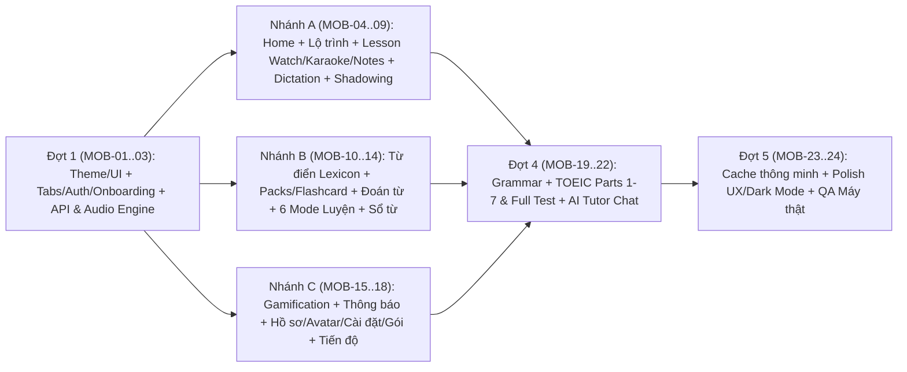

# Lyreo Mobile — Tài Liệu Bàn Giao Kỹ Thuật & Danh Mục Công Việc

> **Tài liệu nguồn duy nhất cho đội ngũ Lyreo Mobile:** Toàn bộ tính năng lớn và nhỏ, API, DTO, bẫy kỹ thuật và luật validator bên dưới đã được đối chiếu trực tiếp từ mã nguồn thực tế của **15 module Learner Backend**, `apps/mobile/`, `packages/i18n/` và `tooling/repo_checks/`.
> **Quy tắc vàng:** Lấy từng mã `MOB-xx` đưa vào AI Agent đang mở repo `lyreo-platform` → **tự đọc code + kiểm tra liên kết chéo + bắt buộc Agent lập Plan để bạn phản biện và duyệt trước khi viết một dòng code nào**. Team có toàn quyền sửa Backend/DB/API/Header khi FE gặp bất tiện, và tự do research/cài thư viện Expo/RN tốt nhất.

Tài liệu liên quan: [Bản đồ tài liệu (docs/README.md)](../README.md) · [Hợp đồng HTTP API](../architecture/http-api-contract.md) · [Tài khoản & Dev Auth](../ACCOUNT.md) · [README ứng dụng Mobile](../../apps/mobile/README.md) · [Rule kiểm tra Frontend](../../tooling/repo_checks/frontend.py) · [Câu hỏi mở](../requirements/open-questions.md)

---

## 1. Bảng Danh Mục Công Việc (24 Gói Việc Đã Gom Nhóm)

> **Quy ước:**
> - **Ưu tiên:** `P0` (Bắt buộc làm trước — lõi sản phẩm), `P1` (Hoàn thiện đầy đủ trải nghiệm học), `P2` (Mở rộng & tối ưu phát hành).
> - **Cỡ:** `S` (0.5–1 ngày), `M` (1–2 ngày), `L` (2–4 ngày), `XL` (4–5 ngày).
> - **Liên quan** giữ mã gọn (`MOB-xx`) để bảng không vỡ dòng.
> - **API chính:** Toàn bộ đường dẫn trong cột này mặc định có tiền tố `/api/v1` (rút gọn cho gọn bảng). Chi tiết sâu nằm ở **Mục 3 → Mục 7**.

| Mã | Đợt | Ưu tiên | Nhóm | Tên công việc | Cỡ | Phụ thuộc | Liên quan | Tóm tắt tính năng chính & Gợi ý UX / BE | API chính (tiền tố `/api/v1`) |
|---|---|---|---|---|---|---|---|---|---|
| **MOB-01** | Đợt 1 | P0 | Nền tảng | Thiết kế lại Theme Sáng/Tối, UI Kit, Icon & Vá Foundation + Dev Client | XL | - | MOB-02, MOB-03 | Dựng lại semantic theme Light/Dark rõ chiều sâu, bỏ ~50 màu chết và sửa đảo token radius (`sm=14 > xl=12`), sửa chớp Splash khi cold-start, đồng bộ NativeWind `colorScheme` + `SystemUI`, sửa `i18next.d.ts` (`defaultNS: 'mobile'`), `Button` `minHeight` và bỏ Unicode block/emoji giả. **Gợi ý UX / BE:** Tự do research & cài thư viện tốt nhất tương thích Expo Dev Client; tuân thủ tuyệt đối luật `frontend.py` (cấm hex/rgb cứng). | - |
| **MOB-02** | Đợt 1 | P0 | Tài khoản & Điều hướng | Navigation 5 Tab, Gỡ `SafeAreaView`, Auth Hardening & Onboarding 3 bước | L | MOB-01 | MOB-04, MOB-17 | Gỡ `<SafeAreaView>` bọc toàn app & sửa `<PortalHost />`, dựng Navigation 5 Tab hợp nhất cùng `route-contract.test.ts`, giữ `<Stack>` mount khi `exchanging`, lưu PKCE vào `SecureStore` chống Android kill, fix `signOut()` bật popup iOS, xử lý acc bị khóa `401` (`"This session is no longer valid"`), check **`GET /me` trả `"LEARNER"`** *(đã bỏ `ROLE_`!)*; Onboarding 3 bước (`starterSuggestion`). | `GET /me`, `GET /learner/profile`, `PUT /learner/onboarding` |
| **MOB-03** | Đợt 1 | P0 | Nền tảng | Nâng cấp API Client (headers/binary/errors) & Audio/Mic Engine `.m4a` | XL | MOB-01 | Toàn app | Nâng `ApiClient`: single-flight `refreshSession(failedToken)`, timeout, multipart, binary, `createIdempotencyKey()`, đọc `Location`/`ETag`, xử lý `429` theo 5 bucket, thay `useCoreResource` bằng query cache không xóa trắng data; xây Audio Player (`Range 206`, tua ms, lặp A–B, `0.5x–1.5x`) & Recorder **AAC `.m4a`** (tránh `.caf`/AMR) có cả chạm và giữ để thu. **Gợi ý UX:** xử lý chế độ im lặng iOS (`silent-switch`) & tự tạm dừng khi có cuộc gọi/ngắt tai nghe. | `GET /lessons/{id}/audio`, `/shadowing-attempts/{id}/audio`, `/lexicon/.../audio`, `/vocabulary/.../media/...`, `/assessment-sessions/.../media/...` |
| **MOB-04** | Đợt 2 | P0 | Trang chủ | Thay toàn bộ Mock Trang chủ bằng dữ liệu thật (Home Dashboard) | L | MOB-02, MOB-03 | MOB-05, MOB-15, MOB-16, MOB-18 | Xóa sạch số giả & debug box `account-summary.tsx`; hiện tên/avatar, Streak, Kim cương, chuông `unreadCount`, thẻ **"Tiếp tục học"** 1 chạm (`/curriculum/continue` hoặc `starterSuggestion`), lối tắt Bài học / Đoán từ / Flashcard / Từ điển, thống kê tuần thật. **Gợi ý UX / BE:** Dùng skeleton không giật layout; cân nhắc thêm endpoint BFF Home ở BE (#11). | `GET /learner/profile`, `/gamification/summary`, `/curriculum/continue`, `/analytics/overview`, `/vocabulary/due`, `/notifications` |
| **MOB-05** | Đợt 2 | P0 | Lộ trình | Danh sách Lộ trình, Cây bài học (bắt buộc/nhánh phụ) & Deep-link `config` | L | MOB-01, MOB-03 | MOB-04, MOB-07, MOB-08, MOB-09, MOB-12, MOB-13, MOB-19, MOB-20 | Duyệt lộ trình `PUBLISHED` (`cover` ETag `304`, CEFR, `locked`, tiến độ), Enroll idempotent; cây `sections -> items` phân biệt bắt buộc (`required: true`) vs nhánh phụ (`false`), gate `enrollmentStatus == null` → nút Enroll, deep-link lát cắt `config`. **Gợi ý UX:** thiết kế node timeline + thanh tiến độ chặng & Paywall ngữ cảnh cho lộ trình Plus. **Lưu ý:** Tiến độ không hồi tố (chỉ hoàn thành mục đang `UNLOCKED`/`IN_PROGRESS`); `VOCABULARY_REVIEW` chỉ tính khi nộp Unit Practice/Guess. | `GET /curriculum/paths`, `GET .../cover`, `GET .../paths/{id}`, `POST .../enroll`, `GET /curriculum/continue` |
| **MOB-06** | Đợt 2 | P0 | Bài học | Thư viện Bài học (lọc đa tiêu chí) & Màn Tổng quan Bài học (Overview) | L | MOB-01, MOB-03 | MOB-07, MOB-08, MOB-09 | Xóa `lesson.tsx` giả; tìm kiếm `q`, lọc Chủ đề (`categories` đa ngôn ngữ + `lessonCount`), CEFR, `sourceType` (`TEXT`/`AUDIO`/`YOUTUBE`), `activity`, phân trang `hasMore`, hiện `channelTitle`, `durationMs`, `locked`; trang Overview xem tiến độ từng activity & danh sách câu (`dictationSelected`, `shadowingSelected`). **Gợi ý UX:** chip lọc trượt ngang, badge trạng thái (Đang dở / Đã xong / Plus). | `GET /lessons`, `GET /lessons/categories`, `GET /lessons/{id}` |
| **MOB-07** | Đợt 2 | P0 | Bài học | Watch / Listen Karaoke (Audio & YouTube) + 4 Lớp Ngữ cảnh & Lưu từ 1 chạm | XL | MOB-03, MOB-06, MOB-10 | MOB-05, MOB-08, MOB-09, MOB-14, MOB-22 | Phát Audio gốc (`Range 206`) & YouTube (`sourceStartMs..sourceEndMs`); Karaoke sáng câu & từ (`words[]`), chạm câu nhảy mốc, lặp A–B, tốc độ session-only, `thoughtGroups[]`. Tích hợp 4 lớp câu (`translation`, `ipa`, `vocabulary[]` có `headwordId`, `grammar[]`, `notes[]`), chạm từ tra Lexicon & lưu 1 chạm. **Gợi ý UX / BE:** Thêm batch check từ đã lưu ở BE (#3). | `GET /lessons/{id}/activities/{actId}`, `GET .../audio`, `POST .../complete`, `GET /learner/preferences`, `GET /lexicon/by-headword/{hid}`, `POST /vocabulary/saved-items` |
| **MOB-08** | Đợt 2 | P0 | Bài học | Nghe–Chép chính tả (Dictation 3 mức đục lỗ + Gợi ý Word Pool kéo/chạm từ) | XL | MOB-03, MOB-06 | MOB-05, MOB-07, MOB-09 | Đủ 3 mức `hintLevel` (`NONE`/`EASY`/`MEDIUM`) + `properNounHints`, lọc lát cắt `sentenceIds`, tắt `autoCorrect`/`spellCheck` bàn phím; server chấm (`RELAXED_TOKEN_DISTANCE_V1`) trả `serverScore`/`expectedText`, mở khóa kiến thức sau nộp (ngưỡng `>= 70`). **Gợi ý UX / BE:** Làm thêm **Word Pool kéo/chạm thẻ từ** cho mobile; mở rộng BE trả `wordPool`, annotations ngay khi nộp & `?sentenceIds` (#7). | `GET /lessons/{id}/activities/{actId}?hintLevel=...&properNounHints=...`, `POST .../dictation/attempts` |
| **MOB-09** | Đợt 3 | P0 | Bài học | Shadowing trọn luồng (Thu `.m4a`, Chấm AI từng từ/IPA, Nghe lại & Lịch sử) | XL | MOB-03, MOB-06 | MOB-05, MOB-07, MOB-08, MOB-15 | `constraints?revision=...` (`STALE_REVISION`), nghe mẫu kèm `thoughtGroups`/`ipa`, thu **AAC `.m4a`** (12–60s, ≤ 8 MiB) với nút chạm/giữ + sóng âm; upload multipart (`Idempotency-Key` UUID bắt buộc, không ghi đè quota khi replay trả `null`) → poll 7 `BackgroundJobStatus` + `/cancel`; 4 điểm + màu từ/IPA, nghe lại 24h (`audioAvailable`), `NO_SPEECH` hoàn quota & tab `/attempts`. **Gợi ý UX:** nút nghe đối chiếu A/B (Giọng mẫu vs Giọng bạn) & màn tổng kết bài. | `GET .../shadowing/sentences/{sid}/constraints`, `POST .../attempts`, `GET /shadowing-attempts/{id}`, `GET .../audio`, `POST .../cancel`, `GET /lessons/{id}/attempts` |
| **MOB-10** | Đợt 2 | P0 | Từ điển | Từ điển Tra cứu chuyên sâu (5 loại từ, Biến thể, EN–VI/EN–EN & Phát âm đa vùng) | L | MOB-01, MOB-03 | MOB-07, MOB-14 | Search debounce giữ ranking server cho 5 `entryType` (`WORD`..`COLLOCATION`) & 4 `matchType` (`EXACT_FORM` gõ `went` khớp `go`, tô đậm `matchedText`). Chi tiết có `etymologyText`, `forms[]`, `pronunciationVariants[]` (UK/US/AU, `Range 206`), 2 tab tách nguồn sạch `en-vi`/`en-en` (`readingModes`), bản quyền `licenseText` & lưu từng nghĩa. **Gợi ý UX:** lưu lịch sử từ vừa tra trên máy & báo rõ khi từ chỉ có `en-en`. | `GET /lexicon/search`, `GET /lexicon/{id}`, `GET /lexicon/by-headword/{hid}`, `GET .../pronunciations/{pid}/audio` |
| **MOB-11** | Đợt 2 | P0 | Từ vựng | Bộ từ chuẩn (Packs/Units giàu media, `modeAvailability`) & Học Flashcard SRS | XL | MOB-01, MOB-03 | MOB-05, MOB-12, MOB-13, MOB-14, MOB-15 | Duyệt Packs (`cover` ETag, `completedEntries/entryCount`, `locked`) & Units (CEFR); đọc **`modeAvailability`** 8 mode (khóa mode 0 câu); mỗi từ có 5 media (ảnh, UK, US, 2 audio ví dụ) & `senses`/`collocations`/`family`/`synonyms`/`antonyms`/`contextNotes`. Flashcard SRS (`DUE_AND_NEW`/`ALL`, 4 nút `intervalPreviews`, `expectedReviewCount`; ôn sớm `ALL` không tính thưởng). **Gợi ý UX / BE:** lật/vuốt thẻ + haptic & mở lối ngang hàng cho Đoán từ / 6 mode / Flashcard; thêm pack `modeAvailability`, `entryIds` ở `/flashcards` & `*Url` (#4, #5). | `GET /vocabulary/packs`, `GET .../cover`, `GET .../units`, `GET /vocabulary/units/{uid}`, `GET .../entries/{eid}/media/{aid}`, `GET /vocabulary/flashcards`, `POST .../entries/{eid}/flashcard-review` |
| **MOB-12** | Đợt 2 | P0 | Từ vựng | Chế độ Đoán Từ tương tác (`GUESS_WORD` — Trụ cột ngang hàng Flashcard) | L | MOB-11 | MOB-05, MOB-13, MOB-14 | Game đoán từ chủ lực ngang hàng Flashcard: nghĩa, từ loại, IPA, ảnh/audio, chuỗi che `maskedTerm` (`******`); mở từng chữ (`/hint` trái→phải, không bump `revision`), kiểm tra từng câu (`/check` + `revision`, khóa câu sau check), đầu hàng (`giveUp: true`); chơi theo Unit / Cả Pack / lát cắt `entryIds[]`. **Gợi ý UX:** nút lưu nhanh từ vừa sai vào Sổ từ. **Lưu ý:** Nộp phiên Unit mở khóa mục `VOCABULARY_REVIEW` của Lộ trình. | `POST /vocabulary/units/{uid}/sessions`, `POST .../packs/{pid}/sessions`, `GET /vocabulary/sessions/{id}`, `POST .../questions/{qid}/hint`, `POST .../check`, `POST .../submit` |
| **MOB-13** | Đợt 3 | P0 | Từ vựng | 6 Chế độ Luyện từ vựng, Chế độ `MIXED`, lát cắt `entryIds` & Lưu nháp 24h | XL | MOB-11 | MOB-05, MOB-12 | UX cảm ứng cho 6 dạng + `MIXED`: `CHOOSE_MEANING`, `CHOOSE_WORD`, `LETTER_SCRAMBLE` (`scrambledLetters`/`wordLengths`), `MISSING_LETTERS` (`blankPositions`), `LISTEN_WRITE` (UK/US), `CONTEXT_CLOZE` (`clozeSentence` + `exampleVi`). `/check` dùng được cho **mọi** mode; auto-save `answers` (`revision`), resume `OPEN` 24h & lịch sử (không đổi SRS). **Gợi ý UX:** chạm/kéo chip chữ cái (`LETTER_SCRAMBLE`) & tự nhảy ô nhập (`MISSING_LETTERS`). | `POST .../units/{uid}/sessions`, `POST .../packs/{pid}/sessions`, `GET /vocabulary/sessions`, `GET .../sessions/{id}`, `PUT .../answers`, `POST .../check`, `POST .../submit` |
| **MOB-14** | Đợt 3 | P1 | Từ vựng | Sổ từ cá nhân, Bộ sưu tập (Collections CRUD/Move) & Hàng đợi ôn SRS (`/due`) | L | MOB-10, MOB-11 | MOB-07, MOB-15 | CRUD bộ sưu tập (`coverPreset`, bộ mặc định "Đã lưu" **không đổi tên & không xóa được `409`**; xóa bộ thường chuyển thẻ về mặc định), tìm kiếm `q`, gắn/gỡ thẻ (`/items`), di chuyển `/move`, lưu nhiều nghĩa (`saved-items` ưu tiên hơn `/cards` legacy), nghe media thẻ đã lưu (hết Plus vẫn đọc chữ, media `403`), giới hạn 100 thẻ FREE (`QUOTA_EXCEEDED`), ôn SRS `/due` + `/cards/{cid}/review`. **Gợi ý BE:** Thêm `intervalPreviews`/`srsState` cho `/due` & `/cards/{id}/review` (#4). | `CRUD /vocabulary/collections`, `.../items`, `.../move`, `POST /vocabulary/saved-items`, `GET .../media/{aid}`, `GET /vocabulary/due`, `POST /vocabulary/cards/{cid}/review`, `DELETE .../cards/{cid}` *(legacy: `POST /vocabulary/cards`)* |
| **MOB-15** | Đợt 3 | P1 | Thưởng | Gamification trọn gói: Level/XP, Streak (UTC), Nhiệm vụ Claim, Thành tựu & Sổ Kim cương | L | MOB-04 | MOB-09, MOB-11, MOB-19 | Thanh Level/XP (trần Lv 99, tự cộng `LEVEL_MILESTONE` mỗi 5 level + Lv 99), Streak (UTC), Nhiệm vụ 3 chu kỳ (`DAILY`/`WEEKLY` thứ Hai UTC/`ONE_TIME`) + Claim thủ công (`Idempotency-Key`, xong invalidate Summary/Missions/Achievements/Ledger), 6 chỉ số Thành tựu (`badge` ETag `304`), Sổ Kim cương 8 loại (`directLessonActivityDiamondsEnabled=false`). **Fix BE ngay:** `GamificationQueryService.summary()` đang trả `currentStreak` cũ sau ngày bỏ học — cần vá + thêm `studiedToday` (#1). | `GET /gamification/summary`, `GET /gamification/missions`, `POST .../missions/{mid}/claim`, `GET /gamification/achievements`, `GET .../{id}/badge`, `GET /gamification/ledger` |
| **MOB-16** | Đợt 3 | P1 | Thông báo | Hoàn thiện Hộp thư Thông báo (Lọc chưa đọc, Mark-read & đồng bộ badge Home) | S | MOB-04 | MOB-04 | Mở rộng `notifications-screen.tsx` (đã có `hasMore` & chống stale-page race): phân biệt 4 loại (`SYSTEM`/`STUDY_REMINDER`/`REWARD`/`PROMO`) + chưa đọc/đã đọc, lọc `unreadOnly`, `/{id}/read`, `/read-all`, sửa nút back mượn nhầm `progress.back` & đồng bộ `unreadCount` về Home. **Gợi ý UX:** chạm thông báo điều hướng sâu tới màn đích liên quan. | `GET /notifications`, `POST /notifications/{id}/read`, `POST /notifications/read-all` |
| **MOB-17** | Đợt 3 | P1 | Tài khoản | Hồ sơ, Mục tiêu TOEIC, Đổi Avatar (27 Preset + Camera/EXIF), Cài đặt 9 mục & Gói Free/Plus | L | MOB-02, MOB-04 | MOB-07, MOB-08, MOB-18 | Sửa hồ sơ + mục tiêu TOEIC (`10..990` bội 5); đổi avatar 27 preset (4 nhóm Thú/Hoa/Peep/Comic + 4 legacy, `GET /avatar` trả `404` khi dùng preset) hoặc upload ≤ 2 MiB JPEG/PNG; chia nhóm `settings.tsx` đủ 9 preferences (sửa bug ẩn form khi lỗi); màn Gói (`8` seeded keys, 3 `lockReason`). **Fix BE:** `CAPACITY` (`vocabulary.saved-cards`) đang trả `used/remaining: null` (#6) & tự xoay EXIF ảnh (#9). | `GET/PATCH /learner/profile`, `GET/PUT /learner/profile/avatar`, `GET/PUT /learner/preferences`, `GET /entitlements`, `GET /learner/entitlements` |
| **MOB-18** | Đợt 3 | P1 | Tiến độ | Phân tích Tiến độ 6 kỹ năng, Điểm yếu (`weaknesses`) & Lịch sử phiên gần đây | M | MOB-04, MOB-17 | MOB-13, MOB-19, MOB-20 | Mở rộng `learner-progress.tsx`: cửa sổ hôm nay/tuần (bỏ qua `studySeconds` vì BE trả `0`), 6 `skillCode` + `sampleCount`, 7 `weaknessType` kèm nút "Luyện khắc phục ngay" & list phiên gần đây. **Lưu ý / Fix BE:** 4/7 `weaknessType` (`LESSON_ACTIVITY`, `TOEIC_PART`, `TOEIC_SECTION`, `SHADOWING_ASSESSMENT`) đang trả `label: null` → map nhãn i18n ở Mobile hoặc bổ sung BE (#11). | `GET /analytics/overview`, `GET /vocabulary/sessions`, `GET /assessment-sessions` |
| **MOB-19** | Đợt 4 | P1 | Ngữ pháp | Danh mục Ngữ pháp phân cấp (Topic→Subtopic→Bank) & Quiz + Review chi tiết | M | MOB-01, MOB-03 | MOB-05, MOB-15, MOB-22 | Duyệt cây `topic`/`subtopic`/`bank` song ngữ (khóa thừa kế Topic cha), quiz `limit <= 50`, auto-save `revision`, resume 24h; review đủ `explanationVi`, `translationVi`, `combinedTranslationVi`, `answerTranslationVi`, `vocabularyNote`. **Fix BE ngay:** `Start` hiện chỉ nhận `{limit, itemIds}` (không nhận `subtopicIds`, start từ `topic` để `subtopicId=null` làm trượt Curriculum!) → tạm gọi `kind="subtopic"` hoặc sửa BE (#2). | `GET /grammar/catalogs/{kind}`, `GET .../page`, `GET .../{id}`, `POST .../sessions`, `/assessment-sessions/**` |
| **MOB-20** | Đợt 4 | P1 | TOEIC | Danh mục TOEIC (`PartBreakdown`, Drill/Full Test) & Trình làm Parts 1–5 + Review sâu | XL | MOB-03, MOB-01 | MOB-05, MOB-21, MOB-22 | Danh mục đề (`parts[]` chỉ trả ở `GET /toeic/catalog/{id}`), chọn `DRILL` (`parts[]`) hoặc `FULL_TEST`, resume 24h; Parts 1–5 (Part 2 đúng 3 đáp án A/B/C; Part 1–2 bị ẩn text ở `View.questions` **kể cả sau nộp** → bắt buộc đọc từ `View.result.questions[].content` & `View.result.groups[]`), hiện `accuracyPercent` (không bịa điểm 990 cho Drill). **Gợi ý UX:** đánh dấu cờ (`flag`), bảng nhảy câu & nút Hỏi AI / Lưu từ ở màn review. | `GET /toeic/catalog`, `GET .../page`, `GET .../catalog/{id}`, `POST .../sessions`, `GET /assessment-sessions`, `GET/PUT/POST /assessment-sessions/{id}/**` |
| **MOB-21** | Đợt 4 | P2 | TOEIC | TOEIC Part 6, Part 7 (Tab Đoạn văn/Câu hỏi), Đồng hồ & Kết quả Full Test | L | MOB-20 | MOB-22 | Đồng hồ đếm ngược Listening/Reading; giao diện tab/sheet **"Đoạn văn / Câu hỏi"** + bảng nhảy câu cho Part 6 (`gapNumber`) & Part 7 (1–3 tài liệu HTML); hiện scaled scores (`5..495` / `10..990` từ `ToeicScoreConverter`) khi nộp `FULL_TEST`. **Gợi ý BE:** Ghim `listeningDurationSeconds`/`readingDurationSeconds` vào `AssessmentSessions.View` & cho phép gửi `answers` cuối trong `POST /submit` (#8). | `POST /toeic/catalog/{id}/sessions` (`FULL_TEST`), `/assessment-sessions/{id}/**` |
| **MOB-22** | Đợt 4 | P1 | Trợ lý AI | Trợ lý AI English Tutor theo ngữ cảnh (Lesson/Vocab/Grammar/TOEIC) & Lịch sử Chat | L | MOB-03, MOB-07 | MOB-10, MOB-19, MOB-20 | Nút **"Hỏi AI"** ngữ cảnh gắn tại màn học (sheet trượt lên + chip gợi ý), màn lịch sử (`lastMessagePreview`, `messageCount`), `Idempotency-Key`, cập nhật `remainingQuota`/`quotaResetAt` (lỗi AI tự hoàn quota), đổi tên/xóa hội thoại. **Gợi ý BE:** Thêm structured `context` vào `AskRequest` để không nhồi prompt vào tin nhắn user (#10). | `POST /chat/ask`, `GET /chat/conversations`, `GET/PATCH/DELETE .../conversations/{id}` |
| **MOB-23** | Đợt 5 | P2 | Tối ưu | Cache Audio/Ảnh thông minh, Dọn cache Logout & Tinh chỉnh Bàn phím/Haptics/Dark Mode | L | MOB-03, MOB-11, MOB-17 | Toàn app | Preload audio/ảnh câu hoặc thẻ kế tiếp (tôn trọng bucket `media`), nút "Xóa bộ nhớ đệm" & tự dọn sạch cache riêng tư khi Logout/bị khóa; chống bàn phím che nút (`react-native-keyboard-controller`), haptic nhẹ, rà chữ Việt có dấu với Raleway & Dark mode trên màn nhỏ. | Media endpoints (`ETag` / `Range 206`) |
| **MOB-24** | Đợt 5 | P2 | QA | Kiểm thử E2E thực địa toàn app trên Emulator & Thiết bị thật + Chốt toàn bộ Gate | L | Đợt 1–5 | Toàn app | Test trọn hành trình + ma trận lỗi (`401` khóa acc, `403` 3 lockReason, `409`, `429` bucket, replay `null`) trên máy thật Android/iOS; fix dứt điểm bug FE/BE phát sinh; chốt xanh toàn bộ `typecheck`, `test`, `make validate` & Java IT liên quan. | Toàn bộ Learner API |

---

## 2. Quy Trình Làm Việc Bắt Buộc, Quyền Sửa Xuyên Tầng & Công Nghệ Mở

### 2.1 Quy trình bắt buộc: Tự Nghiên Cứu + Plan-First + Phản Biện (Chống quăng task mù vào Agent)

> [!CAUTION]
> **CẤM TUYỆT ĐỐI** quăng cộc lốc mã Task (kiểu *"làm cho tôi MOB-08"*) cho AI Agent tự viết code và commit mù quáng! Làm vậy gần như chắc chắn sẽ dính sai `GET /me` (`"LEARNER"` vs `"ROLE_LEARNER"`), vi phạm rule `frontend.py`, sai masking TOEIC hoặc đứt liên kết chéo sang Curriculum/Gamification.

Mỗi task (`MOB-01` → `MOB-24`) bắt buộc đi qua **5 bước**:
1. **Dev tự đọc & đối chiếu code thật:** Đọc Mục 3, 4, 5, 6, 7 liên quan tới `MOB-xx` trong tài liệu này, rồi tự mở file Java Controller/DTO/Service và `apps/mobile/` tương ứng để hiểu tận gốc dữ liệu và ngoại lệ.
2. **Dev kiểm tra UX & liên kết chéo:** Chủ động thiết kế luồng thao tác di động mượt (tránh nhồi form web vào điện thoại) và rà **Mục 4 (9 mạch liên kết chéo)** xem màn này cần cập nhật cache/trạng thái của màn nào khác.
3. **Bắt Agent lập Kế hoạch chi tiết (chưa được code):** Dùng mẫu lệnh ở **Mục 8**, yêu cầu Agent đọc code thật và trả về Bản Kế Hoạch (screen/component, API/header, error/retry, thư viện cần cài, phần BE/DB đề xuất sửa, danh sách test).
4. **Dev phản biện & chốt Kế hoạch:** Soi ngược bản Plan của Agent với quy tắc `frontend.py`, hợp đồng DTO và liên kết chéo; chỉ cho phép viết code sau khi Plan đã sạch lỗ hổng.
5. **Kiểm chứng thực tế trước khi xong:**
   - `pnpm --filter @lyreo/mobile typecheck && pnpm --filter @lyreo/mobile test`
   - `make validate`
   - Nếu có sửa Java Backend: `./mvnw -B -pl modules/<module-đã-sửa>,apps/core-service -am verify`
   - Chạy thử thực tế trên **Expo Dev Client** nối vào Backend cục bộ (`make core`) và rà kỹ `git diff`.

### 2.2 Quyền sửa xuyên tầng (Không ép cứng nếu FE gặp khó)
Nếu API, request/response, header, quy tắc lọc hay luồng dữ liệu hiện tại khiến Frontend phải xử lý vòng vo hoặc làm trải nghiệm di động bị gượng, đội Mobile **được quyền chủ động sửa cả Backend lẫn Database**:
- **Java Backend (`modules/*`, `libs/contracts/*`, `apps/core-service/*`):** Thêm/đổi field DTO, thêm query param/header, tạo BFF endpoint gom dữ liệu cho Mobile (xem 11 đề xuất ở **Mục 6**), hoặc đưa xử lý nặng lên server.
- **Database (`apps/core-service/src/main/resources/db/migration/`):** Tạo migration mới nối tiếp (`V021__...sql`, `V022__...sql`, ...). **Không sửa** các migration cũ (`V001`..`V020`), giữ Hibernate ở mode `validate`.
- **Docs (`docs/`):** Khi cố ý đổi API/luật nghiệp vụ/biến môi trường, cập nhật đồng bộ [http-api-contract.md](../architecture/http-api-contract.md), `docs/requirements/*.md` và `.env.example`.

**4 ranh giới bắt buộc giữ vững (CI & `ArchitectureTest` kiểm soát):**
1. **Spring Modulith:** Giao tiếp giữa các module chỉ qua public/named API, shared contracts hoặc domain events; không import repository hay query thẳng bảng nội bộ module khác.
2. **Server nắm quyền điểm, thưởng & quyền truy cập:** Client không tự gửi `score`, `xp`, `diamonds` hay tự đánh dấu `completed`; các thao tác ghi quan trọng dùng `Idempotency-Key` và `revision`.
3. **Bảo mật & Quyền riêng tư:** Không đưa secret vào `EXPO_PUBLIC_*`; không trả raw storage key cho client (luôn đi qua HTTP media endpoint được bảo vệ); `expo-secure-store` chỉ dùng trong `apps/mobile/src/auth/`.
4. **Quy tắc giao diện & i18n (`make validate` — [frontend.py](../../tooling/repo_checks/frontend.py)):** Tách riêng theme/component khỏi `apps/admin-web`; tuân thủ toàn bộ 8 luật CI ở **Mục 3.3**.

### 2.3 Công nghệ & Thư viện MỞ (Chỉ gợi ý tham khảo, không gò bó)
- Code hiện tại trong `apps/mobile/` chỉ là khung khởi tạo tối thiểu (scaffold) trên **Expo + React Native + Expo Router**.
- Mọi tên thư viện trong tài liệu **chỉ là gợi ý tham khảo (RCM)**. Khuyến khích team chủ động research và cài thư viện Expo/RN hiện đại, bảo trì tốt (VD: `react-native-reanimated`, `react-native-gesture-handler`, `@gorhom/bottom-sheet`, `@shopify/flash-list`, `lucide-react-native`, `expo-audio`, `react-native-youtube-iframe`, `expo-image`, `expo-image-manipulator`, `expo-haptics`, `react-native-keyboard-controller`, `@tanstack/react-query`, `zustand`, thư viện waveform/SSE...).
- **Điều kiện duy nhất:** Tương thích **Expo SDK 55 + React Native 0.83 + Expo Dev Client** (Lyreo **không dùng Expo Go**; rebuild Dev Client bằng `make mobile-android-install` hoặc `expo prebuild` khi thêm native package) và giữ xanh `typecheck`, `test`, `make validate`.

---

## 3. Hiện Trạng `apps/mobile/`, Kiến Trúc Điều Hướng, Luật CI & Môi Trường Chạy Thử

### 3.1 Đã chạy thật (giữ làm nền) vs Lỗi/Quirk hiện hữu cần xử lý ngay (Đợt 1)
- **Đã chạy thật (`src/config/env.ts`, `src/auth/*`, `src/api/*`, một phần UI):**
  - `SessionManager` + `expo-secure-store`: OIDC PKCE (`lyreo://auth/callback`), single-flight `bootstrap()` / `refreshSession()`, phân biệt mất phiên vs lỗi mạng (`SessionUnavailableError`).
  - `ApiClient` & `errors.ts`: RFC 9457 Problem Details mapping.
  - `NotificationsScreen` (đã có `hasMore` & `AbortController` chống race refresh), `LearnerProgress` (đã gọi `analytics/overview`), `SettingsScreen` (đã đọc/ghi một phần preferences & đổi theme/locale).
- **Lỗi & điểm yếu thực tế cần sửa ngay ở `MOB-01..03`:**
  - **Theme & Typography:** `foundation.json`/`tailwind.config.js` đảo ngược bo góc (`rounded-sm=14px`, `rounded-md=20px`, `rounded-lg=28px` lớn hơn `rounded-xl=12px` & `rounded-2xl=16px`); Light mode trùng `background === secondary === muted` (`#F5F5F4`) và `surface === surfaceElevated` (`#FFFFFF`); Dark mode trùng `secondary === muted === surfaceElevated` (`#44403C`); thiếu token nền dịu (`primarySubtle`, `successSubtle`, `warningSubtle`, `destructiveSubtle`); `primitives.ts` còn ~50 màu chết; Raleway chỉ có 5 weight (400–800, không italic, cần test dấu tiếng Việt Android).
  - **Cold-start & Theme Providers:** `SplashScreen.hideAsync()` không đợi `AppThemeProvider`/`LocaleProvider` đọc `AsyncStorage` → chớp theme/ngôn ngữ; `AppThemeProvider` tạo object mới mỗi render (vỡ memo), thiếu `.catch()`, chưa gọi NativeWind `colorScheme.set(mode)` và `SystemUI.setBackgroundColorAsync(...)`.
  - **SafeArea, Portal & Route/Stack:** `AppProviders.tsx` bọc `<PortalHost />` bên trong `<SafeAreaView>` toàn cục (chặn edge-to-edge và lệch modal/sheet); `app/_layout.tsx` hủy mount `<Stack>` khi `status === 'bootstrapping'` (gồm cả `exchanging`); `app/(app)/_layout.tsx` thiếu `contentStyle: { backgroundColor }`.
  - **Auth & API Client:** PKCE `codeVerifier`/`state` chỉ nằm trong RAM (bị Android kill app khi mở Keycloak tab là lỗi callback); `app/auth/callback.tsx` chạy ngay trước khi `discovery`/`request` sẵn sàng; `signOut()` mở `WebBrowser` gây iOS consent popup; `client.ts` bị double-refresh nếu 2 request `401` nối đuôi nhau (`refreshSession` chưa nhận `failedToken`), chưa parse binary, chưa có timeout (`'timeout'` không được sinh ra) và chưa có `multipart/form-data`; `useCoreResource` xóa sạch data cũ về loading mỗi lần focus và nuốt `ApiError`.
  - **UI, i18n & Test Quirks:** `src/i18next.d.ts:11` import sai `mobileI18nResources` và khai báo `defaultNS: 'common'` (lệch với `frontend.py`); `Button` ép `minHeight: 44/48` inline lên cả `size="sm"`; `NotificationsScreen` & `LearnerProgress` tạo `Intl.*` mới mỗi lần render; `settings.tsx` ẩn luôn form khi lỗi; Jest `transformIgnorePatterns` chưa mở cho gói RN/ESM mới; mock cứng ở `home-screen.tsx`, `account-summary.tsx`, `lesson.tsx`.

### 3.2 Kiến Trúc Điều Hướng Đề Xuất (Navigation 5 Tab, SafeArea & Deep-Link)
- **Gỡ `<SafeAreaView>` bọc toàn app** trong `src/providers/AppProviders.tsx`; giữ `<PortalHost />` toàn màn hình và tự áp `useSafeAreaInsets()` ở header, `contentContainerStyle`, tab bar và thanh action đáy để hỗ trợ cuộn edge-to-edge mượt trên iOS Dynamic Island & Android gesture bar.
- **Hợp nhất Authenticated Shell + 5 Tab chính:** Hiện `app/index.tsx` nằm ngoài `app/(app)/_layout.tsx` (lưu ý `src/tests/route-contract.test.ts` đang khóa cấu trúc hiện tại — khi hợp nhất thành shell chuẩn có **5 Tab chính**, cần cập nhật chủ đích `route-contract.test.ts`). Gợi ý 5 Tab: **Trang chủ**, **Lộ trình / Bài học**, **Từ vựng & Từ điển**, **Luyện thi (Grammar / TOEIC)**, **Cá nhân / Tiến độ** (team được tùy chỉnh tên/bố cục tab nếu research ra UX tốt hơn).
- **Route Stack & Sheet theo ngữ cảnh:** Giữ `<Stack>` luôn mount trong suốt quá trình `exchanging` (hiển thị overlay thay vì unmount navigator); tách các màn chuyên sâu (`lesson/[id]`, `watch`, `dictation`, `shadowing`, `vocab/session`, `lexicon/[id]`, `toeic/session`, `chat`, `notifications`, `settings`) đẩy trên tab bar, kết hợp Bottom Sheet ngữ cảnh (tra từ Lexicon, cài đặt Player, Hỏi AI Tutor).
- **Onboarding Gate & Deep-Link Central Router:**
  - Nếu `GET /learner/profile` cho `onboarded === false` → điều hướng qua Onboarding 3 bước (`MOB-02`) trước khi vào Home.
  - Hỗ trợ điều hướng trực tiếp kèm lát cắt `config` từ Curriculum (`sentenceIds`, `entryIds`, `subtopicIds`, `parts`, `questionCount`) và từ điểm yếu Analytics (`weaknessType` + `weaknessKey`).

### 3.3 Luật Chặn CI Bắt Buộc (`tooling/repo_checks/frontend.py` & `repository.py`)
`make validate` kiểm tra 8 luật sau — vi phạm là **chết CI ngay**:
1. **Cấm màu cứng (`#[0-9a-fA-F]{3,8}\b|rgba?\(`)** trong mọi `.ts`/`.tsx`/`.css` dưới `apps/mobile/app/**` và `apps/mobile/src/**` (kể cả trong **comment, test, SVG props, `bg-[#...]`, `global.css`**) — **chỉ cho phép** trong `src/theme/primitives.ts` và `src/theme/semantic.ts`.
2. **Cấm chữ `"primitiveColors"`** ở mọi file `.ts`/`.tsx` dưới `app/` hoặc `src/` ngoài `primitives.ts` và `semantic.ts` (kể cả comment).
3. **`"SecureStore"`** chỉ được xuất hiện (kể cả trong comment) tại các đường dẫn có segment **`auth`** (VD: `src/auth/...`).
4. **Khớp 100% key EN ↔ VI** trong `packages/i18n/src/locales/{en,vi}/{common,admin,mobile}.json`.
5. **Kiểm tra literal `t('...')` trong `.tsx`** (trừ `src/components/ui/**`): mọi key không có dấu `:` **luôn kiểm tra trong namespace `mobile`** — muốn dùng key trong `common` **bắt buộc viết `t('common:...')`** (kể cả khi hook có truyền `'common'`).
6. **Baseline packages bắt buộc** trong `apps/mobile/package.json`: `nativewind`, `tailwindcss`, `tailwindcss-animate`, `@rn-primitives/portal` (deps/devDeps) và `expo-router`, `expo-constants`, `expo-linking`, `expo-status-bar`, `react-native-safe-area-context`, `react-native-screens`, `expo-auth-session`, `expo-crypto` (runtime deps).
7. **Component UI không tạo barrel `index.ts`:** Mỗi file `src/components/ui/<name>.tsx` phải được import theo đường dẫn có chứa `components/ui/<name>` ở file `.tsx` ngoài `components/ui/` (nếu tạo barrel sẽ dính warning).
8. **Env contract (`repository.py`):** Các key trong `apps/mobile/.env.example` phải khớp với `src/config/env.ts` và tên key **không** được chứa từ nhạy cảm kiểu `SECRET`, `API_KEY`, `PASSWORD`, `PRIVATE_KEY`.

### 3.4 Tài Khoản Demo Cục Bộ & Sơ Đồ Chia Luồng Song Song
Xem [apps/mobile/README.md](../../apps/mobile/README.md) và [ACCOUNT.md](../ACCOUNT.md). Chạy `make core` + `make migrate && make seed` để có sẵn:
- **Plus Learner (full dữ liệu & quyền):** `demo-learner-minh-anh` / `Password123!`
- **Free Learner (test paywall & hạn mức quota):** `demo-learner-gia-huy` / `Password123!`
- **New Learner (test Onboarding 3 bước & empty state):** `demo-learner-new` / `Password123!`
- Metro chạy port **8082**; Android Emulator nối host qua `10.0.2.2`, máy thật USB dùng `adb reverse`.



---

## 4. Ma Trận 9 Mạch Liên Kết Chéo Toàn Hệ Thống (Coi Chừng Đứt Mạch)

| Mạch liên kết | Điểm phát sinh (Producer) | Hệ quả & Màn hình chịu tác động | Bẫy bắt buộc phải xử lý |
|---|---|---|---|
| **1. Saved Vocab mọi nơi** | Lesson `vocabulary[]`, Lexicon `Sense`, Vocab `UnitEntry`, Grammar/TOEIC `vocabularyNote` | `POST /vocabulary/saved-items` → Bộ sưu tập & hàng đợi `/vocabulary/due` | 1) Chưa có API batch check "từ này đã lưu chưa" (#3). 2) Thẻ lưu từ Pack Plus kiểm tra quyền lúc lưu **và lúc stream** `saved-items/{id}/media/{aid}` (hết Plus vẫn đọc được chữ, media trả `403`). 3) Nếu bỏ trống `collectionIds` sẽ vào bộ mặc định `"Đã lưu"`. |
| **2. Preferences → Practice** | `PUT /learner/preferences` | Watch, Dictation, Shadowing, Flashcard, Listen-Write | Server **chỉ** tự đọc `properNounHints` trong `GET /lessons/{id}/activities/{actId}`. Cả **8 tùy chọn còn lại** (`preferredAccent`, `defaultPlaybackSpeed`, 4 `DisplayTiming`, `thoughtGroups`, `karaokeHighlighting`) FE phải tự áp dụng; chỉnh tạm trong lúc học là state phiên (`FR-IDN-004`). |
| **3. Entitlements & 3 kiểu `403`** | `entitlement` (`FREE`/`PLUS`, quotas) | 8 feature keys ở Lesson, Vocab, Shadowing, Grammar, TOEIC, Curriculum, Chat, Notifications | Phân biệt đủ 3 mã `403` (`ACCESS_DENIED`, `FEATURE_ENTITLEMENT_REQUIRED`, `QUOTA_EXCEEDED`); đổi gói làm thay đổi ngay danh sách Notifications nhìn thấy; phiên Grammar/TOEIC/Vocab đang dở giữ snapshot & media nên vẫn resume được dù catalog bị ẩn sau đó. |
| **4. Curriculum không hồi tố & Slice `config`** | Nộp Lesson, Unit Practice, Grammar Subtopic, TOEIC | `CurriculumCompletionListener` → mở khóa mục tiếp & `/curriculum/continue` | 1) **Chỉ item đang `UNLOCKED`/`IN_PROGRESS` mới hoàn thành** (làm trước khi mở khóa không được tính bù!). 2) `VOCABULARY_REVIEW` **chỉ** tính khi nộp **Unit** Practice/Guess (`unitId != null`) — **không** tính Flashcard SRS và **không** tính Pack! 3) `GRAMMAR_PRACTICE` có `config.subtopicIds` bắt buộc chạy từ `kind="subtopic"` (nếu chạy `kind="topic"` BE để `subtopicId=null` nên trượt!). 4) `LESSON` có `sentenceIds` cần đạt `>= 70` mọi câu trong slice. |
| **5. Gamification Anti-Farm & Sync sau Claim** | Lesson, Vocab SRS (chỉ due/new), Shadowing `SCORED`, Grammar, TOEIC (`DRILL` cho mission), Claim | `MissionEventListener`, `JdbcXpLedger` | 1) Sau khi bấm **Claim** (`POST /missions/{id}/claim`), **bắt buộc** invalidate đồng thời **Summary + Missions + Achievements + Ledger** (vì Claim thưởng XP có thể làm lên cấp & tự thưởng `LEVEL_MILESTONE` Diamonds!). 2) Ôn sớm `scope=ALL` ở Flashcard không tạo sự kiện thưởng/analytics. 3) `TOEIC FULL_TEST` chỉ cộng Streak/Analytics, **không** tính mission `TOEIC_DRILL_COMPLETED`. |
| **6. Analytics → Deep-Link Luyện Bù** | `LearningAnalyticsListener` | `GET /analytics/overview` (`weaknesses[]`) → nhảy thẳng vào module đích | Branch điều hướng theo `weaknessType`: `GRAMMAR_TOPIC`→`weaknessKey` (topic/subtopic UUID), `VOCABULARY_UNIT`→`unitId`, `VOCABULARY`→`headwordId`/`cardId`, `TOEIC_PART`→part `"1".."7"`, `LESSON_ACTIVITY`/`SHADOWING_ASSESSMENT`→Lesson filtered. Lưu ý 4/7 type đang có `label: null` ở BE! |
| **7. AI Tutor theo ngữ cảnh** | Câu Lesson, Từ điển, Câu sai Grammar/TOEIC | `POST /chat/ask` (`chat.tutor` quota) | Hiện `AskRequest` chỉ nhận `{conversationId, learnerLevel, question, title}` nên tạm thời FE gói context vào `question` (≤ 2000 ký tự) + truyền `profile.currentLevel`, hoặc làm **Đề xuất BE #10**. |
| **8. Media Auth, 5 Bucket Rate Limit & Dọn Cache** | Mọi URL `/audio`, `/media/`, `/cover`, `/badge`, `/avatar` | Player, Image loader & Disk Cache | Mọi URL đều bắt buộc header `Authorization: Bearer` (`ByteRangeResponses` trả `no-store`; `avatar`/`cover`/`badge` hỗ trợ `ETag 304`). Rate limit `120 req/phút` chia 5 bucket (`media`, `chat`, `speech`, `lesson`, `general`) → `429` + `Retry-After`. Khi **Logout / Khóa acc**, bắt buộc xóa sạch cache media riêng tư trên đĩa. |
| **9. Khóa Tài Khoản / Thu Hồi Phiên (`401`)** | `AccountAccessGuard` | `ApiClient` & `SessionManager` | Khi Admin khóa tài khoản hoặc mở khóa (JWT `iat` cũ hơn thời điểm mở), BE trả `401 AUTHENTICATION_REQUIRED` (`"This session is no longer valid"`). Client phải ngắt vòng lặp retry refresh, xóa SecureStore + disk cache và hiện màn thông báo rõ ràng. |

---

## 5. Chi Tiết Kỹ Thuật Toàn Bộ 15 Module Backend (Code-Verified)

### 5.1 Nền tảng Bảo mật, Rate Limit, Media Streaming & ETag
- **`GET /api/v1/me` (`MeController.java:30`):** Strip tiền tố `ROLE_` nên `roles[]` trả **`"LEARNER"`** / **`"ADMIN"`** (không dùng `"ROLE_LEARNER"`). Toàn bộ endpoint learner yêu cầu `hasRole("LEARNER")` (riêng `/lexicon/**` cho `hasAnyRole("LEARNER", "ADMIN")`).
- **Rate Limit (`ApiRateLimitConfiguration.java`):** `120 req/phút` chia riêng theo **5 bucket**: `media`, `chat`, `speech`, `lesson`, `general` → vượt trả `429 RATE_LIMITED` + header `Retry-After`.
- **Byte-Range Media & ETag:** Toàn bộ `ByteRangeResponses` audio trả `Cache-Control: no-store`, `Accept-Ranges: bytes`, hỗ trợ single-range `206` hoặc `416`. Bốn endpoint ảnh hỗ trợ `If-None-Match` → `304`: `/learner/profile/avatar`, `/vocabulary/packs/{id}/cover`, `/curriculum/paths/{id}/cover`, `/gamification/achievements/{id}/badge`.

### 5.2 Định danh, Hồ sơ, 27 Avatar Preset, Cài đặt & Gói (`identity`, `learner`, `entitlement`)
- **Onboarding (`PUT /api/v1/learner/onboarding`):** `goal` (`CONVERSATION|WORK|TOEIC|UNDECIDED`), `currentLevel` (`A1..C2|UNKNOWN`), `dailyMinutes` (integer JSON chặt `5..240`), `toeicTargetScore` (nullable `10..990` bội `5`). Gọi lại là idempotent; `PATCH /profile` hay `PUT /profile/avatar` trước khi onboarding trả `409 STATE_CONFLICT`.
- **Avatar 2 cách chọn:**
  - **27 Preset chính thức (+ 4 legacy):** Động vật (9): `BEAR`, `PANDA`, `RED_PANDA`, `KOALA`, `LION`, `PENGUIN`, `GIRAFFE`, `ORCA`, `TOUCAN`; Hoa (6): `FLOWER_HEATHER`, `FLOWER_CLIMBING_LILY`, `FLOWER_CHRYSANTHEMUMS`, `FLOWER_ROSES_LILACS`, `FLOWER_IRISES`, `FLOWER_POTTED_PANSIES`; Peep (6): `PEEP_CURLS`, `PEEP_BEANIE`, `PEEP_BUN`, `PEEP_HEADSCARF`, `PEEP_LONG_HAIR`, `PEEP_QUIFF`; Comic (6): `COMIC_MILO`, `COMIC_LUNA`, `COMIC_NOVA`, `COMIC_KYO`, `COMIC_MIKA`, `COMIC_ARI` *(4 legacy: `CAT`, `DOG`, `FOX`, `RABBIT`)*.
  - Upload (`PUT /learner/profile/avatar`): JPEG/PNG ≤ 2 MiB (≤ 4096×4096), BE cắt thành PNG `256×256` **không tự xoay EXIF** (cần xoay ở FE bằng `expo-image-manipulator` hoặc vá BE #9). `GET /learner/profile/avatar` trả **`404`** khi đang dùng preset/initials.
- **9 Tùy chọn (`GET/PUT /api/v1/learner/preferences`):** Gọi được cả trước onboarding. Mặc định: `preferredAccent="US"`, `defaultPlaybackSpeed=1.0` (`0.5..2.0`), 4 `DisplayTiming` (`OFF|TAP_TO_SHOW|AFTER_ATTEMPT|ALWAYS`: `translation=AFTER_ATTEMPT`, `sentenceIpa=TAP_TO_SHOW`, `vocabularyNotes=AFTER_ATTEMPT`, `grammarNotes=AFTER_ATTEMPT`), cùng `thoughtGroups=true`, `karaokeHighlighting=true`, `properNounHints=true`.
- **Quyền & Quota (`GET /api/v1/entitlements` & alias `/api/v1/learner/entitlements`):**
  - **8 feature keys (dùng gạch nối `-`):** `vocabulary.plus-packs`, `toeic.full-access`, `grammar.advanced`, `lesson.plus-lessons` (`GRANT`); `vocabulary.saved-cards` (`CAPACITY`: `100` FREE / `5000` PLUS — **BE hiện trả `used: null, remaining: null`**!); `speech.shadowing` (`5`/`100` ngày UTC), `chat.tutor` (`10`/`200` ngày UTC), `speaking.roleplay` (`5`/`100`, future) (`PERIOD_USAGE`).
  - `lockReason`: `FEATURE_UNAVAILABLE | FEATURE_GRANT_REQUIRED | QUOTA_EXCEEDED`.

### 5.3 Bài Học — Watch Karaoke, Ngữ Cảnh, Dictation & Shadowing (`lesson`, `speech-assessment`)
- **Watch / Listen Karaoke:** Audio (`Range 206`) & YouTube (`videoId`, `sourceStartMs..sourceEndMs`), sáng từng câu & từng từ (`words[]`), `thoughtGroups[]`, `POST .../complete` chỉ nhận activity `WATCH`.
- **4 lớp kiến thức `SentenceView`:** (1) `translation` & `ipa`; (2) `vocabulary[]` (có `headwordId` → mở Lexicon & lưu 1 chạm); (3) `grammar[]`; (4) `notes[]`. Trước lần nộp đầu (`attempted == false`), server trả `null`/`[]`.
- **Dictation (`RELAXED_TOKEN_DISTANCE_V1`):** 3 `hintLevel` (`NONE|EASY|MEDIUM`) + `properNounHints` (nếu bỏ trống param sẽ dùng từ Preferences). Chuẩn hóa NFKC + lowercase + bỏ dấu câu; ngưỡng qua là **`70`**. **RCM UX:** song song gõ bàn phím, thêm chế độ **Word Pool kéo/chạm thẻ từ** (#7).
- **Shadowing (`speech-assessment`):**
  - `maxDurationSeconds = ceil(clamp(refMs * 2.0 / 1000 + 6, 12, 60))` (+1.5s tolerance); max **8 MiB**; thu **AAC `.m4a`** (tránh `.caf` & AMR vì bị `ffmpeg` từ chối).
  - `POST .../attempts`: bắt buộc header **`Idempotency-Key` chuẩn UUID**! **Cảnh báo:** Replay idempotent trả `quotaLimit/quotaRemaining/quotaResetAt` = **`null`** — tuyệt đối không ghi đè state quota client bằng `null`!
  - **7 `BackgroundJobStatus`:** `QUEUED`, `RUNNING`, `RETRY_WAIT`, `CANCEL_REQUESTED`, `CANCELLED`, `SUCCEEDED`, `FAILED`; `outcome`: `"SCORED"` | `"NO_SPEECH"` | `null`. Quota chỉ trừ khi `SCORED`, được hoàn nếu `NO_SPEECH`/`CANCELLED`/`FAILED`/`EXPIRED`.
  - WAV giữ **24h**: quá 24h `audioAvailable: false` (`GET /audio` trả `404`), điểm & chi tiết từ/IPA (`result`) vẫn còn nguyên.

### 5.4 Từ Điển Chuyên Sâu (`lexicon`)
- **Search (`GET /api/v1/lexicon/search`):** `q` (1..120), `limit` (1..50, mặc định 20), 5 `entryType` (`WORD`, `PHRASE`, `PHRASAL_VERB`, `IDIOM`, `COLLOCATION`), 4 `matchType` (`EXACT_HEADWORD`, `EXACT_FORM`, `PREFIX_HEADWORD`, `PREFIX_FORM`) + `matchedText` + `hasMore`.
- **Chi tiết (`/{id}`, `/by-headword/{headwordId}`):** `readingModes` (`["en-vi", "en-en"]` sạch nguồn, không bịa dịch), `items[]` (`partOfSpeech`, `etymologyText`), `forms[]`, `senses[]` (`translationStatus`, `examples`, `definitions`), `pronunciationVariants[]` (UK/US/AU, `audioEndpoint` `Range 206`), `licenseText`.

### 5.5 Từ Vựng — 4 Trụ Cột Ngang Hàng (`vocabulary`)
1. **Packs & Units:** `UnitDetail.modeAvailability` báo trước số câu cho cả **8 mode** (khóa mode 0 câu); 5 loại media (`imageId`, `ukAudioId`, `usAudioId`, `exampleAudioId`, `secondExampleAudioId`).
2. **Đoán Từ (`GUESS_WORD` — ngang hàng Flashcard):** Hiện `maskedTerm`, `/hint` (mở trái→phải, không cần `revision`; `409` nếu đã check), `/check` (`revision`, khóa câu), `giveUp: true`. Hỗ trợ Unit / Pack / `entryIds[]`.
3. **6 Chế độ Luyện & `MIXED` + Nháp 24h:** `CHOOSE_MEANING`, `CHOOSE_WORD`, `LETTER_SCRAMBLE`, `MISSING_LETTERS`, `LISTEN_WRITE`, `CONTEXT_CLOZE`, `MIXED`. **Lưu ý:** `POST .../questions/{qid}/check` chạy được cho **tất cả các mode**, không riêng `GUESS_WORD`! Nộp phiên Unit không đổi lịch SRS.
4. **Flashcard SRS & Sổ từ cá nhân:**
   - Bộ chuẩn (`GET /flashcards`, `POST /entries/{id}/flashcard-review`): `DUE_AND_NEW` / `ALL`, `expectedReviewCount` (`409 STALE_REVISION`), `intervalPreviews` (`AGAIN` min `1` ngày). Ôn sớm `ALL` cập nhật SRS nhưng **không** phát `VocabularyReviewCompletedEvent`.
   - Sổ từ cá nhân: `POST /vocabulary/saved-items` chống trùng đa nghĩa (`ENTRY` / `LEXICON_SENSE` / `TERM` / `SENSE_FP`; ưu tiên thay cho `/cards` legacy); giới hạn `100` FREE / `5000` PLUS; CRUD Collection (bộ mặc định `"Đã lưu"` **không đổi tên & không xóa được `409`**; xóa bộ thường chuyển thẻ về mặc định), `POST/DELETE /collections/{id}/items`, `/move`, `/due` + `/cards/{cid}/review`.

### 5.6 Lộ Trình, Ngữ Pháp, TOEIC, Điểm Thưởng, Thông Báo, Tiến Độ & AI Tutor
- **Curriculum (`curriculum`):** 5 `ContentType` (`LESSON`, `GRAMMAR_PRACTICE`, `TOEIC_DRILL`, `TOEIC_TEST`, `VOCABULARY_REVIEW`). Trước enroll `enrollmentStatus == null` & mọi item `LOCKED`. **Chỉ hoàn thành item đang `UNLOCKED`/`IN_PROGRESS`** (không hồi tố); `VOCABULARY_REVIEW` chỉ tính khi nộp **Unit** practice session (`unitId != null`); `LESSON` có `sentenceIds` đòi Dictation `>= 70` mọi câu trong slice.
- **Grammar & TOEIC (`grammar`, `toeic`, `assessment`):**
  - Grammar: `kind` chữ thường `topic | subtopic | bank`; **lưu ý bug `Start` (#2):** không nhận `subtopicIds` và start `topic` để `subtopicId = null` (trượt Curriculum `subtopicIds` nếu không start từ `kind="subtopic"` hoặc vá BE).
  - TOEIC: `GET /toeic/catalog` & `/page` trả `parts: []`, chỉ `/catalog/{id}` trả `PartBreakdown`; Part 2 có đúng **3 đáp án A/B/C**; Part 1–2 ẩn text ở `View.questions` **kể cả sau submit** — đọc đầy đủ text, transcript, `explanationVi`, `translationVi`, **`combinedTranslationVi`**, `answerTranslationVi`, `vocabularyNote` từ **`View.result.questions[].content`** & **`View.result.groups[]`**. Chế độ `FULL_TEST` đã có **`ToeicScoreConverter`** (`5..495` / `10..990`), còn `DRILL` giữ scaled score `null` & dùng `accuracyPercent`.
- **Gamification (`gamification`):** Lv 1–99; tự cộng `LEVEL_MILESTONE` Diamonds khi vượt bội 5 + Lv 99; `directLessonActivityDiamondsEnabled=false`; 3 chu kỳ Mission (`DAILY`/`WEEKLY` thứ Hai UTC/`ONE_TIME`) với **5 metrics** (`TOEIC_DRILL_COMPLETED` chỉ tính `DRILL`!), Claim thủ công (`Idempotency-Key`); **6 Achievement metrics** (`badge` `304`); **8 `DiamondTransaction.Type`**. *(Nhớ vá `GamificationQueryService.summary()` #1!)*
- **Notifications, Analytics & Chat:**
  - Notifications (`GET /notifications`): lọc theo tier `FREE`/`PLUS`, 4 loại (`SYSTEM`, `STUDY_REMINDER`, `REWARD`, `PROMO`), chưa có SSE push.
  - Analytics (`GET /analytics/overview`): 6 `skillCode`, `studySeconds` = `0`, 7 `weaknessType` (**4 loại `LESSON_ACTIVITY`, `TOEIC_PART`, `TOEIC_SECTION`, `SHADOWING_ASSESSMENT` hiện trả `label: null`!**).
  - Chat (`POST /chat/ask`, `/conversations/**`): giữ 6 tin gần nhất gửi LLM, lỗi tự hoàn quota `chat.tutor`.

---

## 6. 11 Đề Xuất Vá & Nâng Cấp Backend Cụ Thể Cho Team Mobile

1. **`modules/gamification` — `GamificationQueryService.summary()` (`MOB-15`, BẮT BUỘC):** Vá `currentStreak` luôn reset về `0` khi `lastStudyDate < todayUtc - 1` (khớp `AdminGamificationController`) và thêm `studiedToday`.
2. **`modules/grammar` — `GrammarCatalogController.Start` (`MOB-19`, BẮT BUỘC):** Hỗ trợ thêm optional `subtopicIds[]` và gán đúng `subtopicId` cho từng item khi start từ `kind="topic"` để pass Curriculum `config.subtopicIds`.
3. **`modules/vocabulary` — Batch Saved-State Lookup (`MOB-07/10/11/14`):** Thêm `POST /api/v1/vocabulary/saved-items/status` (hoặc `savedCardId` trong `UnitEntryDetail`) để tô sáng hàng loạt từ đã lưu không bị N+1 request.
4. **`modules/vocabulary` — Chuẩn hóa `/due`, `/cards/{id}/review` & URL (`MOB-11/13/14`):** Bổ sung `intervalPreviews`, `srsState`, `reviewCount`, `lapseCount` cho `/due` & `/cards/{id}/review`; bổ sung đồng nhất `audioUrl`/`imageUrl` trên `UnitEntryDetail`, `QuestionView`, `CollectionItemView`.
5. **`modules/vocabulary` — Pack `modeAvailability` & `/flashcards` `entryIds` (`MOB-11`):** Trả `modeAvailability` ở Pack và hỗ trợ query param `entryIds` trên `GET /vocabulary/flashcards`.
6. **`modules/entitlement` — `DefaultEntitlementService` cho `CAPACITY` (`MOB-17`, BẮT BUỘC):** Tính & trả `used` và `remaining` cho `vocabulary.saved-cards` (hiện trả `null`).
7. **`modules/lesson` — `DictationAttemptResponse` & `?sentenceIds` (`MOB-08`):** Trả ngay annotations vừa mở khóa (+ optional `wordPool` xáo trộn) khi nộp dictation và hỗ trợ filter `?sentenceIds` trên `GET .../activities/{actId}`.
8. **`modules/assessment` — Timer TOEIC & Final `answers` (`MOB-21`):** Ghim `listeningDurationSeconds`/`readingDurationSeconds` vào `AssessmentSessions.View` và cho phép gửi `answers` cuối kèm `POST /submit`.
9. **`modules/learner` — `LearnerAvatarImage.normalize()` (`MOB-17`):** Tự động đọc & xoay pixel theo EXIF Orientation trước khi crop 256×256 PNG.
10. **`modules/chat` — Structured `context` trong `AskRequest` (`MOB-22`):** Thêm optional object `context` để BE đưa ngữ cảnh câu/bài học vào system prompt mà không làm bẩn bong bóng tin nhắn của user.
11. **`modules/analytics` & Home BFF (`MOB-04/18`):** Thêm optional `GET /api/v1/home/summary` gom dữ liệu Trang chủ; điền `label`/`labelEn` cho 4 `weaknessType` đang bị `null` (và bổ sung `studySeconds` khi chốt telemetry).

---

## 7. Tài Liệu & Mã Nguồn Cần Đọc + Tiêu Chí Xong Theo Từng Mã Công Việc

- **`MOB-01`:** `apps/mobile/src/theme/*`, `tailwind.config.js`, `app.json`, `package.json`, `src/providers/*`, `src/i18n*.ts`, `tooling/repo_checks/frontend.py`. *Xong khi:* Sửa hết bug radius/surface/Splash/Button/i18next; bộ UI Kit + icon vector đầy đủ; dev client build chạy mượt; `make validate` pass 100%.
- **`MOB-02`:** `apps/mobile/app/_layout.tsx`, `app/(app)/_layout.tsx`, `src/auth/*`, `src/tests/route-contract.test.ts`, `modules/learner/.../LearnerController.java`, `MeController.java`. *Xong khi:* 5 tab + `route-contract.test.ts` pass, check `"LEARNER"`, PKCE giữ khi Android kill, `signOut()` sạch không popup, acc `401` khóa báo rõ, 3 demo user qua đúng luồng.
- **`MOB-03`:** `apps/mobile/src/api/*`, `src/tests/api-client.test.ts`, `ByteRangeResponses.java`, `ApiRateLimitConfiguration.java`. *Xong khi:* Refresh token an toàn trước 401 song song, hỗ trợ timeout/multipart/binary/`429` bucket, audio Range `206` tua/A–B mượt, thu AAC `.m4a` nghe lại rõ.
- **`MOB-04`:** `src/features/home/home-screen.tsx`, `account-summary.tsx`, `ContinueLearningView.java`. *Xong khi:* Xóa hết số giả & debug box; Home hiển thị dữ liệu thật trên cả 3 demo user.
- **`MOB-05`:** `modules/curriculum/.../CurriculumController.java`, `CurriculumService.java`. *Xong khi:* Enroll idempotent, cây bài học phân biệt bắt buộc/nhánh phụ, mở đúng slice `config`, nắm chắc rule non-retroactive & `VOCABULARY_REVIEW` unit-only.
- **`MOB-06`:** `modules/lesson/.../LearnerLessonController.java`, `LearnerLessonQuery.java`. *Xong khi:* Tìm kiếm + lọc đa tiêu chí + phân trang mượt; Overview hiện tiến độ & danh sách câu.
- **`MOB-07`:** `LearnerLessonService.java`, `AuthoringSentence.java`, `LexiconController.java`. *Xong khi:* Karaoke sáng từng từ trên Audio & YouTube, đủ 4 lớp câu theo `DisplayTiming`, chạm từ mở Lexicon & lưu 1 chạm.
- **`MOB-08`:** `LessonPracticeController.java`, `DictationMaskingPolicy.java`, `LessonPracticeService.java`. *Xong khi:* Đủ 3 mức `hintLevel` + `properNounHints` (+ Word Pool nếu triển khai), diff từng từ, hoàn thành `sentenceIds` mở lộ trình.
- **`MOB-09`:** `LearnerShadowingController.java`, `LearnerPronunciationAttempts.java`. *Xong khi:* Thu AAC `.m4a` hợp lệ, UUID `Idempotency-Key` + bảo toàn quota khi replay `null`, poll 7 status + `/cancel`, xử lý `NO_SPEECH` & `audioAvailable=false` sau 24h.
- **`MOB-10`:** `LexiconController.java`, `LexiconAudioController.java`. *Xong khi:* Search `EXACT_FORM` giữ ranking, tab `en-vi`/`en-en` sạch nguồn, nghe phát âm đa vùng & lưu từng nghĩa.
- **`MOB-11`:** `VocabularyStudyController.java`, `VocabularyStudyService.java`, `VocabularyStudyModels.java`. *Xong khi:* Pack/Unit hiện `modeAvailability`, phát đủ 5 media; Flashcard SRS `DUE_AND_NEW`/`ALL` với 4 nút `intervalPreviews`.
- **`MOB-12`:** `VocabularyStudyController.java`, `VocabularyExerciseGenerator.java`. *Xong khi:* Chơi trọn `GUESS_WORD` (`/hint`, `/check`, `giveUp`) cho Unit/Pack/`entryIds`, nộp Unit mở khóa Curriculum.
- **`MOB-13`:** `VocabularyStudyController.java`, `VocabularyStudyService.java`. *Xong khi:* Chơi mượt 6 chế độ + `MIXED`, `/check` mọi mode, resume 24h, không ảnh hưởng SRS.
- **`MOB-14`:** `VocabularyCollectionController.java`, `VocabularyController.java`, `VocabularyCommandService.java`. *Xong khi:* CRUD collection (bảo vệ `409` ở bộ `"Đã lưu"`), `/items`, `/move`, `saved-items`, quota 100 FREE, ôn `/due`.
- **`MOB-15`:** `GamificationController.java`, `GamificationQueryService.java`, `DiamondTransaction.java`. *Xong khi:* Vá stale `currentStreak`, đủ Level 1–99 + `LEVEL_MILESTONE`, Claim invalidates 4 query, `badge` ETag `304`, sổ 8 loại giao dịch.
- **`MOB-16`:** `notifications-screen.tsx`, `LearnerNotificationController.java`. *Xong khi:* Lọc chưa đọc, mark-read & read-all đồng bộ badge Home, sửa key back, giữ pass test chống race.
- **`MOB-17`:** `LearnerController.java`, `LearnerAvatarImage.java`, `settings.tsx`, `LearnerEntitlementController.java`. *Xong khi:* Đủ 27 preset + upload đúng EXIF, sửa lỗi ẩn form settings, đủ 9 preferences, hiện đúng quota (gồm fix `CAPACITY`).
- **`MOB-18`:** `learner-progress.tsx`, `AnalyticsOverview.java`. *Xong khi:* Đủ hôm nay/tuần (xử lý `studySeconds=0`), 6 kỹ năng, 7 điểm yếu (kể cả 4 type thiếu label) kèm deep-link luyện bù.
- **`MOB-19`:** `GrammarCatalogController.java`, `AssessmentSessionController.java`. *Xong khi:* Topic→Subtopic→Bank đúng khóa thừa kế, quiz ≤ 50 câu, xử lý `subtopic` (hoặc fix `Start` #2) để mở Curriculum, review đủ giải thích/dịch.
- **`MOB-20`:** `ToeicCatalogController.java`, `AssessmentSessionController.java`, `AssessmentSessions.java`. *Xong khi:* Drill/Full Test, Part 2 3 đáp án, **đọc review Part 1–2 từ `View.result.questions[].content` & `View.result.groups[]`**, hiện `accuracyPercent` cho Drill.
- **`MOB-21`:** `PublishedToeicTests.java`, `AssessmentSessions.java`, `ToeicScoreConverter.java`. *Xong khi:* Đồng hồ thật 2 section, tab/sheet Part 6–7 không vỡ màn dọc, nộp `FULL_TEST` hiện đúng scaled scores ETS.
- **`MOB-22`:** `EnglishTutorController.java`, `EnglishTutorService.java`. *Xong khi:* Bottom-sheet Hỏi AI ngữ cảnh + lịch sử hội thoại, cập nhật `remainingQuota`, hoàn quota khi lỗi, đổi tên/xóa mượt.
- **`MOB-23`:** `apps/mobile/src/api/`, `src/auth/session-manager.ts`, `src/theme/*`, `settings.tsx`. *Xong khi:* Prefetch mượt, Logout/Khóa acc dọn sạch disk cache, bàn phím không che nút, tiếng Việt/Dark mode sắc nét.
- **`MOB-24`:** `apps/mobile/README.md`, `Makefile`, `tooling/repo_checks/frontend.py`. *Xong khi:* Test trọn hành trình & ma trận lỗi trên Emulator + thiết bị thật; `typecheck`, `test`, `make validate` & Java IT xanh 100%.

---

## 8. Mẫu Lệnh Giao Việc Chuẩn Cho AI Agent & Các Điểm Mở Cần Theo Dõi

### 8.1 Mẫu Prompt Bắt Buộc (Self-Research + Plan-First + Phản Biện)

```text
Tôi cần triển khai công việc [MÃ_TASK — VD: MOB-12] trong repo lyreo-platform theo docs/mobile/HANDOFF_AND_BACKLOG.md.

NGỮ CẢNH TÔI ĐÃ ĐỌC TRƯỚC:
- Mục liên kết chéo (Mục 4) & kỹ thuật module (Mục 5) áp dụng cho [MÃ_TASK]: [tóm tắt ngắn]
- Các file Backend/Mobile tôi vừa mở kiểm tra: [liệt kê đường dẫn]
- Đề xuất UX / Thay đổi BE kèm theo (nếu có): [VD: thêm Word Pool, hoặc làm Đề xuất BE #x]

QUY TRÌNH BẮT BUỘC — KHÔNG ĐƯỢC CODE NGAY:
1. Mở đọc mã nguồn thật của các file Backend, Mobile và Docs liên quan tới [MÃ_TASK] (không đoán tên field/endpoint).
2. Kiểm tra đủ 8 luật CI của tooling/repo_checks/frontend.py (cấm #hex/rgb/rgba/primitiveColors ngoài primitives.ts & semantic.ts kể cả comment/SVG/global.css; SecureStore chỉ trong path chứa /auth/; t('...') không prefix trỏ vào mobile namespace nên dùng common: khi cần; EN/VI JSON khớp 100%).
3. Gửi tôi BẢN KẾ HOẠCH TRIỂN KHAI CHI TIẾT để phản biện trước:
   - Màn hình, navigation, luồng UX di động & component dự kiến.
   - API/DTO/header sẽ gọi, state/cache invalidation (theo Mục 4) và bảng xử lý edge-case (401 khóa acc, 403 3 lockReason, 409, 429 bucket, replay null...).
   - Thư viện Expo/RN đề xuất cài thêm (RCM, tương thích Expo Dev Client).
   - Phần Backend Java / Migration V021+ / DTO đề xuất sửa (nếu có).
   - Phương án kiểm thử cụ thể.
4. DỪNG LẠI CHỜ TÔI PHẢN BIỆN VÀ DUYỆT PLAN RỒI MỚI CODE.
5. Sau khi được duyệt code xong, chạy đủ:
   `pnpm --filter @lyreo/mobile typecheck && pnpm --filter @lyreo/mobile test`
   `make validate`
   và `./mvnw -B -pl modules/<module-đã-sửa>,apps/core-service -am verify` (nếu sửa Java).
```

### 8.2 Các Điểm Mở Cần Theo Dõi
Chi tiết tại [open-questions.md](../requirements/open-questions.md):
1. **YouTube Playback (`OQ-001` — `MOB-07`):** Kiểm thử kỹ tua/dừng `sourceStartMs..sourceEndMs` và hành vi nền.
2. **Ngưỡng đạt Dictation & Shadowing (`OQ-002` — `MOB-08/09`):** Hiện BE đang chốt mặc định `70`.
3. **Scaled Score `FULL_TEST` (`OQ-004` — `MOB-21`):** BE (`ToeicScoreConverter`) & `http-api-contract.md` đã trả điểm quy đổi ETS (`5..495` / `10..990`), cần đồng bộ lại wording cũ ở `docs/requirements/grammar-toeic.md` nếu chỉnh TOEIC.
4. **Word Pool (`MOB-08`), `studySeconds` (`MOB-18`) & EXIF Avatar (`MOB-17`):** Theo dõi trực tiếp ở **Mục 6 (Đề xuất #7, #9, #11)**.
