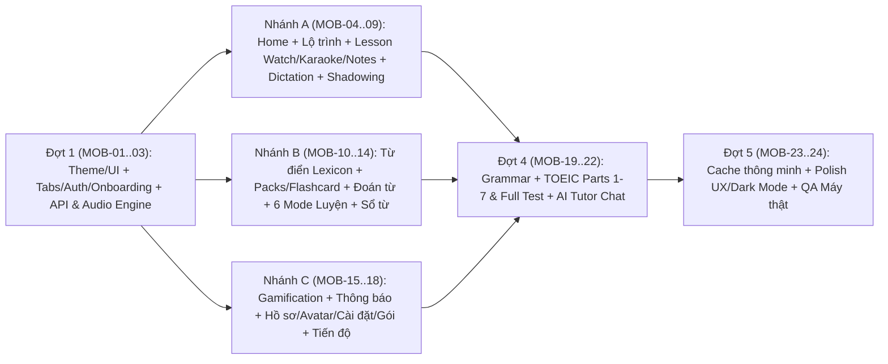

# Lyreo Mobile — Tài Liệu Bàn Giao Kỹ Thuật & Danh Mục Công Việc

> **Tài liệu tự chứa cho đội ngũ Lyreo Mobile:** Toàn bộ tính năng lớn và nhỏ, API, DTO và quy tắc nghiệp vụ bên dưới được đối chiếu trực tiếp từ cả **15 module Learner Backend** và mã nguồn `apps/mobile/`.
> **Quy tắc vàng:** Lấy từng mã `MOB-xx` đưa vào AI Agent đang mở repo `lyreo-platform` → **bắt buộc yêu cầu Agent đọc code thật và lập Plan để duyệt trước khi code**. Team được toàn quyền sửa Backend/DB/API/Header khi FE khó xử lý, và tự do research/cài thư viện Expo/RN tốt nhất (chỉ gợi ý, không ép cứng).

---

## 1. Bảng Danh Mục Công Việc (24 Gói Việc Đã Gom Nhóm)

> **Quy ước:**
> - **Ưu tiên:** `P0` (Bắt buộc làm trước — lõi sản phẩm), `P1` (Hoàn thiện đầy đủ trải nghiệm học), `P2` (Mở rộng & tối ưu phát hành).
> - **Cỡ:** `S` (0.5–1 ngày), `M` (1–2 ngày), `L` (2–4 ngày), `XL` (4–5 ngày).
> - **API chính:** Toàn bộ đường dẫn trong cột này mặc định có tiền tố `/api/v1` (rút gọn cho gọn bảng). Mô tả kỹ từng module và từng mã công việc nằm ở **Mục 4 & Mục 5** bên dưới.

| Mã | Đợt | Ưu tiên | Nhóm | Tên công việc | Cỡ | Phụ thuộc | Liên quan | Tóm tắt tính năng chính & Gợi ý UX / BE | API chính (tiền tố `/api/v1`) |
|---|---|---|---|---|---|---|---|---|---|
| MOB-01 | Đợt 1 | P0 | Nền tảng | Thiết kế lại Theme Sáng/Tối, Bộ UI Kit, Icon & Cài thư viện mở + Dev Client | XL | - | MOB-02, MOB-03 | Xóa 3 bảng màu scaffold cũ, dựng semantic theme Light/Dark rõ tương phản, bộ UI Kit + icon vector, chủ động research & cài thư viện Expo/RN tốt nhất (audio, YouTube, ảnh, animation, bottom sheet, FlashList...) và build lại Dev Client. | - |
| MOB-02 | Đợt 1 | P0 | Tài khoản | Navigation 5 Tab, SafeArea, Auth Hardening & Onboarding 3 bước | L | MOB-01 | MOB-04, MOB-17 | Gỡ `<SafeAreaView>` bọc cứng toàn app, dựng 5 tab chính; check `ROLE_LEARNER` chặn nhầm acc Admin, lưu PKCE chống Android kill, báo rõ khi acc bị khóa `401`, thêm `AppState` refresh; wizard Onboarding 3 bước (`goal`, `currentLevel`, `dailyMinutes`, `toeicTargetScore`) nhận `starterSuggestion`. | `GET /me`, `GET /learner/profile`, `PUT /learner/onboarding` |
| MOB-03 | Đợt 1 | P0 | Nền tảng | Nâng cấp API Client (headers/binary/errors) & Audio/Mic Engine `.m4a` | XL | MOB-01 | Toàn app | Thêm verb helpers, `createIdempotencyKey()`, đọc `Location`/`ETag`, truyền auth headers cho ảnh/audio, `AbortSignal`, không xóa trắng data khi focus refetch; xây Audio Player (HTTP Range `206`, tua ms, lặp A–B, tốc độ `0.5x–1.5x`) & Voice Recorder `.m4a` nghe lại ngay. *(Có thể chỉnh BE nếu cần tối ưu stream).* | `GET /lessons/{id}/audio`, `/shadowing-attempts/{id}/audio`, `/lexicon/.../audio`, `/vocabulary/.../media/...`, `/assessment-sessions/.../media/...` |
| MOB-04 | Đợt 2 | P0 | Trang chủ | Thay toàn bộ Mock Trang chủ bằng dữ liệu thật (Home Dashboard) | L | MOB-02, MOB-03 | MOB-05, MOB-15, MOB-16, MOB-18 | Xóa sạch số liệu giả & debug box `account-summary.tsx`; hiện tên/avatar, Streak, Kim cương, chuông `unreadCount`, thẻ **"Tiếp tục học"** 1 chạm (`/curriculum/continue` hoặc `starterSuggestion`), lối tắt Bài học / Đoán từ / Flashcard / Từ điển, thống kê tuần thật. *(Có thể thêm endpoint BFF Home ở BE).* | `GET /learner/profile`, `/gamification/summary`, `/curriculum/continue`, `/analytics/overview`, `/vocabulary/due`, `/notifications` |
| MOB-05 | Đợt 2 | P0 | Lộ trình | Danh sách Lộ trình, Cây bài học (bắt buộc/nhánh phụ) & Deep-link `config` | L | MOB-01, MOB-03 | MOB-04, MOB-07, MOB-08, MOB-09, MOB-12, MOB-13, MOB-19, MOB-20 | Duyệt lộ trình `PUBLISHED` (cover ETag, CEFR, `locked`, tiến độ), Enroll idempotent; cây `sections -> items` phân biệt mục bắt buộc (`required: true`) và nhánh mở rộng tùy chọn (`false`); xử lý đúng pre-enroll (`enrollmentStatus == null` → nút Enroll); deep-link kèm lát cắt `config` (`sentenceIds`, `entryIds`, `subtopicIds`, `parts`). | `GET /curriculum/paths`, `GET .../cover`, `GET .../paths/{id}`, `POST .../enroll`, `GET /curriculum/continue` |
| MOB-06 | Đợt 2 | P0 | Bài học | Thư viện Bài học (lọc đa tiêu chí) & Màn Tổng quan Bài học (Overview) | L | MOB-01, MOB-03 | MOB-07, MOB-08, MOB-09 | Xóa `lesson.tsx` giả; tìm kiếm, lọc Chủ đề (`categories` đa ngôn ngữ + `lessonCount`), CEFR, `sourceType` (`TEXT`/`AUDIO`/`YOUTUBE`), `activity`, phân trang `hasMore`, hiện `channelTitle`, `durationMs`, `locked`; trang Overview xem tiến độ từng activity & danh sách câu (`dictationSelected`, `shadowingSelected`). | `GET /lessons`, `GET /lessons/categories`, `GET /lessons/{id}` |
| MOB-07 | Đợt 2 | P0 | Bài học | Bài học — Watch / Listen Karaoke (Audio & YouTube) + Lớp Ngữ cảnh & Tra/Lưu từ 1 chạm | XL | MOB-03, MOB-06, MOB-10 | MOB-05, MOB-08, MOB-09, MOB-14, MOB-22 | Phát Audio gốc (`Range 206`) & YouTube clip (`sourceStartMs..sourceEndMs`); Karaoke sáng từng câu & từng từ (`words[]`), chạm câu nhảy mốc, lặp A–B, tốc độ session-only, dấu ngắt hơi `thoughtGroups[]`. Tích hợp 4 lớp kiến thức câu: `translation`, `ipa`, **từ vựng đáng học (`vocabulary[]` có `headwordId`)**, **ngữ pháp (`grammar[]`)**, **ghi chú (`notes[]`)**; chạm từ mở bottom-sheet Lexicon & lưu 1 chạm. | `GET /lessons/{id}/activities/{actId}`, `GET .../audio`, `POST .../complete`, `GET /learner/preferences`, `GET /lexicon/by-headword/{hid}`, `POST /vocabulary/saved-items` |
| MOB-08 | Đợt 2 | P0 | Bài học | Bài học — Nghe–Chép chính tả (Dictation 3 mức đục lỗ + Gợi ý Word Pool kéo/chạm từ) | XL | MOB-03, MOB-06 | MOB-05, MOB-07, MOB-09 | Đủ 3 mức `hintLevel` (`NONE` che hết, `EASY` đục lỗ dễ, `MEDIUM` đục lỗ vừa) + toggle `properNounHints` (tên riêng/số), lọc theo lát cắt `sentenceIds`; server chấm trả `serverScore`/`expectedText`, hiển thị diff từng từ & mở khóa kiến thức câu (`attempted`). **RCM UX:** thêm chế độ **Word Pool kéo/chạm thẻ từ ghép câu** cho đỡ gõ *(được phép thêm trường `wordPool` xáo trộn ở BE)*. | `GET /lessons/{id}/activities/{actId}?hintLevel=...&properNounHints=...`, `POST .../dictation/attempts` |
| MOB-09 | Đợt 3 | P0 | Bài học | Bài học — Shadowing trọn luồng (Thu âm `.m4a`, Chấm AI từng từ/IPA, Nghe lại & Lịch sử) | XL | MOB-03, MOB-06 | MOB-05, MOB-07, MOB-08, MOB-15 | Gọi `constraints?revision=...` (giới hạn giây, quota, `STALE_REVISION`), nghe mẫu kèm `thoughtGroups`/`ipa`, thu `.m4a` có đếm ngược/sóng âm & nghe thử; upload multipart (`Idempotency-Key` bắt buộc UUID) → poll `202` + Hủy `/cancel`; hiện 4 điểm thành phần & tô màu từng từ/âm vị IPA, nghe lại bản thu (lưu 24h), xử lý `NO_SPEECH`; kèm tab lịch sử `/attempts` & màn tổng kết bài. | `GET .../shadowing/sentences/{sid}/constraints`, `POST .../attempts`, `GET /shadowing-attempts/{id}`, `GET .../audio`, `POST .../cancel`, `GET /lessons/{id}/attempts` |
| MOB-10 | Đợt 2 | P0 | Từ điển | Từ điển Tra cứu chuyên sâu (5 loại từ, Biến thể, EN–VI/EN–EN & Phát âm đa vùng) | L | MOB-01, MOB-03 | MOB-07, MOB-14 | Tìm kiếm debounce giữ thứ tự server hỗ trợ 5 loại từ (`WORD`, `PHRASE`, `PHRASAL_VERB`, `IDIOM`, `COLLOCATION`) & 4 kiểu khớp (`EXACT_FORM` gõ `went` khớp `go`, tô đậm `matchedText`). Chi tiết có từ nguyên (`etymologyText`), bảng biến thể (`forms[]`), phát âm theo vùng UK/US/AU (`pronunciationVariants[]`, audio `Range 206`), 2 tab tách nguồn sạch `en-vi`/`en-en` (`readingModes`), bản quyền `licenseText` & lưu từng nghĩa. | `GET /lexicon/search`, `GET /lexicon/{id}`, `GET /lexicon/by-headword/{hid}`, `GET .../pronunciations/{pid}/audio` |
| MOB-11 | Đợt 2 | P0 | Từ vựng | Bộ từ chuẩn (Packs/Units giàu media, `modeAvailability`) & Học Flashcard SRS | XL | MOB-01, MOB-03 | MOB-05, MOB-12, MOB-13, MOB-14, MOB-15 | Duyệt Packs (cover ETag, `completedEntries/entryCount`, `locked`) & Units (CEFR); đọc **`modeAvailability`** hiện số câu từng mode (khóa mode 0 câu) & mở lối vào đồng đều cho **Đoán từ**, **Luyện 6 dạng** và **Flashcard**; thẻ từ có ảnh, audio UK/US, **audio 2 câu ví dụ**, `senses`, `collocations`, `family`, `synonyms`, `antonyms`, `contextNotes`. Kèm trình **Flashcard SRS** (`DUE_AND_NEW`/`ALL`, `counts`, lật/vuốt thẻ, 4 nút kèm `intervalPreviews`, `Idempotency-Key` + `expectedReviewCount`). | `GET /vocabulary/packs`, `GET .../cover`, `GET .../units`, `GET /vocabulary/units/{uid}`, `GET .../entries/{eid}/media/{aid}`, `GET /vocabulary/flashcards`, `POST .../entries/{eid}/flashcard-review` |
| MOB-12 | Đợt 2 | P0 | Từ vựng | Chế độ Đoán Từ tương tác (`GUESS_WORD` — Trụ cột ngang hàng Flashcard) | L | MOB-11 | MOB-05, MOB-13, MOB-14 | Trải nghiệm game đoán từ chủ lực ngang hàng Flashcard: hiện nghĩa, từ loại, IPA, ảnh/audio & chuỗi che chữ `maskedTerm` (`******`); nút **Mở từng chữ cái** (`/hint` cập nhật `revealedPositions`/`hintsRemaining`), nút **Kiểm tra ngay** (`/check` kèm `revision`, khóa câu sau check), nút **Đầu hàng xem đáp án** (`giveUp: true`); chơi được theo Unit, Cả Pack hoặc lát cắt `entryIds[]`. | `POST /vocabulary/units/{uid}/sessions`, `POST .../packs/{pid}/sessions`, `GET /vocabulary/sessions/{id}`, `POST .../questions/{qid}/hint`, `POST .../check`, `POST .../submit` |
| MOB-13 | Đợt 3 | P0 | Từ vựng | 6 Chế độ Luyện từ vựng, Chế độ `MIXED`, lát cắt `entryIds` & Lưu nháp 24h | XL | MOB-11 | MOB-05, MOB-12 | Làm UX cảm ứng mượt cho đủ 6 dạng + `MIXED` (`modes[]`): `CHOOSE_MEANING`, `CHOOSE_WORD`, `LETTER_SCRAMBLE` (chạm/kéo chữ từ `scrambledLetters` & `wordLengths`), `MISSING_LETTERS` (`blankPositions`), `LISTEN_WRITE` (nghe audio UK/US), `CONTEXT_CLOZE` (`clozeSentence` + `exampleVi`). Hỗ trợ Unit / Cả Pack / lát cắt `entryIds[]`; auto-save `answers` (`revision`), resume phiên `OPEN` 24h & lịch sử phiên (không đổi lịch SRS). | `POST .../units/{uid}/sessions`, `POST .../packs/{pid}/sessions`, `GET /vocabulary/sessions`, `GET .../sessions/{id}`, `PUT .../answers`, `POST .../submit` |
| MOB-14 | Đợt 3 | P1 | Từ vựng | Sổ từ cá nhân, Bộ sưu tập (Collections CRUD/Move) & Hàng đợi ôn SRS (`/due`) | L | MOB-10, MOB-11 | MOB-07, MOB-15 | CRUD bộ sưu tập (`coverPreset`, bộ mặc định "Đã lưu" không thể xóa `409`), lưu nhiều nghĩa khác nhau của 1 từ (`senseIndex`/`lexiconSenseId`) hoặc tự tạo `CUSTOM` (xử lý giới hạn 100 thẻ gói FREE -> `QUOTA_EXCEEDED`), tìm kiếm `q`, di chuyển hàng loạt `/move`, nghe media thẻ đã lưu, xóa thẻ, ôn SRS riêng `/due` + `/cards/{cid}/review`. *(Có thể thêm `intervalPreviews` ở BE cho `/due`).* | `CRUD /vocabulary/collections`, `.../items`, `.../move`, `POST /vocabulary/saved-items`, `GET .../media/{aid}`, `GET /vocabulary/due`, `POST /vocabulary/cards/{cid}/review`, `DELETE .../cards/{cid}` |
| MOB-15 | Đợt 3 | P1 | Thưởng | Gamification trọn gói: Level/XP, Streak (UTC), Nhiệm vụ Claim, Thành tựu & Sổ Kim cương | L | MOB-04 | MOB-09, MOB-11, MOB-19 | Thanh Level/XP + mốc thưởng lên cấp (`LEVEL_MILESTONE`), Streak hiện tại/kỷ lục (UTC), Nhiệm vụ đủ 3 chu kỳ `DAILY`/`WEEKLY`/`ONE_TIME` kèm nút **Claim thủ công** (`Idempotency-Key`); Thành tựu đủ 6 chỉ số với ảnh `badge` (ETag `304`) & tier màu; Sổ Kim cương bất biến phân trang hiển thị đủ 8 loại giao dịch. | `GET /gamification/summary`, `GET /gamification/missions`, `POST .../missions/{mid}/claim`, `GET /gamification/achievements`, `GET .../{id}/badge`, `GET /gamification/ledger` |
| MOB-16 | Đợt 3 | P1 | Thông báo | Hoàn thiện Hộp thư Thông báo (Lọc chưa đọc, Mark-read & đồng bộ badge Home) | S | MOB-04 | MOB-04 | Mở rộng `notifications-screen.tsx` (đã có `hasMore` & chống race khi refresh): phân biệt rõ tin chưa đọc/đã đọc, bộ lọc `unreadOnly`, bấm đọc gọi `/{id}/read`, nút "Đọc tất cả" `/read-all`, đồng bộ ngay `unreadCount` về chuông ở Trang chủ. | `GET /notifications`, `POST /notifications/{id}/read`, `POST /notifications/read-all` |
| MOB-17 | Đợt 3 | P1 | Tài khoản | Hồ sơ, Mục tiêu TOEIC, Đổi Avatar (4 nhóm Preset + Camera/EXIF), Cài đặt 9 mục & Gói Free/Plus | L | MOB-02, MOB-04 | MOB-07, MOB-08, MOB-18 | Sửa hồ sơ + mục tiêu TOEIC (`10..990` bội 5); đổi avatar từ 4 nhóm preset (Thú, Hoa, Nhân vật, Truyện tranh) hoặc chụp/chọn ảnh (xoay EXIF + nén ≤ 2 MiB JPEG/PNG, hoặc nâng cấp BE tự xoay EXIF); chia nhóm `settings.tsx` đủ 9 preferences (`preferredAccent`, `defaultPlaybackSpeed`, 4 timing `OFF/TAP_TO_SHOW/AFTER_ATTEMPT/ALWAYS`, 3 toggles), sửa copy lỗi; màn Gói thành viên (`FREE`/`PLUS`, `validUntil`, thanh quota). | `GET/PATCH /learner/profile`, `GET/PUT /learner/profile/avatar`, `GET/PUT /learner/preferences`, `GET /entitlements` |
| MOB-18 | Đợt 3 | P1 | Tiến độ | Phân tích Tiến độ học tập, Điểm yếu (`weaknesses`) & Lịch sử phiên gần đây | M | MOB-04, MOB-17 | MOB-13, MOB-19, MOB-20 | Mở rộng `learner-progress.tsx`: thêm cửa sổ hôm nay/tuần (ưu tiên số bài/từ/câu/ngày học thực tế vì `studySeconds` BE hiện trả `0`), `sampleCount` từng kỹ năng, danh sách điểm yếu dùng `label`/`labelEn` kèm nút "Luyện khắc phục ngay", và list ngắn các phiên Vocabulary/Grammar/TOEIC gần đây. | `GET /analytics/overview`, `GET /vocabulary/sessions`, `GET /assessment-sessions` |
| MOB-19 | Đợt 4 | P1 | Ngữ pháp | Danh mục Ngữ pháp phân cấp (Topic→Subtopic→Bank) & Quiz + Review chi tiết | M | MOB-01, MOB-03 | MOB-05, MOB-15, MOB-22 | Duyệt cây Topic → Subtopic → Bank (tên/mô tả song ngữ, khóa thừa kế từ Topic cha), tạo phiên `limit <= 50` (hỗ trợ `subtopicIds` từ lộ trình), auto-save `revision`, resume 24h; màn review sau nộp hiện đầy đủ `explanationVi`, `translationVi`, `answerTranslationVi`, `vocabularyNote`. | `GET /grammar/catalogs/{kind}/page`, `GET .../{id}`, `POST .../sessions`, `/assessment-sessions/**` |
| MOB-20 | Đợt 4 | P1 | TOEIC | Danh mục TOEIC (`PartBreakdown`, Drill/Full Test) & Trình làm Parts 1–5 + Review sâu | XL | MOB-03, MOB-01 | MOB-05, MOB-21, MOB-22 | Danh mục đề kèm năm/loại/phân bổ Part 1–7 (`PartBreakdown`), chọn `DRILL` (`parts[]`) hoặc `FULL_TEST`, khôi phục phiên `OPEN` 24h. Trình làm Parts 1–5: ảnh Part 1, audio Part 1–4 (`Range 206`), đúng 3 đáp án A/B/C cho Part 2 và ẩn chữ trước nộp, auto-save `revision`; màn kết quả hiện `accuracyPercent` (không bịa điểm 990 cho Drill) + `transcriptEn`, `translationVi`, `answerTranslationVi`, `explanationVi`, `vocabularyNote`. | `GET /toeic/catalog/page`, `GET .../catalog/{id}`, `POST .../sessions`, `GET /assessment-sessions`, `GET/PUT/POST /assessment-sessions/{id}/**` |
| MOB-21 | Đợt 4 | P2 | TOEIC | TOEIC Part 6, Part 7 (Tab Đoạn văn/Câu hỏi), Đồng hồ & Kết quả Full Test | L | MOB-20 | MOB-22 | Đồng hồ đếm ngược thật theo `listeningDurationSeconds`/`readingDurationSeconds`; giao diện chuyển tab gọn **"Đoạn văn / Câu hỏi"** + bảng nhảy nhanh từng câu cho Part 6 (`gapNumber`) & Part 7 (2–3 tài liệu), render HTML an toàn; hiển thị scaled scores (`listening`/`reading`/`total`) khi nộp `FULL_TEST` đúng theo server trả. | `POST /toeic/catalog/{id}/sessions` (`FULL_TEST`), `/assessment-sessions/{id}/**` |
| MOB-22 | Đợt 4 | P1 | Trợ lý AI | Trợ lý AI English Tutor theo ngữ cảnh (Lesson/Vocab/Grammar/TOEIC) & Lịch sử Chat | L | MOB-03, MOB-07 | MOB-10, MOB-19, MOB-20 | Nút **"Hỏi AI"** ngữ cảnh gắn tại câu Lesson / Từ điển / câu làm sai Grammar–TOEIC; màn hình lịch sử hội thoại (`lastMessagePreview`, `messageCount`), hỏi đáp gửi `Idempotency-Key`, cập nhật ngay `remainingQuota` & `quotaResetAt` (lỗi AI không mất oan lượt), đổi tên (`PATCH`) & xóa (`DELETE`). *(Có thể mở rộng `AskRequest` ở BE cho context có cấu trúc).* | `POST /chat/ask`, `GET /chat/conversations`, `GET/PATCH/DELETE .../conversations/{id}` |
| MOB-23 | Đợt 5 | P2 | Tối ưu | Cache Audio/Ảnh thông minh, Dọn cache Logout & Tinh chỉnh Bàn phím/Haptics/Dark Mode | L | MOB-03, MOB-11, MOB-17 | Toàn app | Preload audio/ảnh câu hoặc thẻ kế tiếp cho Lesson/Dictation/Flashcard; nút "Xóa bộ nhớ đệm" trong Cài đặt & tự xóa sạch cache riêng tư khi Logout/đổi tài khoản; chống bàn phím che nút Gửi (Dictation/Đoán từ/Listen-Write/Chat), thêm haptic nhẹ, rà tiếng Việt có dấu & độ tương phản Light/Dark trên màn nhỏ. | Media endpoints (`ETag` / `Range`) |
| MOB-24 | Đợt 5 | P2 | QA | Kiểm thử E2E thực địa toàn app trên Emulator & Thiết bị thật + Chốt toàn bộ Gate | L | Đợt 1–5 | Toàn app | Test thông suốt hành trình người học qua mọi màn hình trên Android/iOS thật (Login → Onboarding → Home → Curriculum → Watch/YouTube → Dictation → Shadowing → Lexicon → Vocab 4 trụ cột → Grammar → TOEIC → Gamification → Notifications → AI Tutor → Profile/Settings); fix dứt điểm bug FE/BE phát sinh; chốt xanh toàn bộ `typecheck`, `test`, `make validate` & Java IT liên quan. | Toàn bộ Learner API |

---

## 2. Quy Trình Làm Việc Bắt Buộc, Quyền Sửa Xuyên Tầng & Công Nghệ Mở

### 2.1 Quy trình bắt buộc: Plan-First với AI Agent trong dự án
1. **Chọn 1 mã công việc (`MOB-xx`)** ở bảng trên và kiểm tra các mã ở cột `Phụ thuộc` đã hoàn tất chưa.
2. **Đưa mã công việc vào AI Coding Agent đang mở trực tiếp repo `lyreo-platform`**, yêu cầu Agent:
   - Đọc Mục 4 (chi tiết tính năng module) và Mục 5 (đặc tả & file code/docs nguồn của `MOB-xx`) trong file này.
   - Đọc mã nguồn thật của Backend & Mobile trước khi thiết kế.
   - **Lập Kế hoạch triển khai (Plan) chi tiết để duyệt trước:** màn hình/component, luồng API/header/trạng thái lỗi, thư viện dự kiến cài thêm (nếu có), phần Backend/DB/API đề xuất sửa (nếu có) và phương án test.
3. **Duyệt Plan rồi mới code.** Không nhảy thẳng vào sửa code khi chưa thống nhất Plan.
4. **Kiểm chứng thực tế trước khi chốt:**
   - `pnpm --filter @lyreo/mobile typecheck && pnpm --filter @lyreo/mobile test`
   - `make validate`
   - Nếu có sửa Java Backend: `./mvnw -B -pl modules/<module-đã-sửa>,apps/core-service -am verify`

### 2.2 Quyền sửa xuyên tầng (Không ép cứng nếu FE gặp khó)
Nếu API, request/response, header, quy tắc lọc hay luồng dữ liệu hiện tại khiến Frontend phải xử lý quá phức tạp hoặc làm trải nghiệm di động bị gượng, đội Mobile **được quyền chủ động sửa cả Backend lẫn Database**:
- **Java Backend (`modules/*`, `libs/contracts/*`, `apps/core-service/*`):** Thêm/đổi field DTO, thêm query param/header, tạo endpoint BFF gom dữ liệu cho Mobile, hoặc đưa xử lý nặng lên server (VD: xoay ảnh EXIF khi upload avatar, trả `wordPool` xáo trộn cho Dictation ghép từ, thêm `intervalPreviews` cho `/vocabulary/due`, nhận context có cấu trúc cho AI Chat, ghi `studySeconds` cho Analytics).
- **Database (`apps/core-service/src/main/resources/db/migration/`):** Tạo thêm migration mới nối tiếp (`V021__...sql`, `V022__...sql`, ...). **Không sửa** các migration cũ (`V001`..`V020`).
- **Docs (`docs/`):** Khi cố ý đổi API/luật nghiệp vụ/biến môi trường, cập nhật đồng bộ [http-api-contract.md](../architecture/http-api-contract.md), `docs/requirements/*.md` và `.env.example`.

**4 ranh giới bắt buộc giữ vững (CI & `ArchitectureTest` kiểm soát):**
1. **Spring Modulith:** Giao tiếp giữa các module chỉ qua public/named API, shared contracts hoặc domain events; không import repository hay query thẳng bảng nội bộ của module khác.
2. **Server nắm quyền điểm, thưởng & quyền truy cập:** Client không tự gửi `score`, `xp`, `diamonds` hay tự đánh dấu `completed`; các thao tác ghi quan trọng dùng `Idempotency-Key` và `revision`.
3. **Bảo mật & Quyền riêng tư:** Không đưa secret vào `EXPO_PUBLIC_*`; không trả raw storage key cho client (luôn đi qua HTTP media endpoint được bảo vệ); `expo-secure-store` chỉ dùng trong `apps/mobile/src/auth/`.
4. **Quy tắc giao diện & i18n (`make validate` — [frontend.py](../../tooling/repo_checks/frontend.py)):** Tách riêng theme/component khỏi `apps/admin-web`; cấm hardcode màu hex/rgb ngoài `src/theme/{primitives,semantic}.ts`; cấm import `primitiveColors` ngoài `src/theme/`; đủ key `en` và `vi` trong `packages/i18n/src/locales/{en,vi}/mobile.json`.

### 2.3 Công nghệ & Thư viện MỞ (Chỉ gợi ý tham khảo, không gò bó)
- Code hiện tại trong `apps/mobile/` chỉ là khung khởi tạo tối thiểu (scaffold) trên **Expo + React Native + Expo Router** — màu sắc và component cũ là đồ dựng tạm, cần làm lại sạch sẽ.
- Mọi tên thư viện trong tài liệu **chỉ là gợi ý tham khảo (RCM)**. Khuyến khích team chủ động tìm tòi, nghiên cứu phương pháp UX và thư viện Expo/RN hiện đại, bảo trì tốt để app đạt chất lượng cao nhất (VD: `react-native-reanimated`, `react-native-gesture-handler`, `@gorhom/bottom-sheet`, `@shopify/flash-list`, `lucide-react-native`, `expo-audio`, `react-native-youtube-iframe`, `expo-image`, `expo-image-manipulator`, `expo-haptics`, `@tanstack/react-query`, `zustand`, thư viện waveform/lottie...).
- **Điều kiện duy nhất:** Tương thích **Expo Dev Client** (Lyreo **không dùng Expo Go**; chạy `make mobile-android-install` hoặc `expo prebuild` sau khi cài native module) và giữ xanh `typecheck`, `test`, `make validate`.

---

## 3. Hiện Trạng `apps/mobile/` & Môi Trường Chạy Thử

### 3.1 Đã chạy thật (giữ làm nền) vs Đang giả/thiếu (cần làm lại)
- **Giữ làm nền:** OIDC PKCE + `SessionManager` + `expo-secure-store` (`src/auth/`), `client.ts` tự refresh token 1 lần khi `401` & `errors.ts` map lỗi RFC 9457 (`src/api/`), màn `notifications-screen.tsx` (đã có `hasMore` + chống race refresh), `learner-progress.tsx` (đã gọi `analytics/overview`), `settings.tsx` (đã lưu một phần preferences & đổi ngôn ngữ/theme máy).
- **Cần đập đi làm lại / nâng cấp:**
  - `src/theme/primitives.ts` & `semantic.ts` chồng chéo 3 bảng màu, Light mode nền trùng card bị chìm.
  - `src/providers/AppProviders.tsx` bọc cứng `<SafeAreaView>` toàn app.
  - `src/components/ui/` mới có 3 file sơ sài, đang dùng emoji `💎` và ASCII `▂▄▆█`.
  - `home-screen.tsx`, `account-summary.tsx`, `app/(app)/lesson.tsx` là dữ liệu giả/debug 100%.
  - `src/auth/` thiếu check `ROLE_LEARNER`, thiếu Onboarding gate, thiếu lưu PKCE state chống Android kill, thiếu thông báo rõ khi acc bị khóa (`401`).
  - `src/api/client.ts` & `use-core-resource.ts` ép 2xx phải là JSON (chưa tải binary/đọc `Location`/`ETag`), focus refetch xóa trắng màn hình và nuốt `ApiError` chi tiết.

### 3.2 Tài khoản & cấu hình cục bộ
Xem [apps/mobile/README.md](../../apps/mobile/README.md) và [ACCOUNT.md](../ACCOUNT.md). Chạy `make migrate && make seed` để có sẵn:
- **Plus Learner (full dữ liệu & quyền):** `demo-learner-minh-anh` / `Password123!`
- **Free Learner (test paywall & hạn mức quota):** `demo-learner-gia-huy` / `Password123!`
- **New Learner (test Onboarding 3 bước & empty state):** `demo-learner-new` / `Password123!`
- Metro chạy port **8082**; Android Emulator nối host qua `10.0.2.2`, máy thật USB dùng `adb reverse`.

### 3.3 Chia luồng song song sau Đợt 1



---

## 4. Chi Tiết Toàn Bộ 15 Module Backend (Không Bỏ Sót Tính Năng Nhỏ)

### 4.1 Định danh, Hồ sơ, Avatar Preset, Cài đặt & Gói (`identity`, `learner`, `entitlement`)
- **Không có Guest Mode:** `GET /api/v1/me` trả `roles[]` — bắt buộc có `ROLE_LEARNER`.
- **Onboarding & `StarterSuggestion`:** `PUT /api/v1/learner/onboarding` nhận `goal` (`CONVERSATION|WORK|TOEIC|UNDECIDED`), `currentLevel` (`A1..C2|UNKNOWN`), `dailyMinutes` (`5..240`), `toeicTargetScore` (`10..990` bội 5); trả sẵn `starterSuggestion` (`topic`, `difficulty: BEGINNER|INTERMEDIATE|ADVANCED`, `dailyMinutes`).
- **Avatar 2 cách chọn:** 4 nhóm preset có sẵn (**Thú, Hoa, Nhân vật, Truyện tranh** qua `avatarPreset` ở `PATCH /profile`, mặc định chữ viết tắt) hoặc upload ảnh riêng tư JPEG/PNG ≤ 2 MiB (`PUT /profile/avatar`, tải về hỗ trợ `If-None-Match` `304`). Chú ý xử lý xoay EXIF từ camera ở FE hoặc nâng cấp BE.
- **9 tùy chọn đồng bộ (`LearnerPreferences`):** `preferredAccent` (`US|UK`), `defaultPlaybackSpeed` (`0.5..2.0`), 4 lớp hiển thị hỗ trợ đủ **4 mức `DisplayTiming` (`OFF`, `TAP_TO_SHOW`, `AFTER_ATTEMPT`, `ALWAYS`)** cho `translation`, `sentenceIpa`, `vocabularyNotes`, `grammarNotes`, cùng 3 công tắc `thoughtGroups`, `karaokeHighlighting`, `properNounHints`. Đổi tạm trong lúc học bài là state phiên (`FR-IDN-004`), không tự ghi đè Cài đặt.
- **Quyền gói & Quota (`GET /api/v1/entitlements`):** `tier` (`FREE|PLUS`), `validUntil`, danh sách `FeatureAccess` gồm `featureKey`, `granted`, `limitType`, `limit`, `used`, `remaining`, `resetAt` (UTC), `lockReason`.

### 4.2 Bài Học — Watch Karaoke, Ngữ Cảnh, Dictation & Shadowing (`lesson`, `speech-assessment`)
- **Đa nguồn (`TEXT`, `AUDIO`, `YOUTUBE`):** Catalog hỗ trợ tìm `q`, lọc `categoryId` (tên đa ngôn ngữ + `lessonCount`), `cefr`, `sourceType`, `activity`, trả `channelTitle`, `durationMs`, `imageUrl`, `sentenceCount`, `progress`, `locked`.
- **Chế độ Watch / Listen Karaoke:** Phát audio gốc (`Range 206`) hoặc YouTube theo đúng khoảng `videoId`, `sourceStartMs..sourceEndMs`; bôi sáng Karaoke từng câu và từng từ theo `words[].startMs..endMs`; chạm câu nhảy mốc; lặp A–B; tốc độ session-only; hiển thị dấu ngắt hơi **`thoughtGroups[]`**; hoàn thành gọi `POST .../complete`.
- **4 lớp kiến thức gắn từng câu (`SentenceView`):**
  1. `translation` (dịch câu) & `ipa` (`ipaAccent`, `ipaVersion`).
  2. **`vocabulary[]`** (từ vựng đáng học: `tokenStart..tokenEnd`, `surface`, `label`, `explanation`, `importance`, `canonicalForm`, **`headwordId`** → chạm mở ngay `GET /lexicon/by-headword/{headwordId}` & lưu từ 1 chạm).
  3. **`grammar[]`** (điểm ngữ pháp đáng học: `tokenStart..tokenEnd`, `surface`, `label`, `explanation`, `importance`).
  4. **`notes[]`** (ghi chú sắc thái/cách dùng tự nhiên: `tokenStart..tokenEnd`, `text`, `kind`).
- **Chế độ Dictation (`hintLevel` & Word Pool):**
  - 3 mức sẵn từ server: `NONE` (che toàn bộ), `EASY` (đục lỗ ít), `MEDIUM` (đục lỗ vừa) + công tắc `properNounHints` (hé lộ tên riêng, số, viết tắt). Trước khi nộp (`attempted = false`), server ẩn `expectedText`, dịch, IPA và ghi chú.
  - Nộp qua `POST .../dictation/attempts` (`Idempotency-Key`, `{ sentenceId, answer }`) → server trả `serverScore`, `expectedText`, `completedItems/totalItems`, `activityCompleted`, `lessonCompleted` và mở khóa toàn bộ kiến thức câu.
  - **RCM UX cho di động:** Làm thêm chế độ **Word Pool kéo/chạm thẻ từ lắp câu** song song gõ bàn phím (có thể thêm trường `wordPool` xáo trộn từ phía server trong `SentenceView` để không lộ đáp án trước khi nộp).
- **Chế độ Shadowing & Lịch sử:** `constraints?revision=...` kiểm tra giới hạn giây, 8 MiB, quota và `STALE_REVISION` → ghi âm **AAC `.m4a`** (Backend gắn `ffmpeg` tự chuyển sang 16kHz mono WAV cho Azure; tránh `.3gp`/`.caf`) → upload multipart (`Idempotency-Key` bắt buộc UUID) → poll `202` + hủy `/cancel` → hiển thị `overallScore`, 4 điểm (Accuracy, Fluency, Completeness, Prosody), tô màu từng từ/âm vị IPA (`result` đã bỏ `providerRaw`), nghe lại bản thu `/audio` (`Range 206`, lưu 24h), xử lý `NO_SPEECH`, xem lịch sử `/lessons/{id}/attempts`.

### 4.3 Từ Điển Chuyên Sâu (`lexicon`)
- **Tìm kiếm thông minh:** Hỗ trợ 5 loại mục từ (`WORD`, `PHRASE`, `PHRASAL_VERB`, `IDIOM`, `COLLOCATION`) và 4 kiểu khớp (`EXACT_HEADWORD`, `EXACT_FORM` — gõ `went` khớp `go`, `PREFIX_HEADWORD`, `PREFIX_FORM`) kèm `matchedText`, giữ nguyên xếp hạng server + `hasMore`.
- **Chi tiết từ:** Nhiều từ loại & nguồn gốc từ nguyên (`etymologyNumber`, `etymologyText`), bảng biến thể (`forms[]` quá khứ/phân từ/số nhiều), nhóm phát âm theo vùng miền (`pronunciationVariants[]` UK/US/AU + `audioEndpoint` Range `206`), 2 chế độ đọc tách nguồn sạch **`en-vi` và `en-en`** (`readingModes`, báo rõ nếu chỉ có tiếng Anh), ví dụ, bản quyền `licenseText` và lưu từng nghĩa cụ thể.

### 4.4 Từ Vựng — 4 Trụ Cột Ngang Hàng (`vocabulary`)
1. **Bộ từ chuẩn (Packs & Units):** Có `completedEntries/entryCount` vẽ thanh tiến độ; `UnitDetail` trả **`modeAvailability`** (`Map<PracticeMode, Integer>`) cho biết trước số câu khả dụng của từng mode trong 8 mode; mỗi từ có ảnh, phát âm **UK**, **US**, **audio 2 câu ví dụ** (`exampleAudioUrl`, `secondExampleAudioUrl`), nhiều `senses[]`, `examples`/`examplesVi`, `collocations`, `family`, `synonyms`, `antonyms`, `contextNotes`.
2. **Đoán Từ tương tác (`GUESS_WORD` — ngang hàng hoặc hấp dẫn hơn Flashcard):** Hiển thị nghĩa, từ loại, IPA, ảnh/audio, chuỗi che ký tự `maskedTerm`, `maxHints`/`hintsUsed`/`hintsRemaining`; vòng tương tác mở từng chữ cái (`/hint`), kiểm tra ngay từng câu (`/check` + `revision`, khóa câu sau check), đầu hàng xem đáp án (`giveUp: true`), hỗ trợ Unit / Cả Pack / lát cắt `entryIds[]`.
3. **6 Chế độ Luyện tập & `MIXED` + Lưu nháp 24h:** `CHOOSE_MEANING`, `CHOOSE_WORD`, `LETTER_SCRAMBLE` (có sẵn `scrambledLetters[]` & `wordLengths[]` cực hợp kéo/chạm thẻ chữ), `MISSING_LETTERS` (`blankPositions`), `LISTEN_WRITE` (audio UK/US), `CONTEXT_CLOZE` (`clozeSentence`, `spanStart..spanEnd`, `exampleVi`) và `MIXED` (`modes[]`); tạo phiên theo Unit, Cả Pack hoặc lát cắt `entryIds[]` (giữ full pool làm nhiễu 4 đáp án); auto-save `PUT /answers`, resume phiên `OPEN` 24h & lịch sử; không đổi lịch SRS.
4. **Flashcard SRS & Sổ từ cá nhân (`Collections` + `/due`):**
   - Flashcard bộ chuẩn (`DUE_AND_NEW` / `ALL`): có `counts` đầy đủ (`dueCount`, `newCount`, `learningCount`, `masteredCount`...) và `intervalPreviews` 4 nút `AGAIN|HARD|GOOD|EASY`; chế độ `ALL` ôn thẻ chưa đến hạn vẫn tính SRS nhưng không cộng thưởng lặp.
   - Sổ từ cá nhân: lưu nhiều nghĩa riêng biệt của cùng 1 từ (`senseIndex`/`lexiconSenseId`) với snapshot bất biến hoặc tự thêm `CUSTOM` (gói FREE tối đa 100 thẻ -> `QUOTA_EXCEEDED`), CRUD bộ sưu tập (`coverPreset`, bộ mặc định "Đã lưu" không xóa được `409`), tìm kiếm `q`, di chuyển hàng loạt `/move`, nghe media thẻ đã lưu, và ôn SRS `/due` + `/cards/{cid}/review` (cũng chống thưởng lặp).

### 4.5 Lộ Trình, Ngữ Pháp, TOEIC, Điểm Thưởng, Thông Báo, Tiến Độ & AI Tutor
- **Curriculum (`curriculum`):** Phân biệt mục bắt buộc (`required: true`) vs nhánh mở rộng tùy chọn (`false`); kiểm tra `enrollmentStatus == null` trước khi báo khóa; thẻ "Tiếp tục học" (`ContinueLearningView`) có sẵn tên lộ trình/chương/bài & `config`; deep-link truyền đúng slice `sentenceIds`, `entryIds`, `subtopicIds`, `parts`, `questionCount` (hoàn thành đúng slice là tự mở mục tiếp theo).
- **Grammar & TOEIC (`grammar`, `toeic`, `assessment`):**
  - Grammar cây `Topic → Subtopic → Bank` song ngữ, khóa thừa kế từ Topic cha, tối đa 50 câu/lượt.
  - TOEIC có `PartBreakdown` từng part, đồng hồ đếm ngược thật theo `listeningDurationSeconds`/`readingDurationSeconds`; Part 2 đúng 3 đáp án A/B/C; Part 1–2 ẩn chữ trước nộp; Part 6 giữ đúng `gapNumber`; Part 7 nên làm tab **"Đoạn văn / Câu hỏi"** + bảng nhảy câu.
  - **Review sau nộp cực giàu:** `explanationVi`, **`translationVi`**, **`answerTranslationVi`** (dịch từng đáp án A/B/C/D), **`vocabularyNote`**, và `transcriptEn`/`translationVi` cho cả Group Listening/Reading. **Không bịa điểm quy đổi 990 cho Drill** (chỉ hiện scaled scores khi server trả ở `FULL_TEST`).
- **Gamification (`gamification`):** Level/XP + mốc thưởng lên cấp (`LEVEL_MILESTONE`), Streak theo ngày UTC, Nhiệm vụ đủ 3 chu kỳ **`DAILY`, `WEEKLY`, `ONE_TIME`** với nút **Claim thủ công**, Thành tựu cho đủ 6 chỉ số (Streak, Lesson, Vocab, TOEIC, Shadowing, Grammar) kèm `badge` ETag `304`, Sổ Kim cương phân trang đủ 8 `DiamondTransaction.Type`.
- **Notifications (`notification`):** 4 loại `SYSTEM`, `STUDY_REMINDER`, `REWARD`, `PROMO`, lọc `unreadOnly`, `/{id}/read`, `/read-all`, đồng bộ `unreadCount`.
- **Analytics (`analytics`):** `today` & `week` activity counts (`studySeconds` hiện `0` nên ưu tiên số bài/từ/câu/ngày học), `skills[]` kèm `sampleCount`, **`weaknesses[]`** có sẵn `label`/`labelEn` & `severity` để gắn nút luyện khắc phục.
- **AI Tutor (`chat`):** Hỏi đáp kèm `Idempotency-Key`, trả ngay `remainingQuota` & `quotaResetAt` (lỗi AI tự hoàn quota), lịch sử hội thoại có `lastMessagePreview` & `messageCount`, đổi tên & xóa hội thoại.

---

## 5. Tài Liệu & Mã Nguồn Cần Đọc + Tiêu Chí Xong Theo Từng Mã Công Việc

- **`MOB-01`:** Đọc `apps/mobile/src/theme/*`, `package.json`, `app.json`, `src/components/ui/*`, `packages/i18n/src/locales/{en,vi}/mobile.json`. *Xong khi:* Theme Light/Dark rõ chiều sâu, bộ UI Kit + icon vector đầy đủ, cài thư viện mở & `make mobile-android-install` build sạch, `make validate` pass.
- **`MOB-02`:** Đọc `apps/mobile/app/(app)/_layout.tsx`, `src/providers/AppProviders.tsx`, `src/auth/*`, `src/navigation/root-route.ts`, `modules/learner/.../LearnerController.java`. *Xong khi:* 5 tab mượt, `route-contract.test.ts` pass, 3 demo user đi đúng luồng (New qua Onboarding, Locked hiện lý do rõ, Admin-only bị chặn lịch sự).
- **`MOB-03`:** Đọc `apps/mobile/src/api/*`, `src/tests/api-client.test.ts`, `platform/content/.../ByteRangeResponses.java`. *Xong khi:* `api-client.test.ts` pass, phát audio seed tua/lặp/tốc độ mượt, ghi `.m4a` nghe lại rõ trên emulator/máy thật.
- **`MOB-04`:** Đọc `apps/mobile/src/features/home/home-screen.tsx`, `src/features/account/account-summary.tsx`, `modules/curriculum/.../ContinueLearningView.java`. *Xong khi:* Không còn số giả hay debug box; dữ liệu thật khớp trên cả 3 demo user.
- **`MOB-05`:** Đọc `modules/curriculum/.../CurriculumController.java`, `CurriculumService.java`. *Xong khi:* Enroll idempotent, cây bài học hiển thị chuẩn bắt buộc/nhánh phụ, bấm item mở đúng màn & lát cắt `config`, xong tự mở khóa mục sau.
- **`MOB-06`:** Đọc `modules/lesson/.../LearnerLessonController.java`, `LearnerLessonQuery.java`. *Xong khi:* Tìm kiếm + lọc đa tiêu chí + phân trang mượt trên data seed; Overview đủ tiến độ & danh sách câu.
- **`MOB-07`:** Đọc `modules/lesson/.../LearnerLessonService.java`, `AuthoringSentence.java`, `modules/lexicon/.../LexiconController.java`. *Xong khi:* Karaoke sáng đúng từng từ trên cả Audio & YouTube, đủ 4 lớp kiến thức câu, chạm từ tra & lưu không rời bài học, hoàn thành Watch cập nhật tiến độ.
- **`MOB-08`:** Đọc `modules/lesson/.../LessonPracticeController.java`, `DictationMaskingPolicy.java`, `LessonPracticeService.java`. *Xong khi:* Chạy mượt đủ 3 mức `hintLevel` + `properNounHints` (+ Word Pool nếu chọn làm), diff rõ từng từ, hoàn thành lát cắt `sentenceIds` cập nhật đúng lộ trình.
- **`MOB-09`:** Đọc `modules/speech-assessment/.../LearnerShadowingController.java`, `LearnerPronunciationAttempts.java`. *Xong khi:* Thu `.m4a` đúng giới hạn, upload + poll `202` + hủy `/cancel`, hiện 4 điểm & màu từ/IPA, nghe lại bản thu HTTP `206`, xem lịch sử & tổng kết bài.
- **`MOB-10`:** Đọc `modules/lexicon/.../LexiconController.java`, `LexiconAudioController.java`. *Xong khi:* Tìm kiếm khớp cả dạng biến thể (`EXACT_FORM`), đổi tab EN–VI/EN–EN sạch nguồn, phát audio đa vùng giọng & lưu đúng nghĩa đang xem.
- **`MOB-11`:** Đọc `modules/vocabulary/.../VocabularyStudyController.java`, `VocabularyStudyService.java`, `VocabularyStudyModels.java`. *Xong khi:* Duyệt Pack/Unit hiện `modeAvailability`, nghe đủ audio từ & 2 câu ví dụ; Flashcard SRS chạy cả `DUE_AND_NEW`/`ALL` với 4 nút `intervalPreviews`.
- **`MOB-12`:** Đọc `VocabularyStudyController.java`, `VocabularyExerciseGenerator.java`. *Xong khi:* Chơi trọn phiên Đoán từ (`GUESS_WORD`), dùng `/hint` từng chữ, `/check` từng câu, `giveUp` và xem tổng kết cho Unit/Pack/slice `entryIds`.
- **`MOB-13`:** Đọc `VocabularyStudyController.java`, `VocabularyStudyService.java`, `VocabularyStudyModels.java`. *Xong khi:* Chơi mượt đủ 6 chế độ + `MIXED` + lát cắt `entryIds`, thoát ra mở lại resume đúng chỗ trong 24h, không ảnh hưởng lịch SRS.
- **`MOB-14`:** Đọc `VocabularyCollectionController.java`, `VocabularyController.java`, `VocabularyCommandService.java`. *Xong khi:* CRUD bộ sưu tập, lưu nhiều nghĩa của 1 từ, chuyển bộ `/move`, xử lý giới hạn 100 thẻ FREE và ôn `/due` trọn vẹn.
- **`MOB-15`:** Đọc `modules/gamification/.../GamificationController.java`, `DiamondTransaction.java`. *Xong khi:* Hiển thị đủ Level/XP/Streak UTC, Claim nhiệm vụ tăng đúng XP/Kim cương & khóa tái nhận, badge ETag `304`, sổ Kim cương cuộn nhiều trang khớp số dư.
- **`MOB-16`:** Đọc `apps/mobile/src/features/notifications/notifications-screen.tsx`, `LearnerNotificationController.java`. *Xong khi:* Lọc chưa đọc, mark-read 1 tin & đọc tất cả cập nhật ngay badge Home, giữ pass test chống race refresh.
- **`MOB-17`:** Đọc `modules/learner/.../LearnerController.java`, `LearnerAvatarImage.java`, `apps/mobile/app/(app)/settings.tsx`, `LearnerEntitlementController.java`. *Xong khi:* Lưu đủ hồ sơ + avatar preset/upload đúng chiều EXIF, đủ 9 preferences theo nhóm, hiện chính xác gói Free/Plus & quota.
- **`MOB-18`:** Đọc `apps/mobile/src/features/progress/learner-progress.tsx`, `modules/analytics/.../AnalyticsOverview.java`. *Xong khi:* Hiện đầy đủ chỉ số hôm nay/tuần thật, điểm yếu có nhãn dịch + lối tắt luyện khắc phục và danh sách phiên gần đây.
- **`MOB-19`:** Đọc `modules/grammar/.../GrammarCatalogController.java`, `AssessmentSessionController.java`. *Xong khi:* Duyệt Topic→Subtopic→Bank (đúng khóa thừa kế), làm quiz <= 50 câu, xem đủ giải thích/dịch/vocabNote sau nộp & mở khóa lộ trình.
- **`MOB-20`:** Đọc `modules/toeic/.../ToeicCatalogController.java`, `AssessmentSessionController.java`, `AssessmentSessions.java`. *Xong khi:* Bắt đầu & resume được Drill/Full Test, làm trọn Parts 1–5 (Part 2 đúng 3 đáp án), xem đầy đủ transcript/dịch/giải thích/vocabNote sau nộp và không bịa điểm 990 cho Drill.
- **`MOB-21`:** Đọc `PublishedToeicTests.java`, `AssessmentSessions.java`. *Xong khi:* Đồng hồ đếm ngược thật, Part 6–7 chuyển tab Đoạn văn/Câu hỏi mượt không vỡ layout trên màn dọc, nộp Full Test hiện đúng scaled scores từ server.
- **`MOB-22`:** Đọc `modules/chat/.../EnglishTutorController.java`, `EnglishTutorService.java`. *Xong khi:* Hỏi AI ngữ cảnh trực tiếp từ màn học, giữ ngữ cảnh hội thoại, đổi tên/xóa hội thoại mượt, cập nhật đúng quota còn lại.
- **`MOB-23`:** Đọc `apps/mobile/src/api/`, `src/auth/session-manager.ts`, `src/theme/*`, `app/(app)/settings.tsx`. *Xong khi:* Chuyển câu/thẻ mượt nhờ prefetch, Logout dọn sạch cache riêng tư, không lỗi bàn phím che nút hay vỡ tiếng Việt trên màn nhỏ & Dark mode.
- **`MOB-24`:** Đọc `apps/mobile/README.md`, `Makefile`. *Xong khi:* Chạy thông suốt toàn bộ luồng trên Emulator + máy thật Android/iOS; toàn bộ `typecheck`, `test`, `make validate` và Java IT liên quan xanh 100%.

---

## 6. Mẫu Lệnh Giao Việc Chuẩn Cho AI Agent (Bắt Buộc Lên Plan Trước)

```text
Hãy chuẩn bị triển khai công việc [MÃ_TASK — VD: MOB-12] trong repo lyreo-platform theo hướng dẫn tại docs/mobile/HANDOFF_AND_BACKLOG.md.

QUY TRÌNH BẮT BUỘC — KHÔNG CODE NGAY:
1. Đọc Mục 2, Mục 4 và phần chi tiết của [MÃ_TASK] trong docs/mobile/HANDOFF_AND_BACKLOG.md, sau đó mở đọc mã nguồn thật của các file Backend, Mobile và Docs được liệt kê.
2. Lập bản Kế hoạch triển khai (Plan) chi tiết gửi tôi duyệt trước, gồm:
   - Màn hình, component và luồng UX dự kiến (tối ưu trải nghiệm di động).
   - Các API/DTO/header sẽ gọi và cách xử lý loading/empty/error/quota/revision.
   - Đề xuất thư viện Expo/React Native tốt nhất nếu cần cài thêm (chủ động research, không tự gò bó theo scaffold cũ, miễn tương thích Expo Dev Client).
   - Đề xuất chỉnh sửa Backend Java / API request-response / header / Flyway migration mới (V021+) nếu thiết kế hiện tại làm FE khó xử lý hoặc trải nghiệm kém (giữ đúng Spring Modulith và server-side authority).
   - Phương án kiểm thử cụ thể.
3. CHỜ tôi xác nhận Plan rồi mới bắt đầu sửa code.
4. Quy tắc bắt buộc khi triển khai:
   - Không hardcode màu hex/rgb ngoài apps/mobile/src/theme/{primitives,semantic}.ts; thêm đủ bản dịch en & vi vào packages/i18n/src/locales/{en,vi}/mobile.json.
   - Cập nhật docs/architecture/http-api-contract.md và test liên quan nếu có sửa Backend/API.
   - Chạy kiểm chứng thực tế trước khi báo xong:
     `pnpm --filter @lyreo/mobile typecheck && pnpm --filter @lyreo/mobile test`
     `make validate`
     và `./mvnw -B -pl modules/<module-đã-sửa>,apps/core-service -am verify` (nếu có sửa Java).
```

---

## 7. Các Điểm Mở Cần Theo Dõi

Chi tiết các quyết định mở nằm tại [open-questions.md](../requirements/open-questions.md):

1. **YouTube Playback (`OQ-001` — `MOB-07`):** Kiểm thử kỹ tua/dừng theo đoạn `sourceStartMs..sourceEndMs` và hành vi khi đưa app xuống nền.
2. **Mở rộng Dictation Word Pool (`MOB-08`):** Nếu triển khai chế độ ghép thẻ từ cho di động, thống nhất thêm trường `wordPool` đã xáo trộn từ phía server trong `SentenceView` để giữ ẩn `expectedText` trước khi nộp.
3. **Ghi nhận thời lượng học (`studySeconds` — `MOB-18`):** Hiện `analytics/overview` trả `0`; ưu tiên số bài/từ/câu/ngày học thực tế hoặc đề xuất bổ sung ghi thời lượng phía Backend.
4. **Xoay ảnh Avatar theo EXIF (`MOB-17`):** Kết hợp xoay/nén ảnh ở client bằng `expo-image-manipulator` và bổ sung đọc EXIF phòng thủ trong `LearnerAvatarImage.java` ở Backend.
