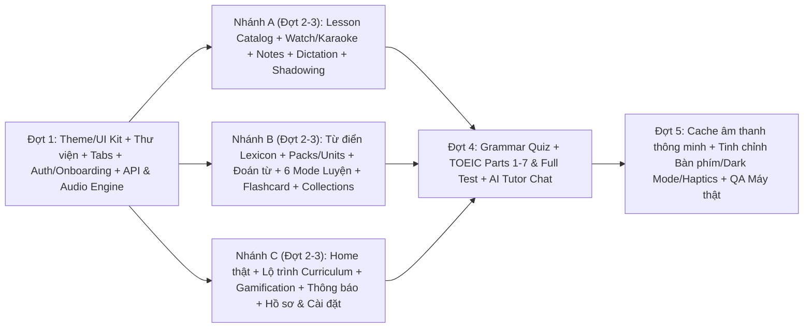

# Lyreo Mobile — Tài Liệu Bàn Giao Kỹ Thuật & Danh Mục Công Việc (Backlog)

> **Mục đích tài liệu:** Bản đặc tả bàn giao đầy đủ, tự chứa (self-contained) dành cho đội ngũ phát triển ứng dụng **Lyreo Mobile**. Toàn bộ tính năng lớn và nhỏ, DTO, quy tắc nghiệp vụ và danh sách API trong tài liệu này đã được rà soát trực tiếp trên cả **15 module Learner Backend** và mã nguồn hiện có của `apps/mobile/`.
>
> **Tham chiếu gốc trong dự án:** Bản đồ tài liệu tại [docs/README.md](../README.md), hợp đồng HTTP tại [http-api-contract.md](../architecture/http-api-contract.md), tài liệu yêu cầu tại `docs/requirements/*.md`.

---

## 1. Quy Trình Làm Việc Bắt Buộc & Quyền Chủ Động Toàn Diện

### 1.1 Quy trình triển khai bắt buộc (Plan-First với Agent trong dự án)

Mỗi công việc trong tài liệu này **bắt buộc** đi qua đúng 4 bước — không nhảy thẳng vào viết code khi chưa có kế hoạch:

1. **Chọn 1 mã công việc (`MOB-xxx`)** theo thứ tự ưu tiên và kiểm tra các mã ở cột `Phụ thuộc` đã hoàn tất chưa.
2. **Đưa mã công việc vào AI Coding Agent đang mở trực tiếp repo `lyreo-platform`**, yêu cầu Agent:
   - Đọc phần mô tả miền tính năng (Mục 3) và phần đặc tả chi tiết của `MOB-xxx` (Mục 6.2) trong file này.
   - Đọc mã nguồn thật của các file Backend, Mobile và Docs liên quan.
   - **Lập Kế hoạch triển khai (Plan) chi tiết trước khi sửa code:** màn hình/component sẽ làm, luồng gọi API/header/trạng thái lỗi, thư viện dự kiến cài thêm (nếu có), phần Backend/DB/API cần điều chỉnh (nếu có) và phương án kiểm thử.
3. **Duyệt Plan rồi mới code:** Chỉ triển khai sau khi người phụ trách đã xem và đồng ý với Plan.
4. **Kiểm chứng thực tế trước khi đóng công việc:**
   - `pnpm --filter @lyreo/mobile typecheck && pnpm --filter @lyreo/mobile test`
   - `make validate`
   - Nếu có sửa Java Backend: `./mvnw -B -pl modules/<module-đã-sửa>,apps/core-service -am verify`

### 1.2 Quyền sửa xuyên tầng (Frontend, Backend, Logic, API, Header & Database)

Đội Mobile **KHÔNG bị ép cứng phải gồng gánh logic khó ở Frontend**. Nếu API hiện tại, định dạng request/response, header, quy tắc lọc hay luồng dữ liệu khiến FE khó triển khai hoặc làm trải nghiệm di động kém mượt, đội Mobile **được phép chủ động sửa xuyên tầng**:

- **Backend Java (`modules/*`, `libs/contracts/*`, `apps/core-service/*`):** Thêm field DTO, đổi/mở rộng request–response, thêm header/query param, tạo endpoint tổng hợp (BFF) cho Mobile, hoặc xử lý nặng phía server (ví dụ: xoay ảnh EXIF khi upload avatar, trả sẵn danh sách `wordPool` xáo trộn cho Dictation ghép từ, bổ sung `intervalPreviews` cho `/vocabulary/due`, nhận ngữ cảnh có cấu trúc trong Chat `AskRequest`, ghi nhận thời lượng `studySeconds`, v.v.).
- **Database (`apps/core-service/src/main/resources/db/migration/`):** Thêm migration nối tiếp (`V021__...sql`, `V022__...sql`, ...). **Tuyệt đối không sửa** các migration cũ đã áp dụng (`V001`..`V020`).
- **Tài liệu & Hợp đồng (`docs/`):** Khi cố ý thay đổi API, luật sản phẩm hoặc biến môi trường, cập nhật đồng bộ [http-api-contract.md](../architecture/http-api-contract.md), file `docs/requirements/*.md` liên quan và `.env.example`.

**4 ranh giới nền tảng bắt buộc giữ vững (được CI & `ArchitectureTest` bảo vệ):**
1. **Spring Modulith:** Module chỉ giao tiếp qua public/named API, shared contracts hoặc domain events; không import repository hay query trực tiếp bảng nội bộ của module khác.
2. **Server quyết định điểm, thưởng & quyền truy cập:** Client không gửi `score`, `xp`, `diamonds` hay tự đánh dấu `completed`; các thao tác ghi quan trọng dùng `Idempotency-Key` và `revision`.
3. **Bảo mật & Quyền riêng tư:** Không đưa secret vào `EXPO_PUBLIC_*`; không trả raw storage key (R2/local path) cho client; `expo-secure-store` chỉ dùng trong `apps/mobile/src/auth/`.
4. **Quy tắc giao diện & i18n để `make validate` xanh ([frontend.py](../../tooling/repo_checks/frontend.py)):**
   - Giữ hệ thống theme/component của Mobile tách biệt hoàn toàn khỏi `apps/admin-web`.
   - Không viết cứng mã màu hex/rgb trực tiếp trong JSX/`StyleSheet` — mọi màu khai báo qua semantic token trong `src/theme/primitives.ts` và `src/theme/semantic.ts` (không import `primitiveColors` ngoài `src/theme/`).
   - Mọi khóa dịch `t('...')` phải khai báo đủ cả `en` và `vi` trong `packages/i18n/src/locales/{en,vi}/mobile.json`.

### 1.3 Công nghệ, Thư viện & Phương pháp UX MỞ (Chỉ gợi ý tham khảo, không gò bó)

> **Quan trọng:** Mọi thư viện hoặc phương án UX nhắc tới trong file này **chỉ là gợi ý tham khảo (RCM)**, **KHÔNG phải yêu cầu bắt buộc**.

- `apps/mobile/` hiện mới dừng ở khung khởi tạo cơ bản trên **Expo + React Native + Expo Router**. Toàn bộ màu sắc, font, component cũ chỉ là **đồ dựng tạm (scaffold)** để test build và login.
- **Khuyến khích tìm tòi, nghiên cứu thư viện & phương pháp mới:** Team được tự do chọn thư viện phổ biến, bảo trì tốt cho Expo/React Native để app đạt trải nghiệm đẹp và mượt nhất — ví dụ:
  - *UI & Styling:* Tự thiết kế hệ màu, typography, spacing, bộ component mới (hoặc kết hợp thư viện UI tương thích React Native / NativeWind).
  - *Animation & Gesture:* `react-native-reanimated`, `react-native-gesture-handler`, `@gorhom/bottom-sheet`, `moti`, `lottie-react-native`...
  - *Hiệu năng danh sách & Ảnh:* `@shopify/flash-list`, `expo-image`, `expo-image-manipulator`.
  - *Audio, Video & Thu âm:* `expo-audio` / `react-native-track-player`, `react-native-youtube-iframe`, `react-native-webview`, thư viện vẽ waveform...
  - *Icon, Haptic, State & Cache:* `lucide-react-native`, `expo-haptics`, `@tanstack/react-query` / `zustand`...
- **Điều kiện duy nhất:** Thư viện native phải tương thích **Expo Dev Client** (Lyreo **không dùng Expo Go** — sau khi thêm native module chạy `make mobile-android-install` hoặc `expo prebuild` tương ứng) và giữ xanh `typecheck`, `test`, `make validate`.

---

## 2. Hiện Trạng Codebase `apps/mobile/`

### 2.1 Những phần đã chạy thật & nên giữ làm nền
- **Auth OIDC PKCE (`apps/mobile/src/auth/`):** `oidc.ts`, `session-manager.ts`, `session-storage.ts` đã nối Keycloak và lưu refresh token bằng `expo-secure-store`.
- **API Client & Map lỗi (`apps/mobile/src/api/`):** `client.ts` tự refresh token 1 lần khi `401`; `errors.ts` đã map sẵn các mã lỗi RFC 9457 (`FEATURE_ENTITLEMENT_REQUIRED`, `QUOTA_EXCEEDED`, `STALE_REVISION`, `SESSION_EXPIRED`, `IDEMPOTENCY_CONFLICT`, `PAYLOAD_TOO_LARGE`, `RATE_LIMITED`).
- **3 màn hình đã nối API thật nhưng chưa đầy đủ:**
  - `notifications-screen.tsx`: đã có phân trang `hasMore` và chống race-condition khi kéo làm mới; còn thiếu trạng thái đã đọc/chưa đọc, lọc `unreadOnly`, nút đánh dấu đã đọc (`/{id}/read`, `/read-all`) và đồng bộ badge Home.
  - `learner-progress.tsx`: đã gọi `/api/v1/analytics/overview`; còn thiếu số liệu hôm nay, số lượng mẫu kỹ năng, nút luyện khắc phục điểm yếu và lịch sử các phiên gần đây.
  - `settings.tsx`: đã lưu một phần preferences & đổi ngôn ngữ/theme máy; nhưng giao diện bị phẳng, thiếu `preferredAccent` & `defaultPlaybackSpeed`, câu báo lỗi sai ngữ cảnh.

### 2.2 Những phần đang giả / lỗi thời cần làm lại
- **Theme & Màu (`src/theme/primitives.ts`, `semantic.ts`):** Đang chồng chéo 3 bảng màu cũ; Light mode gán `background === secondary === muted` (`#F5F5F4`) và `surface === surfaceElevated` (`#FFFFFF`) khiến thẻ bị chìm.
- **Vỏ App (`src/providers/AppProviders.tsx`):** Bọc `<SafeAreaView>` cứng toàn app làm hỏng header tràn viền, bottom tab và bottom sheet.
- **UI Kit (`src/components/ui/`):** Chỉ có 3 file sơ sài (`button`, `card`, `text`), chưa có icon vector (đang dùng emoji `💎` và chữ ASCII `▂▄▆█`).
- **Trang chủ (`home-screen.tsx`) & `account-summary.tsx`:** Toàn bộ chỉ số (`"💎 240"`, `"LEVEL 12"`, `"82%"`, `"18"`, `"25m"`) là dữ liệu giả cứng; `account-summary.tsx` là hộp debug chữ `"Loaded securely from GET /api/v1/me"`.
- **Màn Lesson (`app/(app)/lesson.tsx`):** 100% giả tĩnh (waveform giả, điểm 84 giả, nút thu âm không chạy).
- **Auth & Onboarding:** Thiếu kiểm tra `ROLE_LEARNER` từ `/api/v1/me`, thiếu luồng Onboarding 3 bước khi `onboarded = false`, thiếu lưu PKCE state chống Android kill tiến trình, thiếu thông báo rõ khi tài khoản bị khóa (`401`), thiếu `AppState` refresh.
- **API Client (`client.ts` & `use-core-resource.ts`):** Ép mọi response 2xx phải là JSON (chưa tải binary/blob, chưa đọc `Location`/`ETag`), `useCoreResource` nuốt `ApiError` chi tiết và xóa trắng màn hình khi focus refetch.

---

## 3. Toàn Cảnh 15 Module Backend & Chi Tiết Từng Tính Năng Nhỏ

Toàn bộ danh sách dưới đây được rà soát trực tiếp từ mã nguồn thực tế của 15 module Learner Backend để đội phát triển **không bỏ sót bất kỳ tính năng hay field hữu ích nào đã được xây sẵn**.

### 3.1 Định danh, Hồ sơ, Avatar Preset, Cài đặt & Gói thành viên (`identity`, `learner`, `entitlement`)
- **Định danh & Chặn sai vai trò:** `GET /api/v1/me` trả `id`, `subject`, `email`, `roles[]`. Bắt buộc có `ROLE_LEARNER` (không có Guest Mode); nếu user đăng nhập nhầm acc Admin-only thì chặn lịch sự.
- **Onboarding & Gợi ý khởi đầu (`StarterSuggestion`):** `GET /api/v1/learner/profile` trả `onboarded` và `profile`. Khi chưa onboard, gọi `PUT /api/v1/learner/onboarding` với `{ goal, currentLevel, dailyMinutes, toeicTargetScore? }` (`goal`: `CONVERSATION|WORK|TOEIC|UNDECIDED`; `currentLevel`: `A1..C2|UNKNOWN`; `dailyMinutes`: `5..240`; `toeicTargetScore`: `10..990` bội 5). Server trả sẵn `starterSuggestion` (`topic`, `difficulty: BEGINNER|INTERMEDIATE|ADVANCED`, `dailyMinutes`) để gợi ý ngay bài/lộ trình mở đầu ở Trang chủ.
- **Hồ sơ & Bộ Avatar đa dạng:** `PATCH /api/v1/learner/profile` cập nhật tên, mục tiêu, trình độ, phút/ngày, kỹ năng ưu tiên (`focusArea`: `LISTENING|SPEAKING|VOCABULARY|GRAMMAR`), mục tiêu điểm TOEIC, và **`avatarPreset`** (hỗ trợ 4 nhóm ảnh có sẵn: **Thú, Hoa, Nhân vật, Truyện tranh**; mặc định dùng chữ cái đầu tên/email). Ngoài ra hỗ trợ tải ảnh riêng tư lên `PUT /api/v1/learner/profile/avatar` (JPEG/PNG ≤ 2 MiB, ≤ 4096×4096) và tải về `GET /api/v1/learner/profile/avatar` (có `If-None-Match` `304`). *Lưu ý:* BE chưa tự xoay ảnh theo EXIF Orientation — có thể dùng `expo-image-manipulator` ở FE hoặc nâng cấp `LearnerAvatarImage.java` ở BE.
- **9 Tùy chọn học tập đồng bộ (`LearnerPreferences`):** `GET/PUT /api/v1/learner/preferences` quản lý đủ:
  - `preferredAccent` (`US|UK`) và `defaultPlaybackSpeed` (`0.5..2.0`).
  - 4 lớp hiển thị hỗ trợ đủ **4 chế độ thời điểm (`DisplayTiming`)**: `OFF`, `TAP_TO_SHOW` (chạm mới hiện), `AFTER_ATTEMPT` (nộp mới hiện), `ALWAYS` — áp dụng riêng cho `translation`, `sentenceIpa`, `vocabularyNotes`, `grammarNotes`.
  - 3 công tắc: `thoughtGroups` (cụm ngắt hơi), `karaokeHighlighting`, `properNounHints` (hiện tên riêng/số khi chép chính tả).
  - *Quy tắc:* Đổi tạm tốc độ/lặp câu/ẩn hiện note trong lúc đang học chỉ là state phiên (`FR-IDN-004`), không tự ghi đè preference tài khoản.
- **Gói thành viên & Hạn mức (`entitlement`):** `GET /api/v1/entitlements` (alias `/api/v1/learner/entitlements`) trả `tier` (`FREE|PLUS`), `validUntil`, danh sách `entitlements[]` với từng `featureKey`, `granted`, `limitType`, `limit`, `used`, `remaining`, `resetAt` (UTC), `lockReason`.

### 3.2 Bài học Nghe – Chép – Nói & Lớp Kiến Thức Ngữ Cảnh (`lesson`, `speech-assessment`)
Mỗi bài học hỗ trợ 3 nguồn (`TEXT`, `AUDIO`, `YOUTUBE` kèm `channelTitle`, `durationMs`, `imageUrl`, `cefr`, `accent`, `categories[]` đa ngôn ngữ) và tách rõ **Nội dung ngữ cảnh** với **3 chế độ học (`WATCH`, `DICTATION`, `SHADOWING`)**:
- **Chế độ Chỉ Nghe / Xem Karaoke (`WATCH`):**
  - Phát audio gốc qua `GET /api/v1/lessons/{id}/audio` (**hỗ trợ HTTP `Range 206`**) hoặc nhúng video YouTube theo đúng khoảng cắt `videoId`, `sourceStartMs..sourceEndMs`.
  - Bôi sáng Karaoke **từng câu và từng từ** theo `words[].startMs..endMs`, chạm vào bất kỳ câu nào nhảy đúng mốc, lặp câu A–B, chỉnh tốc độ phát `0.5x–1.5x`.
  - Hiển thị dấu ngắt hơi/ngắt ý từ **`thoughtGroups[]`** (`tokenStart..tokenEnd`).
  - Bấm hoàn thành gọi `POST /api/v1/lessons/{id}/activities/{actId}/complete` (`Idempotency-Key`).
- **4 Lớp Kiến Thức Ngữ Cảnh gắn theo từng câu (`SentenceView`):**
  - **Dịch câu (`translation`)** & **Phiên âm cả câu (`ipa`, `ipaAccent`, `ipaVersion`)**.
  - **Từ vựng đáng học (`vocabulary[]`):** mỗi mục có `tokenStart`, `tokenEnd`, `surface`, `label`, `explanation`, `importance`, `canonicalForm` và **`headwordId`** → chạm vào bật ngay bottom-sheet tra từ điển (`GET /api/v1/lexicon/by-headword/{headwordId}`) & lưu vào Sổ từ cá nhân chỉ 1 chạm.
  - **Điểm ngữ pháp đáng học (`grammar[]`):** highlight cấu trúc trong câu kèm `label`, `explanation`, `importance`.
  - **Ghi chú sắc thái / cách dùng (`notes[]`):** `tokenStart`, `tokenEnd`, `text`, `kind`.
- **Chế độ Nghe – Chép Chính Tả (`DICTATION`) đa mức gợi ý + Gợi ý UX kéo/chạm Word Pool:**
  - `GET /api/v1/lessons/{id}/activities/{actId}?hintLevel=NONE|EASY|MEDIUM&properNounHints=true|false`:
    - `NONE`: che toàn bộ câu (giữ dấu câu).
    - `EASY`: đục lỗ mức dễ, giữ lại nhiều từ ngữ cảnh.
    - `MEDIUM`: đục lỗ nhiều từ khóa hơn.
    - `properNounHints`: tự động hé lộ sẵn tên riêng, con số, từ viết tắt (`properNounHints[]`).
  - Trước khi nộp (`attempted = false`), server ẩn `expectedText`, dịch, IPA và ghi chú để chống lộ đáp án.
  - Nộp bài: `POST /api/v1/lessons/{id}/activities/{actId}/dictation/attempts` (`Idempotency-Key`, `{ sentenceId, answer }`) → server chấm và trả `serverScore`, `expectedText`, `completedItems`, `totalItems`, `activityCompleted`, `lessonCompleted`. Client hiển thị diff từng từ đúng/sai/thiếu và mở khóa toàn bộ lớp kiến thức câu đó.
  - **Gợi ý UX cho di động (RCM):** Làm thêm chế độ **Word Pool (chạm/kéo thẻ từ để lắp câu)** song song với gõ bàn phím để người học trên điện thoại đỡ phải gõ câu dài *(team có thể thêm 1 trường `wordPool` đã xáo trộn từ phía server trong `SentenceView` để vẫn bảo toàn việc ẩn `expectedText` trước khi nộp)*.
- **Chế độ Nói Theo Chấm Điểm AI (`SHADOWING`) & Lịch sử bài học:**
  - Bước 1: `GET .../shadowing/sentences/{sid}/constraints?revision=...` → lấy `maxDurationSeconds`, `maxUploadBytes` (8 MiB), `startMs..endMs`, `quotaAllowed`, `quotaLimit`, `quotaRemaining`, `quotaResetAt`, `lockReason` (bắt `409 STALE_REVISION`).
  - Bước 2: Nghe lặp câu mẫu (kèm `thoughtGroups` & `ipa`), ghi âm **AAC `.m4a`** (Backend gắn sẵn `ffmpeg` tự chuyển sang 16kHz mono WAV cho Azure; tránh `.3gp`/`.caf`), nghe lại bản vừa thu trước khi gửi.
  - Bước 3: `POST .../shadowing/sentences/{sid}/attempts?revision=...` (`multipart/form-data`, part `audio`, **bắt buộc header `Idempotency-Key` là UUID hợp lệ**) → nhận `202` + `Location` + thông tin quota mới.
  - Bước 4: Poll `GET /api/v1/shadowing-attempts/{id}` (có nút hủy `POST .../cancel`), hiển thị `overallScore`, 4 điểm thành phần (Accuracy, Fluency, Completeness, Prosody) và phân tích màu từng từ/âm vị IPA bị sai/thiếu/thừa (`result` đã lọc sạch `providerRaw`); nghe lại bản thu của mình tại `GET /api/v1/shadowing-attempts/{id}/audio` (HTTP `Range 206`, lưu 24 giờ, kiểm tra `audioAvailable`/`recordingPurgedAt`); xử lý rõ `outcome = NO_SPEECH`.
  - Lịch sử lượt làm cả Dictation & Shadowing: `GET /api/v1/lessons/{id}/attempts?activityId=&activityType=&sentenceId=&page=&size=`.

### 3.3 Từ Điển Tra Cứu Chuyên Sâu (`lexicon`)
- **Tìm kiếm thông minh (`GET /api/v1/lexicon/search?q=&limit=1..50`):**
  - Hỗ trợ **5 loại mục từ (`EntryType`):** `WORD`, `PHRASE`, `PHRASAL_VERB`, `IDIOM`, `COLLOCATION`.
  - Hỗ trợ **4 kiểu khớp (`MatchType`):** `EXACT_HEADWORD`, `EXACT_FORM` (gõ `went` khớp `go`, gõ số nhiều khớp dạng gốc), `PREFIX_HEADWORD`, `PREFIX_FORM` kèm `matchedText` để tô đậm chính xác phần khớp; giữ nguyên xếp hạng server + `hasMore`.
- **Chi tiết từ cực sâu (`GET /api/v1/lexicon/{id}` & `GET /api/v1/lexicon/by-headword/{headwordId}`):**
  - Phân nhóm theo từng từ loại & nguồn gốc từ nguyên (`items[]`: `partOfSpeech`, `posTitle`, `etymologyNumber`, `etymologyText`).
  - **Bảng biến thể hình thái (`forms[]`):** quá khứ, phân từ, số nhiều, so sánh kèm `tags`.
  - **Nhóm phát âm theo vùng miền (`pronunciationVariants[]`):** `regions[]` (UK/US/AU...), `notation`, `notationSystem`, `usage`, `recordings[]` với `audioEndpoint` (`GET /api/v1/lexicon/{id}/pronunciations/{pid}/audio`, HTTP `Range 206`).
  - **2 chế độ đọc tách nguồn sạch (`readingModes`):** `en-vi` (Anh–Việt) và `en-en` (Anh–Anh) — không trộn 2 nguồn ở client; báo rõ nếu từ chỉ có bản tiếng Anh.
  - Hiển thị ví dụ, nguồn dữ liệu & bản quyền (`licenseText`), nút **Lưu đúng nghĩa đang chọn** vào Sổ từ cá nhân.

### 3.4 Từ Vựng — 4 Trụ Cột Ngang Hàng (`vocabulary`)
> **Điểm sản phẩm cần nhấn mạnh:** Trong Backend Lyreo, **Đoán từ (`GUESS_WORD`) và 6 chế độ luyện tập + `MIXED` có chiều sâu ngang hàng hoặc nổi bật hơn cả Flashcard**, bên cạnh Bộ từ chuẩn giàu media và Sổ từ cá nhân.

1. **Bộ từ chuẩn (Packs & Units) giàu media:**
   - `GET /api/v1/vocabulary/packs`, `GET .../packs/{id}/cover` (ETag `304`), `GET .../packs/{id}/units` — có sẵn `completedEntries / entryCount` để vẽ thanh tiến độ ngay trên thẻ Pack & Unit, kèm `locked` & `lockReason`.
   - `GET /api/v1/vocabulary/units/{unitId}` trả:
     - **`modeAvailability`** (`Map<PracticeMode, Integer>`): server tính sẵn số câu khả dụng cho **từng chế độ trong 8 mode** → UI hiển thị sẵn số câu từng mode và vô hiệu hóa mode nào có `0` câu.
     - Danh sách từ (≤ 30 từ/unit) với ảnh minh họa, phát âm **UK**, **US**, **audio câu ví dụ 1 (`exampleAudioUrl`)**, **audio câu ví dụ 2 (`secondExampleAudioUrl`)**, nhiều nghĩa `senses[]`, `examples[]`/`examplesVi[]`, `collocations[]`, `family[]`, `synonyms[]`, `antonyms[]`, `contextNotes[]`. Media đi qua `GET /api/v1/vocabulary/entries/{eid}/media/{aid}` (Range 206).
2. **Đoán Từ Tương Tác (`GUESS_WORD` — Trụ cột chủ lực ngang hàng Flashcard):**
   - Khởi tạo từ Unit, Cả Pack hoặc nhóm từ `entryIds[]` (`POST .../units/{id}/sessions` hoặc `POST .../packs/{id}/sessions`, `mode: "GUESS_WORD"`, `Idempotency-Key`).
   - Vòng chơi tương tác từng câu: hiển thị nghĩa, từ loại, IPA, ảnh/audio, chuỗi ẩn ký tự `maskedTerm` (`******`), `maxHints`, `hintsUsed`, `hintsRemaining`, `revealedPositions[]`.
   - Nút **Mở từng chữ cái** (`POST .../sessions/{id}/questions/{qid}/hint`), nút **Kiểm tra ngay từng câu** (`POST .../sessions/{id}/questions/{qid}/check` kèm `revision`, khóa câu sau check), nút **Đầu hàng xem đáp án** (`giveUp: true`), và tổng kết phiên (`POST .../submit`).
3. **6 Chế độ Luyện tập + Trộn nhiều dạng (`MIXED`) & Phiên lưu nháp 24h:**
   - Hỗ trợ chọn 1 `mode` hoặc nhiều `modes[]` (`MIXED`), `limit` `1..100`, phạm vi **Unit / Cả Pack / lát cắt `entryIds[]`** (vẫn dùng toàn bộ Unit/Pack làm nhiễu 4 đáp án!).
   - 6 dạng bài đã sinh sẵn dữ liệu chuẩn: `CHOOSE_MEANING`, `CHOOSE_WORD`, `LETTER_SCRAMBLE` (có sẵn `scrambledLetters[]` & `wordLengths[]` rất hợp chạm/kéo thẻ chữ trên Mobile), `MISSING_LETTERS` (`blankPositions[]`), `LISTEN_WRITE` (`ukAudioId`/`usAudioId`), `CONTEXT_CLOZE` (`clozeSentence`, `spanStart..spanEnd`, `exampleVi`).
   - Tự động lưu nháp (`PUT .../answers` kèm `revision`), danh sách tiếp tục phiên `OPEN` còn hạn 24h & lịch sử (`GET /api/v1/vocabulary/sessions?packId=&unitId=&status=&page=&size=`, `GET /api/v1/vocabulary/sessions/{id}`). Không làm đổi lịch Flashcard SRS.
4. **Học Flashcard SRS (`DUE_AND_NEW` / `ALL`) & Sổ Từ Cá Nhân (Collections + `/due`):**
   - **Flashcard bộ chuẩn:** `GET /api/v1/vocabulary/flashcards?unitId=&packId=&scope=DUE_AND_NEW|ALL&limit=1..200` trả sẵn bộ đếm `counts` (`dueAndNewUnit`, `allUnit`, `dueAndNewPack`, `allPack`, `dueCount`, `newCount`, `learningCount`, `masteredCount`) và `intervalPreviews` cho 4 nút `AGAIN|HARD|GOOD|EASY`; nộp đánh giá qua `POST .../entries/{entryId}/flashcard-review` (`Idempotency-Key` + `expectedReviewCount`). Ở chế độ `ALL`, ôn lại thẻ chưa đến hạn vẫn tính SRS nhưng không cộng thưởng lặp.
   - **Sổ từ cá nhân:** `POST /api/v1/vocabulary/saved-items` (lưu nhiều nghĩa khác nhau của cùng 1 từ bằng `senseIndex`/`lexiconSenseId`, lưu snapshot bất biến dù nội dung gốc bị sửa/ẩn, hoặc tự tạo từ `CUSTOM`; giới hạn 100 thẻ ở gói FREE -> `403 QUOTA_EXCEEDED`), CRUD bộ sưu tập `/collections/**` (chọn `coverPreset`, tìm kiếm `q`, di chuyển hàng loạt `/move`, bộ mặc định "Đã lưu" không thể xóa `409`), media thẻ đã lưu `/saved-items/{cid}/media/{aid}`, xóa thẻ `DELETE /cards/{cid}`, và ôn SRS riêng qua `GET /api/v1/vocabulary/due` + `POST /api/v1/vocabulary/cards/{cid}/review` (cũng chống cộng thưởng lặp khi chưa đến hạn).

### 3.5 Lộ Trình Học Tập (`curriculum`)
- `GET /api/v1/curriculum/paths`, `GET .../paths/{id}/cover` (ETag `304`), `GET .../paths/{id}`, `POST .../paths/{id}/enroll`, `GET /api/v1/curriculum/continue`.
- **Phân biệt mục bắt buộc & nhánh tùy chọn:** mỗi item có `required` (`true/false`) và `unlockRule` — có thể hiển thị nhánh phụ/thử thách tùy chọn trực quan trên bản đồ lộ trình.
- **Xử lý pre-enroll:** khi `enrollmentStatus == null`, các item trả `LOCKED`; UI hiển thị nút **"Bắt đầu lộ trình / Enroll"** thay vì báo khóa.
- **Thẻ "Tiếp tục học" (`ContinueLearningView`):** trả sẵn `hasNext`, `pathName`, `sectionTitle`, `contentType`, `contentReferenceId`, `contentTitle`, `config` để nhảy 1 chạm vào đúng lát cắt tiếp theo.
- **Deep-link đúng `item.config`:**
  - `LESSON`: `activityType` + `sentenceIds[]` (hoàn thành đủ các câu trong slice tự mở khóa item kế tiếp, không phải làm thừa câu ngoài slice).
  - `VOCABULARY_REVIEW`: `entryIds[]` (truyền thẳng vào `POST /api/v1/vocabulary/units/{unitId}/sessions`).
  - `GRAMMAR_PRACTICE`: `subtopicIds[]`, `questionCount`.
  - `TOEIC_DRILL` / `TOEIC_TEST`: `parts[]`, `questionCount`.

### 3.6 Luyện Ngữ Pháp & TOEIC + Review Sau Nộp Chuyên Sâu (`grammar`, `toeic`, `assessment`)
- **Grammar (`modules/grammar`):** `GET /api/v1/grammar/catalogs/{kind}/page` & `/{id}` (`kind`: `topics|subtopics|banks`, lọc `parentId`, `q`, có `title`/`titleEn`, `description`/`descriptionEn`, `questionCount`, `locked` thừa kế từ Topic cha); tạo phiên `POST .../sessions` (`Idempotency-Key`, `limit <= 50`).
- **TOEIC (`modules/toeic`):** `GET /api/v1/toeic/catalog/page` & `/{id}` trả sẵn `type`, `year`, `questionCount`, **`listeningDurationSeconds`, `readingDurationSeconds`** (làm đồng hồ đếm ngược thật khi thi!), và **`parts[]` (`PartBreakdown`: `part`, `section`, `questionCount`, `groupCount`)**; tạo phiên `POST .../sessions` (`Idempotency-Key`, `mode: DRILL|FULL_TEST`, `parts[]`).
- **Động cơ phiên làm bài & Chấm điểm (`modules/assessment`):**
  - `GET /api/v1/assessment-sessions?domain=grammar|toeic&status=OPEN|SUBMITTED&catalogId=&page=&size=` (lịch sử & khôi phục phiên 24h kèm `ScoreSummary`), `GET /{id}`, `PUT /{id}/answers` (`revision`), `POST /{id}/submit` (`revision`), `GET /{id}/media/{assetId}` (ảnh Part 1 & audio Part 1–4, HTTP `Range 206`).
  - **Dữ liệu Review sau nộp cực giàu (đừng bỏ sót!):** Sau khi nộp bài, `Feedback` và `Group` trả về đầy đủ: `explanationVi` (giải thích tiếng Việt), **`translationVi`** (dịch câu hỏi/đoạn văn), **`answerTranslationVi`** (dịch từng đáp án A/B/C/D), **`vocabularyNote`** (từ vựng đáng nhớ trong câu/đoạn), **`transcriptEn` & `translationVi`** cho đoạn nghe Part 3–4 / đoạn đọc Part 6–7, và `difficultyLevel`.
  - **Quy tắc hiển thị TOEIC:** `DRILL` chỉ hiển thị `accuracyPercent` (scaled scores là `null` — **tuyệt đối không tự bịa điểm 990**); chỉ `FULL_TEST` mới hiển thị `listeningScaledScore`, `readingScaledScore`, `totalScaledScore` khi server trả khác null. Part 2 chỉ có đúng 3 đáp án A/B/C; Part 1–2 ẩn chữ trước khi nộp; Part 6 giữ đúng `gapNumber`; Part 7 nên thiết kế dạng chuyển tab **"Đoạn văn / Câu hỏi"** + bảng lưới nhảy nhanh từng câu.

### 3.7 Điểm Thưởng, Thông Báo, Phân Tích Tiến Độ & Trợ Lý AI (`gamification`, `notification`, `analytics`, `chat`)
- **Gamification (`modules/gamification`):**
  - `GET /api/v1/gamification/summary`: trả sẵn `level`, `xp`, `xpPerLevel`, `xpIntoCurrentLevel`, `xpToNextLevel`, `diamondBalance`, `currentStreak`, `longestStreak`, `lastStudyDate` (UTC) — kèm mốc thưởng lên cấp (`LEVEL_MILESTONE`).
  - `GET /api/v1/gamification/missions` & `POST .../missions/{missionId}/claim` (`Idempotency-Key`): hỗ trợ đủ 3 chu kỳ **`DAILY`, `WEEKLY`, `ONE_TIME`** (nhiệm vụ 1 lần cho người mới) cho 5 chỉ số (`LESSON_COMPLETED`, `SHADOWING_SENTENCE`, `VOCABULARY_REVIEW`, `TOEIC_DRILL_COMPLETED`, `GRAMMAR_ANSWER`). Nhận thưởng **thủ công** qua nút Claim.
  - `GET /api/v1/gamification/achievements` & `GET .../achievements/{id}/badge` (ETag `304`): hiển thị tiến độ cho cả 6 chỉ số (Streak, Lesson, Vocabulary, TOEIC, Shadowing, Grammar), `badgeTier` (`BRONZE|SILVER|GOLD|PLATINUM|LEGENDARY`), `category`, `xpReward`, `diamondReward`.
  - `GET /api/v1/gamification/ledger?page=&size=`: sổ Kim cương bất biến với đủ 8 loại giao dịch (`LESSON_REWARD`, `MISSION_REWARD`, `STREAK_REWARD`, `ACHIEVEMENT_REWARD`, `LEVEL_MILESTONE`, `ADMIN_ADJUSTMENT`, `PURCHASE`, `AI_FEATURE_SPEND`).
- **Thông báo (`modules/notification`):** `GET /api/v1/notifications?page=&size=&unreadOnly=false|true` (4 loại `SYSTEM`, `STUDY_REMINDER`, `REWARD`, `PROMO`, kèm `unreadCount`, `read`, `readAt`), `POST /{id}/read`, `POST /read-all`.
- **Phân tích Tiến độ & Điểm yếu (`modules/analytics`):** `GET /api/v1/analytics/overview` trả `hasHistory`, cửa sổ `today` & `week` (`activeDays`, `lessonCount`, `vocabularyReviewCount`, `grammarAnswerCount`, `toeicQuestionCount`, `studySeconds`), `skills[]` (`skillCode`, `score`, `sampleCount`), và **`weaknesses[]`** (`weaknessType`, `weaknessKey`, `severity`, `sampleCount`, **`label` VI & `labelEn` EN**) → ưu tiên hiển thị trực tiếp `label`/`labelEn` và có thể gắn nút "Luyện khắc phục ngay". *(Lưu ý: `studySeconds` hiện trả `0` — ưu tiên hiện số bài/từ/câu/ngày học thay vì `0m`, hoặc nâng cấp BE ghi thời lượng nếu cần).*
- **Trợ lý AI English Tutor (`modules/chat`):** `POST /api/v1/chat/ask` (`Idempotency-Key`, trả ngay `remainingQuota` & `quotaResetAt`; lỗi AI tự hoàn quota không trừ oan), `GET /api/v1/chat/conversations?page=&size=` (trả sẵn `lastMessagePreview` & `messageCount`), `GET .../conversations/{id}`, `PATCH .../conversations/{id}` (đổi tên), `DELETE .../conversations/{id}`.

---

## 4. Môi Trường & Tài Khoản Chạy Thử Cục Bộ

Chi tiết cài đặt nằm tại [apps/mobile/README.md](../../apps/mobile/README.md) và [ACCOUNT.md](../ACCOUNT.md). Chạy `make migrate && make seed` để có sẵn dữ liệu mẫu:
- **Plus Learner (đầy đủ dữ liệu & quyền):** `demo-learner-minh-anh` / `Password123!`
- **Free Learner (test paywall & hạn mức quota):** `demo-learner-gia-huy` / `Password123!`
- **New Learner (test Onboarding 3 bước & empty state):** `demo-learner-new` / `Password123!`
- **Cổng chạy:** Metro port **8082**; Android Emulator kết nối host qua `10.0.2.2`, thiết bị thật USB qua `adb reverse`.

---

## 5. Lộ Trình Thực Thi Theo Đợt & Chia Nhánh Song Song

Sau **Đợt 1 (Nền tảng, Giao diện mới & Hạ tầng API/Audio)**, team chia song song tối đa **3–4 nhánh**:



---

## 6. Danh Mục Công Việc Chi Tiết

### 6.1 Bảng Tổng Quan Công Việc (Gọn & Dễ Lọc)

> **Quy ước bảng:**
> - **Ưu tiên:** `P0` (Bắt buộc làm trước), `P1` (Hoàn thiện trải nghiệm chính), `P2` (Mở rộng & tối ưu phát hành).
> - **Cỡ:** `S` (0.5 ngày), `M` (1–2 ngày), `L` (2–4 ngày), `XL` (4–5 ngày).
> - **API chính:** Toàn bộ đường dẫn trong cột này mặc định có tiền tố `/api/v1` (rút gọn cho gọn bảng; đặc tả chi tiết nằm ở Mục 6.2).

| Mã | Đợt | Ưu tiên | Nhóm | Tên công việc | Cỡ | Phụ thuộc | Liên quan | API chính (tiền tố `/api/v1`) |
|---|---|---|---|---|---|---|---|---|
| MOB-001 | Đợt 1 | P0 | Nền tảng | Thiết kế lại bảng màu, typography & semantic theme Sáng/Tối | L | - | MOB-003, MOB-004 | - |
| MOB-002 | Đợt 1 | P0 | Nền tảng | Research & cài thư viện Expo/RN mở + Build Dev Client | M | - | MOB-004, MOB-007, MOB-105, MOB-108 | - |
| MOB-003 | Đợt 1 | P0 | Nền tảng | Dựng Navigation 5 Tab & gỡ SafeAreaView bọc cứng toàn app | M | MOB-001 | MOB-005, MOB-101 | - |
| MOB-004 | Đợt 1 | P0 | Nền tảng | Xây bộ UI Kit chuẩn & icon vector thay toàn bộ placeholder cũ | L | MOB-001, MOB-002 | Toàn app | - |
| MOB-005 | Đợt 1 | P0 | Tài khoản | Auth Hardening (`ROLE_LEARNER`, khóa acc) & Onboarding 3 bước | L | MOB-003, MOB-004 | MOB-101, MOB-405 | `GET /me`, `GET /learner/profile`, `PUT /learner/onboarding` |
| MOB-006 | Đợt 1 | P0 | Nền tảng | Nâng cấp API Client (headers, binary, AbortSignal) & `useCoreResource` | M | MOB-004 | Toàn app | Tất cả API & lỗi RFC 9457 |
| MOB-007 | Đợt 1 | P0 | Audio | Bộ Audio Player (Range 206, A–B loop, speed) & Voice Recorder `.m4a` | L | MOB-002, MOB-006 | MOB-105, MOB-107, MOB-108, MOB-201, MOB-204, MOB-303 | `GET /lessons/{id}/audio`, `/shadowing-attempts/{id}/audio`, `/lexicon/.../audio`, `/vocabulary/.../media/...`, `/assessment-sessions/.../media/...` |
| MOB-101 | Đợt 2 | P0 | Trang chủ | Thay thế toàn bộ Mock Trang chủ bằng dữ liệu thật | L | MOB-003, MOB-004, MOB-005, MOB-006 | MOB-102, MOB-401, MOB-403, MOB-406 | `GET /learner/profile`, `/gamification/summary`, `/curriculum/continue`, `/analytics/overview`, `/vocabulary/due`, `/notifications` |
| MOB-102 | Đợt 2 | P0 | Lộ trình | Danh sách Lộ trình học (Cover ETag, tiến độ, gói & Enroll) | M | MOB-004, MOB-006 | MOB-101, MOB-103 | `GET /curriculum/paths`, `GET .../cover`, `POST .../enroll` |
| MOB-103 | Đợt 2 | P0 | Lộ trình | Cây Bài học Lộ trình (bắt buộc/nhánh phụ) & Deep-link `config` | M | MOB-102 | MOB-105, MOB-107, MOB-108, MOB-203, MOB-204, MOB-301, MOB-302 | `GET /curriculum/paths/{id}`, `POST .../enroll` |
| MOB-104 | Đợt 2 | P0 | Bài học | Thư viện Bài học (lọc đa tiêu chí) & Màn Tổng quan Bài học | L | MOB-004, MOB-006 | MOB-105, MOB-106, MOB-107, MOB-108 | `GET /lessons`, `GET /lessons/categories`, `GET /lessons/{id}` |
| MOB-105 | Đợt 2 | P0 | Bài học | Chế độ Watch / Listen Karaoke (Audio & YouTube + Cụm ngắt hơi) | XL | MOB-007, MOB-104 | MOB-103, MOB-106, MOB-109 | `GET /lessons/{id}/activities/{actId}`, `GET .../audio`, `POST .../complete` |
| MOB-106 | Đợt 2 | P0 | Bài học | Lớp Ngữ cảnh câu (Từ vựng đáng học, Ngữ pháp, Ghi chú) & Tra/Lưu 1 chạm | L | MOB-105, MOB-201 | MOB-107, MOB-108, MOB-206, MOB-404 | `GET /learner/preferences`, `GET /lexicon/by-headword/{hid}`, `POST /vocabulary/saved-items`, `GET /vocabulary/collections` |
| MOB-107 | Đợt 2 | P0 | Bài học | Chế độ Nghe–Chép chính tả (`NONE`/`EASY`/`MEDIUM` + gợi ý Word Pool) | XL | MOB-007, MOB-104 | MOB-103, MOB-106, MOB-109 | `GET /lessons/{id}/activities/{actId}?hintLevel=...`, `POST .../dictation/attempts` |
| MOB-108 | Đợt 3 | P0 | Bài học | Chế độ Shadowing (Phần 1): Giới hạn, Nghe mẫu & Ghi âm `.m4a` | L | MOB-007, MOB-104 | MOB-103, MOB-106, MOB-109 | `GET /lessons/{id}/activities/{actId}/shadowing/sentences/{sid}/constraints`, `GET /lessons/{id}/audio` |
| MOB-109 | Đợt 3 | P0 | Bài học | Chế độ Shadowing (Phần 2): Chấm AI, phân tích từ/IPA & Lịch sử bài | XL | MOB-108 | MOB-103, MOB-105, MOB-107, MOB-401 | `POST .../shadowing/.../attempts`, `GET /shadowing-attempts/{id}`, `GET .../audio`, `POST .../cancel`, `GET /lessons/{id}/attempts`, `GET /curriculum/continue` |
| MOB-201 | Đợt 2 | P0 | Từ điển | Từ điển Tra cứu (5 loại từ, biến thể, EN–VI/EN–EN, phát âm đa vùng) | L | MOB-004, MOB-007 | MOB-106, MOB-206 | `GET /lexicon/search`, `GET /lexicon/{id}`, `GET /lexicon/by-headword/{hid}`, `GET .../pronunciations/{pid}/audio` |
| MOB-202 | Đợt 2 | P0 | Từ vựng | Danh mục Bộ từ (Packs) & Chi tiết Bài từ (Units, `modeAvailability`, audio ví dụ) | M | MOB-004, MOB-007 | MOB-103, MOB-203, MOB-204, MOB-205, MOB-206 | `GET /vocabulary/packs`, `GET .../cover`, `GET .../units`, `GET /vocabulary/units/{uid}`, `GET .../entries/{eid}/media/{aid}` |
| MOB-203 | Đợt 2 | P0 | Từ vựng | Chế độ Đoán từ tương tác (`GUESS_WORD` — trụ cột ngang hàng Flashcard) | L | MOB-202 | MOB-103, MOB-204, MOB-205 | `POST /vocabulary/units/{uid}/sessions`, `POST .../packs/{pid}/sessions`, `POST .../questions/{qid}/hint`, `POST .../check`, `POST .../submit` |
| MOB-204 | Đợt 3 | P0 | Từ vựng | 6 Chế độ Luyện từ vựng, Chế độ `MIXED`, lát cắt `entryIds` & Lưu nháp 24h | XL | MOB-202 | MOB-103, MOB-203, MOB-205 | `POST .../units/{uid}/sessions`, `POST .../packs/{pid}/sessions`, `GET /vocabulary/sessions`, `GET .../sessions/{id}`, `PUT .../answers`, `POST .../submit` |
| MOB-205 | Đợt 3 | P0 | Từ vựng | Học Flashcard SRS (`DUE_AND_NEW` / `ALL`) cho Bộ từ chuẩn | L | MOB-202 | MOB-203, MOB-204, MOB-206, MOB-401 | `GET /vocabulary/flashcards`, `POST /vocabulary/entries/{eid}/flashcard-review` |
| MOB-206 | Đợt 3 | P1 | Từ vựng | Sổ từ cá nhân, Bộ sưu tập (Collections) & Hàng đợi ôn (`/due`) | L | MOB-201, MOB-202, MOB-205 | MOB-106, MOB-401 | `CRUD /vocabulary/collections`, `.../items`, `.../move`, `POST /vocabulary/saved-items`, `GET .../media/{aid}`, `GET /vocabulary/due`, `POST /vocabulary/cards/{cid}/review`, `DELETE .../cards/{cid}` |
| MOB-301 | Đợt 4 | P1 | Ngữ pháp | Danh mục Ngữ pháp phân cấp (Topic→Subtopic→Bank) & Quiz + Giải thích | M | MOB-004, MOB-006 | MOB-103, MOB-401, MOB-404 | `GET /grammar/catalogs/{kind}/page`, `GET .../{id}`, `POST .../sessions`, `/assessment-sessions/**` |
| MOB-302 | Đợt 4 | P1 | TOEIC | Danh mục Đề TOEIC (`PartBreakdown`), chọn Drill/Full Test & Phiên dở | M | MOB-004, MOB-006 | MOB-103, MOB-303, MOB-304 | `GET /toeic/catalog/page`, `GET .../catalog/{id}`, `POST .../sessions`, `GET /assessment-sessions?domain=toeic` |
| MOB-303 | Đợt 4 | P1 | TOEIC | Trình làm bài TOEIC Parts 1–5 + Review chi tiết (dịch, giải thích, vocabNote) | XL | MOB-007, MOB-302 | MOB-103, MOB-304, MOB-404 | `GET /assessment-sessions/{id}`, `PUT .../answers`, `POST .../submit`, `GET .../media/{aid}` |
| MOB-304 | Đợt 4 | P2 | TOEIC | TOEIC Part 6, Part 7 (Tab Đoạn văn/Câu hỏi), Đồng hồ & Kết quả Full Test | L | MOB-303 | MOB-302, MOB-404 | `POST /toeic/catalog/{id}/sessions`, `/assessment-sessions/{id}/**` |
| MOB-401 | Đợt 3 | P1 | Thưởng | Gamification Hub: Level/XP, Streak (UTC) & Nhiệm vụ Claim thủ công | M | MOB-101 | MOB-402, MOB-109, MOB-205, MOB-301 | `GET /gamification/summary`, `GET /gamification/missions`, `POST .../missions/{mid}/claim` |
| MOB-402 | Đợt 3 | P1 | Thưởng | Huy hiệu Thành tựu (`badge` ETag) & Sổ Kim cương 8 loại giao dịch | M | MOB-401 | MOB-101 | `GET /gamification/achievements`, `GET .../{id}/badge`, `GET /gamification/ledger` |
| MOB-403 | Đợt 3 | P1 | Thông báo | Hoàn thiện Hộp thư Thông báo (lọc chưa đọc, mark-read & đồng bộ badge) | S | MOB-101 | MOB-101 | `GET /notifications`, `POST /notifications/{id}/read`, `POST /notifications/read-all` |
| MOB-404 | Đợt 4 | P1 | Trợ lý AI | AI English Tutor theo ngữ cảnh (Lesson/Vocab/Grammar/TOEIC) & Lịch sử Chat | L | MOB-006, MOB-106 | MOB-105, MOB-201, MOB-301, MOB-303 | `POST /chat/ask`, `GET /chat/conversations`, `GET/PATCH/DELETE .../conversations/{id}` |
| MOB-405 | Đợt 3 | P1 | Tài khoản | Hồ sơ học viên, Mục tiêu TOEIC & Đổi Avatar (4 nhóm Preset + Camera/Ảnh) | M | MOB-004, MOB-005 | MOB-406, MOB-101 | `GET/PATCH /learner/profile`, `GET/PUT /learner/profile/avatar` |
| MOB-406 | Đợt 3 | P1 | Cài đặt | Cài đặt phân nhóm (đủ 9 preferences), Màn Gói Free/Plus & Tiến độ chi tiết | M | MOB-004, MOB-405 | MOB-106, MOB-107, MOB-204, MOB-301 | `GET/PUT /learner/preferences`, `GET /entitlements`, `GET /analytics/overview`, `GET /vocabulary/sessions`, `GET /assessment-sessions` |
| MOB-501 | Đợt 5 | P2 | Tối ưu | Tải trước Audio/Ảnh thông minh & Quản lý / Dọn bộ nhớ đệm khi Logout | M | MOB-007, MOB-205, MOB-406 | MOB-105, MOB-107, MOB-204 | Media endpoints (`ETag` / `Range`) |
| MOB-502 | Đợt 5 | P2 | Tối ưu | Tinh chỉnh Bàn phím/IME, Haptics, Dark/Light, Tiếng Việt & Accessibility | M | Đợt 1–4 | Toàn app | - |
| MOB-503 | Đợt 5 | P2 | QA | Kiểm thử E2E thực địa trên Emulator & Thiết bị thật + Chốt toàn bộ Gate | L | Đợt 1–5 | Toàn app | Toàn bộ Learner API |

---

### 6.2 Đặc Tả Chi Tiết Từng Công Việc (Dùng Khi Lập Plan Với Agent)

#### Đợt 1 — Dựng Khung, Thiết Kế Lại Giao Diện & Hạ Tầng Lõi
- **`MOB-001` (Theme & Màu mới):** *Nguồn:* `apps/mobile/src/theme/{primitives,semantic}.ts`, `foundation.json`, `tailwind.config.js`. Dọn sạch 3 bảng màu cũ, tách rõ lớp nền/bề mặt/viền/trạng thái (XP, streak, đúng/sai, waveform, Plus) cho cả Light & Dark mode. Đảm bảo `make validate` không báo vi phạm hardcode màu.
- **`MOB-002` (Thư viện mở & Dev Client):** *Nguồn:* `apps/mobile/package.json`, `app.json`, `README.md`, `Makefile`. Tự do research & chọn thư viện Expo/RN tốt nhất cho audio, ghi âm `.m4a`, YouTube, icon, ảnh, bottom sheet, animation, danh sách dài. Cấu hình quyền Mic/Photo và build sạch `make mobile-android-install`.
- **`MOB-003` (Navigation 5 Tab & SafeArea):** *Nguồn:* `apps/mobile/app/(app)/_layout.tsx`, `app/index.tsx`, `src/providers/AppProviders.tsx`. Gỡ `<SafeAreaView>` bọc toàn app; dựng 5 tab (Trang chủ, Lộ trình, Bài học, Từ vựng, Cá nhân) + stack/modal cho các màn luyện tập; cập nhật `route-contract.test.ts`.
- **`MOB-004` (UI Kit & Icon Vector):** *Nguồn:* `apps/mobile/src/components/ui/*`, `packages/i18n/src/locales/{en,vi}/mobile.json`. Xây bộ component dùng chung (Button, Input, Badge, Chip, ProgressBar, Avatar, BottomSheet, Tabs, Skeleton, Toast, QuotaBanner, Empty/Error) + icon vector thay emoji/ASCII cũ; touch target >= 44pt; đủ dịch `en`/`vi`; không để file component thừa.
- **`MOB-005` (Auth Hardening & Onboarding 3 bước):** *Nguồn:* `apps/mobile/src/auth/*`, `src/navigation/root-route.ts`, `modules/learner/.../LearnerController.java`. Check `ROLE_LEARNER` từ `/me`; lưu PKCE state chống Android kill; báo rõ khi tài khoản bị khóa (`401`); thêm `AppState` refresh; dựng wizard 3 bước (`goal` → `currentLevel` → `dailyMinutes` + tùy chọn `toeicTargetScore`) nhận `starterSuggestion` khi `onboarded = false`.
- **`MOB-006` (API Client & `useCoreResource`):** *Nguồn:* `apps/mobile/src/api/{client,errors,use-core-resource}.ts`. Thêm verb helpers, `createIdempotencyKey()` (UUID), đọc header `Location`/`ETag`, truyền auth headers cho ảnh/audio, hỗ trợ `AbortSignal` & timeout, expose đầy đủ `ApiError` (`featureKey`, `limit`, `remaining`, `resetAt`), không xóa trắng list khi focus refetch.
- **`MOB-007` (Audio Player & Voice Recorder Engine):** *Nguồn:* `../requirements/lesson.md`, `platform/content/.../ByteRangeResponses.java`. Phát audio có Bearer token + HTTP `Range 206`, tua theo mili-giây, lặp câu A–B, tốc độ `0.5x–1.5x`; ghi âm AAC `.m4a` trên cả Android/iOS và nghe lại ngay; giải phóng tài nguyên khi unmount. *(Cho phép chỉnh BE nếu cần tối ưu stream thực địa).*

#### Đợt 2 — Vòng Học Cốt Lõi (Trang Chủ, Lộ Trình, Bài Học, Từ Điển & Từ Vựng Chủ Lực)
- **`MOB-101` (Trang chủ dữ liệu thật):** *Nguồn:* `apps/mobile/src/features/home/home-screen.tsx`, `src/features/account/account-summary.tsx`. Bỏ toàn bộ số giả & debug box; hiện lời chào/avatar, Streak, Kim cương, chuông `unreadCount`, thẻ "Tiếp tục học" từ `/curriculum/continue` (hoặc `starterSuggestion` nếu chưa enroll), lối tắt Bài học / Đoán từ / Flashcard / Từ điển, thống kê hoạt động thật. *(Cho phép thêm endpoint BFF Home ở BE nếu muốn gom 1 lần gọi).*
- **`MOB-102` (Danh sách Lộ trình):** *Nguồn:* `modules/curriculum/.../CurriculumController.java`. Duyệt lộ trình `PUBLISHED`, ảnh bìa `If-None-Match`, cấp độ CEFR, thanh tiến độ required items, badge `FREE`/`PLUS` (`locked`), nút Enroll idempotent.
- **`MOB-103` (Cây bài học Lộ trình & Deep-link slice):** *Nguồn:* `modules/curriculum/.../CurriculumService.java`. Vẽ cây `sections -> items` phân biệt mục bắt buộc (`required: true`) và nhánh mở rộng tùy chọn (`required: false`); xử lý đúng pre-enroll (`enrollmentStatus == null` → nút Enroll); deep-link kèm `config` (`activityType`/`sentenceIds`, `entryIds`, `subtopicIds`, `parts`, `questionCount`) sang màn học tương ứng.
- **`MOB-104` (Thư viện & Tổng quan Bài học):** *Nguồn:* `modules/lesson/.../LearnerLessonController.java`, `LearnerLessonQuery.java`. Xóa `lesson.tsx` giả; tìm kiếm, lọc `categoryId` (tên đa ngôn ngữ + `lessonCount`), `cefr`, `sourceType`, `activity`, phân trang `hasMore`, hiện `channelTitle`, `durationMs`, `locked`; trang Overview xem tiến độ từng activity và danh sách câu (`dictationSelected`, `shadowingSelected`).
- **`MOB-105` (Watch / Listen Karaoke):** *Nguồn:* `modules/lesson/.../LearnerLessonService.java`, `../requirements/lesson.md`. Chạy cả Audio gốc (`Range 206`) và Video YouTube (`videoId`, `sourceStartMs..sourceEndMs`); bôi sáng Karaoke từng câu & từng từ theo `words[].startMs..endMs`, tự cuộn, bấm câu nhảy mốc, lặp câu A–B, tốc độ phát session-only, hiển thị cụm ngắt hơi `thoughtGroups[]`, bấm hoàn thành gọi `POST .../complete`.
- **`MOB-106` (Lớp kiến thức Ngữ cảnh & Tra/Lưu từ 1 chạm):** *Nguồn:* `modules/lesson/.../AuthoringSentence.java`, `modules/lexicon/.../LexiconController.java`. Bật/tắt nhanh `translation`, `ipa`, highlight **`vocabulary[]`** (có `importance`, `explanation`, `headwordId`), **`grammar[]`** và **`notes[]`** theo timing mặc định trong `preferences`; chạm từ mở bottom-sheet Lexicon (`by-headword/{headwordId}`) & lưu vào bộ sưu tập cá nhân 1 chạm.
- **`MOB-107` (Dictation đa mức & Gợi ý Word Pool):** *Nguồn:* `modules/lesson/.../LessonPracticeController.java`, `DictationMaskingPolicy.java`, `LessonPracticeService.java`. Đủ 3 mức `hintLevel` (`NONE`, `EASY`, `MEDIUM`) + toggle `properNounHints`, hỗ trợ lọc theo `sentenceIds` từ lộ trình; nộp bài nhận `serverScore`, `expectedText`, hiển thị diff từng từ đúng/sai/thiếu và mở khóa dịch/IPA/ghi chú (`attempted = true`). **RCM UX:** thêm chế độ **Word Pool kéo/chạm thẻ từ** song song gõ phím *(được phép thêm trường `wordPool` xáo trộn phía server trong `SentenceView`)*.
- **`MOB-201` (Từ điển tra cứu chuyên sâu):** *Nguồn:* `modules/lexicon/.../LexiconController.java`, `LexiconAudioController.java`. Tìm kiếm debounce hỗ trợ 5 loại mục từ (`WORD`, `PHRASE`, `PHRASAL_VERB`, `IDIOM`, `COLLOCATION`) & 4 kiểu khớp (`EXACT_FORM`, `PREFIX_FORM`...) tô đậm `matchedText`; trang chi tiết hiện từ loại, nguồn gốc từ nguyên (`etymologyText`), bảng biến thể (`forms[]`), nhóm phát âm đa vùng miền (`pronunciationVariants[]` + audio `Range 206`), chuyển tab sạch `en-vi` / `en-en` (`readingModes`), bản quyền `licenseText` và lưu từng nghĩa cụ thể.
- **`MOB-202` (Bộ từ chuẩn Packs & Units):** *Nguồn:* `modules/vocabulary/.../VocabularyStudyController.java`, `VocabularyStudyService.java`. Duyệt Packs (cover ETag, `completedEntries/entryCount`, `locked`), Units theo CEFR; trang Unit đọc `modeAvailability` hiển thị sẵn số câu từng mode (ẩn/khóa mode 0 câu), mở lối vào đồng đều cho **Đoán từ**, **Luyện 6 dạng** và **Flashcard**; thẻ từ đủ ảnh, audio UK/US, **audio 2 câu ví dụ**, nhiều `senses[]`, `examples`/`examplesVi`, `collocations`, `family`, `synonyms`, `antonyms`, `contextNotes` và nút lưu từng nghĩa.
- **`MOB-203` (Đoán từ tương tác `GUESS_WORD`):** *Nguồn:* `modules/vocabulary/.../VocabularyStudyController.java`, `VocabularyExerciseGenerator.java`. Thiết kế game đoán từ hấp dẫn ngang hàng Flashcard: hiện gợi ý nghĩa/IPA/ảnh/audio + `maskedTerm`, nút mở từng chữ cái (`/hint`), nút kiểm tra ngay từng câu (`/check` kèm `revision`, khóa câu sau check), nút đầu hàng (`/check` `giveUp: true`), hỗ trợ chơi theo Unit, Cả Pack hoặc lát cắt `entryIds[]`.

#### Đợt 3 — Luyện Tập Chuyên Sâu, Giữ Chân & Cá Nhân Hóa
- **`MOB-108` (Shadowing Phần 1 — Thu âm & Giới hạn):** *Nguồn:* `modules/speech-assessment/.../LearnerShadowingController.java`, `LearnerPronunciationAttempts.java`. Gọi `constraints?revision=...`, hiển thị quota còn lại & giới hạn giây thu, xử lý `STALE_REVISION` / `QUOTA_EXCEEDED`; cho nghe câu mẫu kèm `thoughtGroups` & `ipa`; xin quyền mic, thu âm `.m4a` có đếm ngược + sóng âm và nghe lại trước khi gửi.
- **`MOB-109` (Shadowing Phần 2 — Chấm AI, Âm vị IPA & Lịch sử bài):** *Nguồn:* `LearnerPronunciationAttempts.java`, `LearnerLessonController.java`. Upload multipart (header `Idempotency-Key` bắt buộc UUID), poll `202` + nút Hủy `/cancel`; hiển thị `overallScore`, 4 điểm thành phần, tô màu từng từ/âm vị IPA sai/thiếu/thừa, nghe lại bản thu `/audio` (HTTP 206, kiểm tra hết hạn 24h), xử lý `NO_SPEECH`; kèm tab lịch sử lượt làm (`/attempts`) & màn tổng kết hoàn thành bài / chuyển tiếp Curriculum.
- **`MOB-204` (6 Chế độ Luyện từ vựng + `MIXED` & Lưu nháp 24h):** *Nguồn:* `VocabularyStudyController.java`, `VocabularyStudyModels.java`. UX tối ưu cảm ứng cho đủ 6 dạng + `MIXED` (`modes[]`), đặc biệt `LETTER_SCRAMBLE` kéo/chạm chữ theo `scrambledLetters`/`wordLengths`, `MISSING_LETTERS`, `LISTEN_WRITE`, `CONTEXT_CLOZE`, `CHOOSE_MEANING`, `CHOOSE_WORD`; hỗ trợ Unit / Cả Pack / `entryIds[]`; auto-save `PUT /answers` (`revision`), tiếp tục phiên `OPEN` 24h & lịch sử `GET /sessions`.
- **`MOB-205` (Flashcard SRS bộ chuẩn):** *Nguồn:* `VocabularyStudyController.java`, `VocabularyStudyService.java`. Phạm vi `DUE_AND_NEW` / `ALL` theo Unit hoặc Pack, hiển thị bộ đếm `counts`, animation lật/vuốt thẻ, phát âm theo preference, 4 nút `AGAIN|HARD|GOOD|EASY` kèm `intervalPreviews`, gửi `Idempotency-Key` + `expectedReviewCount`.
- **`MOB-206` (Sổ từ cá nhân Collections & `/due`):** *Nguồn:* `VocabularyCollectionController.java`, `VocabularyController.java`. CRUD bộ sưu tập (`coverPreset`, bộ mặc định "Đã lưu" không thể xóa `409`), lưu nhiều nghĩa khác nhau của 1 từ hoặc tự tạo từ `CUSTOM` (xử lý giới hạn 100 thẻ gói FREE), tìm kiếm `q`, di chuyển hàng loạt `/move`, nghe media thẻ đã lưu, xóa thẻ, ôn SRS hàng đợi `/due` + `/cards/{cid}/review`. *(Cho phép thêm `intervalPreviews` ở BE cho `/due`).*
- **`MOB-401` (Gamification Hub):** *Nguồn:* `modules/gamification/.../GamificationController.java`. Thanh Level/XP (hiển thị mốc thưởng `LEVEL_MILESTONE`), Streak hiện tại/kỷ lục (UTC), Nhiệm vụ đủ 3 chu kỳ `DAILY`/`WEEKLY`/`ONE_TIME` kèm nút **Claim thủ công** (`Idempotency-Key`, khóa nút khi đang gửi).
- **`MOB-402` (Thành tựu & Sổ Kim cương):** *Nguồn:* `GamificationController.java`, `DiamondTransaction.java`. Thành tựu đủ 6 chỉ số (Streak, Lesson, Vocab, TOEIC, Shadowing, Grammar) với badge ETag `304` và tier màu; Sổ Kim cương phân trang hiển thị rõ đủ 8 `DiamondTransaction.Type`.
- **`MOB-403` (Hộp thư Thông báo hoàn chỉnh):** *Nguồn:* `apps/mobile/src/features/notifications/notifications-screen.tsx`, `LearnerNotificationController.java`. Thêm phân biệt đã đọc/chưa đọc, lọc `unreadOnly`, bấm đọc gọi `/{id}/read`, nút "Đọc tất cả" `/read-all`, đồng bộ `unreadCount` về Trang chủ (giữ nguyên cơ chế hủy trang cũ khi refresh).
- **`MOB-405` (Hồ sơ & Đổi Avatar):** *Nguồn:* `modules/learner/.../LearnerController.java`, `LearnerAvatarImage.java`. Chỉnh hồ sơ + mục tiêu TOEIC (`10..990` bội 5); chọn preset trong 4 nhóm (Thú, Hoa, Nhân vật, Truyện tranh) hoặc chụp/chọn ảnh nén ≤ 2 MiB & xoay EXIF đúng chiều trước khi upload *(hoặc nâng cấp BE tự xoay EXIF)*; cache avatar bằng ETag `304`.
- **`MOB-406` (Cài đặt phân nhóm, Gói thành viên & Tiến độ chi tiết):** *Nguồn:* `apps/mobile/app/(app)/settings.tsx`, `learner-progress.tsx`, `LearnerEntitlementController.java`, `AnalyticsOverview.java`. Phân nhóm `settings.tsx` theo `FR-IDN-005`, bổ sung đủ 9 tùy chọn preferences (`preferredAccent`, `defaultPlaybackSpeed`, 4 timing `OFF|TAP_TO_SHOW|AFTER_ATTEMPT|ALWAYS`, 3 toggles), sửa copy lỗi; màn Gói thành viên (`FREE`/`PLUS`, `validUntil`, thanh quota từng feature); mở rộng màn Tiến độ thêm số liệu `today`, `sampleCount` kỹ năng, điểm yếu `weaknesses[]` (dùng `label`/`labelEn` + nút luyện khắc phục) và lịch sử phiên gần đây.

#### Đợt 4 — Ngữ Pháp, TOEIC & Trợ Lý AI
- **`MOB-301` (Ngữ pháp phân cấp & Quiz):** *Nguồn:* `modules/grammar/.../GrammarCatalogController.java`, `AssessmentSessionController.java`. Duyệt cây Topic → Subtopic → Bank (hiện `title`/`description` song ngữ & khóa thừa kế), tạo phiên `limit <= 50`, auto-save `revision`, resume 24h, review sau nộp hiển thị đủ `explanationVi`, `translationVi`, `answerTranslationVi`, `vocabularyNote`.
- **`MOB-302` (Danh mục TOEIC & Bộ chọn chế độ):** *Nguồn:* `modules/toeic/.../ToeicCatalogController.java`. Danh sách đề kèm năm/loại/tổng câu, phân bổ từng Part 1–7 (`PartBreakdown`), chọn `DRILL` (`parts[]`) hoặc `FULL_TEST`, mục tiếp tục phiên `OPEN` 24h và lịch sử làm bài.
- **`MOB-303` (Trình làm TOEIC Parts 1–5 + Review chuyên sâu):** *Nguồn:* `AssessmentSessionController.java`, `AssessmentSessions.java`. Ảnh Part 1 (`/media/{aid}`), audio Part 1–4 (`Range 206`), đúng 3 đáp án A/B/C cho Part 2 và ẩn chữ trước nộp, auto-save `revision`; màn kết quả hiện `accuracyPercent` (không bịa điểm 990 cho Drill) + đầy đủ `transcriptEn`, `translationVi`, `answerTranslationVi`, `explanationVi`, `vocabularyNote`.
- **`MOB-304` (TOEIC Part 6, Part 7 & Kết quả Full Test):** *Nguồn:* `AssessmentSessions.java`, `PublishedToeicTests.java`. Đồng hồ đếm ngược thật theo `listeningDurationSeconds`/`readingDurationSeconds`; giao diện chuyển tab gọn **"Đoạn văn / Câu hỏi"** + bảng nhảy nhanh từng câu cho Part 6 (`gapNumber`) & Part 7 (2–3 tài liệu); render đoạn văn an toàn; hiển thị scaled scores khi nộp `FULL_TEST` theo đúng server trả về.
- **`MOB-404` (Trợ lý AI English Tutor ngữ cảnh):** *Nguồn:* `modules/chat/.../EnglishTutorController.java`, `EnglishTutorService.java`. Nút **"Hỏi AI"** ngữ cảnh gắn tại Lesson / Từ điển / câu sai Grammar–TOEIC; màn hình danh sách hội thoại (`lastMessagePreview`, `messageCount`), hỏi đáp có `Idempotency-Key`, cập nhật ngay `remainingQuota` & `quotaResetAt`, đổi tên (`PATCH`), xóa (`DELETE`). *(Cho phép mở rộng `AskRequest` ở BE để nhận context có cấu trúc).*

#### Đợt 5 — Tối Ưu, Tinh Chỉnh & QA Thực Địa
- **`MOB-501` (Cache Audio/Ảnh thông minh & Dọn cache):** Preload media câu/thẻ kế tiếp khi học Lesson/Dictation/Flashcard; thêm nút "Xóa bộ nhớ đệm" trong Cài đặt; tự động xóa sạch cache riêng tư khi Logout hoặc đổi tài khoản.
- **`MOB-502` (Tinh chỉnh cảm ứng, Bàn phím, Haptics & Dark/Light):** Chống bàn phím che nút Gửi ở Dictation/Đoán từ/Listen-Write/Chat; thêm haptic nhẹ khi lật thẻ/chọn đúng/Claim thưởng; rà tiếng Việt có dấu, font scale và độ tương phản trên màn hình nhỏ cả Light & Dark.
- **`MOB-503` (QA E2E trên Emulator & Thiết bị thật):** Chạy thông suốt toàn bộ hành trình người học từ Login đến mọi màn học/thưởng/chat/hồ sơ trên Android & iOS thật; sửa dứt điểm bug FE/BE phát sinh; chốt xanh toàn bộ `typecheck`, `test`, `make validate` và Java IT liên quan.

---

## 7. Mẫu Lệnh Giao Việc Chuẩn Cho AI Agent (Bắt Buộc Lên Plan Trước)

Khi bắt đầu triển khai bất kỳ công việc nào (ví dụ `MOB-107` hoặc `MOB-203`), gửi đúng khung lệnh sau cho AI Agent đang mở repo `lyreo-platform`:

```text
Hãy chuẩn bị triển khai công việc [MÃ_TASK — VD: MOB-203] trong repo lyreo-platform theo hướng dẫn tại docs/mobile/HANDOFF_AND_BACKLOG.md.

QUY TRÌNH BẮT BUỘC — KHÔNG CODE NGAY:
1. Đọc Mục 1–3 và phần chi tiết của [MÃ_TASK] trong docs/mobile/HANDOFF_AND_BACKLOG.md, sau đó mở đọc mã nguồn thật của các file Backend, Mobile và Docs được liệt kê.
2. Lập bản Kế hoạch triển khai (Plan) chi tiết gửi tôi duyệt trước, gồm:
   - Màn hình, component và luồng UX dự kiến (tối ưu trải nghiệm di động).
   - Các API/DTO/header sẽ gọi và cách xử lý loading/empty/error/quota/revision.
   - Đề xuất thư viện Expo/React Native phù hợp nếu cần cài thêm (chủ động research phương án tốt nhất, không tự bó buộc theo scaffold cũ, miễn tương thích Expo Dev Client).
   - Đề xuất chỉnh sửa Backend Java / API request-response / header / Flyway migration mới (V021+) nếu thiết kế hiện tại làm FE khó xử lý hoặc trải nghiệm kém (giữ đúng Spring Modulith và server-side authority).
   - Phương án kiểm thử cụ thể.
3. CHỜ tôi xác nhận Plan rồi mới bắt đầu sửa code.
4. Quy tắc bắt buộc khi triển khai:
   - Không hardcode màu hex/rgb ngoài apps/mobile/src/theme/{primitives,semantic}.ts; thêm đủ bản dịch en & vi vào packages/i18n/src/locales/{en,vi}/mobile.json.
   - Cập nhật docs/architecture/http-api-contract.md và test liên quan nếu có sửa Backend/API.
   - Chạy kiểm chứng thực tế trước khi báo xong:
     `pnpm --filter @lyreo/mobile typecheck && pnpm --filter @lyreo/mobile test`
     `make validate`
     và `./mvnw -B -pl modules/<module-đã-sửa>,apps/core-service -am verify` (nếu có sửa Java).
```

---

## 8. Các Điểm Mở Cần Theo Dõi

Chi tiết các quyết định mở của dự án nằm tại [open-questions.md](../requirements/open-questions.md):

1. **Phát YouTube theo đoạn (`OQ-001`):** Kiểm thử kỹ tua & dừng đúng khoảng `sourceStartMs..sourceEndMs` và hành vi khi đưa app xuống nền ở `MOB-105`.
2. **Mở rộng Dictation Word Pool (`MOB-107`):** Nếu triển khai chế độ ghép thẻ từ cho di động, thống nhất thêm trường `wordPool` đã xáo trộn từ phía server trong `SentenceView` để không làm lộ `expectedText` trước khi nộp.
3. **Ghi nhận thời lượng học (`studySeconds` ở `MOB-406`):** Hiện `GET /api/v1/analytics/overview` trả `0` cho `studySeconds`; ưu tiên hiện số bài/từ/câu/ngày học thực tế hoặc đề xuất bổ sung ghi nhận thời lượng phía Backend.
4. **Xoay ảnh Avatar theo EXIF (`MOB-405`):** Nên xoay & nén ảnh ở client bằng `expo-image-manipulator` kết hợp bổ sung đọc EXIF phòng thủ trong `LearnerAvatarImage.java` ở Backend.
